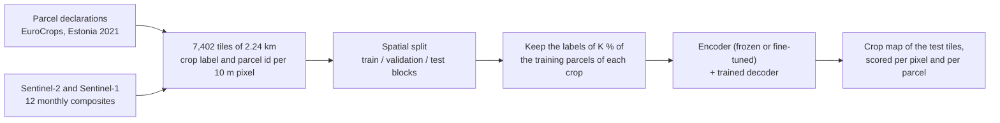

# Crop-type maps of Estonia 2021 from geospatial foundation models: first results

19 October 2026. Every number below comes from one random draw of the labels and one training seed per setting, so
none has a confidence interval yet (section 5). The figures and [tables.md](tables.md) are made by
[report.py](report.py).

## In short

- **Best map:** TESSERA v2 with its encoder fine-tuned. Test Macro-F1 per pixel is 0.660, 0.630 and 0.581 with
  100 %, 20 % and 5 % of the training parcels labelled, and 0.639, 0.603 and 0.566 per parcel. It leads at every
  budget except per pixel with all labels, where it ties frozen TerraMind (0.661).
- **Best frozen encoder:** TerraMind per pixel with all labels. With fewer labels, and per parcel at every budget,
  frozen TESSERA v2 leads (0.582 and 0.504 per pixel at 20 % and 5 %).
- **The baseline is hard to beat.** A U-Net trained from scratch, with no pretraining, scores 0.616, 0.564 and 0.467.
  TESSERA is above it at every budget, though frozen only narrowly with all labels (0.618). TerraMind beats it with
  all labels and ties it at 20 %. At 5 %, every token-grid model falls below it.
- **Fine-tuning pays off for TESSERA only:** +0.04 to +0.08 Macro-F1. For TerraMind, THOR and Prithvi the gain is
  about +0.01 in validation, within the noise of a single seed.
- **Per parcel, every model scores lower than per pixel,** by 0.002 to 0.08, because small parcels are mapped badly
  and the parcel score counts each parcel once.
- **Against published Estonian results:** our parcel overall accuracy with all labels, 0.75 to 0.82, is at the level
  of the 0.787 reported on EuroCropsML. With 5 % of the labels (4,354 parcels) we reach 0.67 to 0.78, above the
  0.55 to 0.65 published with up to 500 parcels per class. The tasks differ, though (section 4): the published
  task has 127 classes and a random split, ours 20 classes and a spatial split. No published study maps Estonian
  crops per pixel, and none has tested these five foundation models on Estonia; the one foundation model published
  on Estonia, Presto, scored below a model trained from scratch.

## 1. What was done

1. **Labels.** Farmers' declarations of 2021 from EuroCrops v11: a polygon and a crop per parcel. We keep the 20 most
   common crop classes of Estonia (each with at least 250 parcels). They hold 95 % of the declared parcels;
   grassland alone is about half. Pixels of other classes are left unlabelled.
2. **Tiles.** Estonia is cut into a fixed grid of 7,402 tiles of 2.24 x 2.24 km, 224 x 224 pixels of 10 m. Each tile
   has two label rasters: the crop of each pixel, and the parcel each pixel belongs to.
3. **Imagery.** For every tile, twelve monthly composites of 2021, each the median of the cloud-free views of that
   month: Sentinel-2 L2A (12 optical bands) and Sentinel-1 RTC radar (VV and VH, which see through cloud).
4. **Split.** Tiles are grouped into blocks of 4 x 4 tiles (9 km) and whole blocks go to training, validation or test,
   with a 1.6 km buffer, so the model is never tested next to a field it was trained on: 4,898 training, 769
   validation and 1,475 test tiles, with 34,610 test parcels.
5. **Label budget K.** To simulate scarce labels, we keep the labels of only K % of the training parcels of each crop,
   K = 100, 20 and 5 % (86,909, 17,390 and 4,354 parcels). Counting per crop keeps the rare crops in the training
   set. Validation and test stay fully labelled.
6. **Models.** Each model is an encoder that turns the imagery into features and a decoder that turns the features
   into a crop per pixel (section 2). **Frozen:** the pretrained encoder is kept as it is and only the decoder is
   trained. **Fine-tuned:** the encoder is trained too, with a small learning rate so it adapts without forgetting. The
   **baseline** is a U-Net that learns everything from our labels, with no pretraining.
7. **Training.** 45 epochs for every model; cross-entropy on the labelled pixels; random flips and rotations; the
   checkpoint with the lowest validation loss is the one tested.
8. **Scoring, on the test tiles.** *Per pixel:* Macro-F1, the mean of the 20 per-crop F1 scores, so a rare crop counts
   as much as grassland (the primary metric). *Per parcel:* each parcel takes the crop most of its pixels were
   predicted as and is right or wrong as a whole, as published EuroCrops studies score; we report Macro-F1, overall
   accuracy and Cohen's kappa.

## 2. The models

| Model | Pretrained on | What we give it | What the decoder receives | Decoder (trained) | Encoder size |
|---|---|---|---|---|---|
| **TerraMind v1 large** (IBM and ESA, Jakubik et al. 2025) | Single-date multimodal Earth observation (Sentinel-2, Sentinel-1 and more) | S2 + S1, each month run separately; the two sensors' features averaged | One 1,024-number feature per 160 m square (16 x 16 px), 14 x 14 per tile, for each of 12 months | Squeeze the 12 months to 768 channels, then a U-Net decoder that upsamples to 10 m: 53.3 M parameters | 306 M |
| **THOR v1 large** (Norwegian Computing Center and ESA, Forgaard et al. 2026) | Single-date Sentinel-1, 2 and 3 | S2 (10 m and 20 m bands) + S1, each month separately; the three band groups averaged | As TerraMind: 160 m features, 12 months | Same decoder as TerraMind, 53.3 M | 314 M |
| **Prithvi-EO-2.0 600M TL** (NASA and IBM, Szwarcman et al. 2024) | Time series of Harmonised Landsat and Sentinel-2, with date and location | S2 only (its six pretraining bands, all it accepts), the 12 months as one time series | One 1,280-number feature per 140 m square (14 x 14 px), for each month | Same design, 62.7 M | 631 M |
| **TESSERA v2 Medium** (University of Cambridge, Feng et al. 2025) | Per-pixel yearly time series of Sentinel-2 and Sentinel-1 | S2 (10 bands) + S1, the 12 months of each pixel | 128 numbers per 10 m pixel, summarising its year | A small per-pixel network (two layers, 512 and 256): 0.2 M | 21 M |
| **AlphaEarth Foundations v1** (Google DeepMind, Brown et al. 2025) | Many sources (optical, radar, lidar, climate) | Nothing: Google publishes the result for every pixel on Earth, and we download it | 64 numbers per 10 m pixel for 2021 | The same per-pixel network: 0.2 M | not released |
| **U-Net from scratch** (baseline) | Nothing | S2 + S1, the 12 months stacked as 168 input channels | (no separate encoder) | A ResNet-18 U-Net, everything trained: 14.8 M | none |

**Two families.** TerraMind, THOR and Prithvi see the tile in squares of 140 to 160 m and look at the whole tile at
once; their decoder has to rebuild the 10 m detail. TESSERA and AlphaEarth describe each 10 m pixel by its own year
and know nothing of its neighbours; their decoder judges each pixel alone. That 256-fold difference in starting
detail is the main reason the two families behave differently, so the decoder is matched within each family, not
across them.

**Fine-tuned versions.** TerraMind, THOR, Prithvi and TESSERA were also run with their encoders trained (learning
rate 1e-5 after a one-epoch warm-up; decoder and everything else unchanged). AlphaEarth cannot be fine-tuned, as only
its outputs are published. Fine-tuned TESSERA is run on the labelled pixels only, since unlabelled pixels carry no
loss for a per-pixel model.

## 3. Results

### 3.1 Accuracy against the number of labels

| Test Macro-F1, per pixel / per parcel | K = 100 % | K = 20 % | K = 5 % |
|---|---|---|---|
| TerraMind v1 large, frozen | **0.661** / 0.583 | 0.566 / 0.515 | 0.433 / 0.381 |
| TerraMind v1 large, fine-tuned | 0.598 / 0.545 | 0.562 / 0.511 | 0.351 / 0.316 |
| THOR v1 large, frozen | 0.594 / 0.516 | 0.547 / 0.491 | 0.393 / 0.349 |
| THOR v1 large, fine-tuned | 0.627 / 0.545 | 0.535 / 0.475 | 0.404 / 0.369 |
| Prithvi-EO-2.0 600M, frozen | 0.580 / 0.535 | 0.505 / 0.472 | 0.445 / 0.409 |
| Prithvi-EO-2.0 600M, fine-tuned | 0.613 / 0.545 | 0.540 / 0.492 | 0.394 / 0.371 |
| TESSERA v2 Medium, frozen | 0.618 / 0.602 | 0.582 / 0.574 | 0.504 / 0.502 |
| TESSERA v2 Medium, fine-tuned | 0.660 / **0.639** | **0.630** / **0.603** | **0.581** / **0.566** |
| AlphaEarth v1, frozen | 0.523 / 0.484 | 0.497 / 0.455 | 0.449 / 0.425 |
| U-Net from scratch (baseline) | 0.616 / 0.553 | 0.564 / 0.520 | 0.467 / 0.446 |

- **Fewer labels cost the token-grid models most.** From 100 % to 5 % of the labels, frozen TerraMind loses 0.23
  Macro-F1 and THOR 0.20, while TESSERA loses 0.11 and AlphaEarth 0.07. TESSERA also leads the frozen models at 20 %
  and 5 %.
- **The baseline is a strong reference.** Without any pretraining, the U-Net beats THOR, Prithvi and AlphaEarth with
  all labels, and every token-grid model, frozen or fine-tuned, at 5 %. Fine-tuned TESSERA stays clearly above it at
  every budget; frozen TESSERA ties it with all labels and is above it at 20 and 5 %; TerraMind is above it only
  with all labels.
- **AlphaEarth** is the weakest with many labels but the flattest curve: at 5 % it is level with Prithvi.

### 3.2 Frozen against fine-tuned

| Fine-tuned minus frozen, Macro-F1 | Test per pixel (100 / 20 / 5 %) | Test per parcel | Best validation |
|---|---|---|---|
| TerraMind | -0.063 / -0.004 / -0.082 | -0.038 / -0.004 / -0.065 | +0.012 / +0.008 / +0.010 |
| THOR | +0.033 / -0.012 / +0.011 | +0.029 / -0.016 / +0.020 | +0.010 / 0.000 / -0.033 |
| Prithvi | +0.033 / +0.034 / -0.051 | +0.009 / +0.020 / -0.038 | +0.016 / +0.004 / +0.008 |
| TESSERA | +0.042 / +0.047 / +0.077 | +0.037 / +0.028 / +0.063 | +0.053 / +0.051 / +0.056 |

- **TESSERA gains clearly**, under all three readouts and most with the fewest labels. Run frozen through the same
  fine-tuning code, its validation score moves by less than 0.005, so the gain comes from training the encoder.
- **TerraMind, THOR and Prithvi gain about +0.01** on the best validation score, the readout that does not depend on
  which checkpoint is kept. On test, the sign flips from one budget to the next.
- **The test swings come from the checkpoint rule.** We test the checkpoint of lowest validation loss. With the
  encoder training, that loss turns up after only 5 to 9 epochs, before the rarer crops are learnt, while
  validation Macro-F1 keeps rising to epochs 13 to 44. Tested at its best-Macro-F1 epoch instead, fine-tuned
  TerraMind would score 0.688, 0.627 and 0.523; the frozen models were not tested that way, so that comparison is
  not yet possible.
- **Cost.** Fine-tuning takes 4 to 9 times the frozen training time for the token-grid models, and 15 times for
  TESSERA (26 h for the full-label fit on one RTX PRO 6000).

Details: [`experiments/2026-10-15_kshot_finetune/REPORT.md`](../../../experiments/2026-10-15_kshot_finetune/REPORT.md).

### 3.3 Per pixel against per parcel

- **The parcel score is lower for every model** (section 3.1 table). Each parcel counts once, and 18 % of the test
  parcels are under 0.64 ha: parcels under 0.16 ha get the right crop only 24 to 38 % of the time, those above
  0.64 ha 67 to 87 %. (The size and vote figures in this section were measured on the 15-epoch fits; for the frozen
  token-grid models those are the same fits.)
- **The token-grid models lose most** (0.02 to 0.08), because their 140 to 160 m squares are larger than these
  fields. TESSERA loses 0.002 to 0.03, which is why it leads per parcel at every budget.
- **Potatoes show it most:** they are mostly household plots, with a median test parcel of 0.12 ha. Frozen TerraMind
  scores 0.75 F1 on potatoes per pixel (mostly the large commercial fields) but 0.18 per parcel.
- **The vote fixes little:** taking the majority per parcel corrects only 15 to 32 % of the wrong pixels. The rest
  sit in parcels mapped as the wrong crop as a whole.

Details: [`experiments/2026-10-16_parcel_metric/REPORT.md`](../../../experiments/2026-10-16_parcel_metric/REPORT.md).

### 3.4 Per crop

Rows are sorted by the number of training parcels, given in brackets.

- **Easy crops:** grassland, winter wheat, winter rapeseed, winter barley and maize reach F1 0.87 to 0.97 with all
  labels for almost every model.
- **Confusable crops:** the forage crops that look like grassland (legumes harvested green, clover, F1 0.41 to
  0.55) and the spring cereals that look like each other (oats, spring wheat, 0.42 to 0.71).
- **Four crops are almost never found:** fresh vegetables, orchards, dried pulses and alfalfa score F1 0 to 0.26 for
  every model, even with all labels. They are mixed or small plots with few parcels. Being 4 of the 20 classes, they
  alone cap Macro-F1 near 0.80.
- **With 5 % of the labels the 10 m models keep the small crops** that the token-grid models and the U-Net lose:
  potatoes drop to F1 0 for TerraMind, THOR, Prithvi and the U-Net but stay at 0.52 for frozen TESSERA and 0.70
  fine-tuned. Buckwheat behaves alike: 0.70 and 0.81 for TESSERA against 0 to 0.53 for the others. Prithvi misses
  potatoes even with all labels.

## 4. Comparison with published results for Estonia

No published study maps Estonian crops per pixel, and none has run TerraMind, THOR, Prithvi, TESSERA or AlphaEarth
on Estonia. All published Estonian numbers are per parcel:

| Study | Task | Model | Labels | Result |
|---|---|---|---|---|
| Reuss et al. 2026, *ISPRS Open J. Photogramm. Remote Sens.* 19, 100117 (EuroCropsML benchmark) | Parcel classification, 127 classes, Estonia 2021, random 60/20/20 split, 35,182 test parcels; input: per-parcel median Sentinel-2 L1C time series | Transformer from scratch | all (105,543 parcels) | OA 0.787 |
| | | Transformer from scratch | 500 per class | OA 0.632, kappa 0.529 |
| | | ANIL meta-learning, pretrained on Latvia (best at 500) | 500 per class | OA 0.652, kappa 0.556 |
| | | **Presto** (foundation model, released weights, fine-tuned) | 500 per class | OA 0.553, kappa 0.430 |
| Reuss, Gikalo and Körner 2026, arXiv 2603.12905 (DirPA) | Parcel classification on EuroCropsML 2.0, Estonia, 127 classes and coarser HCAT3 groups; random class-aware split; few-shot only | Transformer, best of plain cross-entropy and DirPA | 100 per class | Macro-F1 0.174 (127 classes), 0.313 (coarse) |
| | | **Presto** | 100 per class | Macro-F1 0.064 (127 classes), 0.256 (coarse) |
| Järveoja 2021, MSc thesis, University of Tartu | Parcel classification, 28 classes, Estonia 2018 and 2019 | Random forest on S1 and S2 features | all | Weighted F1 0.82 and 0.85 |

| Ours, per parcel, OA / kappa | K = 100 % (86,909 parcels) | K = 20 % (17,390) | K = 5 % (4,354) |
|---|---|---|---|
| TerraMind, frozen | 0.787 / 0.698 | 0.742 / 0.639 | 0.689 / 0.563 |
| THOR, frozen | 0.753 / 0.650 | 0.727 / 0.613 | 0.673 / 0.540 |
| Prithvi, frozen | 0.763 / 0.661 | 0.723 / 0.609 | 0.677 / 0.557 |
| TESSERA, frozen | 0.798 / 0.709 | 0.784 / 0.687 | 0.755 / 0.638 |
| TESSERA, fine-tuned | **0.821 / 0.745** | **0.793 / 0.702** | **0.777 / 0.675** |
| AlphaEarth, frozen | 0.748 / 0.637 | 0.735 / 0.617 | 0.720 / 0.596 |
| U-Net from scratch | 0.772 / 0.676 | 0.758 / 0.656 | 0.723 / 0.600 |

**How the numbers line up.**

- **With all labels,** our parcel accuracy (0.75 to 0.82) is at the level of EuroCropsML's 0.787. Grassland is about
  half of the parcels in both test sets, so overall accuracy rewards getting grassland right in both.
- **With few labels,** our 5 % budget (4,354 parcels) is smaller than EuroCropsML's 500 per class (up to 63,500
  parcels), yet our accuracy (0.67 to 0.78) and kappa (0.53 to 0.68) are above theirs (0.55 to 0.65; kappa 0.43
  to 0.56).
- **Presto, the only foundation model published on Estonia,** fell below the Transformer trained from scratch in
  both Reuss papers. Here too several frozen foundation models fall below our from-scratch U-Net. Only TESSERA, and
  TerraMind with all labels, beat it per parcel.

**Why the numbers are not on the same scale.** The comparison says our results are plausible, not that our models
are better:

| | Published (EuroCropsML) | Ours | Effect on our numbers |
|---|---|---|---|
| Classes | 127, of which 107 hold under 5 % of the parcels | 20 most common, 95 % of the parcels | Higher, especially Macro-F1 |
| Split | Random: test parcels sit next to training parcels | Spatial blocks with a 1.6 km buffer | Lower: a harder, more honest test |
| Input | One median spectrum per parcel per date, Sentinel-2 L1C | Every 10 m pixel, monthly S2 L2A and S1 composites | Pixels add field shape and radar; medians add clean per-parcel spectra |
| Model output | One class per parcel | One class per pixel, then a vote | Lower on small parcels |
| Few-shot unit | k parcels per class | K % of the parcels of each class | Not directly comparable; rare classes get few parcels at 5 % |

The DirPA Macro-F1 numbers (0.06 to 0.31 at 100 parcels per class) sit far below ours (0.32 to 0.57 per parcel at
5 %) mostly because of the 127 classes: Macro-F1 averages over the many rare classes with a handful of training
parcels each.

## 5. Caveats and next steps

- **One draw, one seed.** A different random choice of labelled parcels or a different seed can move a cell by a
  few hundredths, about the size of several gaps above. Repeated draws with intervals are next in the protocol.
- **The checkpoint rule decides the token-grid results.** Lowest validation loss stops TerraMind, THOR and Prithvi
  long before their best validation Macro-F1, and training 45 instead of 15 epochs changed none of their frozen
  results. Testing the checkpoint of highest validation Macro-F1 for every model would settle whether fine-tuning
  helps them.
- **Only three budgets.** The protocol plans 1, 5, 10, 20, 50 and 100 %.
- **Latvia and Portugal** follow; the comparison to EuroCropsML extends to them.
- **A per-parcel anchor on our own split.** Training a classifier on per-parcel medians of our tiles, as EuroCropsML
  does, would put the published numbers and ours on the same split.

## Sources

- Our results: `results/kshot/EE_2021_rev/` (frozen and baseline) and `results/2026-10-15_kshot_finetune/EE_2021_rev/`
  (fine-tuned), 45 epochs, run on the UT HPC cluster, 16 to 18 October 2026. Method: [protocol.md](../protocol.md),
  [pipeline.md](../pipeline.md), and in plain language [pipeline_overview.md](../pipeline_overview.md).
- J. Reuss, J. Macdonald, S. Becker, E. Gikalo, K. Schultka, L. Richter, M. Körner (2026). Benchmarking for practice:
  few-shot time-series crop-type classification on the EuroCropsML dataset. *ISPRS Open Journal of Photogrammetry
  and Remote Sensing* 19, 100117. arXiv 2504.11022. Numbers from section 6.1, Table 4a and Table B.18.
- J. Reuss, E. Gikalo, M. Körner (2026). DirPA: addressing prior shift in imbalanced few-shot crop-type
  classification. arXiv 2603.12905.
- The models: TerraMind, Jakubik et al. 2025, arXiv 2504.11171; THOR, Forgaard et al. 2026, arXiv 2601.16011;
  Prithvi-EO-2.0, Szwarcman et al. 2024, arXiv 2412.02732; TESSERA, Feng et al. 2025, arXiv 2506.20380; AlphaEarth
  Foundations, Brown et al. 2025, arXiv 2507.22291.
- M. Järveoja (2021). Põllukultuuride tuvastamise masinõppe mudeli tunnuste olulisuse hindamine. MSc thesis,
  University of Tartu. [dspace.ut.ee](https://dspace.ut.ee/items/5f143077-3e65-4f9c-b493-e68eca91d30e)
