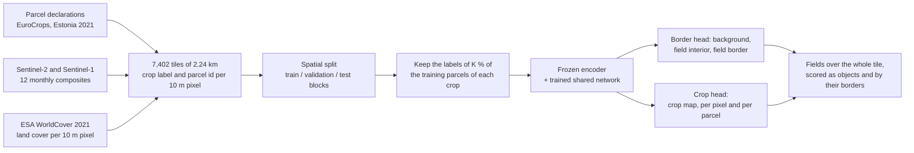
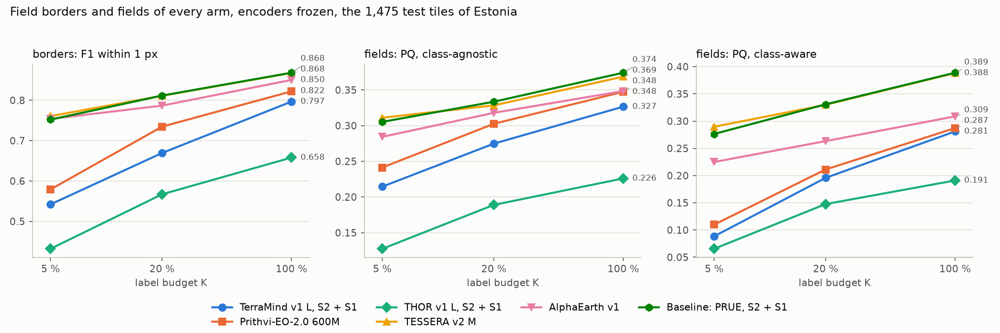
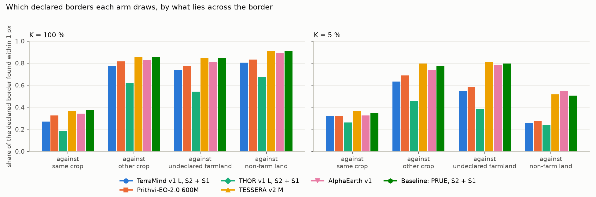
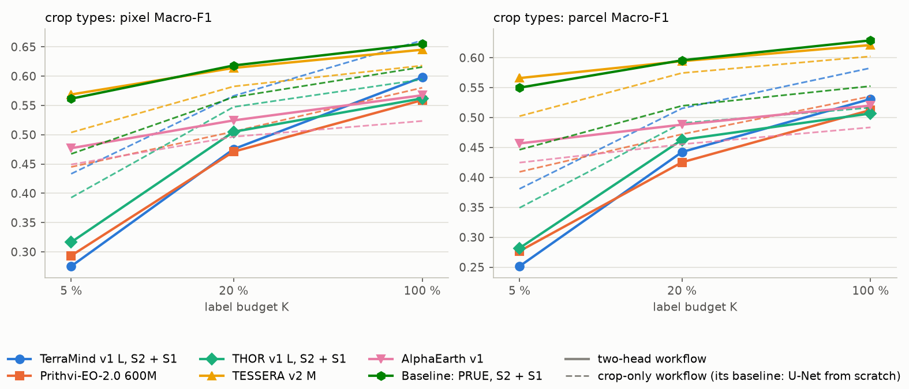
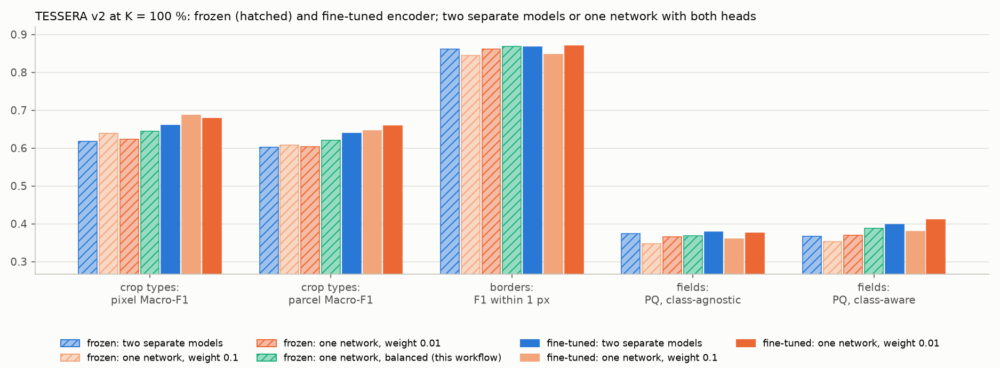
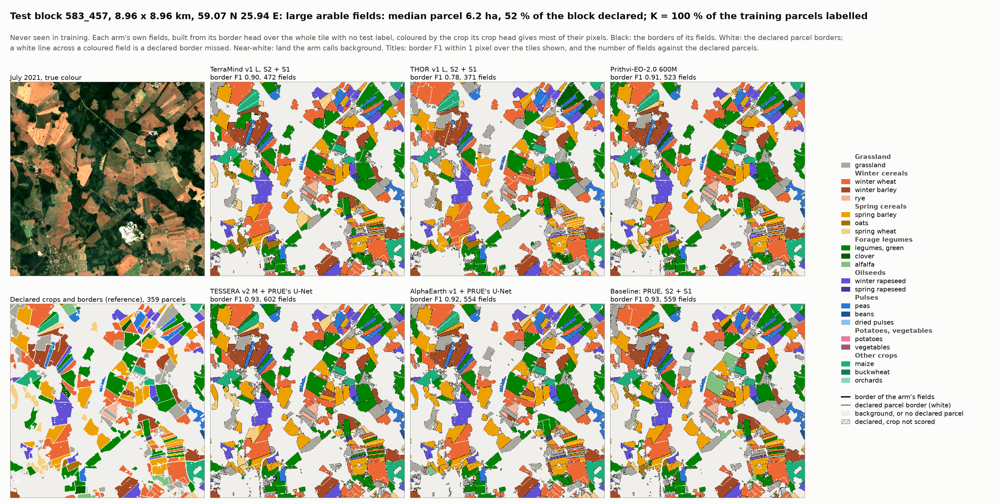
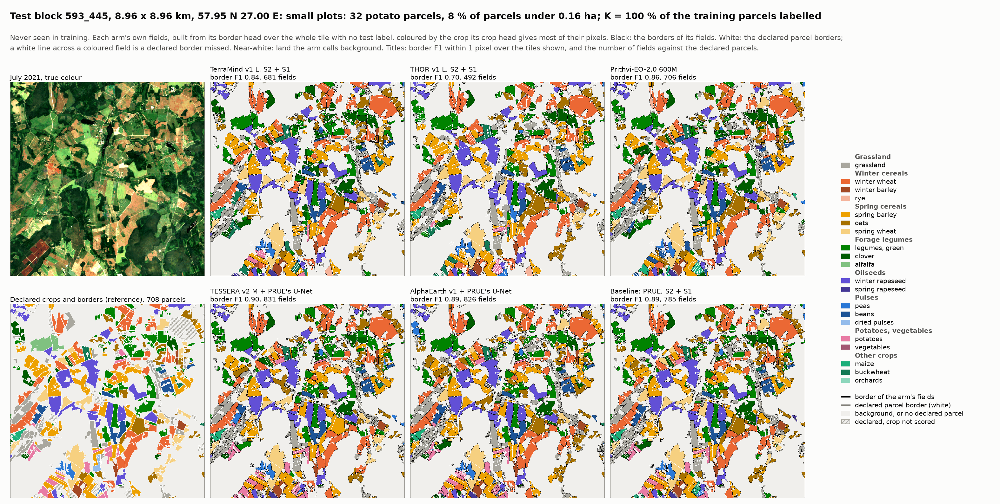
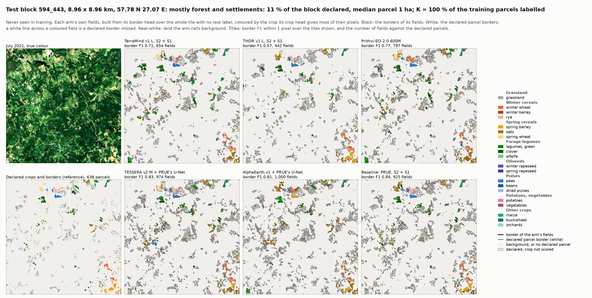
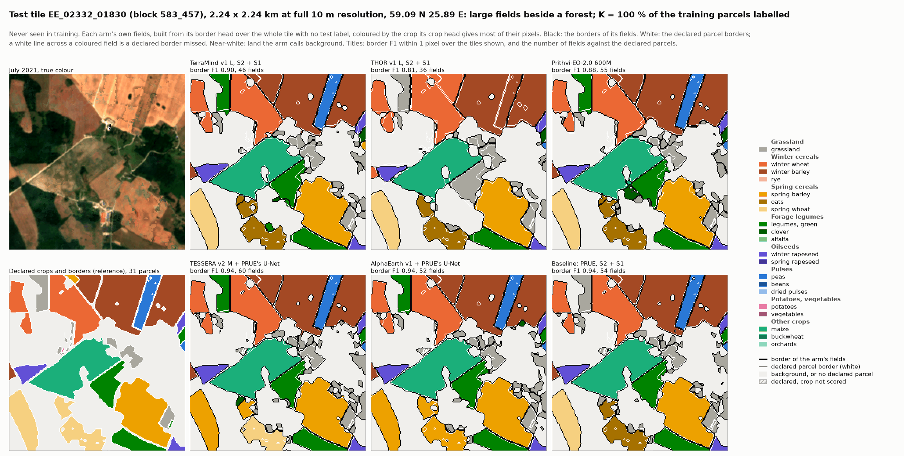
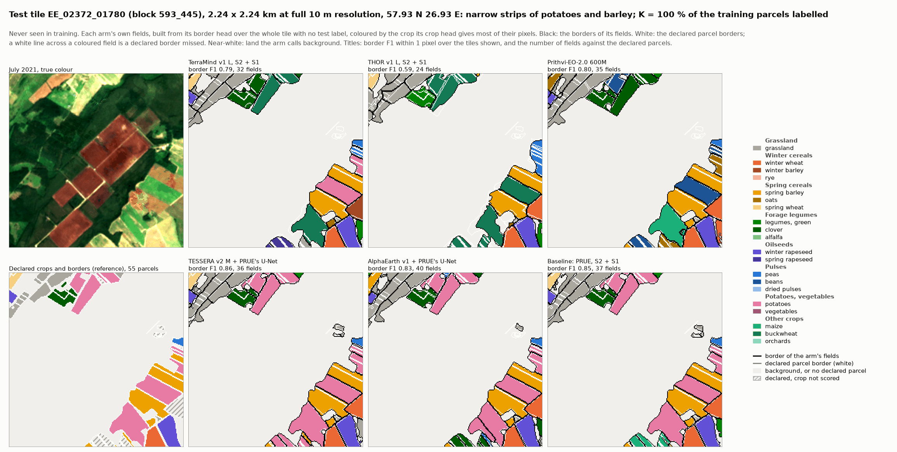

# Field borders and crop types of Estonia 2021 from geospatial foundation models: the two-head workflow

11 November 2026. The two-head workflow of the pipeline (protocol D30, [pipeline.md](../pipeline.md) section 9) gives
every model a field-border head beside its crop head. Every number below comes from one random draw of the labels and
one training seed per setting, so none has a confidence interval yet (section 5). The figures and
[tables.md](tables.md) are made by [report.py](report.py), the maps of section 3.5 and
[maps_tables.md](maps_tables.md) by [maps.py](maps.py). The crop-only workflow's results are in
[../results_estonia/REPORT.md](../results_estonia/REPORT.md).

## In short

- **Best borders among the foundation models: TESSERA.** Border F1 within one pixel is 0.868, 0.811 and 0.761 with
  100 %, 20 % and 5 % of the training parcels labelled. AlphaEarth is close behind (0.850, 0.787, 0.754).
- **Neither beats the baseline.** PRUE itself, the field-boundary network that leads the Fields of The World
  benchmark, started from ImageNet and trained on the raw Sentinel-2 and Sentinel-1 composites, scores 0.868, 0.812
  and 0.752. On the fields built from the borders the picture is the same: class-agnostic panoptic quality 0.374 for
  the baseline, 0.369 for TESSERA, 0.348 for AlphaEarth with all labels.
- **The token-grid models draw weaker borders and lose more of them as labels get scarce.** Prithvi falls from 0.822
  to 0.579, TerraMind from 0.797 to 0.542, THOR from 0.658 to 0.432: they lose 0.23 to 0.25 border F1 between
  100 % and 5 %, against 0.10 to 0.12 for TESSERA, AlphaEarth and the baseline.
- **No model draws the border between two fields of the same crop.** With all labels every model finds 54 to 91 %
  of the borders against another crop, undeclared farmland or non-farm land, but at every budget only 18 to 37 % of
  those between two parcels of the same crop.
- **The border head improves the crop map of the 10 m models and spoils that of the token-grid models.** TESSERA's
  crop map rises to 0.645, 0.614 and 0.569 pixel Macro-F1 (+0.03 to +0.07 over the crop-only workflow), AlphaEarth's
  by 0.03 to 0.04; TerraMind, THOR and Prithvi fall by 0.02 to 0.16, because here their crop head reads only the
  border-trained last block. For their crop maps the crop-only workflow stays the reference.
- **Fine-tuning helps the crop map, not the borders** (TESSERA, all labels). Training the encoder raises the crop map
  by 0.04 to 0.08 at every budget, but border F1 only from 0.862 to 0.868, at about 35 times the training time for
  the two models. One network with both heads, fine-tuned, maps crops at 0.678 / 0.658 (pixel / parcel) with border
  F1 0.870: the best parcel Macro-F1, border F1 and class-aware PQ of every setting.
- **Against published results:** our parcel Macro-F1 for crop types stays far above the only published Estonian
  Macro-F1 (DirPA), a gap that comes mostly from the task (section 4). For field delineation no Estonian study
  exists; on the Fields of The World benchmark PRUE reaches an object F1 of 0.47, and our models reach 0.31 to 0.46 on
  Estonia with all labels, on another benchmark.

## 1. What was done

Steps 1 to 5 are those of the crop-only workflow ([../results_estonia/REPORT.md](../results_estonia/REPORT.md),
section 1): the 20 most common crops of Estonia, 7,402 tiles of 2.24 km at 10 m, twelve monthly Sentinel-2 and
Sentinel-1 composites, a split into 4,898 training, 769 validation and 1,475 test tiles by blocks of 9 km with a
1.6 km buffer, and K = 100, 20 and 5 % of the training parcels of each crop labelled (86,909, 17,390 and 4,354
parcels). What the two-head workflow adds:

6. **Border labels.** From the same declared parcels, every pixel gets one of three classes, as PRUE draws them: the
   **border** of a parcel (a parcel pixel next to another parcel or to undeclared land), its **interior**, and
   **background**, the land ESA WorldCover 2021 calls neither cropland nor grassland (forest, water, built-up
   land). Undeclared grassland and cropland are left unlabelled, since nobody says whether a field lies there. The
   border labels are hidden exactly like the crop labels: a parcel outside the K % teaches nothing about its edge.
7. **Models.** Every encoder stays frozen, as in the crop-only workflow. On top of it sits a shared trained network
   with the two heads (section 2).
8. **Training.** 45 epochs, whole tiles in batches of 4, random flips and rotations. The loss is PRUE's (a log-cosh
   Dice on the three border classes, the border class weighted most) plus the crop cross-entropy. Because the two
   tasks share one network, the crop loss could crowd out the borders: its weight is reset during training so that
   it always pulls 0.3 times as hard as the border loss on the shared network. The checkpoint tested is the epoch of
   the best mean of two validation scores, the object F1 of the model's own fields and the crop Macro-F1.
9. **Scoring, on the test tiles.** *Crop types* exactly as in the crop-only workflow, per pixel and per parcel.
   *Fields:* the model's border map is turned into fields over the whole tile, with no test label: each region of
   predicted interior, grown back out to its border. A field counts as found when it overlaps a declared parcel by
   more than half (panoptic quality, PQ, which multiplies how many fields are found, the object F1, by how well they
   fit). Class-aware PQ also asks that the field's crop, the one most of its pixels were mapped as, is right.
   *Borders:* the share of the declared borders that the model's fields draw within one pixel (recall), the share of
   its borders that are real (precision), and their harmonic mean, the **border F1**, the headline. Borders are
   scored only where the truth is known: on the declared parcels and on non-farm land.

## 2. The models

| Model | What it gives the shared network | Shared network (trained) | Crop head | Trained parameters |
|---|---|---|---|---|
| **TerraMind v1 large**, frozen | One feature per 160 m square for each of 12 months, S2 + S1 | The crop-only workflow's decoder (squeeze to 768 channels, U-Net decoder to 20 m), then a **fifth block** that brings it to 10 m | A 1 x 1 layer on the fifth block | 53.4 M |
| **THOR v1 large**, frozen | As TerraMind | The same | The same | 53.4 M |
| **Prithvi-EO-2.0 600M TL**, frozen | One feature per 140 m square, S2 only | The same | The same | 62.8 M |
| **TESSERA v2 Medium**, frozen | 128 numbers per 10 m pixel | **PRUE's U-Net** (EfficientNet-B7 encoder from ImageNet, its first layer widened to 128 channels) | The crop-only workflow's per-pixel network (512, 256), reading the embedding and the U-Net's last 16 features | 67.2 M + 0.21 M |
| **AlphaEarth v1** | 64 numbers per 10 m pixel | The same | The same | 67.1 M + 0.18 M |
| **Baseline: PRUE** | The raw S2 + S1 composites, 12 months stacked on 168 channels | PRUE's U-Net, its encoder from ImageNet and trained too | The same per-pixel network on the composites and the 16 features | 67.2 M + 0.23 M |

**Why two networks.** TESSERA and AlphaEarth describe each pixel by its own year and know nothing of its
neighbours, so nothing in them tells where a field ends; PRUE's U-Net looks around each pixel and draws the edge. The
token-grid models already look around, but in squares of 140 to 160 m; the fifth block lets their border head work
at 10 m, where the borders are. No raw band enters their network, so their borders come from what the tokens know.
**The baseline differs from the crop-only workflow's.** There it is a ResNet-18 U-Net trained from scratch; here it
is PRUE itself, a larger U-Net started from ImageNet, the strongest published recipe for field boundaries at 10 m.

## 3. Results

### 3.1 Borders and fields against the number of labels

| Border F1 within 1 px / class-agnostic PQ of the fields | K = 100 % | K = 20 % | K = 5 % |
|---|---|---|---|
| TerraMind v1 large | 0.797 / 0.327 | 0.669 / 0.275 | 0.542 / 0.215 |
| THOR v1 large | 0.658 / 0.226 | 0.567 / 0.189 | 0.432 / 0.127 |
| Prithvi-EO-2.0 600M | 0.822 / 0.348 | 0.735 / 0.303 | 0.579 / 0.241 |
| TESSERA v2 Medium | **0.868** / 0.369 | 0.811 / 0.328 | **0.761** / **0.311** |
| AlphaEarth v1 | 0.850 / 0.348 | 0.787 / 0.318 | 0.754 / 0.284 |
| Baseline: PRUE from ImageNet | **0.868** / **0.374** | **0.812** / **0.334** | 0.752 / 0.305 |

- **Two groups.** The 10 m models and the baseline lose 0.10 to 0.12 border F1 from 100 % to 5 % of the labels; the
  token-grid models 0.23 to 0.25. With all labels the gap between the groups is 0.03 to 0.21; with 5 % it is 0.17 to
  0.33.
- **TESSERA and the baseline are level** at every budget, within 0.01 on borders and on class-agnostic PQ;
  AlphaEarth is 0.02 lower on borders with many labels and level with them at 5 %.
- **Prithvi is the best token-grid model at every budget**, THOR the weakest by a wide margin: its borders reach
  only 0.658 with all labels.
- **Fields are found less well than borders.** With all labels the object F1 of the best models is 0.45 to 0.46
  ([tables.md](tables.md)); a field that is found fits well (segmentation quality 0.81). A parcel is missed mostly
  because it is merged with a neighbour, as the PRUE experiment found on TESSERA, and section 3.2 shows which
  borders go undrawn. Class-aware PQ separates the models more:
  0.388 for TESSERA and 0.389 for the baseline, 0.309 for AlphaEarth, 0.19 to 0.29 for the token-grid models, since
  it also needs the right crop.

### 3.2 Which borders are found

- **Borders against another crop, undeclared farmland or non-farm land are found** (54 to 91 % with all labels).
  Across them the imagery changes: the other side greens up at another time of year, or is forest or water.
- **Borders between two parcels of the same crop are mostly missed** (18 to 37 % for every model at every budget).
  Two adjoining grassland parcels can look alike all year, and then only a visible line, such as a ditch, a track or
  a different mowing date, separates them. These merges are the main error in the fields.
- **With few labels, the borders against non-farm land go first.** With 5 % of the labels, the token-grid models find
  24 to 27 % of them (68 to 83 % with all labels), the 10 m models and the baseline 51 to 55 % (89 to 91 %). A likely
  reason: with few labelled parcels, few field edges against forest and villages are labelled in training.

### 3.3 The crop map with and without the border head

| Crop Macro-F1 per pixel / per parcel, and the change against the crop-only workflow | K = 100 % | K = 20 % | K = 5 % |
|---|---|---|---|
| TerraMind v1 large | 0.598 / 0.531 (-0.063) | 0.475 / 0.442 (-0.091) | 0.275 / 0.251 (-0.158) |
| THOR v1 large | 0.562 / 0.507 (-0.032) | 0.505 / 0.463 (-0.042) | 0.317 / 0.282 (-0.076) |
| Prithvi-EO-2.0 600M | 0.559 / 0.513 (-0.021) | 0.471 / 0.425 (-0.034) | 0.293 / 0.277 (-0.151) |
| TESSERA v2 Medium | 0.645 / 0.621 (+0.027) | 0.614 / 0.594 (+0.032) | **0.569** / **0.566** (+0.065) |
| AlphaEarth v1 | 0.567 / 0.520 (+0.044) | 0.524 / 0.488 (+0.028) | 0.477 / 0.457 (+0.028) |
| Baseline: PRUE from ImageNet | **0.655** / **0.629** (+0.039) | **0.618** / **0.596** (+0.054) | 0.561 / 0.550 (+0.094) |

The change in brackets is per pixel; for the baseline it is against the crop-only workflow's baseline, a different
model (section 2).

- **The 10 m models gain** 0.03 to 0.07. Their crop head now also reads the U-Net's features, which see the
  neighbourhood; on TESSERA the gain is largest with the fewest labels.
- **The token-grid models lose** 0.02 to 0.16, most with the fewest labels. Their crop head is a single layer on the
  fifth block, which the border loss dominates (the crop loss pulls 0.3 times as hard); in the crop-only workflow it
  reads the decoder directly. This is a limitation of the design (pipeline.md section 10), so their crop maps here
  say little about the encoders.
- **The baseline ties TESSERA on the crop map too**, and is 0.04 to 0.09 per pixel and 0.08 to 0.10 per parcel
  above the crop-only workflow's baseline. Whether that comes from the larger encoder started from ImageNet or from
  the border head is not yet separated: the same network has not been trained without the border head.

### 3.4 Frozen against fine-tuned

Fine-tuning is not part of either workflow (protocol D29). Its effect on the borders was measured on TESSERA with all
labels, in two experiments that fed the design of this workflow:
[2026-11-06_prue_tessera](../../../experiments/2026-11-06_prue_tessera/REPORT.md) (PRUE on TESSERA, as a separate
border model) and [2026-11-07_prue_crop_tessera](../../../experiments/2026-11-07_prue_crop_tessera/REPORT.md) (one
network with both heads, the crop loss at a fixed weight).

| TESSERA v2, K = 100 % | Crop, pixel / parcel | Border F1 | PQ agnostic | PQ class-aware | Training time |
|---|---|---|---|---|---|
| Frozen: two separate models (crop MLP, PRUE) | 0.618 / 0.602 | 0.862 | **0.374** | 0.367 | 1.5 h |
| Frozen: one network, crop weight 0.01 | 0.624 / 0.604 | 0.861 | 0.366 | 0.370 | 1.2 h |
| Frozen: one network, balanced (this workflow) | 0.645 / 0.621 | 0.868 | 0.369 | 0.388 | 3.5 h |
| Fine-tuned: two separate models | 0.660 / 0.639 | 0.868 | **0.378** | 0.397 | 54 h |
| Fine-tuned: one network, crop weight 0.01 | 0.678 / **0.658** | **0.870** | 0.376 | **0.411** | 60 h |
| Fine-tuned: one network, crop weight 0.1 | **0.687** / 0.646 | 0.847 | 0.360 | 0.380 | 55 h |

- **Fine-tuning helps the crop map.** In the crop-only workflow it raises TESSERA by 0.042, 0.047 and 0.077 pixel
  Macro-F1 at 100, 20 and 5 % ([tables.md](tables.md); [../results_estonia/REPORT.md](../results_estonia/REPORT.md)
  section 3.2); TerraMind, THOR and Prithvi move by -0.08 to +0.03 on test, about +0.01 in validation.
- **It barely helps the borders.** Border F1 moves from 0.862 to 0.868 for the separate border model and from 0.861
  to 0.870 for one network; the fields' PQ by 0.004 to 0.010. The frozen embedding already holds what the borders
  need; what fine-tuning adds is in the crop types, so the class-aware PQ, which needs both, gains most (+0.03 to
  +0.04).
- **It costs 35 to 50 times the frozen training** (54 to 60 h against 1.2 to 1.5 h on comparable settings).
- **One network is enough, if the crop task's pull stays small.** At a crop weight of 0.01 it matches the two
  separate models' borders and improves their crop map; at 0.1 the crop loss pulls three times as hard as the border
  loss and the borders fall by 0.02. The balanced weight of this workflow, frozen, gives the best frozen crop map and
  borders; its run also differs in training (whole tiles for 45 epochs, against 128-pixel windows for 30), so not all
  of that is the balance.

### 3.5 What the maps look like

The places are those of the crop report's section 3.5: three of the 40 complete test blocks (8.96 x 8.96 km) and
two single test tiles (2.24 km) at full resolution, areas no model saw in training. Each panel shows one model's
**own fields**, built from its border head over the whole tile with no test label, each coloured by the crop its crop
head gives most of the field's pixels. **Black** lines are the borders of its fields, **white** lines the declared
parcel borders: a white line across a coloured field is a declared border the model missed, a black line inside a
declared parcel a false cut. Near-white is land the model calls background. The title gives the border F1 within one
pixel over the tiles shown and the number of fields. The maps at K = 100 % are below; those at 20 % and 5 % are
linked under each. [maps.py](maps.py) checks that every tile's border counts equal those the workflow scored, and
writes [maps_tables.md](maps_tables.md).

K = [20 %](figures/map_block_583_457_K20.png), [5 %](figures/map_block_583_457_K5.png).

K = [20 %](figures/map_block_593_445_K20.png), [5 %](figures/map_block_593_445_K5.png).

K = [20 %](figures/map_block_594_443_K20.png), [5 %](figures/map_block_594_443_K5.png).

K = [20 %](figures/map_tile_EE_02332_01830_K20.png), [5 %](figures/map_tile_EE_02332_01830_K5.png).

K = [20 %](figures/map_tile_EE_02372_01780_K20.png), [5 %](figures/map_tile_EE_02372_01780_K5.png).

- **Large fields are drawn by every model.** On block 583_457 and tile EE_02332_01830 every model outlines the large
  arable fields, with border F1 0.78 to 0.94 with all labels; white lines inside a field are rare.
- **Narrow strips separate the two groups.** On tile EE_02372_01780, TESSERA, AlphaEarth and the baseline keep the
  strips of potatoes and barley apart, a black line along each, at every budget (border F1 0.71 to 0.78 at 5 %). The
  token-grid models merge neighbouring strips into broader fields with declared borders running through them, and
  with 5 % of the labels call them oats or beans (0.43 to 0.61).
- **Small parcels in a forest landscape are lost by the token-grid models when labels are few.** On block 594_443,
  with 5 % of the labels, TerraMind, THOR and Prithvi draw 253 to 471 fields for 638 declared parcels (border F1 0.20
  to 0.46); TESSERA, AlphaEarth and the baseline still draw the clearings' parcels (0.69 to 0.71).
- **Fields appear where nothing is declared.** Every model draws extra fields, mostly called grassland, on clearings
  and forest edges with no declaration: on tile EE_02332_01830, 36 to 60 fields for 31 declared parcels, and on
  block 594_443 up to 1,000 fields for 638 parcels with all labels. That land is not scored, since nobody says
  whether a field lies there, and some of it is likely undeclared grassland.
- **Adjoining parcels of the same crop merge.** White lines run through many grey grassland fields in every panel,
  the error of section 3.2.
- **A border can be right and the crop wrong.** The spring wheat field in the south-west of tile EE_02332_01830 is
  drawn by every model, but TESSERA and AlphaEarth call it spring barley.

The numbers in [maps_tables.md](maps_tables.md) come from one place each, so they illustrate the maps and are not
test scores.

## 4. Comparison with published results

### Crop types

The published Estonian crop-type results classify whole parcels; the only one reporting parcel Macro-F1 is DirPA
(Reuss, Gikalo and Körner 2026, Table 6), with at most 100 labelled parcels per class. Our K = 5 % labels a median of
74 parcels per crop, so it stands beside their 100 per class ([../results_estonia/REPORT.md](../results_estonia/REPORT.md)
section 4 explains the matching).

| Parcel Macro-F1 | Classes | k = 100 per class, or K = 5 % | K = 20 % | K = 100 % |
|---|---|---|---|---|
| **Published:** *DirPA, mean of five runs* | | | | |
| Transformer from scratch | 127 crop types | 0.174 | | |
| Presto, released weights, fine-tuned | 127 crop types | 0.064 | | |
| Transformer from scratch | coarse groups | 0.307 | | |
| Presto, released weights, fine-tuned | coarse groups | 0.255 | | |
| **Ours, two-head workflow:** *one run* | | | | |
| TerraMind v1 large, frozen | 20 crops | 0.251 | 0.442 | 0.531 |
| THOR v1 large, frozen | 20 crops | 0.282 | 0.463 | 0.507 |
| Prithvi-EO-2.0 600M, frozen | 20 crops | 0.277 | 0.425 | 0.513 |
| TESSERA v2 Medium, frozen | 20 crops | 0.566 | 0.594 | 0.621 |
| AlphaEarth v1, frozen | 20 crops | 0.457 | 0.488 | 0.520 |
| Baseline: PRUE from ImageNet | 20 crops | 0.550 | 0.596 | 0.629 |

As for the crop-only workflow, the gap to DirPA comes mostly from the task: 20 crops against 127, of which most have
a handful of parcels. The numbers are plausible, and they do not show our models to be better. The ranking carries
over here too: in DirPA the pretrained Presto falls below a model trained from scratch, and here only TESSERA among
the foundation models reaches the baseline.

### Field delineation

No published study delineates Estonian fields from declarations, and none has run these five foundation models for
field borders on Estonia. The nearest references come from the Fields of The World benchmark (Kerner et al. 2025),
whose 24 countries include Estonia, as reported by PRUE (Table 1), averaged over the countries, with object
precision and recall at an IoU above 0.5:

| Model, on Fields of The World | Pixel IoU | Object F1 |
|---|---|---|
| PRUE: U-Net + EfficientNet-B7, log-cosh Dice | 0.76 | 0.47 |
| FTW baseline: U-Net + EfficientNet-B3 | 0.70 | 0.38 |
| Mask2Former (Swin-S) | 0.68 | 0.39 |
| SAM ViT-H, fine-tuned / zero-shot | 0.45 / 0.32 | 0.37 / 0.17 |
| DECODE (FracTAL ResUNet, multi-task) | 0.71 | 0.21 |
| Delineate Anything, zero-shot | 0.37 | 0.09 |
| Clay ViT-L, frozen; fully fine-tuned | 0.67; 0.73 | 0.36; 0.42 |
| Galileo ViT-B, DINOv3 ViT-L, frozen | 0.66, 0.60 | 0.32, 0.31 |
| TerraMind ViT-B, Prithvi 2.0 ViT-L, frozen | 0.57, 0.56 | 0.26, 0.25 |

Our object F1 is the class-agnostic recognition quality of the fields at an IoU above 0.5. With all labels it is
0.46 for the baseline, 0.45 for TESSERA, 0.44 for AlphaEarth and Prithvi, 0.42 for TerraMind and 0.31 for THOR
(0.27 to 0.39 for PRUE's interior regions before they are grown back to their borders, [tables.md](tables.md)).

- **The order agrees.** On both benchmarks PRUE leads, and frozen foundation models with a trained decoder stay below
  it. Here frozen TerraMind and Prithvi come closer to it than on Fields of The World (0.42 and 0.44, against 0.26 and
  0.25 for their smaller versions there), with a larger decoder, twelve months of imagery and, for TerraMind,
  Sentinel-1.
- **The numbers are not on one scale.** Fields of The World pairs two Sentinel-2 dates with field masks from many
  countries and scores its own polygons; we use twelve monthly Sentinel-2 and Sentinel-1 composites, declarations of
  one country with WorldCover as the background, and the void rule, which leaves out parcels of crops outside our
  20 classes. Our pixel scores are therefore not set beside theirs.

## 5. Caveats and next steps

- **One draw, one seed.** Differences below about 0.01 to 0.02 are ties. Repeated draws with intervals are next in
  the protocol, for both workflows.
- **Two baselines.** The crop-only workflow is read against a ResNet-18 U-Net from scratch, this one against PRUE
  from ImageNet, which scores 0.04 to 0.10 higher on crop types and ties TESSERA. Training PRUE's network on crop types
  alone would show whether the encoder or the border head makes the difference, and which baseline RQ1 should be read
  against.
- **The token-grid crop head.** Here it reads only the border-trained block; a crop head on the decoder before the
  fifth block would give those models a fair crop map in this workflow.
- **Borders between fields of the same crop** are the main error of every model. Nothing in the setup targets them.
- **Fine-tuning was measured for borders on TESSERA only**, with all labels, and under the training settings of the
  earlier experiments.
- **Latvia and Portugal** follow; WorldCover covers them, so the workflow carries over unchanged.

## Sources

- Our results: `results/2026-11-09_borders_all_arms/EE_2021_rev/` (the two-head workflow's first grid, run on the UT
  HPC cluster on 9 and 10 November 2026, reproduced exactly by the core, pipeline.md section 9),
  `results/kshot/EE_2021_rev/` and `results/2026-10-15_kshot_finetune/EE_2021_rev/` (the crop-only workflow, frozen
  and fine-tuned), and for TESSERA fine-tuned `results/2026-11-06_prue_tessera/`, `results/2026-11-07_border_accuracy/`
  and `results/2026-11-07_prue_crop_tessera/`. Method: [protocol.md](../protocol.md) D30 and section 4.6,
  [pipeline.md](../pipeline.md), and in plain language [pipeline_overview.md](../pipeline_overview.md).
- H. Kerner et al. (2025). Fields of The World: a machine learning benchmark dataset for global agricultural field
  boundary segmentation. AAAI 2025. arXiv 2409.16252.
- PRUE: A practical recipe for field boundary segmentation at scale. CVPR 2026. arXiv 2603.27101; code
  github.com/fieldsoftheworld/ftw-prue. Table 1 for the references of section 4.
- J. Reuss, E. Gikalo, M. Körner (2026). DirPA: addressing prior shift in imbalanced few-shot crop-type
  classification. arXiv 2603.12905 (v2, July 2026). Estonian parcel Macro-F1 from Table 6.
- ESA WorldCover 10 m 2021 v200 (Zanaga et al. 2022), read from the Microsoft Planetary Computer.
- The models: TerraMind, Jakubik et al. 2025, arXiv 2504.11171; THOR, Forgaard et al. 2026, arXiv 2601.16011;
  Prithvi-EO-2.0, Szwarcman et al. 2024, arXiv 2412.02732; TESSERA, Feng et al. 2025, arXiv 2506.20380; AlphaEarth
  Foundations, Brown et al. 2025, arXiv 2507.22291; EfficientNet, Tan and Le 2019; U-Net, Ronneberger et al. 2015.
