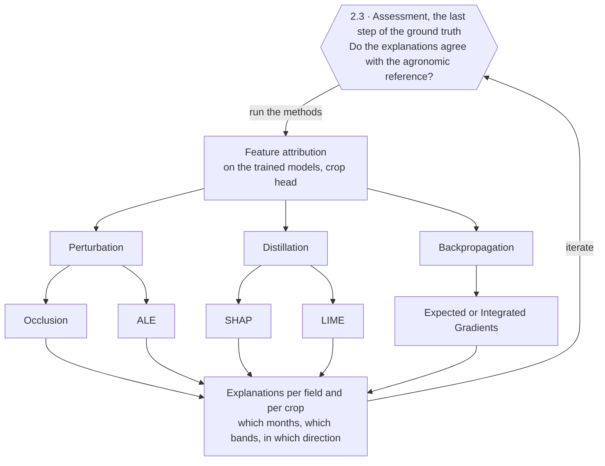

# Phase 2 · Explainability: experimental set-up

Set-up of 13 November 2026, designed and not yet run. It is the source of the Explainability section of the
[Phase 2 page](index.html) of the site.

The Phase 2 page has two sections:

| Section | Content |
|---|---|
| **Explainability** | this document: the experimental set-up |
| **Uncertainty quantification** | empty for now |

Scope: the **crop type** of each field, from the two-head workflow of Phase 1. The field borders are not explained
here.

The set-up is a flow of three steps: the agronomic questions, the agronomic ground truth, and the experimentation,
which returns to the last step of the ground truth round after round.

## 1. The agronomic questions

> Agronomic experts frequently evaluate whether AI-generated explanations are biologically meaningful and
> consistent with established agricultural knowledge.
>
> Abou Samra and Ali (2026), *AgriEngineering* 8(7):270, [doi:10.3390/agriengineering8070270](https://doi.org/10.3390/agriengineering8070270)

An explanation of a field's crop is useful when an agronomist can check it. Three questions do that.

### When? Crop phenology

Does the evidence fall at the right moment of the crop's phenology?

- Every crop follows its own calendar of emergence, green-up, peak vegetation growth, flowering, ripening and
  harvest.
- Crops differ most around peak vegetation growth and flowering, so that is where an explanation should fall.
- In our 2021 profiles of Estonia, winter wheat and spring barley reach peak growth in June, peas in early July and
  potatoes in late August.

### Which property? What tells crops apart

Does the evidence rest on a property of the plant or the soil that tells this crop apart? Each group of bands
measures one.

| Property | Bands | How it tells crops apart |
|---|---|---|
| Greenness and canopy cover | red, near infrared | a growing crop against bare soil: winter crops are green in April, spring crops are not |
| Chlorophyll | red-edge | canopies that look equally green but differ in leaf chlorophyll and density |
| Canopy water and dry matter | shortwave infrared | a green, water-rich canopy against a ripening one: cereals ripen in July while grassland and potatoes stay green |
| Flower colour | visible | rapeseed in yellow flower against cereals |
| Canopy structure | radar VH | tall, branching, broad-leaved crops against cereals: rapeseed's return in late June is far stronger than the cereals' |
| Soil roughness and moisture | radar VV | bare, tilled or ridged soil before a late crop emerges, as with potatoes |

### Against which crop?

Is it the cue that separates this crop from the ones it is confused with?

- Winter wheat rather than spring wheat rests on a canopy in April.
- Spring barley rather than spring wheat rests on a peak two to three weeks earlier.

## 2. The agronomic ground truth

What established agronomic knowledge says a model should rely on, written down per crop type and zone before any
explanation is read.

### 2.1 External datasets to integrate

| Dataset | What it gives | Candidates | Status |
|---|---|---|---|
| **Agro-ecological zones** | the zone of every field, so that one crop can have a different calendar in each zone | GAEZ v5 agro-ecological zones, already used in the transferability plan | the zoning is still to be determined |
| **Crop calendar maps** | sowing, growing and harvest windows per crop and region | JRC ASAP crop calendar; WorldCereal crop calendars; national sources | coverage of Estonia and of the 20 crop types not yet checked |
| **Theoretical band values** | the spectral and radar behaviour expected of a crop at each growth stage | published Sentinel-2 and Sentinel-1 signatures per stage | sources to be chosen |

### 2.2 The reference per crop type and zone

One entry per crop type, zone and growth stage: the months and the bands expected to carry the evidence, the
direction, and the crop it is told apart from.

**Sample matrix: the "true" cues of six crop types.** Estonia 2021, taken as one zone. Cells in bold are the cues an
explanation should point to.

| Crop type | April | May | June | July | August | September | Property that tells it apart | Told apart from |
|---|---|---|---|---|---|---|---|---|
| Winter wheat | **green canopy** | growth | peak growth | ripening | stubble | | greenness in April (red, near infrared) | spring cereals |
| Spring barley | bare soil | emergence | **peak growth** | **ripening** | stubble | | an early peak and early drying (red, near infrared, shortwave infrared) | spring wheat, oats |
| Winter rapeseed | green canopy | **flowering** | **tall, branching canopy** | ripening | stubble | | yellow flowers (visible); a strong radar return (VH) | cereals |
| Grassland | green-up | **green** | **green** | **green, mown** | **green, mown** | **green** | never bare soil; greenness dips after mowing | arable crops |
| Peas | bare soil | emergence | **dense canopy** | peak growth, then ripening | stubble | | a radar return above the cereals' (VH) | spring cereals |
| Potatoes | bare soil | bare, ridged soil | emergence | **late green-up** | **peak growth** | ripening | the latest season of all; ridged soil in spring (radar VV) | every other spring-sown crop |

- **Where the sample comes from.** Our 2021 class profiles of Estonia (580 parcels, notebook 07) and the monthly
  composites the models read.
- **Not yet checked for Estonia.** The rapeseed flowering month, the ridged potato soil and the mowing months come
  from general agronomy.
- **It is a sample.** The reference will hold every crop type, per zone, with the source of each entry.

What the reference must respect, since the models read twelve monthly composites of the calendar year 2021:

- the 2021 winter crops were sown in autumn 2020, outside the input;
- February, March and November are mostly interpolated in Sentinel-2;
- an event shorter than a month, such as a flowering peak or one mowing, is blurred.

### 2.3 The assessment

The last step of the ground truth. For each crop type, zone and method, the explanation is compared with the
reference:

- **Months and bands:** how much of the explanation falls in the expected months and bands, against what an even
  spread would give.
- **Direction:** whether the crop's score moves the way the theoretical band values say it should.

Two readings are kept apart:

- **Agreement with the ground truth** says an explanation is agronomically plausible.
- **Agreement between methods** says it reflects the model, and not one method's behaviour.

## 3. The experimentation

Feature attribution methods, applied to the trained models, say how much each month and band contributed to a
field's crop. Their explanations go back to the assessment (2.3), round after round: what one round shows sets the
next.

| Method | Family | What it gives | Compared with |
|---|---|---|---|
| **Occlusion** | Perturbation | how much the field's crop score falls when a month or a band group is removed | expected months and bands |
| **ALE** (accumulated local effects) | Perturbation | how a crop's score changes as the level of a band group in a month rises | expected direction, from the theoretical band values |
| **SHAP** | Distillation | each month's and band group's share of the score, averaged over combinations of removed groups | expected months and bands |
| **LIME** | Distillation | the weights of a small linear model fitted around one field | expected months and bands |
| **Expected or Integrated Gradients** | Backpropagation | the contribution of every band and month, from the gradients of the crop score | expected months and bands |

What every method shares, so that their results can be compared:

- **Unit:** the field. The explained quantity is the crop score averaged over the field.
- **Against which crop:** the score of crop A minus the score of crop B, read from the same runs.
- **Input groups:** months, sensors and band groups.
- **Replacement of a removed month:** two, because they show different things. The month interpolated from its
  neighbours shows events, such as a peak. The mean of that month over the training set shows states, such as
  "green in April".

Models: the five with image inputs (TerraMind, THOR, Prithvi-EO-2.0, TESSERA v2 and the baseline trained on the raw
imagery). AlphaEarth is open: only its embedding is available, so these methods cannot act on its inputs.

## Uncertainty quantification

Empty for now.

## Open points

1. **The zoning.** Which agro-ecological zoning the reference uses, and whether Estonia is one zone or several.
2. **The sources** of the crop calendar and of the theoretical band values.
3. **AlphaEarth.** It is either left out of the explainability set-up or explained over its 64 dimensions, which do
   not read in agronomic terms.
4. **What the loop may change.** Proposed rule: a round of experiments can change the next experiments (methods,
   input groups, replacements). The reference itself changes only on external evidence, with the change recorded.
   Otherwise the ground truth would drift towards the explanations it is meant to judge.

## On the site

The Explainability section of the Phase 2 page is generated from `XAI` in `docs/phase1/pipeline_page/site_shell.py`,
worded as this document. Change both together, then rebuild as `docs/phase1/pipeline_page/README.md` describes.
