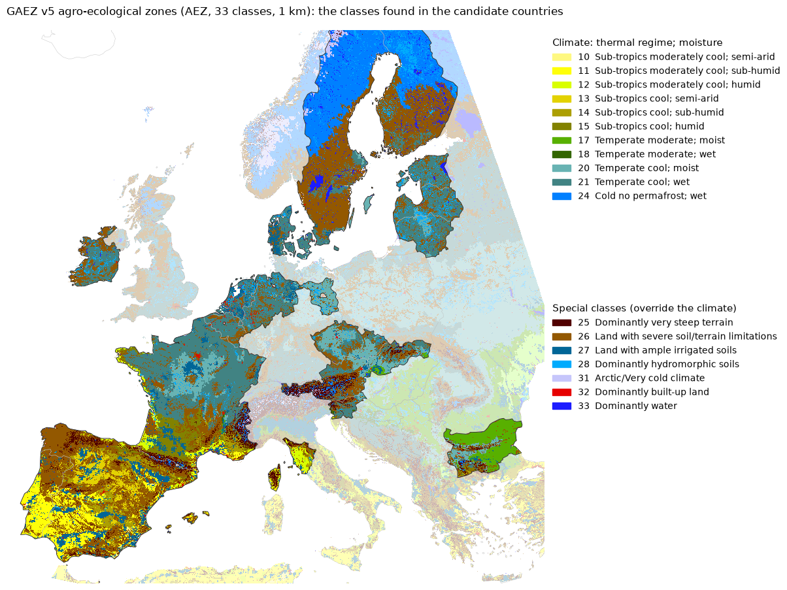
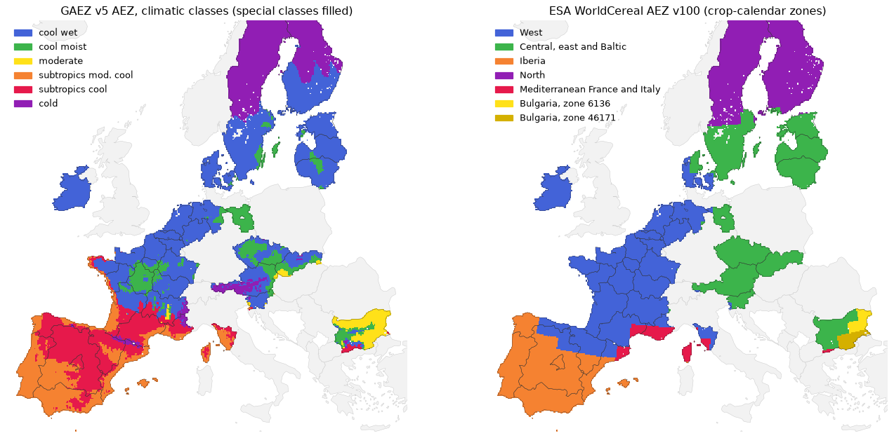
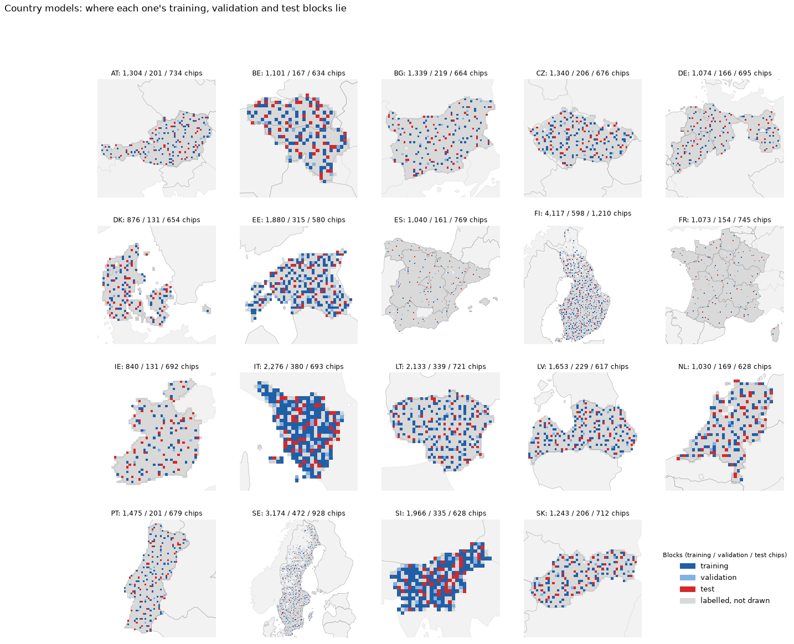
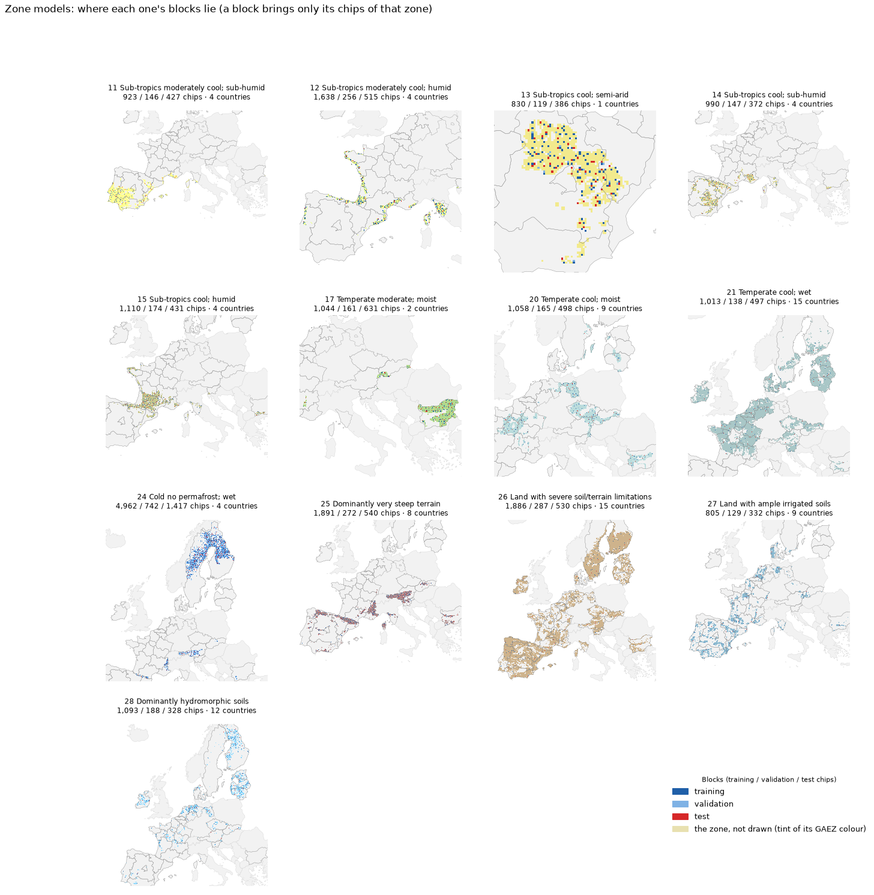
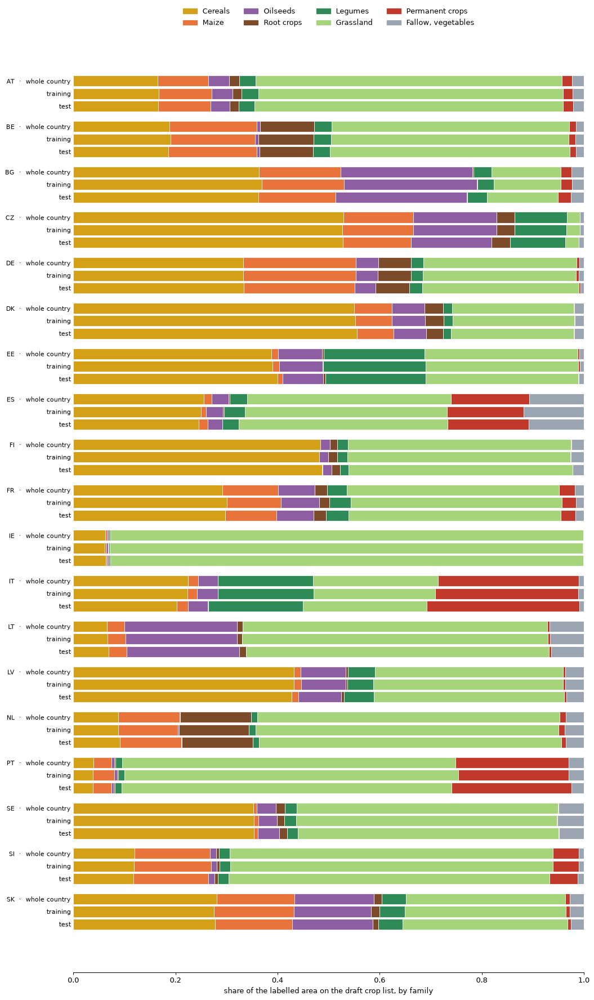
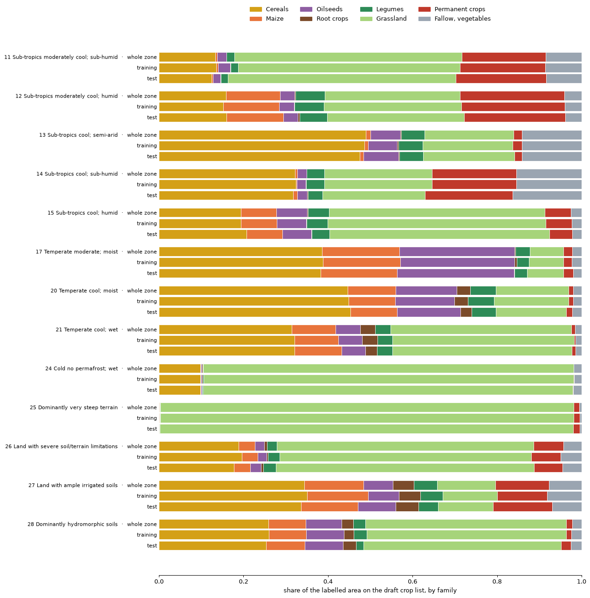

# Spatial transfer by country and by zone: the plan

Built question by question from 5 November 2026. Each section says what is decided and what is still open, and a
point counts as decided only once the user has agreed to it. The country matrix itself, its scores and its climate
analysis are described in [transfer_setup.md](transfer_setup.md).

## Decided so far

| # | Decision |
|---|---|
| 1 | **Two matrices.** A model is trained in every country and tested in every other country. Likewise, a model is trained in every zone and tested in every other zone |
| 2 | **No label budget.** Each model uses every label of its training sample (K = 100 %) |
| 3 | **Zones are the GAEZ v5 agro-ecological zones, 33 classes, exactly as GAEZ maps them**, special classes included. Every block also carries its underlying climate (the nearest climatic class) as a tag, so that the test set of a special-class zone can be read by climate |
| 4 | **Sampling:** whole blocks, drawn so that each sample is spread over its domain and matches its crop mix, with the labels downloaded before any imagery |
| 5 | **ESA WorldCereal's crop-calendar zones are not trained on.** They tag the country pairs (the share of cropland in shared ESA zones), and their season start dates give a calendar distance for the climate correlation |
| 6 | **Every model gets the same labelled area:** 250,000 ha of labelled crop land to train on and 37,500 ha to validate on. A test set holds at least 50 blocks and at least 75,000 ha, whichever is larger |
| 7 | **One role per block for every model:** a quarter of all blocks, fixed by their position, are test blocks; no model trains on a chip that any model is tested on. **A zone sample is the zone's chips inside the drawn blocks**, since a block usually holds two or three GAEZ classes |
| 8 | **The country samples are drawn and their export has started** (5 November 2026): the draw below, balanced on the draft crop groups, is fixed for them; the crop list decided later changes the masks, not the blocks |
| 9 | **Test sets are independent draws; training and validation share.** Every country and zone draws its own test set, with no preference for chips already downloaded. A zone's training and validation samples prefer blocks already drawn for the country samples, inside the zone's own steps along the space-filling curve, so the zone keeps its own spread and mix of countries |
| 10 | **The crop classes: 21 species in 9 groups, two levels in one model.** A model learns the species where the labels name it, and the group where they name only the group (Lithuania's unspecified cereals); land off the list is ignored, as unlabelled land is now |
| 11 | **A country pair is scored on the species with support on both sides** (at least 30 parcels in the training sample, at least 30 parcels in at least 5 test blocks); beside it, on all species of the test domain (a species the model never saw scores F1 = 0), and both again at the group level |
| 12 | **A zone enters the zone matrix with at least 4 supported species that each cover 1 % of it.** Very steep terrain fails (grassland only) and is left out: 12 zone models. All 19 countries stay |
| 13 | **Three matrices**, each model tested on every test set: country × country, zone × zone, and country × zone in both directions (country models on zone test sets, zone models on country test sets). A zone model is not zero-shot on the countries whose land it trained on |
| 14 | **Frozen encoders**: TerraMind, THOR, Prithvi and TESSERA v2 frozen with a trained decoder, the U-Net from scratch as the baseline, trained as in the main workflow (45 epochs, lowest validation loss on the model's own domain); AlphaEarth left out for now. One seed first, three for the final run. A 1,600 m buffer between test and training land |
| 15 | **Loss = 1 − score / home score of the test set's own model**, with the absolute drop beside it. The loss is correlated with one climate metric per family, chosen beforehand (heat sum, summer P/PET, precipitation, growing-period days, frost days), with ESA's season start and with km, from GAEZ's 2021 layers |

## Still open, in the order they will be discussed

1. How AlphaEarth's tiles are handled.

## 1. The zones

### GAEZ v5 agro-ecological zones, 33 classes

FAO and IIASA, released in 2025, at 1 km and about 9 km, from the 2001 to 2020 climate (AgERA5). A class is built in
two steps:

- **24 climatic classes**, each a thermal regime crossed with a moisture regime. The thermal regimes are tropics
  (lowland, highland), subtropics (warm, moderately cool, cool), temperate (moderate, cool) and cold. The moisture
  regimes are semi-arid, sub-humid and humid, called dry, moist and wet in the temperate and cold regimes. Moisture
  is set by the length of the growing period.
- **9 special classes**, which take priority over the climate wherever their condition holds: very steep terrain,
  severe soil or terrain limitations, ample irrigated soils, hydromorphic (waterlogged) soils, desert, boreal or
  cold, arctic, built-up land and water.

The map shows the classes as GAEZ draws them, in GAEZ's own colours. The candidate countries are in full colour and
outlined; the rest of Europe is faded.

The classes found on the candidate countries' cropland. Chips are the grid cells that would become chips (cropland
plus grassland above 4.5 %, `download_estimate.py`; the real chips for Estonia and Latvia), each given the class
that covers most of it:

| Code | Class | Kind | Chips | Countries with 1,000 chips or more | Largest |
|---|---|---|--:|:-:|---|
| 10 | Sub-tropics moderately cool; semi-arid | climate | 478 | 0 | ES 478 |
| 11 | Sub-tropics moderately cool; sub-humid | climate | 24,735 | 3 | ES 15,467, PT 7,999, FR 1,087 |
| 12 | Sub-tropics moderately cool; humid | climate | 7,453 | 3 | FR 4,151, IT 2,026, ES 1,002 |
| 13 | Sub-tropics cool; semi-arid | climate | 8,931 | 1 | ES 8,906 |
| 14 | Sub-tropics cool; sub-humid | climate | 12,722 | 2 | ES 9,603, FR 2,222, IT 420 |
| 15 | Sub-tropics cool; humid | climate | 13,616 | 2 | FR 11,603, ES 1,447 |
| 17 | Temperate moderate; moist | climate | 13,873 | 1 | BG 12,845, SK 759 |
| 20 | Temperate cool; moist | climate | 32,514 | 8 | FR 10,507, CZ 7,077, DE 4,974 |
| 21 | Temperate cool; wet | climate | 112,498 | 15 | FR 44,783, DE 10,106, LT 7,926 |
| 24 | Cold no permafrost; wet | climate | 52,662 | 2 | SE 32,951, FI 17,910, AT 936 |
| 25 | Dominantly very steep terrain | special | 14,607 | 3 | FR 4,723, AT 4,493, ES 3,711 |
| 26 | Land with severe soil/terrain limitations | special | 136,557 | 15 | ES 42,045, SE 21,395, FI 17,612 |
| 27 | Land with ample irrigated soils | special | 26,095 | 5 | ES 11,409, FR 7,145, DK 1,862 |
| 28 | Dominantly hydromorphic soils | special | 15,677 | 6 | FI 6,580, DE 1,450, LT 1,344 |
| 30 | Boreal/Cold climate | special | 372 | 0 | SE 307 |
| 31 | Arctic/Very cold climate | special | 3,513 | 1 | SE 3,115 |
| 32 | Dominantly built-up land | special | 1,468 | 0 | FR 462 |
| 33 | Dominantly water | special | 1,362 | 0 | SE 554, FI 352 |

**What the classes show:**

1. **18 of the 33 classes occur, and 14 have enough chips for a training and a test sample** (about 2,900 chips).
2. **The special classes cover about two fifths of the cropland chips**, and the largest class of all is a special
   class: "Land with severe soil/terrain limitations", 137,000 chips from Finland to Spain. As a zone it would
   join boreal and Mediterranean fields.
3. **Several climatic classes lie in one or two countries:** cold, wet in Sweden and Finland; temperate moderate,
   moist in Bulgaria; subtropics cool, semi-arid in Spain. A model of such a zone is close to a model of one country.
4. **Temperate cool, wet is the shared zone:** 15 countries, from Ireland to Estonia.

### Decided: the special classes stay as zones

GAEZ tests its conditions in a fixed order and the first that holds decides a cell's class: water and built-up
land first, then steep terrain, irrigation and waterlogged soils, then desert, permafrost and arctic climates, then
poor soils (a soil suitability index for grain maize at low input below 0.25), and only then the climate. A
special class therefore hides the climate underneath it; it does not change it.

Kept as GAEZ maps them, the zones are of two kinds:

- **climatic classes**, which answer the climate question;
- **special classes**, which ask whether a soil, terrain or irrigation condition makes a domain of its own.

The climate gradient stays covered, because the continuous climate metrics of `transfer_setup.md` are computed for
every country from GAEZ's own climate layers, whatever the special classes. And every block keeps its underlying
climate as a tag, so the test set of a special-class zone can be scored apart by country and by climate: a model
trained on "poor soils" learns from Finland and Spain together, and a good score in that zone could come from
training on several climates rather than from the shared soil.

**Accepted with it:** a climatic zone covers only its land outside the special classes (temperate cool, wet leaves
out Estonia's waterlogged and poor-soil fields), so a country's sample and its zones' samples cover its land
differently. Three of the 14 usable zones lie in one country (subtropics cool, semi-arid in Spain; temperate
moderate, moist in Bulgaria; arctic in Sweden), so their models are close to that country's model.

### ESA WorldCereal zones, compared

ESA WorldCereal AEZ v100 has 106 zones worldwide. They are built from maize and cereal crop calendars (the day each
season starts and ends), gridded at 0.5°, and were made to schedule when WorldCereal maps each region. They
describe when crops grow, not climate or soil. Left: GAEZ climatic classes with the special classes filled. Right:
the ESA zones, on the same blocks.

ESA's zones on the candidate countries (`worldcereal_zones.csv`). Season start is the day of the year as
WorldCereal gives it:

| ESA zone | Chips | Countries with 1,000 chips or more | Season start: winter cereals · maize | GAEZ zones inside, chips |
|---|--:|---|---|---|
| West | 170,888 | FR, ES (north), DE (west), IE, NL, BE, DK, IT | 15 · 102 | cool wet 100,566; subtropics cool 37,662; cool moist 15,866; subtropics mod. cool 12,002 |
| Central, east and Baltic | 117,501 | SE (south), AT, CZ, LT, BG, LV, SK, EE, DE (east), DK, SI, FR | 44 · 107 | cool wet 73,808; cool moist 28,150; moderate 8,181; cold 6,631 |
| Iberia | 91,937 | ES, PT | 315 · 112 | subtropics mod. cool 51,168; subtropics cool 40,769 |
| North | 90,995 | SE, FI | 53 · 113 | cold 69,231; cool wet 21,386 |
| Mediterranean France and Italy | 11,147 | FR, ES, IT | 318 · 105 | subtropics mod. cool 5,979; subtropics cool 4,823 |
| Bulgaria, zone 6136 | 4,838 | BG | 39 · 115 | moderate 4,438 |
| Bulgaria, zone 46171 | 4,198 | BG | 3 · 109 | moderate 3,670 |

**The two zonings divide Europe in different directions.** GAEZ splits by warmth and moisture, and puts Estonia with
France and Ireland (cool, wet). ESA splits west from east by season timing, and puts Estonia with Czechia, Austria
and southern Sweden, and France with Ireland and northern Spain. ESA's layout is closer to GAEZ's thermal climate
layer (oceanic, sub-continental, Mediterranean) than to the 33 classes.

| Criterion | GAEZ AEZ (33 classes) | ESA WorldCereal AEZ |
|---|---|---|
| What it measures | Climate (warmth, growing period), plus soil and terrain | The calendar of maize and cereals |
| Link to why our models fail abroad | Indirect | Direct: our models see fixed calendar months, and calendar shift is the main cause of loss across regions in the literature (`transfer_literature.md`) |
| Resolution | 1 km | 0.5°, about 50 km |
| Zones usable on our cropland | About 6 climatic classes, plus the special classes | 5 |
| How it is made | Documented FAO and IIASA rules on published climate layers | Derived from modelled crop calendars, partly simulated where data are missing |
| Weak point | Special classes override the climate | Coarse borders; made for scheduling production, not as a classification |
| Standing | The standard agro-ecological reference | The operational zoning of one system, citable through its ESSD paper (Van Tricht et al. 2023) |

### Decided: ESA's zones tag the country pairs

ESA's zones are too coarse to train on: 13 of the 19 countries lie 90 % or more in one of them, so the country
matrix already answers whether transfer follows the crop calendar. Six countries are split: Germany 75 / 25 (west,
central and east), Denmark 57 / 43, Sweden 32 / 68 (central, north), Spain 77 / 22 (Iberia, west), Bulgaria 56 / 44
and Tuscany 65 / 35. A country pair is therefore tagged with the share of cropland in ESA zones the two countries
share, not with a yes or no, and ESA's season start dates (winter cereals, maize) give a calendar distance beside
GAEZ's start of the growing period. Their limits: 0.5° cells, and calendars for maize and cereals only.

## 2. Sampling

### Decided: balanced and spread, labels first

- **Unit:** whole blocks of 4 x 4 chips (8.96 km), the unit of the main workflow's split.
- **Steps:**
  1. Download the 2021 labels of all 19 countries before any imagery: 21.5 GB of EuroCrops v2 files (Spain alone 9.4
     GB), plus Sweden and Lower Saxony from v11; Estonia, Latvia and Lithuania are on disk.
  2. For every candidate block: its country, its zone(s), and the area of each crop class.
  3. For every country and every zone: draw the test blocks, then the training and validation blocks, spread over
     the domain and chosen so that the sample's crop mix matches the domain's.
  4. Check every sample against the criteria below.
  5. Export imagery only for the drawn blocks.
- **What "representative" means** (proposed thresholds, to be confirmed):
  - **crop mix:** every crop class's share in the sample within about 1 to 1.5 percentage points of its share in
    the domain;
  - **support:** every crop class with at least 1 % of the domain's area has at least 30 parcels in the test set;
  - **spread:** the blocks cover the domain's extent and its climate range.

**The evidence.** Estonia's and Latvia's real masks (20 classes), 200 draws of whole blocks per size and design. The
error is the share of the area whose class would have to change for the sample's crop mix to equal the country's
(total variation distance); "worst class" is the 90th percentile of the largest error of any one class.

| Design | 50 blocks (about 600 chips): median error | worst class | 200 blocks (about 2,300 chips): worst class |
|---|---|---|---|
| Random blocks | EE 4.9 %, LV 5.0 % | 5.3 to 6.4 points | 2.0 to 3.0 points |
| Spread | EE 4.3 %, LV 5.1 % | 3.4 to 5.5 points | 1.6 to 1.8 points |
| **Balanced and spread** | **EE 2.4 %, LV 2.1 %** | **1.2 to 1.3 points** | **0.5 to 0.6 points** |

A balanced sample of 50 blocks matches the crop mix better than a random sample of 200. From 30 to 50 blocks on,
every one of Estonia's 20 classes has at least 30 parcels, whatever the design.

### Decided: the same labelled area for every model

The same number of chips would not give the same supervision: the share of a chip that carries labels runs from 10 %
(the cold, wet zone) and 14 % (Finland) to about 61 % (Ireland, the irrigated zone), so 2,000 chips meant 102,000 ha
of labels for one model and 615,000 ha for another. Equal parcels are no alternative: a Spanish parcel is a fraction
of a hectare, an Estonian one several hectares. Every model therefore gets the same labelled area, and the number of
chips varies instead.

The size is capped by the smallest domains: Tuscany can give 340,000 ha to training and validation, Slovenia
97,000 ha to testing. 250,000 ha for training and 37,500 ha for validation fit every model with margin.

| Training / validation, labelled ha | Training chips per model | Chips in all, before any sharing | Fits all 32 models |
|---|---|---|---|
| 150,000 / 22,500 | about 490 to 2,900 | about 50,000 | yes |
| **250,000 / 37,500 (chosen)** | **754 to 4,849, median 1,198** | **74,891** | **yes, with margin** |
| 290,000 / 43,500, the most every domain can give | about 940 to 5,700 | about 85,000 | only just |
| 2,000 chips each, unequal labels | 2,000 | about 88,000 | yes |

A test set holds **at least 50 blocks and at least 75,000 ha**, whichever is larger: labelled area alone would give
Ireland about 20 test blocks, and chips alone would give Finland few labels. How precise 50 blocks are, measured on
Estonia's real K = 100 % predictions by resampling test blocks:

| Test blocks (chips) | Spread of Macro-F1, one standard deviation | Spread of the difference between two models |
|---|---|---|
| 25 (about 290) | ±0.016 | ±0.010 |
| 50 (about 580) | ±0.009 | ±0.007 |

Transfer losses in the literature are 0.15 to 0.45, far above that.

### The draw: what each model trains on

`label_blocks.py` places all 46 million parcels of the 19 countries' 2021 files by their centroid in a chip cell and
a block; counting chips this way reproduces the real chip sets within 5 % (Estonia 7,048 against 7,402, Latvia
11,364 against 11,500). `draw_samples.py` then draws, for each of the 19 countries and the 13 zones with enough
labelled area (the 14 counted above, less arctic, which falls short; very steep terrain is drawn but left out of the
zone matrix, section 3):

1. the test set from the test blocks, then the training and validation sets from the training blocks;
2. each one spread over the domain: the units are ordered along a space-filling curve, cut into equal steps, and one
   unit is taken at a random position inside each step;
3. each one balanced: of 500 such candidates within 10 % of the target area, the one whose crop mix is closest to
   the whole domain's is kept.

Every unit has the same chance of being picked. A first version picked units in proportion to their labelled area;
that favours the most cropped blocks and, once summed, over-weights their crops, and grassland came out 7 to 10
points short in Sweden and Slovakia. It was corrected before the export.

**The country models.** Training blocks blue, validation light blue, test red, the rest of the labelled blocks grey:

**The zone models.** Same colours; each zone is drawn in a tint of its GAEZ colour:

**Their crop mix.** For every model, three bars: the whole country or zone, the training sample and the test sample,
by crop family (the draft groups, grouped for display):

**What each model trains on** (`sample_models.csv`). "Off by" is the total variation distance between the test
sample's crop mix and the domain's; "worst group" is the largest error of any single crop group, in percentage
points:

| Country | Training: labelled ha · chips | Validation: ha · chips | Test: ha · chips (blocks) | Test crop mix: off by · worst group | Crop groups with 1 % or more of the country |
|---|---|---|---|---|---|
| AT | 262k · 1,304 | 38k · 201 | 145k · 734 (50) | 1.6 % · 0.4 pt | wheat, barley, rye, triticale, maize, soy, sugar beet, forage legumes, grassland, fallow, vineyards |
| BE | 260k · 1,101 | 39k · 167 | 138k · 634 (47) | 0.9 % · 0.4 pt | wheat, barley, maize, potatoes, sugar beet, dry pulses, forage legumes, grassland, vegetables, orchards |
| BG | 250k · 1,339 | 41k · 219 | 136k · 664 (50) | 2.0 % · 0.9 pt | wheat, barley, maize, rapeseed, sunflower, forage legumes, grassland, fallow, orchards |
| CZ | 249k · 1,340 | 37k · 206 | 120k · 676 (50) | 1.4 % · 0.6 pt | wheat, barley, rye, oats, triticale, maize, rapeseed, sugar beet, dry pulses, forage legumes, grassland |
| DE | 256k · 1,074 | 38k · 166 | 162k · 695 (50) | 1.6 % · 0.6 pt | wheat, barley, rye, triticale, maize, rapeseed, potatoes, sugar beet, dry pulses, forage legumes, grassland |
| DK | 257k · 876 | 37k · 131 | 182k · 654 (49) | 1.0 % · 0.4 pt | wheat, barley, rye, oats, maize, rapeseed, potatoes, sugar beet, dry pulses, grassland, fallow |
| EE | 248k · 1,880 | 40k · 315 | 78k · 580 (50) | 1.7 % · 0.7 pt | wheat, barley, rye, oats, maize, rapeseed, dry pulses, forage legumes, grassland |
| ES | 264k · 1,040 | 39k · 161 | 191k · 769 (50) | 4.0 % · 1.6 pt | durum wheat, wheat, barley, oats, triticale, maize, sunflower, dry pulses, forage legumes, grassland, fallow, orchards, olive, vineyards |
| FI | 245k · 4,117 | 37k · 598 | 69k · 1,210 (124) | 0.8 % · 0.3 pt | wheat, barley, oats, rapeseed, dry pulses, grassland, fallow |
| FR | 239k · 1,073 | 40k · 154 | 187k · 745 (50) | 2.1 % · 0.8 pt | durum wheat, wheat, barley, triticale, maize, rapeseed, sunflower, sugar beet, dry pulses, forage legumes, grassland, fallow, vineyards |
| IE | 251k · 840 | 37k · 131 | 218k · 692 (49) | 0.2 % · 0.1 pt | wheat, barley, grassland |
| IT | 231k · 2,276 | 37k · 380 | 71k · 693 (51) | 2.9 % · 1.8 pt | durum wheat, wheat, barley, oats, maize, sunflower, dry pulses, forage legumes, grassland, orchards, olive, vineyards |
| LT | 249k · 2,133 | 39k · 339 | 86k · 721 (50) | 0.7 % · 0.3 pt | oats, maize, rapeseed, sugar beet, grassland, fallow, vegetables |
| LV | 249k · 1,653 | 36k · 229 | 95k · 617 (49) | 1.3 % · 0.6 pt | wheat, barley, rye, oats, maize, rapeseed, dry pulses, forage legumes, grassland, fallow |
| NL | 251k · 1,030 | 39k · 169 | 154k · 628 (48) | 0.5 % · 0.3 pt | wheat, barley, maize, potatoes, sugar beet, grassland, vegetables, orchards |
| PT | 242k · 1,475 | 34k · 201 | 122k · 679 (50) | 1.8 % · 1.0 pt | oats, maize, rice, dry pulses, grassland, fallow, orchards, olive, vineyards |
| SE | 251k · 3,174 | 39k · 472 | 72k · 928 (109) | 1.5 % · 0.8 pt | wheat, barley, rye, oats, rapeseed, dry pulses, grassland, fallow |
| SI | 228k · 1,966 | 40k · 335 | 79k · 628 (46) | 1.1 % · 0.4 pt | wheat, barley, triticale, maize, forage legumes, grassland, orchards, vineyards |
| SK | 244k · 1,243 | 41k · 206 | 147k · 712 (48) | 2.1 % · 1.1 pt | durum wheat, wheat, barley, maize, rapeseed, sunflower, soy, sugar beet, forage legumes, grassland, fallow |

| Zone | Training: labelled ha · chips | Training chips by country | Test: ha · chips (blocks) | Test crop mix: off by · worst group | Crop groups with 1 % or more of the zone |
|---|---|---|---|---|---|
| 11 Sub-tropics moderately cool; sub-humid | 258k · 923 | ES 60 %, PT 34 %, FR 4 %, IT 2 % | 113k · 427 (50) | 2.1 % · 0.9 pt | durum wheat, wheat, barley, oats, triticale, sunflower, dry pulses, grassland, fallow, orchards, olive, vineyards |
| 12 Sub-tropics moderately cool; humid | 249k · 1,638 | FR 53 %, IT 28 %, ES 14 %, PT 6 % | 82k · 515 (64) | 2.6 % · 0.6 pt | durum wheat, wheat, barley, oats, maize, rapeseed, sunflower, dry pulses, forage legumes, grassland, fallow, orchards, olive, vineyards |
| 13 Sub-tropics cool; semi-arid | 247k · 830 | ES 100 % | 122k · 386 (49) | 2.4 % · 1.0 pt | wheat, barley, rye, oats, triticale, maize, sunflower, dry pulses, forage legumes, grassland, fallow |
| 14 Sub-tropics cool; sub-humid | 241k · 990 | ES 74 %, FR 17 %, IT 6 %, PT 3 % | 92k · 372 (50) | 3.5 % · 1.2 pt | wheat, barley, oats, triticale, sunflower, dry pulses, forage legumes, grassland, fallow, orchards, olive, vineyards |
| 15 Sub-tropics cool; humid | 246k · 1,110 | FR 85 %, ES 12 %, IT 2 %, BG 1 % | 94k · 431 (49) | 2.4 % · 0.8 pt | durum wheat, wheat, barley, triticale, maize, rapeseed, sunflower, soy, dry pulses, forage legumes, grassland, fallow, vineyards |
| 17 Temperate moderate; moist | 268k · 1,044 | BG 92 %, SK 7 % | 154k · 631 (50) | 1.8 % · 0.8 pt | wheat, barley, maize, rapeseed, sunflower, forage legumes, grassland, fallow, orchards |
| 20 Temperate cool; moist | 237k · 1,058 | FR 31 %, CZ 21 %, DE 16 %, BG 11 %, SK 8 %, LT 5 %, AT 4 %, SE 2 %, and 1 more | 111k · 498 (50) | 2.4 % · 0.8 pt | wheat, barley, rye, oats, triticale, maize, rapeseed, sunflower, soy, sugar beet, dry pulses, forage legumes, grassland, fallow |
| 21 Temperate cool; wet | 227k · 1,013 | FR 37 %, DE 8 %, LT 7 %, EE 6 %, DK 5 %, LV 5 %, CZ 5 %, IE 5 %, and 7 more | 124k · 497 (50) | 2.2 % · 0.8 pt | wheat, barley, oats, triticale, maize, rapeseed, potatoes, sugar beet, dry pulses, forage legumes, grassland, fallow |
| 24 Cold no permafrost; wet | 248k · 4,962 | FI 48 %, SE 42 %, AT 5 %, FR 3 % | 76k · 1,417 (311) | 0.3 % · 0.2 pt | barley, oats, grassland, fallow |
| 25 Dominantly very steep terrain | 245k · 1,891 | FR 32 %, AT 29 %, ES 24 %, SI 4 %, BG 4 %, IT 3 %, SK 2 %, PT 1 % | 75k · 540 (97) | 0.3 % · 0.3 pt | grassland |
| 26 Land with severe soil/terrain limitations | 257k · 1,886 | ES 25 %, SE 15 %, FI 14 %, FR 11 %, PT 8 %, IE 5 %, AT 5 %, DE 3 %, and 7 more | 75k · 530 (68) | 2.9 % · 1.0 pt | wheat, barley, oats, maize, rapeseed, sunflower, forage legumes, grassland, fallow, orchards, olive, vineyards |
| 27 Land with ample irrigated soils | 237k · 805 | ES 41 %, FR 26 %, NL 10 %, DK 8 %, PT 4 %, DE 4 %, SK 3 %, AT 1 %, and 1 more | 98k · 332 (50) | 4.9 % · 2.1 pt | durum wheat, wheat, barley, rye, oats, triticale, maize, rice, rapeseed, sunflower, potatoes, sugar beet, dry pulses, forage legumes, grassland, fallow, vegetables, orchards, olive, vineyards |
| 28 Dominantly hydromorphic soils | 241k · 1,093 | FI 22 %, DE 14 %, LT 13 %, FR 10 %, IE 10 %, LV 9 %, EE 7 %, NL 6 %, and 4 more | 73k · 328 (95) | 3.1 % · 0.8 pt | wheat, barley, rye, oats, triticale, maize, rapeseed, sunflower, potatoes, dry pulses, forage legumes, grassland, fallow |

**What the draw shows:**

1. **Every sample is representative by the criteria above.** Training samples are within 0.1 to 3.0 % of their
   domain's crop mix and test samples within 0.2 to 4.9 %; the worst single group is 2.1 points off. Every group with
   1 % or more of its domain has at least 30 parcels in the test set, except one of the irrigated zone's 20.
2. **The same labels, very different chips:** 805 training chips for the irrigated zone, 840 for Ireland, 4,117 for
   Finland and 4,962 for the cold, wet zone, where a tenth of the land is labelled.
3. **Zone models draw on very different numbers of countries:** temperate cool, wet on 15 (France 37 %);
   subtropics cool, semi-arid on Spain alone; temperate moderate, moist on Bulgaria (93 %); cold, wet on Finland
   and Sweden.
4. **Two zones are almost only grassland.** In very steep terrain grassland is the only group above 1 %; in cold,
   wet the groups are barley, oats, grassland and fallow. Whether to keep them is part of the crop-class question.
5. **Lithuania's cereals fall outside a species list:** its v11 labels call them "winter / summer unspecified
   cereals", so on the draft list it has no wheat, barley or rye. Also part of the crop-class question.
6. **Czechia's grassland is missing from its labels** (2 % of its area).

### The export

Started on 5 November 2026 with `scripts/hub/build_sample_chips.py`, which composites only the drawn chips with the
main workflow's code (Sentinel-2 under the `revised` screening, one window per block; Sentinel-1 RTC with the worker
of `build_s1_chips.py`), into one chip set per country, `data/eurocrops_chips/<CC>_2021_transfer/`. The suffix is
`_transfer` because `EE_2021_sample` already names an earlier experiment's chip set; the script refuses to write into
any set that holds a manifest it did not make.

| What | Chips | Status |
|---|---|---|
| Country samples, 17 countries | 44,099 | Sentinel-2 (12 workers, windows of 2 x 2 chips) and Sentinel-1 (4 workers) running; logs `data/eurocrops_chips/transfer_export_s2.log` and `transfer_export_s1.log`. A first start with 16 + 8 workers and whole-block windows overloaded the archive: reads failed in bursts ("systematic read failure"), six blocks failed and the rest slowed to about 95 chips an hour, so it was restarted at lower load, keeping every finished chip |
| Country samples, Estonia and Latvia | 5,274 | Linked from `EE_2021_rev`, `EE_2021` and `LV_2021` (symbolic links, the sets themselves untouched); the few missing (at most 32, cells holding only crops outside the in-country class lists) exported with the rest |
| Zone samples, beyond the country samples | 15,766 for the 12 zones of the matrix (25,518 had the draws been independent) | Queued: starts when the country samples are done |
| Masks | all | Wait for the crop list; rasterised from the 2021 labels without touching the imagery |
| AlphaEarth | all | Waits for the decision below |

### Decided: test sets independent, training shared

The zone samples' test sets are their own draws, so each is a clean sample of its zone; they share 11 % of their
chips with the country samples by chance. Training and validation take 48 % of their chips from blocks the country
samples already hold. The rest lie where no country sample happened to draw, such as most of the cold, wet zone,
which needs about 5,000 chips. The country samples are unchanged by it: the zone draws come after them.

### Open: AlphaEarth

| Options | Consequence | Recommended |
|---|---|---|
| Accept that spread samples touch most tiles | Up to about 820 new tiles, 1.6 TB | To decide with the models |
| Limit the draw to fewer tiles | Less download, less spread | |

## 3. The crop classes

### Decided: 21 species in 9 groups, two levels in one model

The list follows a rule fixed before any result: a crop enters if it covers at least 0.5 % of the labelled land in
at least two of the 19 countries. Cereals are species without a sowing season, because Spain and Portugal declare
none; all grassland is one species, because the countries split it differently.

| Group | Species |
|---|---|
| Cereals | wheat, durum wheat, barley, rye, oats, triticale |
| Maize | maize |
| Oilseeds | rapeseed, sunflower, soy |
| Root crops | potatoes, sugar beet |
| Legumes | dry pulses, forage legumes |
| Grassland | grassland (permanent, temporary, unspecified) |
| Fallow | fallow |
| Vegetables and other arable crops | vegetables, buckwheat |
| Permanent crops | orchards (fruit, nuts, citrus, berries), olive, vineyards |

Every species covers 0.5 % or more in at least three countries (buckwheat: Lithuania, Latvia, Estonia; olive:
Tuscany, Portugal, Spain). Rice misses the rule: only Portugal passes it.

**Why two levels.** A species list alone would cost Lithuania its cereals: its labels call 46 % of its land
"unspecified cereals", and only 7 % of its cereal area is named by species. A group list alone would spare the
models the distinctions crop-type mapping is about (wheat, barley, rye) and the ones most likely to break across
climates. With two levels, a model learns the species where the labels name them and the group where they do not:
the loss of a group-only pixel is that of the group's species taken together. Every model is scored at both levels.

**The share of each country's labelled land on the list** (`crop_classes.py`):

| | AT | BE | BG | CZ | DE | DK | EE | ES | FI | FR | IE | IT | LT | LV | NL | PT | SE | SI | SK |
|---|--:|--:|--:|--:|--:|--:|--:|--:|--:|--:|--:|--:|--:|--:|--:|--:|--:|--:|--:|
| Species level | 98.1 | 95.6 | 97.5 | 95.2 | 96.8 | 94.4 | 99.1 | 94.2 | 92.5 | 91.9 | 94.6 | 63.5 | 50.9 | 98.1 | 93.8 | 69.0 | 95.6 | 98.8 | 97.1 |
| Group level | 98.2 | 96.3 | 97.7 | 96.1 | 97.0 | 95.2 | 99.2 | 94.5 | 94.5 | 94.0 | 94.6 | 63.5 | 97.2 | 98.2 | 93.9 | 70.1 | 96.5 | 98.9 | 97.1 |

Portugal and Tuscany stay low at both levels: their off-list land is forest, oak, unmaintained land and "unknown".

### The mapping table

`crop_classes.csv` maps every one of the 371 HCAT names of the 2021 labels (v11's HCAT3 and v2's HCAT4 alike) to a
species, to a group only, or to nothing: 158 names to a species, 11 to a group only, 202 ignored. The 146 names that
cover at least 0.1 % of some country were checked by hand. The rules:

- **Group only:** names that give the group but not the species: "winter / summer / spring unspecified cereals"
  (Lithuania 46 %), "cereal" (Finland 1.2 %, Sweden 0.9 %), "mixed grains", a bare "legumes" (France 1.5 %), and
  "permanent crops" (Portugal 0.7 %).
- **Ignored:** species off the list even when their group is clear (rice, millet, sorghum, flax, poppy, mustard,
  fodder beet), names beginning "other" (a crop outside the listed ones), and land that is no crop (forest, oak,
  conifers, unmaintained, "unknown", nurseries, flowers).
- **Fixed by hand, against the draft's keyword matching:** "shrubberries / shrubs" (Portugal 1.2 %) is scrub, not
  orchards; "temporary grass" (Sweden 0.7 %) is grassland; pumpkins, leek, cauliflower, asparagus and the other
  vegetables are vegetables; citrus, pistachio and carob are orchards; green fodder of any crop ("plants harvested
  green", Sweden 1.0 %) is ignored. Estonia's "legumes harvested green" are forage legumes, as its v11 labels say;
  v2 calls the same land a bare "legumes", which is why Estonia's forage legumes read 14 % in v11 and 5 % in v2.

### Decided: scoring a pair, and which zones enter

A pair is scored on the species with support on both sides: at least 30 parcels in the training sample and at
least 30 parcels in at least 5 test blocks. Beside it: all species of the test domain, with F1 = 0 for a species the
model never saw; and both at the group level.

A zone enters the zone matrix if at least 4 species have support and each covers at least 1 % of the zone. Counted
by parcels alone, very steep terrain has 9 supported species, but 8 of them together cover under 2 % of it against
98 % grassland, so it is left out. The rule was agreed for zones; applied to countries it would drop Ireland
(grassland 88 %, then barley and wheat), which stays. Support per model (`crop_classes_support.csv`):

| Model | Species with support | of which 1 % or more of the domain | In its matrix |
|---|:-:|:-:|:-:|
| AT | 20 | 12 | yes |
| BE | 16 | 10 | yes |
| BG | 16 | 9 | yes |
| CZ | 17 | 11 | yes |
| DE | 17 | 12 | yes |
| DK | 15 | 11 | yes |
| EE | 15 | 9 | yes |
| ES | 18 | 14 | yes |
| FI | 15 | 7 | yes |
| FR | 21 | 13 | yes |
| IE | 11 | 3 | yes |
| IT | 16 | 13 | yes |
| LT | 9 | 8 | yes |
| LV | 15 | 11 | yes |
| NL | 15 | 8 | yes |
| PT | 15 | 9 | yes |
| SE | 14 | 8 | yes |
| SI | 18 | 9 | yes |
| SK | 19 | 11 | yes |
| zone 11 | 16 | 12 | yes |
| zone 12 | 18 | 15 | yes |
| zone 13 | 17 | 11 | yes |
| zone 14 | 18 | 12 | yes |
| zone 15 | 20 | 13 | yes |
| zone 17 | 16 | 9 | yes |
| zone 20 | 20 | 14 | yes |
| zone 21 | 18 | 12 | yes |
| zone 24 | 12 | 4 | yes |
| zone 25 | 9 | 1 | **no** |
| zone 26 | 18 | 12 | yes |
| zone 27 | 20 | 18 | yes |
| zone 28 | 20 | 13 | yes |

### How the masks will hold it

One mask per chip, rasterised from the 2021 labels once the imagery is in, without touching it: the species index
(0 to 20) where the label names a species, a group code where it names only the group, and the ignore value
elsewhere. Training and scoring read both levels from the same mask.

## Files

- `zone_pools.py`: every chip's GAEZ class, filled and as mapped; writes `aez33_chips.csv`, `zone_pools.csv` and
  `zone_blocks.parquet`.
- `aez_maps.py`: the two maps above and `worldcereal_zones.csv`.
- `crop_groups.py`: crop areas per 2021 label file (`crop_groups.csv`, `crop_groups_parcels.csv`), from the code areas
  in `v2_2021_code_areas.csv`; its `GROUPS` are the draft crop groups the draw balances on.
- `label_blocks.py`: every 2021 parcel placed in its chip cell and block, summed per block (`label_blocks.parquet`),
  per block and zone (`label_block_zones.parquet`) and per HCAT class (`label_blocks_hcat.parquet`); the parcel table
  itself in `data/eurocrops/label_parcels_2021.parquet`. `--countries` reads only those countries again.
- `draw_samples.py`: the draw (`samples.csv`, `sample_models.csv`, `export_cells.csv`) and the four sample figures.
- `crop_classes.py`: the crop classes, every HCAT name mapped (`crop_classes.csv`), and the species with support per model (`crop_classes_support.csv`).
- `scripts/hub/build_sample_chips.py`: the export of the drawn chips, Sentinel-2 (`--product s2`) and Sentinel-1 (`--product s1`).
- Inputs: `data/gaez/v5/`, `data/worldcereal/` and `data/eurocrops/v2/cropcodemapping/`, each with a `SOURCES.txt`;
  the 2021 labels in `data/eurocrops/v2/gpqtv202/` (EuroCrops v2, 18 regions) and `data/eurocrops/v11_extra/`
  (Sweden and Lower Saxony), each fetched by the `fetch.sh` beside them.
- Run each from the repository root: `poetry run python docs/research/transferability/<script>`.
