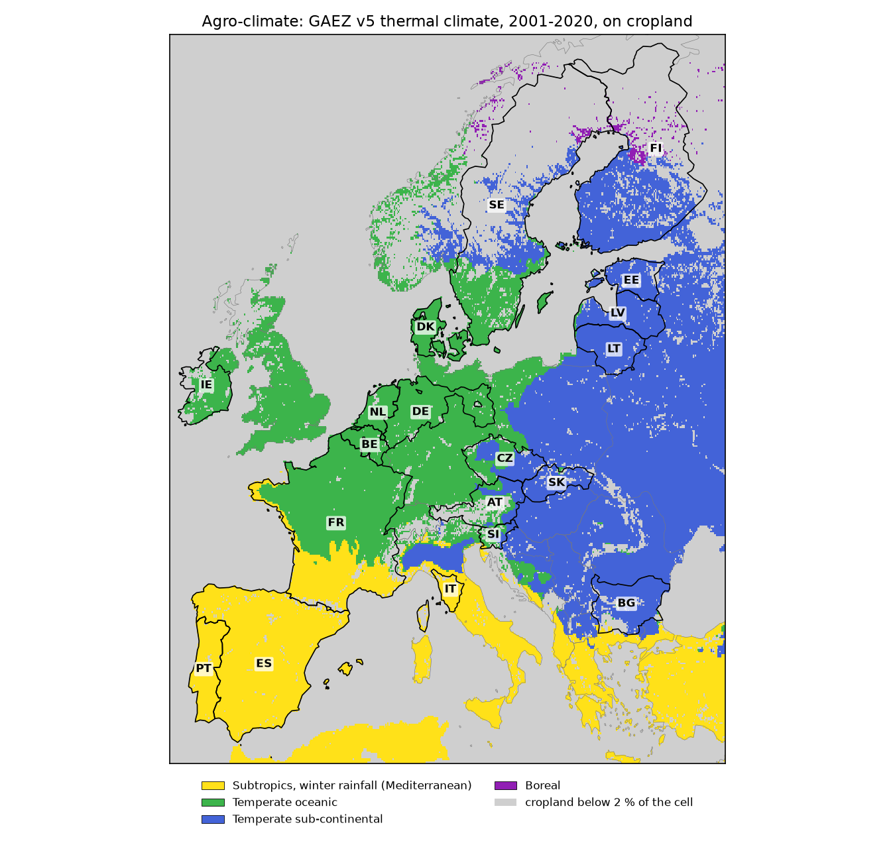
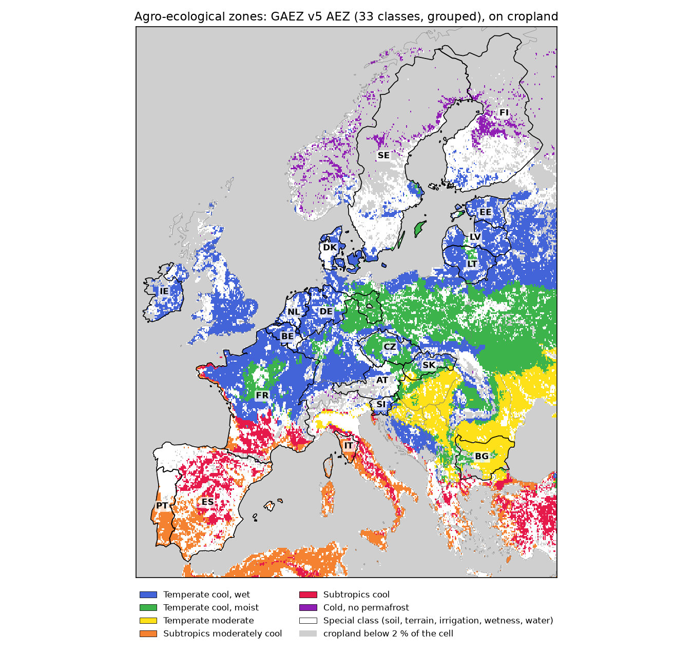
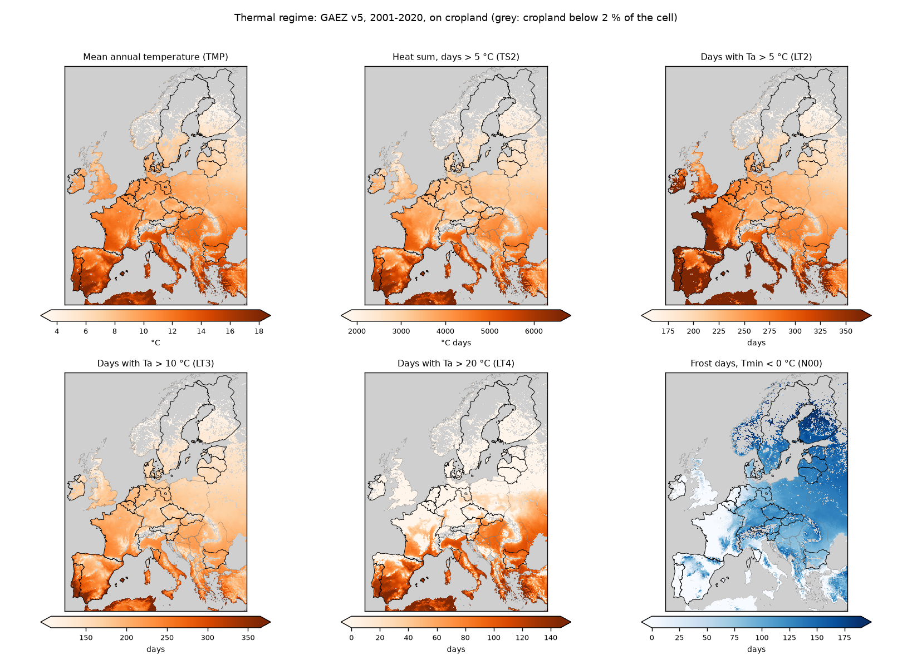
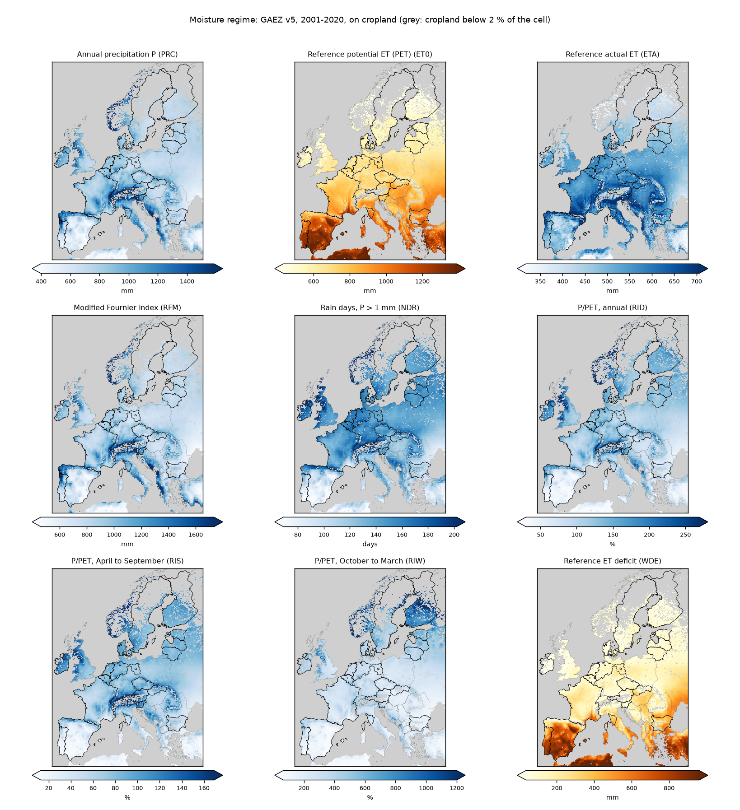
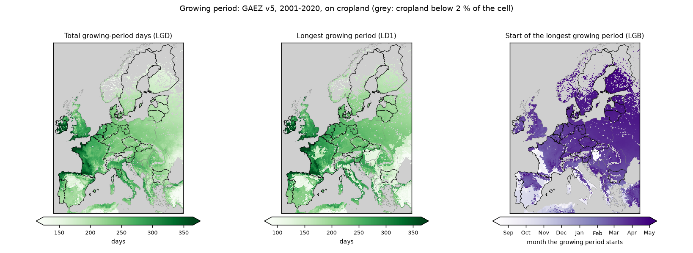

# Spatial transferability: experimental set-up

Draft of 30 October 2026, for discussion. Nothing here is decided yet; the open points are listed at the end.

**The idea in one sentence.** Each model is trained in one country with all of that country's labels (K = 100 %)
and then used, unchanged, in every other country. How much its score drops says how well it travels. The climate
of the two countries says whether climate is the reason.

## The questions

| | Question | In plain words |
|---|---|---|
| **Q1** | How much does a model lose when it is used in a country it was not trained in? | Train in Estonia, test in France: how far below a model trained in France does it score? |
| **Q2** | Is the loss larger between countries with different climates? | Two readings: **Q2a**, do countries in the same GAEZ zone lose less than countries in different zones? **Q2b**, which climate metrics does the loss follow? For each GAEZ metric of climate class, thermal regime, moisture regime and growing period: does the loss grow as the two countries differ more in it, and does it predict the loss better than plain distance in km? |
| **Q3** | Do the foundation models lose less than the U-Net trained from scratch? | Is a frozen GFM easier to carry to a new country than a model that learned everything from one country's labels? |

## How we answer them

### What is trained and what is tested

- **Countries.** The EuroCrops countries with labels for 2021, one year for all, so that no country is a different
  season (19 candidates, listed under Zones below).
- **The same pipeline in every country**, as it runs for Estonia now: 2.24 km chips, twelve monthly Sentinel-2 and
  Sentinel-1 composites, and blocks of 4 x 4 chips split into training, validation and test blocks.
- **The same six models** as the main workflow: TerraMind, THOR, Prithvi, TESSERA v2, AlphaEarth, all frozen
  with a trained decoder, and the U-Net trained from scratch as the baseline.
- **One training run per model and country**, on that country's training blocks with all labels (K = 100 %),
  with the same 45 epochs and checkpoint rule as the main workflow.
- **Each trained model is then tested on the test blocks of every country**, its own included. Testing in another
  country needs no new training, only prediction.

With 19 countries that is 6 x 19 = 114 training runs per seed, and 19 x 19 = 361 scores per model.

### The same crops in every country

All countries use **one fixed crop list**, set before any result. A crop counts in a score only if both the
training country and the test country grow it. The list itself is still open (see the end).

### The scores

- **Score:** Macro-F1 per pixel (main) and per parcel, as in the in-country results.
- **Home score:** the score of a model trained and tested in the same country (the diagonal of the matrix).
- **Loss** of a model trained in country A and tested in country B:

  > loss = 1 − (score of the A model in B) / (score of the B model in B)

  0 means nothing is lost; 0.30 means it reaches 30 % less than a model trained in B itself. Comparing with B's
  own model keeps a country that is simply hard to map from looking like a failure to travel.

### The climate of each country

All measured on each country's **cropland only**, with the GAEZ v5 layers (FAO and IIASA):

- **Zones, for Q2a.** Two GAEZ layers, shown in the maps below:
  - **Agro-climate:** the GAEZ thermal climate. It groups countries by temperature, season length and how
    continental the climate is.
  - **Agro-ecological zone (AEZ):** the 33-class GAEZ zones, which combine temperature, moisture and soil.
  "Same zone" is then counted on each layer separately.
- **Climate metrics, for Q2b.** 18 GAEZ metrics from the four GAEZ agro-climatic sub-themes: climate
  classification, thermal regime, moisture regime and growing period. Each country gets one value per metric, the
  average over its cropland. They are listed, mapped and explained under
  [What the loss is correlated with](#what-the-loss-is-correlated-with).
- **Distance in km**, between the centres of the two countries' cropland, to compare with.

### What we look at, per question

| Question | Output |
|---|---|
| Q1 | One coloured matrix per model, home scores on the diagonal, and the same matrix as loss |
| Q2a | Average loss over pairs in the same zone against pairs in different zones, per model, once for the agro-climate and once for the AEZ |
| Q2b | Per model, the correlation between the loss and the difference in each climate metric, and in km (the correlation table at the end). A scatter plot with one point per pair of countries for the strongest metric of each sub-theme. Every correlation is checked with a permutation test, needed because the pairs share countries |
| Q3 | The same figures with all models side by side, and a matrix of "GFM loss minus U-Net loss" per pair: negative cells are pairs where the GFM travels better |

Every training run is repeated with three seeds, and every score gets an interval by resampling the test blocks.

## Zones of the candidate countries

The two GAEZ layers on cropland, with the candidate countries outlined (`gaez_domains.py` draws them; grey is land
with less than 2 % cropland):

| Agro-climate (GAEZ thermal climate) | Agro-ecological zones (GAEZ AEZ, 33 classes grouped) |
|---|---|
|  |  |

**Colour key**, the same as the maps:

- Agro-climate: 🟩 temperate oceanic · 🟦 temperate sub-continental · 🟨 subtropics with winter rain
  (Mediterranean)
- AEZ: 🔵 temperate cool, wet · 🟢 temperate cool, moist · 🟡 temperate moderate · 🟠 subtropics moderately cool ·
  🔴 subtropics cool · ⚪ special class, where soil, terrain, irrigation or wetness overrides the climate

Per country, in % of its cropland. "AEZ" gives the main climatic zone, with the special classes set aside; their
share is the next column. The last four columns are four of the climate metrics of the next section.

| Country | 2021 labels from | Agro-climate | AEZ | Special class | Heat sum > 5 °C (°C days) | Days > 5 °C | Growing-period days | Precipitation (mm) |
|---|---|---|---|---|---|---|---|---|
| **FI** | v2 | 🟦 96 % | 🔵 61 % | ⚪ 72 % | 2,183 | 172 | 172 | 710 |
| **EE** | v11 (in use), v2 | 🟦 100 % | 🔵 99 % | ⚪ 14 % | 2,472 | 189 | 189 | 746 |
| **LV** | v11 (chips exported) | 🟦 97 % | 🔵 95 % | ⚪ 27 % | 2,665 | 200 | 200 | 743 |
| **LT** | v11 (cereals unnamed) | 🟦 100 % | 🔵 82 % | ⚪ 19 % | 2,819 | 209 | 209 | 732 |
| **CZ** | v2 | 🟦 61 % | 🟢 73 % | ⚪ 13 % | 3,219 | 234 | 233 | 760 |
| **AT** | v11, v2 | 🟦 75 % | 🟢 52 % | ⚪ 36 % | 3,507 | 246 | 243 | 902 |
| **SK** | v11, v2 | 🟦 100 % | 🟢 60 % | ⚪ 18 % | 3,670 | 247 | 238 | 761 |
| **SI** | v11, v2 | 🟦 74 % | 🔵 53 % | ⚪ 21 % | 3,813 | 260 | 260 | 1,086 |
| **BG** | v2 | 🟦 99 % | 🟡 94 % | ⚪ 5 % | 4,458 | 277 | 214 | 696 |
| **SE** | v11 | 🟩 67 % | 🔵 77 % | ⚪ 61 % | 2,569 | 204 | 204 | 748 |
| **DK** | v2 | 🟩 100 % | 🔵 99 % | ⚪ 38 % | 2,924 | 238 | 238 | 821 |
| **DE** | v11, v2 (three Länder) | 🟩 100 % | 🔵 67 % | ⚪ 23 % | 3,358 | 252 | 252 | 803 |
| **BE** | v11, v2 | 🟩 100 % | 🔵 100 % | ⚪ 16 % | 3,489 | 275 | 274 | 854 |
| **NL** | v2 | 🟩 100 % | 🔵 100 % | ⚪ 51 % | 3,504 | 275 | 275 | 862 |
| **IE** | v2 | 🟩 100 % | 🔵 100 % | ⚪ 20 % | 3,530 | 353 | 353 | 973 |
| **FR** | v2 | 🟩 81 % | 🔵 66 % | ⚪ 19 % | 4,043 | 308 | 288 | 860 |
| **ES** | v2 | 🟨 100 % | 🔴 61 % | ⚪ 52 % | 5,106 | 337 | 205 | 563 |
| **IT** | v2 (Tuscany only) | 🟨 100 % | 🟠 85 % | ⚪ 18 % | 5,348 | 356 | 279 | 930 |
| **PT** | v11 (a sample), v2 | 🟨 100 % | 🟠 97 % | ⚪ 38 % | 5,816 | 362 | 226 | 670 |

Germany is Brandenburg, Lower Saxony and North Rhine-Westphalia; Belgium is Flanders and Wallonia; Portugal, Spain
and France are their mainland. v11 is the EuroCrops release the pipeline uses; v2 the 2026 multi-year release
(`eurocrops_coverage.md`).

**What the zones show:**

1. **The agro-climate makes three clear groups:**
   - the oceanic west 🟩;
   - the sub-continental east and north 🟦, where the Baltics sit with Finland, Czechia, Slovakia, Austria,
     Slovenia and Bulgaria;
   - the Mediterranean south 🟨.
2. **The AEZ puts the Baltics in the same zone as most of the oceanic west** (temperate cool, wet 🔵). By AEZ,
   Estonia and France are "the same zone"; by agro-climate they are not. The two GAEZ layers disagree on which pairs
   are close, which is why both are reported and why a continuous climate distance is needed beside them.
3. **The special classes hide the climate in the AEZ for some countries.** Soil, terrain, irrigation or wetness
   cover 61 to 72 % of the cropland of Sweden and Finland, and about half of the Netherlands and Spain.
4. **Heat is the long axis.** The heat sum runs from 2,200 °C days in Finland to 5,800 in Portugal.
5. **The Mediterranean countries also differ in water.** Their growing period is about 80 to 135 days shorter than their
   warm season.

## What the loss is correlated with

The study aims to find **how strongly the loss follows each of the climate metrics below**. They are the GAEZ v5
agro-climatic layers (FAO and IIASA), in the four sub-themes GAEZ groups them in, each averaged over every
country's cropland.

| GAEZ sub-theme | What it describes (GAEZ's description, shortened) | Metrics used (GAEZ code) |
|---|---|---|
| **Climate classification** | Climate classes that guide which crops fit and feed the AEZ. The thermal climates, from monthly temperatures reduced to sea level, are the major latitudinal climate zones | The thermal climate (MCL), i.e. the agro-climate, mapped [above](#zones-of-the-candidate-countries) |
| **Thermal regime** | Mean annual temperature, annual temperature amplitude, and the temperature profile: how warm the climate is and how seasonal | Mean annual temperature (TMP); heat sum above 5 °C (TS2); days above 5, 10 and 20 °C (LT2, LT3, LT4); frost days, minimum temperature below 0 °C (N00) |
| **Moisture regime** | Annual precipitation (P); reference potential evapotranspiration (PET, Penman-Monteith); reference actual evapotranspiration from a daily water balance; how unevenly the rain falls over the year (modified Fournier index); rain days (P above 1 mm); annual and seasonal P/PET; the evapotranspiration deficit, a sign of water scarcity and a rough irrigation need | P (PRC); PET (ET0); actual evapotranspiration (ETA); modified Fournier index (RFM); rain days (NDR); P/PET over the year (RID), April to September (RIS) and October to March (RIW); deficit (WDE) |
| **Growing period** | The length of the growing period (LGP): the days when the mean temperature is above 5 °C and soil moisture lets a reference crop grow, from a daily water balance | Total growing-period days (LGD); the longest unbroken growing period (LD1) and the day it starts (LGB) |

Notes on the choice:

- **Annual temperature amplitude** is not among the GAEZ v5 layers. It can be computed from AgERA5 monthly mean
  temperatures (warmest minus coldest month); not done yet. The **temperature profile** is represented by the days
  above 5, 10 and 20 °C and the frost days.
- **Left out** to keep the list short; they can be added: days above 35 °C (about 0 on the cropland of every
  country but Spain, where it is 2), the quarterly P/PET ratios, the frost indices.
- GAEZ's catalogue files the heat sum under moisture regime and the deficit under thermal regime; here they follow
  the descriptions above.

### How the correlation is measured

1. **One value per country and metric:** the average over the country's cropland, weighted by GAEZ's cropland share.
   The start date is averaged around the calendar, so that December and January count as close. For the thermal
   climate, a country is its mix of classes.
2. **One difference per pair:** for a model trained in A and tested in B, how much A and B differ in the metric, in
   the metric's own unit (for the start date, in days around the calendar). For the thermal climate, the share of
   cropland on which the two class mixes do not overlap: 0 for the same mix, 1 for no class in common.
3. **One correlation per model and metric:** the loss of the 342 pairs against their difference, as a Spearman
   correlation ρ. Spearman works on ranks, so it does not assume a straight line. ρ near +1: the more the two
   countries differ in this metric, the more the model loses. ρ near 0: the metric says nothing about the loss.
4. **Is it real?** A permutation test: the country names are shuffled many times and ρ is recomputed each time (a
   Mantel test). Pairs that share a country are not independent, so the usual test would be too optimistic.
5. **Climate or distance?** Countries far apart usually differ in climate as well. The same correlation is computed
   for km, and each metric again after taking out what km explains (a partial Mantel test).
6. **One number per sub-theme:** the metrics of a sub-theme are put on a common scale and combined into one
   difference per pair, which gives one ρ per sub-theme as well.
7. **Direction:** the matrix is not symmetric, since EE to PT and PT to EE can lose different amounts. With signed
   differences (for example, tested in a warmer country than trained in), the same test says whether moving to a
   warmer or drier country costs more than the reverse.

The maps and values below are the GAEZ 2001 to 2020 averages. GAEZ also publishes every one of these metrics for
single years (2021 checked for all), so the analysis can use 2021 itself, the year of the images.

### The metrics on the map

Each panel has its own colour scale, from the 2nd to the 98th percentile of the cropland in the window; countries of
the matrix are outlined.

**Thermal regime.** Orange: warmer; blue: more frost days.

**Moisture regime.** Blue: water supply; brown: water demand and deficit.

**Growing period.** The start is counted from 1 July, so autumn starts are light and spring starts dark.

Range among the 19 countries, with Estonia for reference (every value per country: `gaez_metrics.csv`):

| Sub-theme | Metric | Unit | Lowest | Highest | EE |
|---|---|---|---|---|---|
| Thermal regime | Mean annual temperature (TMP) | °C | 4.8 FI | 16 PT | 6.2 |
| | Heat sum above 5 °C (TS2) | °C days | 2,183 FI | 5,816 PT | 2,472 |
| | Days above 5 °C (LT2) | days | 172 FI | 362 PT | 189 |
| | Days above 10 °C (LT3) | days | 125 FI | 313 PT | 140 |
| | Days above 20 °C (LT4) | days | 0, nine countries | 110 PT | 0 |
| | Frost days (N00) | days | 0 IE | 171 FI | 147 |
| Moisture regime | Precipitation (PRC) | mm | 563 ES | 1,086 SI | 746 |
| | PET (ET0) | mm | 474 FI | 1,215 ES | 539 |
| | Actual evapotranspiration (ETA) | mm | 403 FI | 684 SI | 448 |
| | Modified Fournier index (RFM) | mm, as GAEZ gives it | 667 ES | 1,152 SI | 799 |
| | Rain days (NDR) | days | 86 PT | 169 IE | 151 |
| | P/PET, year (RID) | % | 49 ES | 174 IE | 138 |
| | P/PET, April to September (RIS) | % | 22 PT | 110 IE | 87 |
| | P/PET, October to March (RIW) | % | 122 ES | 915 FI | 563 |
| | Evapotranspiration deficit (WDE) | mm | 10 IE | 738 ES | 91 |
| Growing period | Total growing-period days (LGD) | days | 172 FI | 353 IE | 189 |
| | Longest unbroken growing period (LD1) | days | 144 BG | 353 IE | 189 |
| | Start of the longest growing period (LGB) | date | 14 Sep IT (earliest) | 27 Apr SK (latest) | 16 Apr |

**What the metrics show:**

1. **Many metrics move together, so the 18 carry about five separate signals.** Spearman correlation between the
   differences of two metrics, over the 171 pairs of countries (`gaez_metrics_correlation.csv`):
   - warmth: mean temperature, heat sum and days above 10 °C, ρ = 0.95; PET and the start of the growing period
     follow them (0.72 to 0.83);
   - summer dryness: annual and summer P/PET, the deficit and rain days (0.74 to 0.88), joined by days above 20 °C;
   - amount of rain: precipitation and the Fournier index (0.84);
   - length of the growing period (LGD and LD1, 0.77 with each other), nearly independent of warmth (0.07 to 0.21);
   - winter cold: frost days and days above 5 °C (0.70).

   Winter P/PET and actual evapotranspiration relate only loosely to the rest (0.58 at most). With 19 countries,
   a correlation of the loss with one metric cannot be told apart from one with the other metrics of its family,
   so results are read per family.
2. **Warmer does not mean a longer growing period.** Portugal and Spain have the most warm days but growing periods
   of 205 to 226 days, shorter than Belgium's 274: summer drought ends the season, and the deficit reaches about
   700 mm there against about 100 mm in the Baltics. Because the two hardly correlate, the study can tell "warmer"
   apart from "longer season".
3. **The Mediterranean growing period starts in autumn:** about mid-September in Tuscany, mid-October in Portugal
   and late November in Spain, against late February (France) to late April (Finland, Slovakia) everywhere else.
   This is the crop-calendar shift that the literature finds to be the main cause of loss across climates
   (`transfer_literature.md`). Our models see fixed calendar months, so it should show in the loss.
4. **Some growing periods are split in two.** In Bulgaria the longest unbroken growing period is 144 of its 214
   growing-period days, in Slovakia 197 of 238: a summer dry spell cuts the season.

## The matrix we will get

One per model, per pixel and per parcel. Rows: the country the model was trained in. Columns: the country it is
tested in. Countries are ordered by agro-climate, then from cold to warm. **◆** is the home score; **·** is a score
abroad. If climate matters, the blocks of the same colour along the diagonal score higher than the rest.

| trained in ↓ · tested in → | 🟦 FI | 🟦 EE | 🟦 LV | 🟦 LT | 🟦 CZ | 🟦 AT | 🟦 SK | 🟦 SI | 🟦 BG | 🟩 SE | 🟩 DK | 🟩 DE | 🟩 BE | 🟩 NL | 🟩 IE | 🟩 FR | 🟨 ES | 🟨 IT | 🟨 PT |
|---|:-:|:-:|:-:|:-:|:-:|:-:|:-:|:-:|:-:|:-:|:-:|:-:|:-:|:-:|:-:|:-:|:-:|:-:|:-:|
| 🟦 **FI** | ◆ | · | · | · | · | · | · | · | · | · | · | · | · | · | · | · | · | · | · |
| 🟦 **EE** | · | ◆ | · | · | · | · | · | · | · | · | · | · | · | · | · | · | · | · | · |
| 🟦 **LV** | · | · | ◆ | · | · | · | · | · | · | · | · | · | · | · | · | · | · | · | · |
| 🟦 **LT** | · | · | · | ◆ | · | · | · | · | · | · | · | · | · | · | · | · | · | · | · |
| 🟦 **CZ** | · | · | · | · | ◆ | · | · | · | · | · | · | · | · | · | · | · | · | · | · |
| 🟦 **AT** | · | · | · | · | · | ◆ | · | · | · | · | · | · | · | · | · | · | · | · | · |
| 🟦 **SK** | · | · | · | · | · | · | ◆ | · | · | · | · | · | · | · | · | · | · | · | · |
| 🟦 **SI** | · | · | · | · | · | · | · | ◆ | · | · | · | · | · | · | · | · | · | · | · |
| 🟦 **BG** | · | · | · | · | · | · | · | · | ◆ | · | · | · | · | · | · | · | · | · | · |
| 🟩 **SE** | · | · | · | · | · | · | · | · | · | ◆ | · | · | · | · | · | · | · | · | · |
| 🟩 **DK** | · | · | · | · | · | · | · | · | · | · | ◆ | · | · | · | · | · | · | · | · |
| 🟩 **DE** | · | · | · | · | · | · | · | · | · | · | · | ◆ | · | · | · | · | · | · | · |
| 🟩 **BE** | · | · | · | · | · | · | · | · | · | · | · | · | ◆ | · | · | · | · | · | · |
| 🟩 **NL** | · | · | · | · | · | · | · | · | · | · | · | · | · | ◆ | · | · | · | · | · |
| 🟩 **IE** | · | · | · | · | · | · | · | · | · | · | · | · | · | · | ◆ | · | · | · | · |
| 🟩 **FR** | · | · | · | · | · | · | · | · | · | · | · | · | · | · | · | ◆ | · | · | · |
| 🟨 **ES** | · | · | · | · | · | · | · | · | · | · | · | · | · | · | · | · | ◆ | · | · |
| 🟨 **IT** | · | · | · | · | · | · | · | · | · | · | · | · | · | · | · | · | · | ◆ | · |
| 🟨 **PT** | · | · | · | · | · | · | · | · | · | · | · | · | · | · | · | · | · | · | ◆ |

The summary for Q1, Q2a and Q3, one row per model:

| Model | Home score, mean | Loss abroad, mean | Loss, same agro-climate | Loss, other agro-climate | Loss, same AEZ | Loss, other AEZ |
|---|---|---|---|---|---|---|
| TerraMind v1 large | | | | | | |
| THOR v1 large | | | | | | |
| Prithvi-EO-2.0 600M | | | | | | |
| TESSERA v2 | | | | | | |
| AlphaEarth v1 | | | | | | |
| U-Net from scratch (baseline) | | | | | | |

And the correlations for Q2b: ρ between the loss and the difference in each metric, one column per model (per
pixel; the same table per parcel). Each cell will also say whether the permutation test holds after correcting for
the number of tests.

| Sub-theme | Metric | TerraMind | THOR | Prithvi | TESSERA v2 | AlphaEarth | U-Net |
|---|---|:-:|:-:|:-:|:-:|:-:|:-:|
| Climate classification | Thermal climate (MCL) | · | · | · | · | · | · |
| Thermal regime | Mean annual temperature (TMP) | · | · | · | · | · | · |
| | Heat sum above 5 °C (TS2) | · | · | · | · | · | · |
| | Days above 5 °C (LT2) | · | · | · | · | · | · |
| | Days above 10 °C (LT3) | · | · | · | · | · | · |
| | Days above 20 °C (LT4) | · | · | · | · | · | · |
| | Frost days (N00) | · | · | · | · | · | · |
| | **Thermal regime, combined** | · | · | · | · | · | · |
| Moisture regime | Precipitation (PRC) | · | · | · | · | · | · |
| | PET (ET0) | · | · | · | · | · | · |
| | Actual evapotranspiration (ETA) | · | · | · | · | · | · |
| | Modified Fournier index (RFM) | · | · | · | · | · | · |
| | Rain days (NDR) | · | · | · | · | · | · |
| | P/PET, year (RID) | · | · | · | · | · | · |
| | P/PET, April to September (RIS) | · | · | · | · | · | · |
| | P/PET, October to March (RIW) | · | · | · | · | · | · |
| | Evapotranspiration deficit (WDE) | · | · | · | · | · | · |
| | **Moisture regime, combined** | · | · | · | · | · | · |
| Growing period | Total growing-period days (LGD) | · | · | · | · | · | · |
| | Longest unbroken growing period (LD1) | · | · | · | · | · | · |
| | Start of the longest growing period (LGB) | · | · | · | · | · | · |
| | **Growing period, combined** | · | · | · | · | · | · |
| Reference | Distance in km | · | · | · | · | · | · |

## Cost, roughly

- **Training.** One model on all of Estonia at three budgets took 2 to 4 GPU-hours on the cluster, feature caches
  included. One run at K = 100 % on a country of Estonia's size is about 1 to 1.5 hours. That makes 114 runs per
  seed, a few weeks of the shared cluster for three seeds. France and Spain are many times Estonia's size, which
  is why a fixed-size sample of whole blocks per country is one of the open choices.
- **Data** is the larger cost. Latvia's 11,500 chips took five days to export on the hub. Every new country needs
  its chips, its AlphaEarth tiles and its split.

## Open before this becomes a protocol

1. **The crop list.** A draft exists; whether cereals are kept by species or only by sowing season is open.
2. **Which countries.** All 19, or a subset that still covers the three agro-climate groups and the heat gradient.
3. **How much of each country.** The whole country, or a fixed-size sample of whole blocks.
4. **Label source per country.** v11 or v2, which use different HCAT versions. Whether v2 Portugal is complete is
   unchecked.
5. **Climate values.** GAEZ 2001 to 2020 averages (as above) or GAEZ's 2021 layers (planned).
6. **Which metrics.** All 18, or one or two per family chosen beforehand. Testing 18 metrics for six models will
   find some correlations by chance, so either the tests are corrected for their number or the list is cut first.
   Annual temperature amplitude: compute it from AgERA5, or leave it out.
7. **The rule of 2 October**, "transfer only within one GAEZ zone", turns from a filter into something the
   experiment measures. To be confirmed.
8. **Seeds.** One seed first, three for the final grid.

**Kept for later:**
- training on small anchor regions and testing at growing distance, across borders;
- label-saving curves (a source country plus K target labels) on a few pairs;
- other years.

## Files

- `gaez_domains.py` computes everything in the zone section: `poetry run python docs/research/transferability/gaez_domains.py`.
- `gaez_domains.csv` holds the per-country summary; `gaez_domains_aez33_detail.csv` the share of every AEZ class.
- `gaez_metrics.py` computes the climate metrics section: `poetry run python docs/research/transferability/gaez_metrics.py`.
  It writes `gaez_metrics.csv` (every metric per country) and `gaez_metrics_correlation.csv` (how the metrics'
  differences correlate with each other).
- `figures/` holds the two zone maps and the three metric panels.
- GAEZ inputs: `data/gaez/v5/` (with `SOURCES.txt`). Country outlines: Eurostat GISCO NUTS 2021 in `data/gisco/`.
