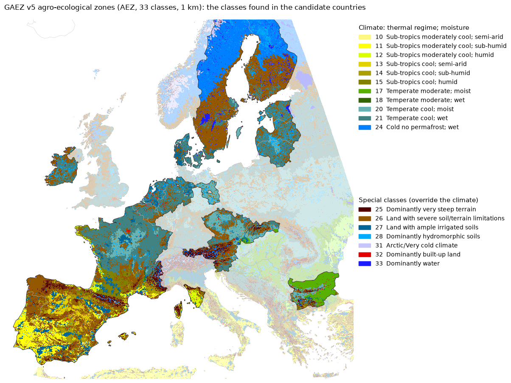
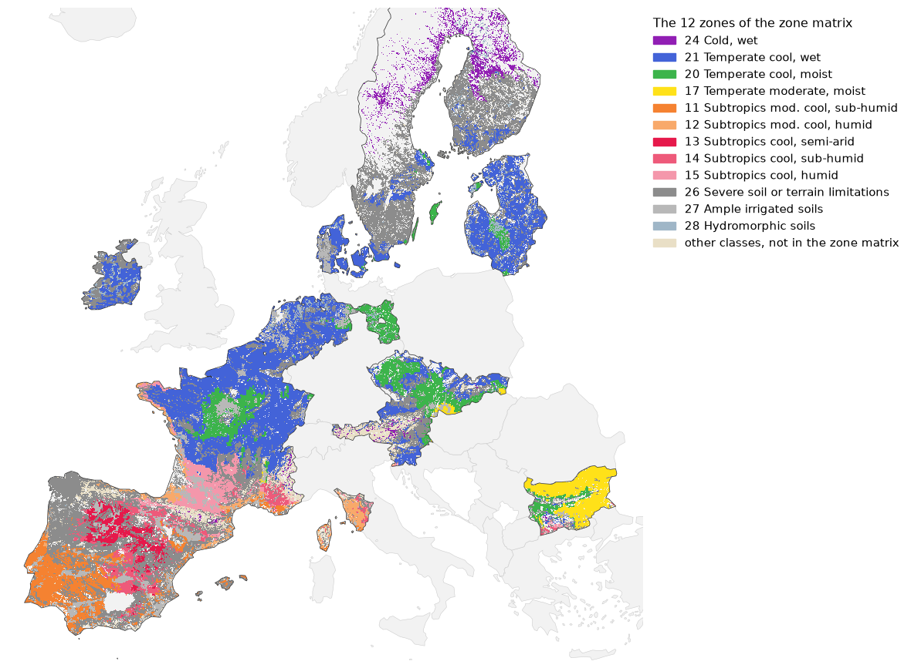
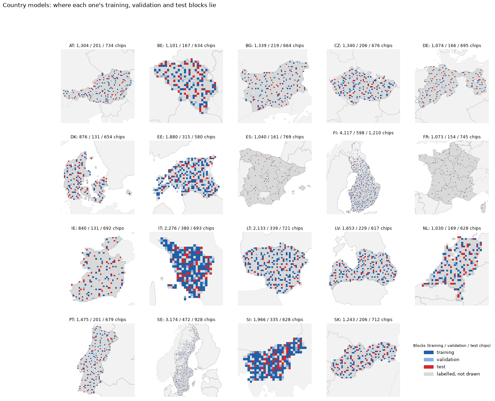
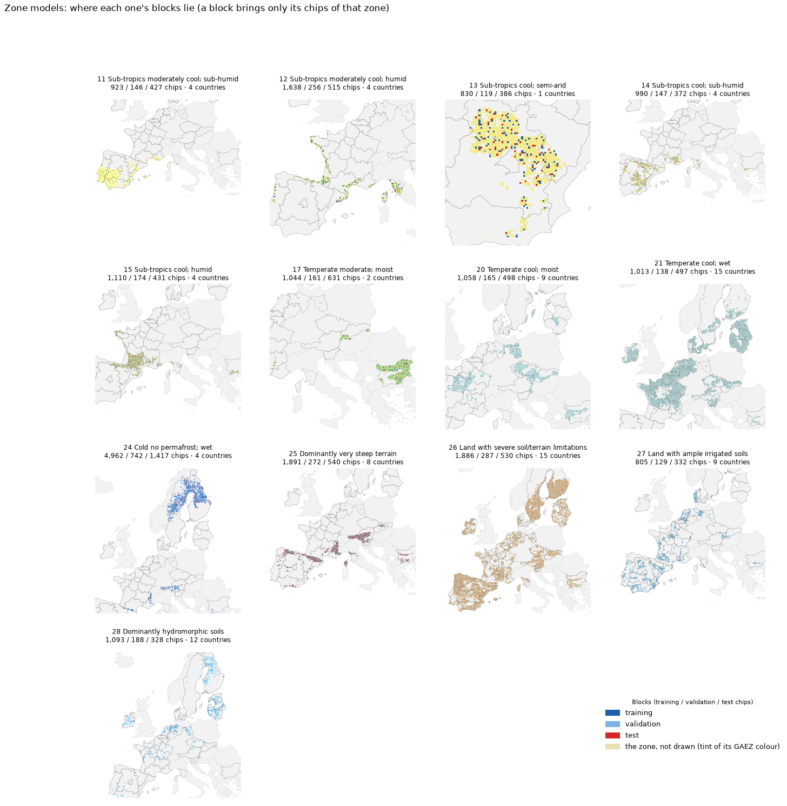
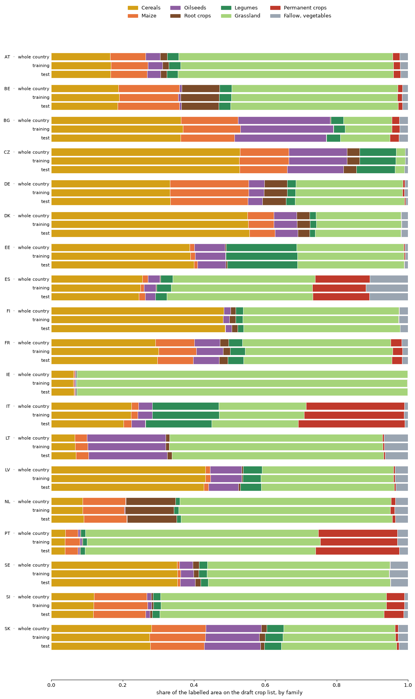
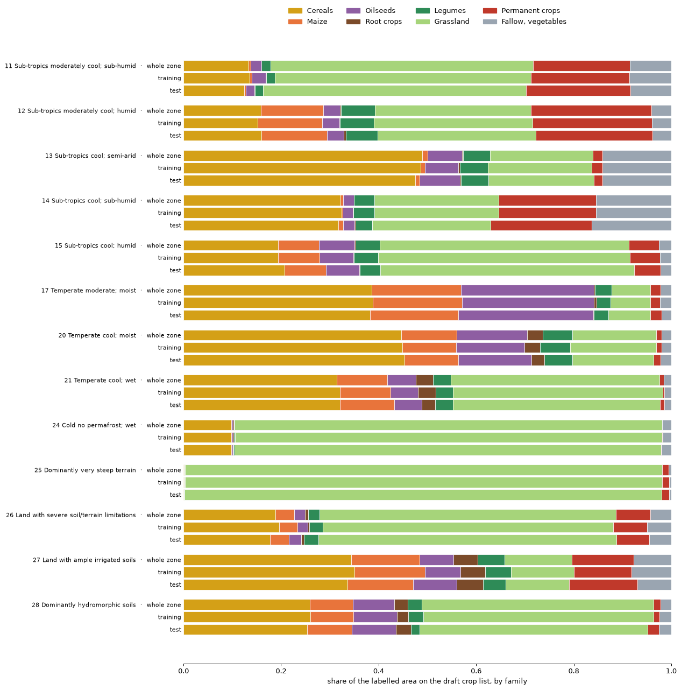

# Spatial transferability: experimental set-up

Agreed with the user on 5 and 6 November 2026. The alternatives considered and the evidence behind each choice are
in [transfer_plan.md](transfer_plan.md). AlphaEarth is left out for now.

The experiment trains one model in every country and one in every agro-ecological zone, each on the same amount of
labels, and tests every model in every other country and zone. How much a model loses away from home indicates
whether transfer is limited by national borders or by climate.

## The questions

| | Question | Matrix |
|---|---|---|
| **Q1** | How much does a model lose in a country it was not trained in? | country × country |
| **Q2** | Does the loss follow climate? Is it smaller within a GAEZ zone than across zones, and which climate differences does it track once distance is accounted for? | country × country, zone × zone |
| **Q3** | Does a model trained on a whole zone, across national borders, hold up within that zone, and can it replace a national model? | zone × zone, country × zone |
| **Q4** | Do the frozen foundation models lose less than the U-Net trained from scratch? | all three |

## Countries and zones

The study covers 19 countries with labels for 2021: AT, BE (Flanders, Wallonia), BG, CZ, DE (Brandenburg, Lower
Saxony, North Rhine-Westphalia), DK, EE, ES and FR (mainland), FI, IE, IT (Tuscany), LT, LV, NL, PT (mainland), SE,
SI and SK. The labels come from EuroCrops v2 where a region has 2021, and from v11 otherwise (EE, LV, LT, SE, Lower
Saxony).

The zones are the GAEZ v5 agro-ecological zones (33 classes at 1 km), used exactly as GAEZ maps them. A class
describes a climate, as a thermal regime crossed with a moisture regime, unless a soil, terrain or irrigation
condition applies, in which case that condition names the class (a special class). The map shows the classes found
in the 19 countries:

Twelve of these classes have enough labelled land for a model and at least four crop species that each cover 1 %
or more:

| Zone | Kind | Training land from |
|---|---|---|
| 🟣 24 Cold, wet | climate | FI 48 %, SE 42 %, AT 5 %, FR 3 % |
| 🔵 21 Temperate cool, wet | climate | 15 countries, FR 37 %, DE 8 %, LT 7 %, EE 6 % … |
| 🟢 20 Temperate cool, moist | climate | 9 countries, FR 31 %, CZ 21 %, DE 16 %, BG 11 % … |
| 🟡 17 Temperate moderate, moist | climate | BG 92 %, SK 7 % |
| 🟠 11 Subtropics moderately cool, sub-humid | climate | ES 60 %, PT 34 %, FR 4 %, IT 2 % |
| 🟠 12 Subtropics moderately cool, humid | climate | FR 53 %, IT 28 %, ES 14 %, PT 6 % |
| 🔴 13 Subtropics cool, semi-arid | climate | ES 100 % |
| 🔴 14 Subtropics cool, sub-humid | climate | ES 74 %, FR 17 %, IT 6 %, PT 3 % |
| 🔴 15 Subtropics cool, humid | climate | FR 85 %, ES 12 %, IT 2 %, BG 1 % |
| ⚪ 26 Severe soil or terrain limitations | special | 15 countries, ES 25 %, SE 15 %, FI 14 %, FR 11 % … |
| ⚪ 27 Ample irrigated soils | special | 9 countries, ES 41 %, FR 26 %, NL 10 %, DK 8 % … |
| ⚪ 28 Hydromorphic (waterlogged) soils | special | 12 countries, FI 22 %, DE 14 %, LT 13 %, FR 10 % … |

The next map places the 12 zones on the chips of the 19 countries, in the colours used in the matrices below,
with the special classes in greys:

Every block also carries the climate beneath it as a tag, so that the results of a special zone can be read by
climate. The crop-calendar zones of ESA WorldCereal are not used for training; they only tag the country pairs in
Q2.

## Sample strategy

1. All 46 million parcels of the 2021 labels are summed per block (4 × 4 chips, 8.96 km) before any imagery is
   downloaded.
2. A quarter of all blocks, fixed by position, are test blocks and the rest are training blocks, for every model
   alike, so that no model trains on a chip on which any model is tested. As in the main workflow, a 1,600 m buffer
   separates test land from training land.
3. Every model receives the same amount of labels: 250,000 ha of labelled crop land for training and 37,500 ha for
   validation. A test set holds at least 50 blocks and at least 75,000 ha. The number of chips therefore depends on
   how densely a domain is labelled, from 805 to 4,962 training chips with a median of about 1,200.
4. Each sample is spread evenly over its domain and chosen so that its crop mix matches that of the domain. Training
   samples deviate from it by 0.1 to 3.0 % and test samples by 0.2 to 4.9 %, and no crop is more than 2.1 points
   off.
5. For training, a zone sample reuses the blocks drawn for the countries wherever they fall within the zone's own
   spread, so that each zone keeps its actual mix of countries; test sets are always drawn independently. Because a
   block usually contains two or three GAEZ classes, a zone sample consists of the zone's chips within the drawn
   blocks.

The maps show where each model's blocks lie: training in blue, validation in light blue, test in red and the
remaining labelled land in grey.

The bars give the crop mix of each model for the whole domain, its training sample and its test sample, by crop
family:

## Crop classes

The crop list has 21 species in 9 groups and was fixed before any result was seen: a crop is included if it covers
at least 0.5 % of the labelled land in at least two countries.

| Group | Species |
|---|---|
| Cereals | wheat, durum wheat, barley, rye, oats, triticale |
| Maize | maize |
| Oilseeds | rapeseed, sunflower, soy |
| Root crops | potatoes, sugar beet |
| Legumes | dry pulses, forage legumes |
| Grassland | grassland |
| Fallow | fallow |
| Vegetables and other arable crops | vegetables, buckwheat |
| Permanent crops | orchards, olive, vineyards |

A model learns a species where the labels name it and only the group where they do not, as for Lithuania's
"unspecified cereals", which cover 46 % of its labelled land. Land off the list is ignored in the same way as
unlabelled land; this concerns forest, land declared as "unknown" and crops that fail the rule, such as rice, flax
and poppy. The list retains 92 to 99 % of each country's labelled land, except in Portugal (70 %) and Tuscany (64 %),
where the remainder is forest and unknown land. The mapping of every HCAT name is in `crop_classes.csv`.

## Models and training

Four foundation models remain frozen, each with a trained decoder, as in the main workflow: TerraMind v1 large and
THOR v1 large on Sentinel-2 and Sentinel-1, Prithvi-EO-2.0 600M on Sentinel-2, and TESSERA v2 Medium on Sentinel-2
and Sentinel-1. Only the decoder learns. The baseline is a U-Net trained from scratch on Sentinel-2 and Sentinel-1,
in which every weight is learnt. Each model trains for 45 epochs, and the checkpoint of lowest validation loss on the
model's own domain is kept. The 31 domains (19 countries and 12 zones) and five models give 155 training runs, first
with one seed and, for the final run, with three.

## Scores

The main score is Macro-F1 per pixel, with Macro-F1 per parcel beside it. The main readout counts the species with
support on both sides, that is, at least 30 parcels in the training sample and at least 30 parcels in at least 5
test blocks. A second readout counts every species of the test set and scores 0 for a species the model never saw;
both readouts are repeated at the group level. The home score is the score of a domain's own model on its own test
set, and the loss of a model on a test set is

> loss = 1 − (its score) / (home score of the test set's own model)

A loss of 0 means that nothing is lost, and 0.30 a score 30 % below that of the test domain's own model; the
absolute drop is reported alongside. Every score receives an interval by resampling test blocks.

## The matrices we will get

Each matrix is produced per model, per pixel and per parcel, as scores and as losses. **◆** marks a home score,
**·** a zero-shot score, and **◐** a cell where the zone model has trained on that country's land and is therefore
not zero-shot.

**Colour key**, as in the zone map above: 🟣 cold, wet · 🔵 temperate cool, wet · 🟢 temperate cool, moist ·
🟡 temperate moderate, moist · 🟠 subtropics, moderately cool · 🔴 subtropics, cool · ⚪ special class (soil,
terrain, irrigation, wetness). Each country takes the colour of its main climate.

**1. Country × country (Q1, Q2).** The countries are ordered by main climate, from cold to warm. If climate
matters, the blocks of one colour along the diagonal will show the smallest losses.

| trained in ↓ · tested in → | 🟣 FI | 🟣 SE | 🔵 EE | 🔵 LV | 🔵 LT | 🔵 DK | 🔵 DE | 🔵 NL | 🔵 BE | 🔵 IE | 🔵 FR | 🔵 AT | 🔵 SI | 🔵 SK | 🟢 CZ | 🟡 BG | 🟠 IT | 🟠 PT | 🔴 ES |
|---|:-:|:-:|:-:|:-:|:-:|:-:|:-:|:-:|:-:|:-:|:-:|:-:|:-:|:-:|:-:|:-:|:-:|:-:|:-:|
| 🟣 **FI** | ◆ | · | · | · | · | · | · | · | · | · | · | · | · | · | · | · | · | · | · |
| 🟣 **SE** | · | ◆ | · | · | · | · | · | · | · | · | · | · | · | · | · | · | · | · | · |
| 🔵 **EE** | · | · | ◆ | · | · | · | · | · | · | · | · | · | · | · | · | · | · | · | · |
| 🔵 **LV** | · | · | · | ◆ | · | · | · | · | · | · | · | · | · | · | · | · | · | · | · |
| 🔵 **LT** | · | · | · | · | ◆ | · | · | · | · | · | · | · | · | · | · | · | · | · | · |
| 🔵 **DK** | · | · | · | · | · | ◆ | · | · | · | · | · | · | · | · | · | · | · | · | · |
| 🔵 **DE** | · | · | · | · | · | · | ◆ | · | · | · | · | · | · | · | · | · | · | · | · |
| 🔵 **NL** | · | · | · | · | · | · | · | ◆ | · | · | · | · | · | · | · | · | · | · | · |
| 🔵 **BE** | · | · | · | · | · | · | · | · | ◆ | · | · | · | · | · | · | · | · | · | · |
| 🔵 **IE** | · | · | · | · | · | · | · | · | · | ◆ | · | · | · | · | · | · | · | · | · |
| 🔵 **FR** | · | · | · | · | · | · | · | · | · | · | ◆ | · | · | · | · | · | · | · | · |
| 🔵 **AT** | · | · | · | · | · | · | · | · | · | · | · | ◆ | · | · | · | · | · | · | · |
| 🔵 **SI** | · | · | · | · | · | · | · | · | · | · | · | · | ◆ | · | · | · | · | · | · |
| 🔵 **SK** | · | · | · | · | · | · | · | · | · | · | · | · | · | ◆ | · | · | · | · | · |
| 🟢 **CZ** | · | · | · | · | · | · | · | · | · | · | · | · | · | · | ◆ | · | · | · | · |
| 🟡 **BG** | · | · | · | · | · | · | · | · | · | · | · | · | · | · | · | ◆ | · | · | · |
| 🟠 **IT** | · | · | · | · | · | · | · | · | · | · | · | · | · | · | · | · | ◆ | · | · |
| 🟠 **PT** | · | · | · | · | · | · | · | · | · | · | · | · | · | · | · | · | · | ◆ | · |
| 🔴 **ES** | · | · | · | · | · | · | · | · | · | · | · | · | · | · | · | · | · | · | ◆ |

**2. Zone × zone (Q2, Q3).** The zones whose models lose least outside their own zone are the most general; a
model that holds up only on the diagonal is bound to its zone.

| trained in ↓ · tested in → | 🟣 24 | 🔵 21 | 🟢 20 | 🟡 17 | 🟠 11 | 🟠 12 | 🔴 13 | 🔴 14 | 🔴 15 | ⚪ 26 | ⚪ 27 | ⚪ 28 |
|---|:-:|:-:|:-:|:-:|:-:|:-:|:-:|:-:|:-:|:-:|:-:|:-:|
| 🟣 **24** | ◆ | · | · | · | · | · | · | · | · | · | · | · |
| 🔵 **21** | · | ◆ | · | · | · | · | · | · | · | · | · | · |
| 🟢 **20** | · | · | ◆ | · | · | · | · | · | · | · | · | · |
| 🟡 **17** | · | · | · | ◆ | · | · | · | · | · | · | · | · |
| 🟠 **11** | · | · | · | · | ◆ | · | · | · | · | · | · | · |
| 🟠 **12** | · | · | · | · | · | ◆ | · | · | · | · | · | · |
| 🔴 **13** | · | · | · | · | · | · | ◆ | · | · | · | · | · |
| 🔴 **14** | · | · | · | · | · | · | · | ◆ | · | · | · | · |
| 🔴 **15** | · | · | · | · | · | · | · | · | ◆ | · | · | · |
| ⚪ **26** | · | · | · | · | · | · | · | · | · | ◆ | · | · |
| ⚪ **27** | · | · | · | · | · | · | · | · | · | · | ◆ | · |
| ⚪ **28** | · | · | · | · | · | · | · | · | · | · | · | ◆ |

**3. Country × zone (Q3), in both directions.** Country models tested on the zone test sets show how far a
national model reaches into each zone. Zone models tested on the country test sets show whether a cross-border zone
model can replace a national model: on a country marked ◐ it competes with that country's own model, and elsewhere it
is zero-shot.

| trained in (country) ↓ · tested in (zone) → | 🟣 24 | 🔵 21 | 🟢 20 | 🟡 17 | 🟠 11 | 🟠 12 | 🔴 13 | 🔴 14 | 🔴 15 | ⚪ 26 | ⚪ 27 | ⚪ 28 |
|---|:-:|:-:|:-:|:-:|:-:|:-:|:-:|:-:|:-:|:-:|:-:|:-:|
| 🟣 **FI** | ◐ | ◐ | · | · | · | · | · | · | · | ◐ | · | ◐ |
| 🟣 **SE** | ◐ | ◐ | ◐ | · | · | · | · | · | · | ◐ | ◐ | ◐ |
| 🔵 **EE** | · | ◐ | ◐ | · | · | · | · | · | · | ◐ | · | ◐ |
| 🔵 **LV** | · | ◐ | ◐ | · | · | · | · | · | · | ◐ | · | ◐ |
| 🔵 **LT** | · | ◐ | ◐ | · | · | · | · | · | · | ◐ | · | ◐ |
| 🔵 **DK** | · | ◐ | ◐ | · | · | · | · | · | · | ◐ | ◐ | ◐ |
| 🔵 **DE** | · | ◐ | ◐ | · | · | · | · | · | · | ◐ | ◐ | ◐ |
| 🔵 **NL** | · | ◐ | · | · | · | · | · | · | · | ◐ | ◐ | ◐ |
| 🔵 **BE** | · | ◐ | · | · | · | · | · | · | · | ◐ | · | · |
| 🔵 **IE** | · | ◐ | · | · | · | · | · | · | · | ◐ | · | ◐ |
| 🔵 **FR** | ◐ | ◐ | ◐ | ◐ | ◐ | ◐ | · | ◐ | ◐ | ◐ | ◐ | ◐ |
| 🔵 **AT** | ◐ | ◐ | ◐ | ◐ | · | · | · | · | · | ◐ | ◐ | ◐ |
| 🔵 **SI** | ◐ | ◐ | ◐ | ◐ | · | ◐ | · | · | ◐ | ◐ | ◐ | ◐ |
| 🔵 **SK** | ◐ | ◐ | ◐ | ◐ | · | · | · | · | · | ◐ | ◐ | ◐ |
| 🟢 **CZ** | · | ◐ | ◐ | · | · | · | · | · | · | ◐ | · | ◐ |
| 🟡 **BG** | ◐ | ◐ | ◐ | ◐ | · | · | · | ◐ | ◐ | ◐ | ◐ | · |
| 🟠 **IT** | · | · | · | · | ◐ | ◐ | · | ◐ | ◐ | ◐ | ◐ | ◐ |
| 🟠 **PT** | · | · | · | · | ◐ | ◐ | ◐ | ◐ | · | ◐ | ◐ | ◐ |
| 🔴 **ES** | ◐ | · | · | · | ◐ | ◐ | ◐ | ◐ | ◐ | ◐ | ◐ | ◐ |

The opposite direction, zone models on the 19 country test sets, uses the same grid transposed.

**The summary, one row per model:**

| Model | Home score, mean | Loss abroad: country × country | Loss, same zone / other zone | Loss off the diagonal: zone × zone | Zone model against the national model, on its own countries |
|---|---|---|---|---|---|
| TerraMind v1 large | | | | | |
| THOR v1 large | | | | | |
| Prithvi-EO-2.0 600M | | | | | |
| TESSERA v2 Medium | | | | | |
| U-Net from scratch (baseline) | | | | | |

**What the loss is correlated with (Q2).** Over the 342 country pairs, the loss is correlated (Spearman) with the
difference between the two countries in one metric per climate family, each metric chosen beforehand and measured on
the country's cropland in 2021 (GAEZ v5). Significance is tested by permutation (a Mantel test), repeated after
removing the effect of distance in km, and corrected for the number of tests.

| Family | Metric | Range over the 19 countries (2001 to 2020) | TerraMind | THOR | Prithvi | TESSERA v2 | U-Net |
|---|---|---|:-:|:-:|:-:|:-:|:-:|
| Warmth | Heat sum above 5 °C | 2,183 (FI) to 5,816 °C days (PT) | · | · | · | · | · |
| Summer dryness | P/PET, April to September | 22 % (PT) to 110 % (IE) | · | · | · | · | · |
| Rain | Annual precipitation | 563 (ES) to 1,086 mm (SI) | · | · | · | · | · |
| Season length | Growing-period days | 172 (FI) to 353 days (IE) | · | · | · | · | · |
| Winter cold | Frost days | 0 (IE) to 171 days (FI) | · | · | · | · | · |
| Crop calendar | ESA WorldCereal season start, winter cereals and maize | winter cereals from day 3 to day 318 | · | · | · | · | · |
| Reference | Distance in km | | · | · | · | · | · |

## Cost and status

The data amount to 65,139 chips, 49,373 for the countries and 15,766 more for the zones, or about 680 GB of
Sentinel-2 and Sentinel-1. The country samples have been downloading since 5 November 2026, with Estonia and Latvia
mostly on disk already; at the archive's pace the full set takes about two weeks, the zones following the countries.
Masks are rasterised once the imagery is in. Training comprises 155 runs per seed on 800 to 5,000 chips each, roughly
100 to 150 GPU-hours on the cluster.

AlphaEarth remains open, since its source tiles amount to up to 1.6 TB. Other years, and a source country combined
with a few target labels, are kept for later.

## Files

All in this folder, run from the repository root with `poetry run python docs/research/transferability/<script>`:
`label_blocks.py` (labels per block), `draw_samples.py` (the samples and their figures), `crop_classes.py` (the crop
classes), `zone_pools.py` and `aez_maps.py` (the zones and their maps), `gaez_metrics.py` (the climate metrics).
The export of the drawn chips: `scripts/hub/build_sample_chips.py`, into `data/eurocrops_chips/<CC>_2021_transfer/`.
