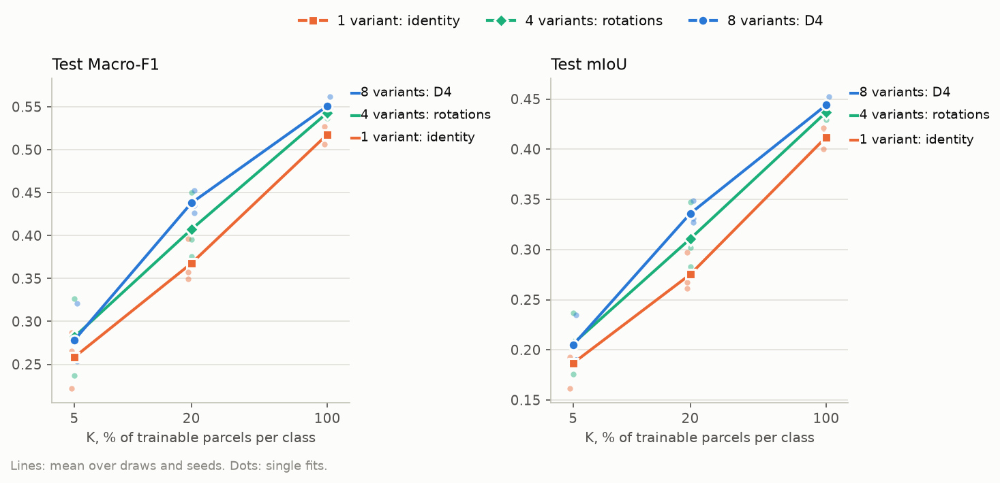
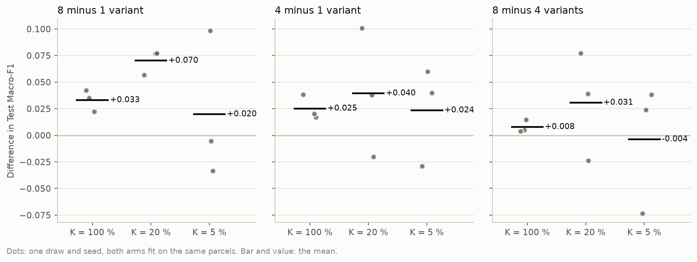
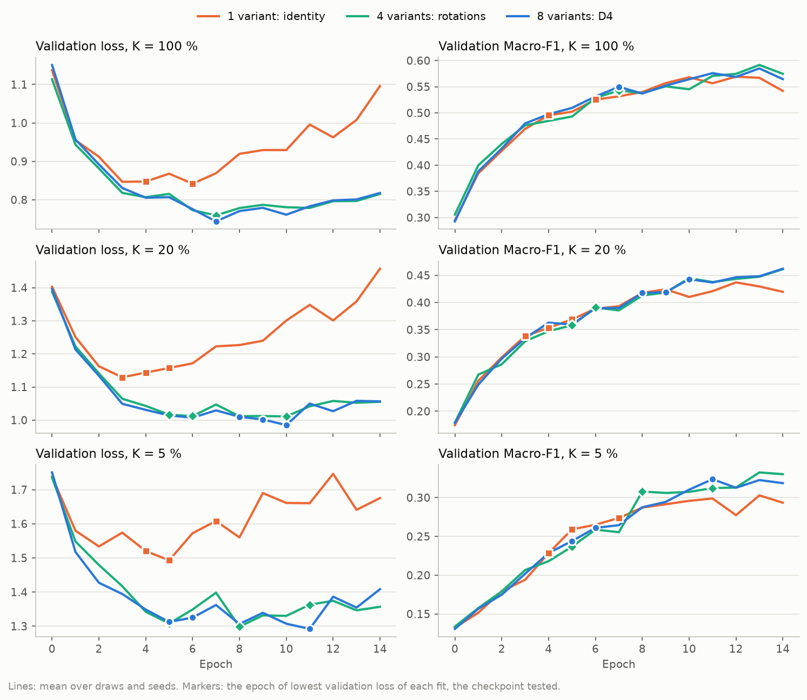
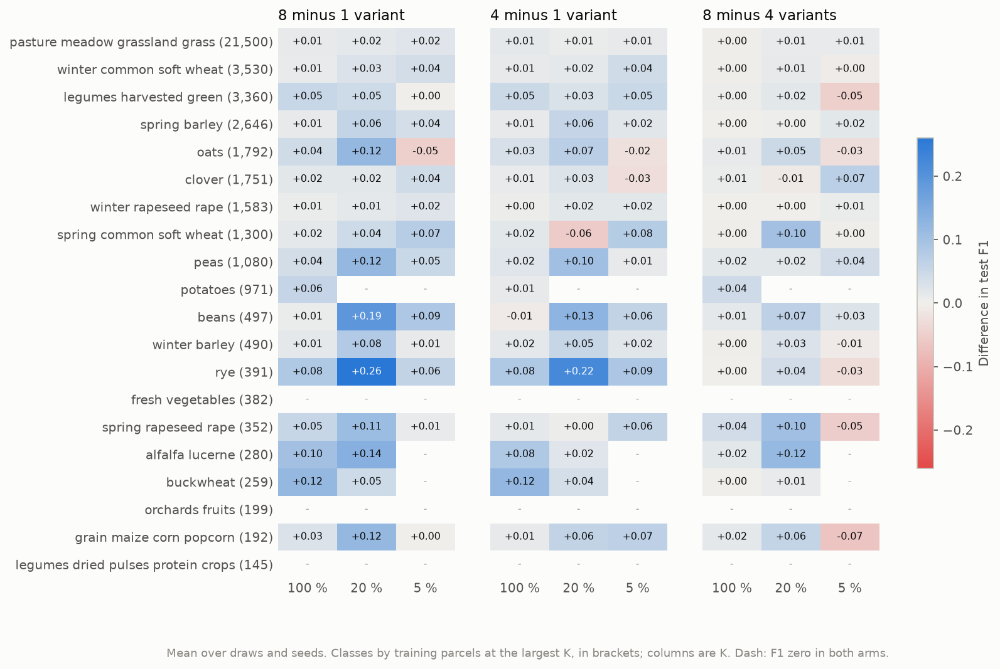

# How many D4 variants does TerraMind's decoder need? Report, 11 October 2026

**Answer.** Yes, the augmentation adds, under the workflow as it stands. Training the decoder on all eight D4
variants instead of the identity alone raises test Macro-F1 by 0.033 at K = 100 % and by 0.070 at K = 20 %, in
every seed and by three to six times the spread of the difference. At K = 5 % three seeds cannot tell the arms
apart. Most of the gain comes through the checkpoint criterion rather than a better decoder: without augmentation
the validation loss turns upward after epoch 3 to 6, so the checkpoint of lowest validation loss keeps an early,
undertrained decoder. On validation, the gap of 0.038 and 0.067 at the epochs kept shrinks to 0.010 and 0.017
at each fit's best epoch. The main
workflow should keep all eight variants. The size of their benefit depends on the checkpoint criterion, which is
still open.

## Setup

| | |
|---|---|
| Question | Does the D4 augmentation of the two-stage fit add to the results, and are four rotations enough? |
| Arms | TerraMind v1 large, frozen, `ChannelBottleneck` and the 12.9 M parameter UNet decoder, as the core arm. Only the variants drawn in training differ: **1 variant** (`terramind_v1_large_d4x1`, identity), **4 variants** (`terramind_v1_large_d4x4`, the quarter turns), **8 variants** (`terramind_v1_large`, the core arm, all of D4). Validation and test always read the identity |
| Chip set | `EE_2021_half`: 224 of Estonia's 448 training blocks with a trainable parcel, and every validation and test block. 2,388 training, 769 validation and 1,475 test chips; the test set is the 2 October grid's |
| Protocol | K = 100, 20 and 5 % of the trainable parcels of each class (42,700, 8,547 and 2,142 parcels), draw 0, seeds 0, 1 and 2, 15 epochs, checkpoint of lowest validation loss. 27 fits; the arms share draw and seeds, so they are compared fit by fit |
| Runs | UT HPC `itc-gpu`, 9 October 2026, one job per arm: 618042 (1 variant, 1 h 37 min) and 618044 (8 variants, 1 h 39 min) at commit `389cf61`. 618043 (4 variants) failed after two cells: a DataLoader worker could not allocate shared memory while node30 also ran the THOR 80 and 40 m jobs. Its partial cell was moved to `logs/failed_618043_P100_draw0_seed2/` and the arm resubmitted away from node30 as 618104 (1 h 14 min, commit `0bedeeb`, which changed only another experiment's folder) |
| Cost | Each job encoded the 21,348 chip encodings (0.41 TB) in 13 min. A fit takes 0.14 h with 1, 4 or 8 variants alike, since each epoch draws one variant per chip |

## Results

### Headline

The augmented arms lie above the identity at every budget. The three arms separate cleanly at 20 % and close
together at 5 %, where single fits scatter over a range larger than the gaps between means.

**Test Macro-F1**, mean +- standard deviation over three seeds

| Arm | K = 100 % | K = 20 % | K = 5 % |
|---|---|---|---|
| 1 variant: identity | 0.518 +- 0.010 | 0.368 +- 0.025 | 0.258 +- 0.033 |
| 4 variants: rotations | 0.543 +- 0.006 | 0.407 +- 0.038 | 0.282 +- 0.045 |
| 8 variants: D4 | 0.551 +- 0.010 | 0.438 +- 0.014 | 0.278 +- 0.037 |

**Test mIoU**, mean +- standard deviation over three seeds

| Arm | K = 100 % | K = 20 % | K = 5 % |
|---|---|---|---|
| 1 variant: identity | 0.412 +- 0.011 | 0.275 +- 0.019 | 0.187 +- 0.022 |
| 4 variants: rotations | 0.437 +- 0.007 | 0.311 +- 0.033 | 0.206 +- 0.030 |
| 8 variants: D4 | 0.444 +- 0.008 | 0.336 +- 0.011 | 0.205 +- 0.026 |

### Paired differences

Each dot is one seed, both arms trained on the same labelled parcels from the same initialisation. Eight variants
beat the identity in all three seeds at 100 and 20 %. At 100 % the ordering 1 < 4 < 8 holds in every seed, and the
rotations alone give 0.025 of the 0.033. At 20 % the four-variant arm is erratic (one seed below the identity, one
far above it), and at 5 % every pair has seeds on both sides of zero.

**Paired difference in test Macro-F1**, mean +- standard deviation (seeds won by the first arm)

| Pair | K = 100 % | K = 20 % | K = 5 % |
|---|---|---|---|
| 8 minus 1 variant | +0.033 +- 0.010 (3/3) | +0.070 +- 0.012 (3/3) | +0.020 +- 0.070 (1/3) |
| 4 minus 1 variant | +0.025 +- 0.011 (3/3) | +0.040 +- 0.061 (2/3) | +0.024 +- 0.047 (2/3) |
| 8 minus 4 variants | +0.008 +- 0.006 (3/3) | +0.031 +- 0.051 (2/3) | -0.004 +- 0.061 (2/3) |

### Training dynamics

This figure explains most of the headline. Without augmentation the validation loss reaches its minimum at
epoch 3 to 6 and then climbs steeply: at K = 20 % from 1.13 to 1.46 by epoch 14. With four or eight variants it
stays near its minimum, about 1.0, until the end. Validation Macro-F1, meanwhile, rises almost identically in the
three arms until epoch 10 to 12; only then does the identity fall behind. The decoder trained on the identity
grows overconfident on the validation chips, which raises the loss, long before it ranks pixels worse. The
checkpoint of lowest validation loss therefore stops it early. The markers show the epochs kept: 4, 6 and 4 for
the identity at 100 %, against 7, 7 and 7 with eight variants.

**Epochs per fit**: the checkpoint (lowest validation loss) / the highest validation Macro-F1

| Arm | K = 100 % | K = 20 % | K = 5 % |
|---|---|---|---|
| 1 variant: identity | 4, 6, 4 / 13, 11, 12 | 5, 3, 4 / 13, 12, 12 | 5, 7, 4 / 11, 9, 13 |
| 4 variants: rotations | 7, 7, 7 / 13, 13, 13 | 5, 10, 6 / 13, 14, 14 | 5, 11, 8 / 13, 11, 13 |
| 8 variants: D4 | 7, 7, 7 / 13, 11, 13 | 10, 9, 8 / 10, 14, 14 | 6, 5, 11 / 11, 14, 13 |

**Validation Macro-F1** at the checkpoint / the best epoch / the last epoch, mean over seeds

| Arm | K = 100 % | K = 20 % | K = 5 % |
|---|---|---|---|
| 1 variant: identity | 0.512 / 0.575 / 0.542 | 0.365 / 0.446 / 0.420 | 0.261 / 0.308 / 0.293 |
| 4 variants: rotations | 0.543 / 0.592 / 0.575 | 0.400 / 0.464 / 0.461 | 0.287 / 0.334 / 0.330 |
| 8 variants: D4 | 0.550 / 0.585 / 0.565 | 0.432 / 0.463 / 0.462 | 0.278 / 0.330 / 0.319 |

On validation, eight variants minus the identity is +0.038 and +0.067 at the checkpoint kept (100 and 20 %), but
+0.010 and +0.017 at each fit's best epoch and +0.023 and +0.042 at the last. The four-variant arm at 20 %
illustrates it fit by fit: its test scores of 0.376, 0.450 and 0.396 follow its checkpoint epochs of 5, 10 and 6.

### Per class

The gains concentrate in the classes with a few hundred training parcels: at K = 20 %, eight variants add 0.26 F1
for rye (391 parcels at K = 100 %), 0.19 for beans, 0.14 for alfalfa and 0.11 to 0.12 for oats, peas, spring
rapeseed and maize. The large classes move by 0.01 to 0.03: grassland, winter wheat, winter rapeseed. Three classes (fresh
vegetables, orchards, dried pulses) score zero in every arm at every budget, and potatoes almost so; at 5 %
alfalfa and buckwheat join them. Augmentation does not make a class learnable that the decoder never learns, so
at 5 % the Macro-F1 over 20 classes moves on 14 at most.

## Analysis

**The augmentation adds, mostly by regularising the decoder against the checkpoint criterion.** The two-stage fit
shows the decoder the same 2,388 training chips every epoch. With the identity alone it fits them within a few
epochs and its predictions on unseen chips become overconfident; the validation loss, which punishes confident
errors, rises while the validation Macro-F1 still improves. Augmentation makes each chip appear in up to eight
geometries, which delays that memorisation and keeps the validation loss flat. Because the workflow keeps the
checkpoint of lowest validation loss, the identity arm is tested at epoch 3 to 6, the eight-variant arm at epoch 7
to 10, and most of the gap is the difference between those epochs. On validation, the gap at each fit's best
epoch is about a quarter of the gap at the epochs kept, at 100 % and at 20 % alike. A smaller, real gain remains: the augmented arms
reach a higher best validation Macro-F1 at every budget.

**The effect is largest at intermediate budgets.** At 20 % the training chips are still many (2,020) but the
labelled parcels few (8,547), so each labelled pixel is seen often and memorised fast; this is where augmentation
pays most, +0.070. At 100 % there are five times more labelled parcels to fit, and the gain halves. At 5 % the
signal is buried in fit-to-fit noise of 0.07 to 0.09 Macro-F1 and in six classes that no arm learns.

**Four rotations recover most, not all.** At 100 % the rotations give 0.025 of the 0.033, and the flips a further
0.008 in every seed. At 20 % the four-variant arm is unstable through its checkpoint epochs, so its mean, 0.407,
says little. Halving the training cache with four variants would cost about 0.01 at 100 % and an unknown amount
below.

**Agreement with the earlier ablation.** On full Estonia at K = 5 % (4,354 parcels, between this study's 5 and 20 %)
the 8 October ablation gave 0.304, 0.335 and 0.358 for 1, 4 and 8 variants, with seed spreads up to 0.049. The
order is the same; this study adds the budgets where the difference is decisive, and the mechanism.

**What it means for RQ1.** The K-shot curves compare models whose decoders are fit under this protocol, so the
augmentation is part of what each frozen encoder is credited with. It must be applied equally to every token-grid
arm, which the workflow does. The interaction with the checkpoint criterion matters more: any comparison between
arms whose validation losses diverge at different speeds is affected by the epoch the criterion picks, not only by
the encoders.

## Caveats

* Three seeds and one draw. The 5 % budget would need several draws and more seeds to resolve differences of 0.02.
* Half of Estonia's training blocks. With the full set the decoder memorises more slowly, so the gains may be
  smaller there; the full-Estonia grid's scores are 0.035 to 0.084 higher than these with eight variants.
* The best-epoch comparison is on validation and picks the maximum of 15 noisy values per fit, which flatters
  every arm; it shows where the gap comes from, not what a validation Macro-F1 checkpoint would score on test.
* TerraMind only. Prithvi and THOR are fit the same way and likely behave alike; that is not tested here.

## Next steps

* **Checkpoint criterion.** Rerun these 27 fits with the checkpoint of highest validation Macro-F1 (a `run.py`
  override of the `ModelCheckpoint` monitor in a new experiment). That separates the augmentation's own effect
  from the criterion's, and informs the open choice of pipeline.md section 10.
* **K = 5 %.** If the low budgets matter for the thesis's claims, more seeds and draws at 5 % (and 1 %) for the 1
  and 8 variant arms only.
* **Record.** An entry in pipeline.md section 11, and an update of the `AUGMENT_SYMMETRIES` comment in
  `src/gfm4agri/benchmark/segmentation_data.py`, which still quotes the 8 October numbers; both only once agreed.

## Reproduce

    poetry run python experiments/2026-10-09_terramind_d4_count/run.py -e experiments/2026-10-09_terramind_d4_count/experiment.yaml --chips data/eurocrops_chips/EE_2021_half   # hub
    bash scripts/cluster/submit.sh experiments/2026-10-09_terramind_d4_count/experiment.yaml EE_2021_half                                                                    # cluster
    bash scripts/cluster/pull_results.sh 2026-10-09_terramind_d4_count EE_2021_half
    poetry run python experiments/2026-10-09_terramind_d4_count/report.py --chips EE_2021_half
