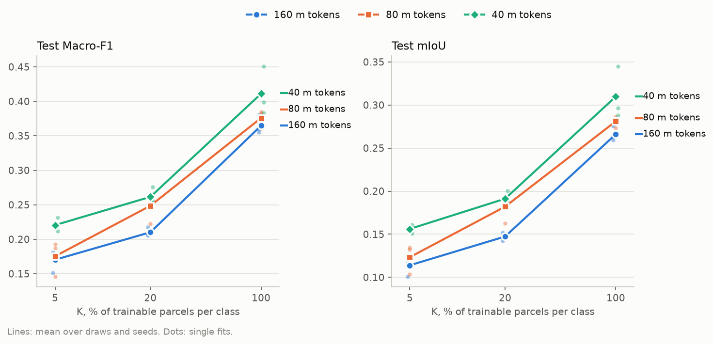
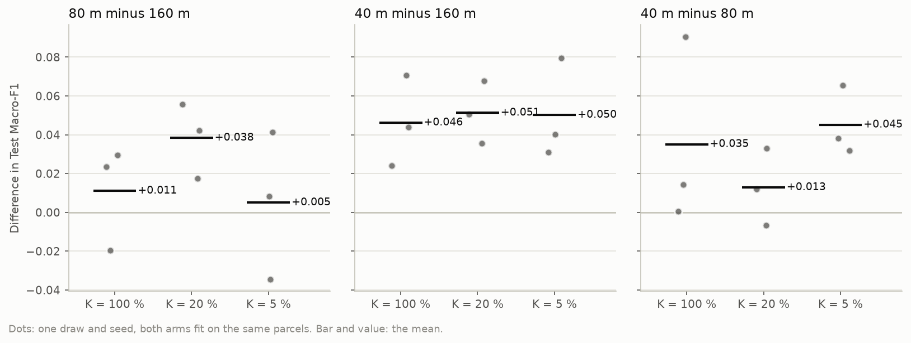
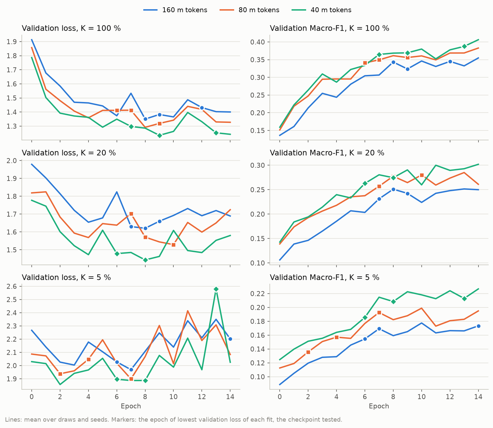
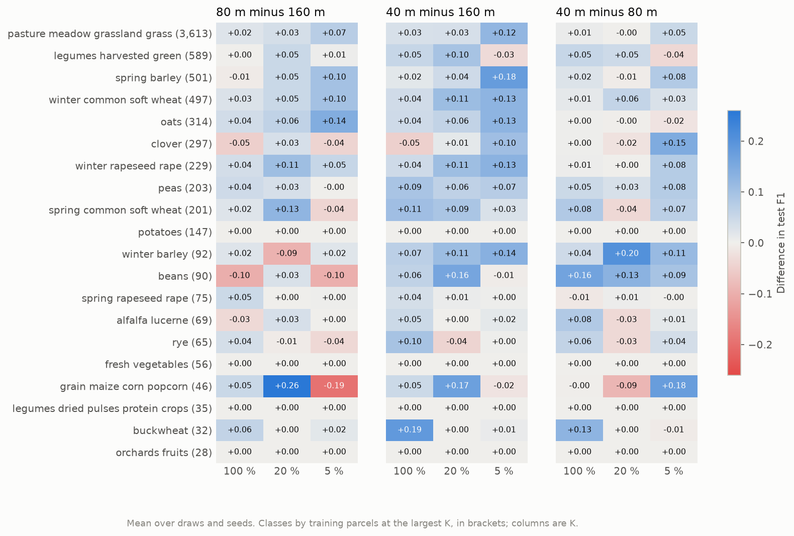
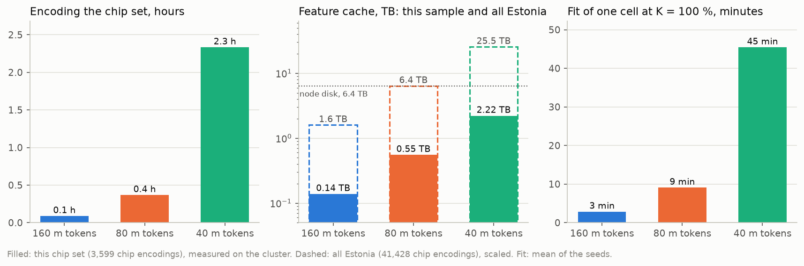

# THOR token size, 160, 80 and 40 m, on a sample of Estonia: report, 11 October 2026

**Answer.** Smaller tokens segment better at every label budget. THOR v1 large on 40 m tokens beats the main
workflow's 160 m tokens by 0.046, 0.051 and 0.050 test Macro-F1 at K = 100, 20 and 5 %, and wins all nine paired
fits. 80 m sits between the two and is clearly ahead of 160 m only at K = 20 %. The 40 m gain holds even though
its 20 m bands run on 2 px patches, below anything THOR saw in pretraining. The evidence is one draw, three
seeds and 207 test chips, so this is a consistent signal rather than a measured interval. The cost is large:
40 m needs 16 times the cache of 160 m, about 25.5 TB for all of Estonia, four times a cluster node's local disk.

## Setup

| | |
|---|---|
| Question | Does the size of THOR's tokens change crop-type segmentation under label scarcity, and does going below THOR's pretraining range (patches of 4 px at the least) still pay? |
| Arms | `thor_v1_large` (core arm, 160 m tokens: 16 px patches on the 10 m bands, 8 px on the 20 m bands, a 14 x 14 grid), `thor_v1_large_80m` (8 and 4 px, 28 x 28), `thor_v1_large_40m` (4 and 2 px, 56 x 56, registered by `run.py`). Everything else is shared: frozen THOR v1 large, layers 5, 11, 17 and 23, `ChannelBottleneck` to 768 channels (78.2 M parameters), a 12.9 M parameter UNet decoder, a batch of 2 accumulated twice, fp16 mixed precision |
| Chip set | `EE_2021_sample`: 36 training, 8 validation and 18 test blocks of 4 x 4 chips, taken whole from `EE_2021`'s split `blocks4_buf1600_seed0__6b0eb4cb`. That is 413 training, 88 validation and 207 test chips, with all 20 classes in every partition |
| Protocol | K = 100, 20 and 5 % of the parcels of each class (7,179, 1,444 and 369 parcels on 413, 352 and 227 chips); draw 0; seeds 0, 1 and 2; 15 epochs; checkpoint of lowest validation loss; tested on the 207 test chips |
| Runs | UT HPC `itc-gpu`, one job per arm. 160 m: job 617993, 32 min. 80 m: job 617994, 1 h 40 min. Both on commit `11fe4da`. 40 m: job 617995 failed at the start of its first fit (see [Run notes](#run-notes)), and the rerun, job 618057 on commit `0bedeeb` with 4 fit workers, took 8 h 28 min. 27 fits, 7.2 GPU hours of fitting |

## Results

### Headline

**Test Macro-F1**, mean ± standard deviation over 3 seeds

| Arm | K = 100 % | K = 20 % | K = 5 % |
|---|---|---|---|
| 160 m tokens | 0.365 ± 0.013 | 0.210 ± 0.006 | 0.170 ± 0.016 |
| 80 m tokens | 0.376 ± 0.013 | 0.249 ± 0.023 | 0.175 ± 0.026 |
| 40 m tokens | **0.411** ± 0.035 | **0.262** ± 0.012 | **0.221** ± 0.010 |

**Test mIoU**, mean ± standard deviation over 3 seeds

| Arm | K = 100 % | K = 20 % | K = 5 % |
|---|---|---|---|
| 160 m tokens | 0.266 ± 0.009 | 0.147 ± 0.005 | 0.114 ± 0.011 |
| 80 m tokens | 0.281 ± 0.007 | 0.182 ± 0.017 | 0.123 ± 0.017 |
| 40 m tokens | **0.310** ± 0.031 | **0.191** ± 0.008 | **0.156** ± 0.005 |

In both metrics the arms rank 40 m, 80 m, 160 m at every K. 40 m's lead over 160 m is about the same in absolute
terms at every budget, so relative to the score it grows as labels get scarcer: +13 % at K = 100 %, +25 % at
20 % and +30 % at 5 %.

### Paired differences

**Paired difference in test Macro-F1**: mean ± standard deviation, with the fits won by the first arm in brackets

| Pair | K = 100 % | K = 20 % | K = 5 % |
|---|---|---|---|
| 80 m minus 160 m | +0.011 ± 0.027 (2/3) | +0.038 ± 0.019 (3/3) | +0.005 ± 0.038 (2/3) |
| 40 m minus 160 m | +0.046 ± 0.023 (3/3) | +0.051 ± 0.016 (3/3) | +0.050 ± 0.026 (3/3) |
| 40 m minus 80 m | +0.035 ± 0.048 (3/3) | +0.013 ± 0.020 (2/3) | +0.045 ± 0.018 (3/3) |

Within a pair, both arms used the same parcels, seed and test chips, so the difference removes the draw and the
test set. **40 m minus 160 m** is positive in all nine fits, with a mean at least about twice its spread at every K. **40 m
minus 80 m** is consistent at K = 5 % (+0.032 to +0.065). At K = 100 % it rests mostly on one seed (+0.090,
+0.014, +0.000), and at 20 % it changes sign. **80 m minus 160 m** is positive in every fit only at K = 20 %; at
100 % and 5 %, one seed reverses it.

### Training dynamics

**Epochs** per fit (seeds 0, 1, 2): the checkpoint (lowest validation loss) / the highest validation Macro-F1

| Arm | K = 100 % | K = 20 % | K = 5 % |
|---|---|---|---|
| 160 m tokens | 9, 12, 8 / 14, 12, 8 | 7, 9, 8 / 14, 12, 13 | 14, 6, 7 / 14, 6, 10 |
| 80 m tokens | 9, 6, 7 / 14, 14, 12 | 7, 10, 8 / 10, 13, 8 | 2, 7, 4 / 10, 14, 12 |
| 40 m tokens | 9, 13, 7 / 14, 14, 13 | 8, 6, 8 / 9, 14, 13 | 8, 13, 6 / 10, 13, 13 |

40 m has the lowest validation loss and the highest validation Macro-F1 at nearly every epoch, from the first
one. Its lead therefore does not depend on which epoch the checkpoint keeps. The usual pattern of the token-grid
arms holds for all three:

* Validation loss bottoms out mostly at epoch 6 to 9 and then rises or jumps, most visibly at K = 5 %, where
  the mean curve is erratic.
* Validation Macro-F1 peaks at epoch 12 to 14 in 19 of the 27 fits.

The lowest-loss checkpoint therefore stops early for every arm. Since the ranking holds on the validation curves
at nearly every epoch, a Macro-F1 criterion would probably raise all three arms without reordering them. Only
the lowest-loss checkpoints were tested, so this is not measured. The markers sit on the mean curve at each fit's
checkpoint epoch, not on that fit's own curve.

### Per class

The classes are ordered by training parcels at K = 100 %, shown in brackets. Four classes are not segmented by
any arm (test F1 below 0.1 at K = 100 % in every fit): fresh vegetables, dried pulses, orchards and potatoes.
They pull every arm's Macro-F1 down by the same amount, which is why the absolute values are low.

**40 m against 160 m.** 40 m gains more than 0.01 F1 in 15 of 20 classes at K = 100 %, 12 at 20 % and 11 at 5 %,
and loses more than 0.01 in at most two. Where the gain falls depends on K:

* At K = 5 % it is largest in the common cereals and oilseeds: spring barley +0.18, winter barley +0.14,
  winter wheat, oats and winter rapeseed +0.13, grassland +0.12.
* At K = 100 % it moves to small classes: buckwheat +0.19, spring wheat +0.11, rye +0.10.

**80 m against 160 m.** The gains are less consistent. At K = 5 % 80 m loses in five classes, maize by 0.19 and
beans by 0.10.

Single cells of classes with fewer than about 100 training parcels can swing on a few test parcels.

### Cost

| Arm | Grid | Per chip encoding | Encoding | Cache | Cache, all Estonia | Fit at K = 100 % | Peak GPU, fit |
|---|---|---|---|---|---|---|---|
| 160 m tokens | 14 x 14 | 39 MB | 5 min | 0.14 TB | 1.6 TB | 3 min | 3.2 GB |
| 80 m tokens | 28 x 28 | 154 MB | 22 min | 0.55 TB | 6.4 TB | 9 min | 4.8 GB |
| 40 m tokens | 56 x 56 | 617 MB | 140 min | 2.22 TB | 25.5 TB | 45 min | 11.3 GB |

Each halving of the token size quadruples the tokens, and the cost follows. The cache grows 4 times per step,
the encoding 4 to 6 times and the fit 3 to 5 times. Scaled to all of Estonia (41,428 chip encodings):

* 160 m needs 1.6 TB.
* 80 m needs 6.4 TB, a node's whole local disk.
* 40 m needs 25.5 TB and about 27 h of encoding on one GPU.

Fits on all Estonia would also be about 12 times longer than here, if fit time scales with training chips.

## Analysis

**The token size matters.** At 160 m, one token covers 16 x 16 pixels of 10 m, 2.56 ha. Where a parcel boundary
runs through a token, the features average across it, and the UNet's upsampling cannot restore detail the
features never held. Halving the token twice quadruples the spatial
detail each time. The per-class figure shows where that pays: most in the cereals and oilseeds at K = 5 %, the
classes with many parcels that are easy to confuse spectrally. Finer features probably make each of the few
labelled parcels more informative for the decoder. That would explain why 40 m's relative gain is largest at
the smallest budget. It is a reading of the pattern, not a test of it.

**Leaving the pretraining range did not break the encoder.** At 40 m, THOR's 16 x 16 kernels for the 20 m bands
are resized to 2 x 2, a size pretraining never used. The features stayed finite, and the arm is the best of the
three. This design cannot tell which group carries the gain:

* the 10 m bands at 4 px, a size inside the pretraining range;
* or the 20 m bands at 2 px, which might add nothing or even cost a little behind a gain from the 10 m bands.

**80 m against 160 m is weaker here than on the pilots.** 80 m beat 160 m on the 12-chip pilot and on
`EE_2021_mini`, but those runs had 9 and 57 chips. On this larger sample it is ahead in seven of nine fits, by a
small margin outside K = 20 %. 40 m is the step that separates clearly from the core arm.

**For the thesis.** The main workflow's choice of 160 m for THOR was made to match TerraMind's 14 x 14 token grid,
and this result says that choice costs THOR about 0.05 Macro-F1. If THOR is compared at its best, it should run
on 40 m tokens. If it is compared like for like with TerraMind on the same grid, 160 m stays, and the token
size becomes a reported sensitivity. That is a design decision for the user. The cost section says what 40 m
would demand on all of Estonia.

## Caveats

* **One draw and three seeds.** The seeds vary the decoder's initialisation, the batch order and the D4 variant
  draws, but not the labelled parcels or the test blocks. The spreads above measure fit noise only. There are no
  bootstrap intervals.
* **A small test set.** 207 test chips in 18 blocks, about 14 % of Estonia's test blocks. Small classes rest on
  a few parcels.
* **The 40 m arm ran with 4 fit workers, the others with 16.** The worker count changes which worker draws each
  sample's D4 variant, so 40 m's augmentation stream differs from the other arms', at the same seed. Nothing
  else changes: same parcels, same seeds, same epochs.
* **The checkpoint criterion.** Lowest validation loss stops mostly at epoch 6 to 9, while validation Macro-F1
  peaks at epoch 12 to 14 in most fits. All arms are affected alike, and the ranking holds at nearly every
  epoch, but the absolute values are lower for that reason (CLAUDE.md, open choices).
* **Lower absolute values than the full-Estonia grid.** The training set is 413 chips rather than 4,898. These
  numbers compare token sizes; they are not THOR's score on Estonia.

### Run notes

Job 617995, the first 40 m run, encoded all 3,599 chip encodings in 2 h 25 min. Two minutes into its first fit, a
DataLoader worker could not allocate shared memory (`unable to allocate shared memory(shm)`), and the job's exit
trap deleted the cache from `/local`.

The cause was the node's `/dev/shm`, not the job's 120 GB:

* DataLoader workers hand each batch to the training process through `/dev/shm`. It is a RAM-backed file system
  shared by every job on the node, with no per-job container on this cluster. Linux's default caps it at half
  the RAM; the login node, with the same 251 GB of RAM, shows 126 GB.
* A 40 m sample is 1.23 GB once the fp16 features are cast to float32. 16 workers, each holding two prefetched
  batches of two samples, therefore keep about 79 GB there before counting the batches in use.
* A TerraMind job on the node's other GPU (618043, `2026-10-09_terramind_d4_count`, needing about 2.5 GB of shared
  memory) failed with the same error 9 s earlier. Its demand was small, so the 40 m job filled the shared space
  and both jobs lost their next allocation.

The rerun caps the fit at 4 workers on the cluster (`run.py`), about 20 GB, what the 80 m arm needs with 16
workers.

## Next steps

* **Separate the two band groups.** Run 40 m tokens on the 10 m bands with 80 m tokens on the 20 m bands, the 20 m
  map upsampled to 56 x 56 before the concatenation, in this folder's `run.py`. This settles whether the gain
  needs the out-of-range 2 px patches.
* **Put an interval on the gain.** Add draws (nested, as the protocol plans) and run on `EE_2021_half` or more
  test blocks, to put an interval on the 0.05.
* **Make 40 m affordable, if the user wants it in the main workflow.** The full cache does not fit a node:
  * Caching only the identity variant cuts all of Estonia to about 4.4 TB, which fits. The D4 count study
    (`../2026-10-09_terramind_d4_count/`) found that dropping the variants costs TerraMind 0.03 Macro-F1 at
    K = 100 % and 0.07 at 20 %, as much as 40 m gains.
  * The other options are a persistent project directory larger than 25 TB, or encoding on the fly.
* **Shared memory, in the core, if agreed.** Keep the cached features in fp16 through the DataLoader and cast on
  the GPU, and scale the workers to the sample size. That would halve the shared memory and prevent another
  job's failure on a shared node.
* **Decide the arm's token size** (user): 160 m for parity with TerraMind, or 40 m as THOR at its best. Then
  record it in `pipeline.md` section 11 and the protocol, once agreed.

## Reproduce

    poetry run python experiments/2026-10-09_thor_token_size/run.py -e experiments/2026-10-09_thor_token_size/experiment.yaml --chips data/eurocrops_chips/EE_2021_sample   # hub
    bash scripts/cluster/submit.sh experiments/2026-10-09_thor_token_size/experiment.yaml EE_2021_sample                                                                    # cluster
    bash scripts/cluster/pull_results.sh 2026-10-09_thor_token_size EE_2021_sample
    poetry run python experiments/2026-10-09_thor_token_size/report.py --chips EE_2021_sample
