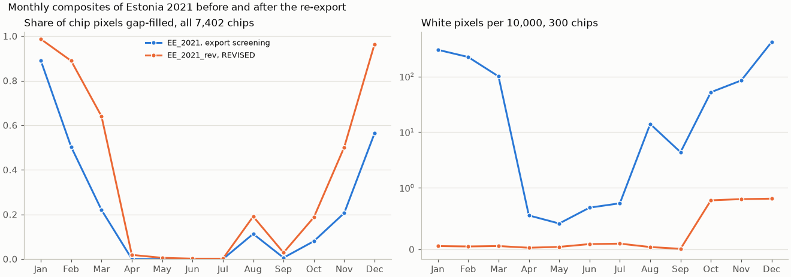

# Re-export of the Estonian Sentinel-2 composites under the revised screening: report, 13 October 2026

**Answer.** `EE_2021_rev` is complete and checked.

- **Export.** All 7,402 chips of `EE_2021`, re-exported under `REVISED` in 36.5 h with no failed chip: 3.9 h for
  the 733 sample chips, then 32.5 h for the rest. The original export took 53.6 h.
- **Checks.** Label and parcel rasters are identical to the parent's, and every report records the screening.
- **Snow and cloud are gone.** White pixels in a 300-chip sample fall from 454,256 to 85 in January and from
  624,764 to 1,240 in December.
- **The price is gap filling.** The mean share of chip pixels filled rises:

  | Month | Before | After |
  |---|---|---|
  | February | 50 % | 89 % |
  | March | 22 % | 64 % |
  | August | 11 % | 19 % |
  | October | 8 % | 19 % |
  | November | 21 % | 50 % |

  April to July stays at 2 % or less.
- **New: never-observed pixels.** 100,367 pixels have no clear observation in the whole year, against 20 before,
  and are written as zeros. Only 520 of them lie on labelled parcels. In the old composites they are bright and
  unvegetated (July NDVI about 0.06, blue 0.11 to 0.23), so they are probably quarries, sand or built-up land
  that the haze test flags on every date.

## Setup

| | |
|---|---|
| Driver | `run.py`: the core `scripts/hub/build_country_chips.py` with `REVISED` and the parent's chip list swapped in; S1, TESSERA, AlphaEarth, `chip_parcels` and the split linked from `EE_2021`. [`PROCESS.md`](PROCESS.md) explains every step |
| Reads | 2 x 2 groups of adjacent chips, 8 workers; 2,245 read windows in place of 7,402 |
| Runs | Hub, 12 to 13 October 2026, commit `7380723`. The 24-frame build shared the archive bandwidth for its first 12.6 h |

## Results

The full tables are in [`figures/tables.md`](figures/tables.md) and the checks in [`check.json`](check.json).

| Check | Result |
|---|---|
| Chips exported, as files rather than links | 7,402 of 7,402 |
| Screening recorded as `REVISED` | 7,402 of 7,402 |
| Mask and parcel rasters identical to `EE_2021` | 7,402 of 7,402 |
| Chips with an unreadable item | 37, 106 items in all (before: 137, 416 items) |

A first run of `check.py` reported no chip with `REVISED`. That was a bug in the check, which compared the
reports' JSON lists with the screening's tuples; it was fixed and rerun.

## Caveats

- **Pixels never observed in the year** are written as 0 in every band, as before. A loader should treat them as
  nodata if they matter; 520 lie on labelled parcels.
- **More interpolation in the shoulder months.** February, March and November are now mostly interpolated, as the
  screening study anticipated.
- **Feature caches.** Every feature cache must be rebuilt for `EE_2021_rev`, because its manifest hash differs.

## Next steps

These are decisions for the user:
- point the main workflow at `EE_2021_rev`;
- record the screening change in `docs/phase1/pipeline.md`.

`EE_2021_rev` has been copied to the cluster.

## Reproduce

    poetry run python experiments/2026-10-12_s2_revised_export/run.py --workers 8 --group-size 2 --only-chips-of data/eurocrops_chips/EE_2021_sample
    poetry run python experiments/2026-10-12_s2_revised_export/run.py --workers 8 --group-size 2
    poetry run python experiments/2026-10-12_s2_revised_export/check.py
    poetry run python experiments/2026-10-12_s2_revised_export/report.py
