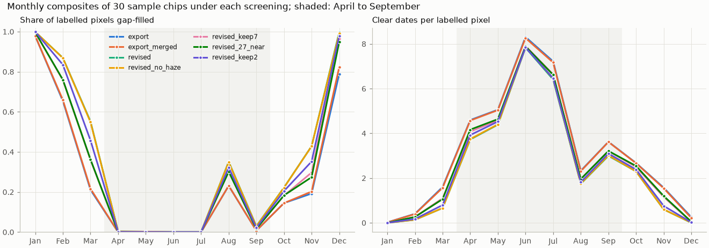
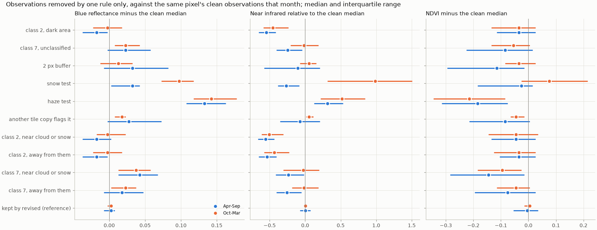
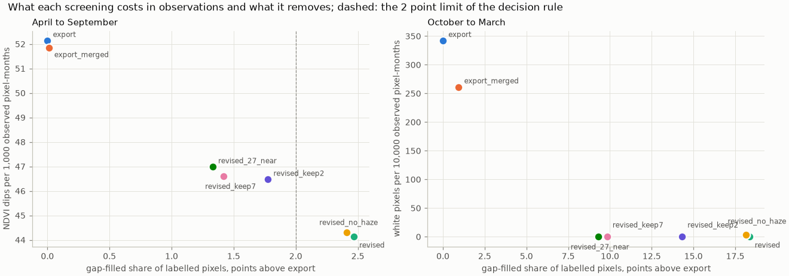
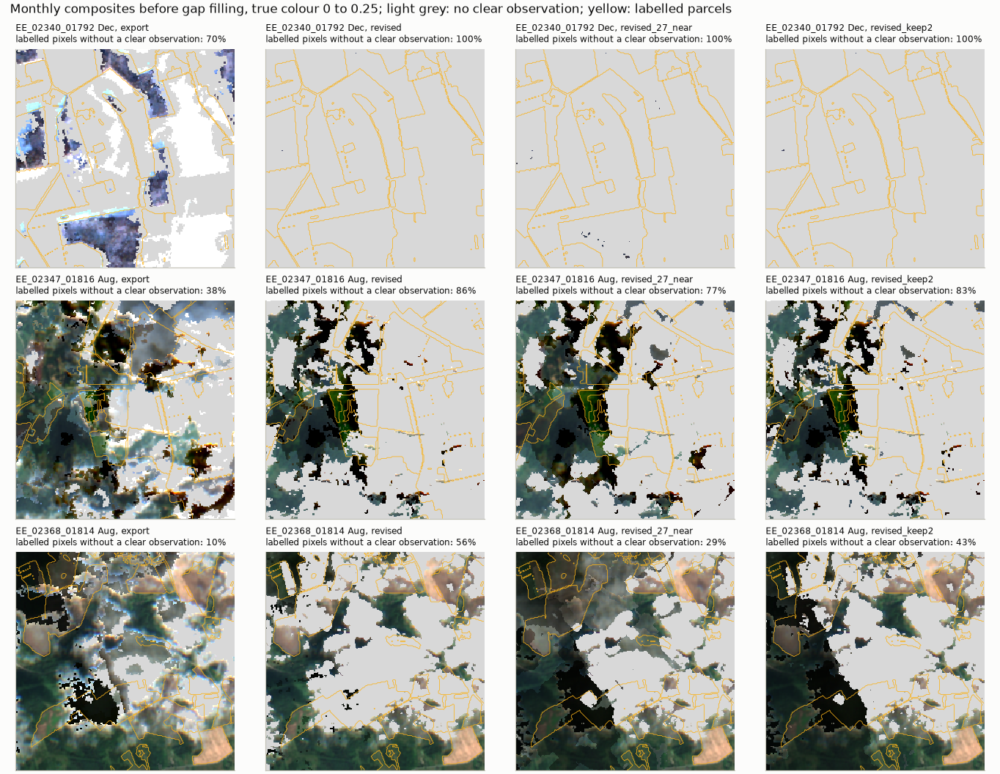

# Sentinel-2 cloud and snow screening on a sample of Estonia: report, 12 October 2026

**Answer.** Re-export the Sentinel-2 chips with `REVISED` as it stands. Every rule it adds to the export screening
removes contaminated observations.

- Most rules remove bright contamination: they take out observations bluer than the pixel's clean ones, with
  lower NDVI.
- Class 2 removes dark contamination, cloud shadow labelled "dark area": its observations have near infrared 55 %
  below the pixel's clean median.
- Each relaxation tested keeps one of these kinds of contamination and leaves about 2 to 3 more NDVI dips per
  1,000 observations in the growing season.

By the letter of the decision rule fixed beforehand, no variant passes.

- `REVISED` raises the April to September gap-filled share of labelled pixels from 4.0 % to 6.4 %, 0.4 points
  over the limit of 2.
- The relaxations stay under the limit, but each keeps observations with a contamination signature.

The recommendation is therefore a judgement. The extra gap filling of `REVISED` falls on pixel-months whose
observations carry that signature, and a frozen encoder takes an interpolated month for an observed one less
misleadingly than a shadowed or hazy one. The evidence is 30 chips and one season, so the size of the differences
between the revised variants is a consistent signal rather than a measured interval.

## Setup

| | |
|---|---|
| Question | Is `REVISED` too strict for a re-export, or does a relaxation keep the clean observations it removes? |
| Variants | `export` (`SCL_DROP`, every item one observation); `export_merged` (the same, one observation per overpass); `revised` (= `REVISED` of `s2_monthly.py`, checked equal on every chip); `revised_no_haze`; `revised_keep7` (class 7 kept unless the haze test flags it); `revised_27_near` (classes 2 and 7 dropped only within 5 px of cloud, shadow or snow); `revised_keep2` (class 2 kept). `revised_keep2` was **added after the first results**, when class 2 looked clean on blue reflectance alone, and was judged by the same rule |
| Sample | 30 chips of `EE_2021`: 24 from a 6 x 4 grid over the country, 6 from the chips whose August or October was more than 30 % gap-filled in the export (`sample.csv`). 3,346 acquisitions, 2,468 distinct overpasses, 49 reprocessed at baseline 04.00, 1 unreadable |
| Data | B02, B03, B04, B08, B11 and SCL of every 2021 L2A acquisition, read exactly as the export reads them (same search, stackstac call, alignment and resampling), stored raw; every variant applied offline to the same data |
| Measures | Over labelled pixels, per month: share gap-filled, clear dates per pixel, white pixels (observed, B02, B03 and B04 all above 0.25) and NDVI dips (more than 0.15 below both neighbouring months, after gap filling). Per rule: the observations it alone removes from `export`, against the same pixel's `revised` median of that month, in blue, near infrared and NDVI |
| Runs | JupyterHub, commit `f561d31` plus this folder. Download about 10 minutes with 6 workers; each analysis pass about 6 minutes |

## Results

### Gap filling and clear dates

Share of labelled pixels gap-filled. All 30 chips, weighted by labelled pixels.

| Variant | Feb | Mar | Apr to Jul | Aug | Sep | Oct | Nov | Apr to Sep | Oct to Mar |
|---|---|---|---|---|---|---|---|---|---|
| export | 65.4 % | 21.1 % | 0.0 % | 23.1 % | 0.7 % | 14.5 % | 19.3 % | 4.0 % | 49.5 % |
| revised | 86.9 % | 55.2 % | ≤ 0.3 % | 35.1 % | 3.0 % | 22.2 % | 42.9 % | 6.4 % | 67.8 % |
| revised_keep2 | 83.5 % | 45.8 % | ≤ 0.1 % | 32.2 % | 2.1 % | 20.5 % | 35.2 % | 5.8 % | 63.8 % |
| revised_keep7 | 75.9 % | 36.1 % | ≤ 0.2 % | 30.3 % | 1.8 % | 18.2 % | 29.7 % | 5.4 % | 59.3 % |
| revised_27_near | 76.0 % | 36.2 % | 0.0 % | 30.2 % | 1.7 % | 18.3 % | 27.4 % | 5.3 % | 58.8 % |

April to July is untouched by any screening. In the growing season the cost falls on August, the cloudiest
month of 2021, where `revised` leaves 35 % of labelled pixels without a clean observation against 23 %. The
larger cost falls on the shoulder months: under `revised`, February, March and November are mostly interpolated.
The full monthly tables are in [`figures/tables.md`](figures/tables.md).

### What each rule removes

Observations removed by one rule only, April to September. Each is compared with the same pixel's clean median
that month; `kept` is the same comparison for the observations `revised` keeps.

| Rule | Share of export's observations | Blue, median difference | Bluer by > 0.02 | NIR, median relative | NIR lower by > 25 % | NDVI, median difference |
|---|---|---|---|---|---|---|
| class 2, dark area | 1.8 % | −0.018 | 8 % | −55 % | 90 % | −0.035 |
| class 7, unclassified | 4.1 % | +0.022 | 53 % | −24 % | 50 % | −0.085 |
| 2 px buffer | 1.3 % | +0.033 | 55 % | −10 % | 43 % | −0.115 |
| haze test | 0.5 % | +0.133 | 100 % | +32 % | 4 % | −0.185 |
| another tile copy flags it | 0.3 % | +0.027 | 56 % | −7 % | 34 % | −0.085 |
| snow test (October to March) | 0.0 % | +0.097 | 97 % | +98 % | 7 % | +0.075 |
| kept by revised (reference) | | +0.003 | 11 % | +1 % | 8 % | −0.005 |

Every rule departs clearly from the reference.

- **Class 2** is the dark case: near infrared halves and the blue does not rise. That is the signature of shadow,
  and the gallery below shows it as black patches beside clouds.
- **Class 7** is contaminated both near clouds and away from them:
  - within 5 px of cloud or snow, 68 % of its observations are bluer and its median NDVI falls 0.145;
  - farther away, 48 % are bluer and NDVI falls 0.075.

  Restricting class 7 to the neighbourhood of clouds would therefore keep a contaminated majority of it.
- **The haze test** removes the most contaminated observations of all, but few of them.
- **Merging tile copies** costs 0.3 % of observations and catches what one tile's classification missed.

### The trade-off

| Variant | Apr to Sep filled | NDVI dips per 1k, Apr to Sep | White per 10k, Oct to Mar | NDVI dips per 1k, Oct to Mar |
|---|---|---|---|---|
| export | 4.0 % | 52.1 | 342.2 | 16.1 |
| export_merged | 4.0 % | 51.8 | 261.2 | 15.0 |
| revised | 6.4 % | **44.1** | 0.2 | **6.7** |
| revised_no_haze | 6.4 % | 44.3 | 3.6 | 6.7 |
| revised_keep2 | 5.8 % | 46.5 | 0.2 | 7.1 |
| revised_keep7 | 5.4 % | 46.6 | 0.2 | 10.6 |
| revised_27_near | 5.3 % | 47.0 | 0.2 | 9.5 |

Per chip, April to September, against `revised`, mean ± standard deviation over the 30 chips:

| Variant | Filled, points | NDVI dips per 1k | Chips with more dips |
|---|---|---|---|
| revised_keep2 | −0.62 ± 1.00 | +2.2 ± 6.0 | 21/30 |
| revised_keep7 | −1.08 ± 1.51 | +3.0 ± 6.4 | 22/30 |
| revised_27_near | −1.09 ± 1.44 | +3.1 ± 6.8 | 22/30 |
| export | −2.48 ± 3.29 | +8.5 ± 16.0 | 24/30 |

The white pixels, the snow and cloud rims of the composite QA, fall to at most 3.6 per 10,000 observations under
every revised variant, so all of them fix what was visible. The NDVI dips separate the variants. NDVI dips include real events, such as mowing and
harvest, which are the same under every variant, so it is the differences that count. Each relaxation leaves
about a third of the dips that `revised` removes, and it does so on about two thirds of the chips.

### Gallery

- **A December** (`EE_02340_01792`): the export composite's "observations" are snow and cloud. Every revised
  variant leaves the month to interpolation.
- **Two Augusts** (`EE_02347_01816`, `EE_02368_01814`): `revised_keep2` and `revised_27_near` keep black cloud
  shadows that `revised` removes, which is where class 2 matters.

## Analysis

Before the study, the doubt about `REVISED` was that dropping classes 2 and 7 might discard real surface. Class 7
turns out to be contaminated wherever it occurs, and class 2 to be shadow. The rule that looked the most doubtful,
class 2, failed the decision rule's blue criterion only because that criterion looked for bright contamination:
measured in the near infrared, class 2 is among the most consistently contaminated rules, with the haze and snow tests.

The decision rule, fixed beforehand, has no winner. Its cost limit of 2 points was an assumption, not a measured
tolerance. `REVISED` exceeds it by 0.4 points, and those points are pixel-months whose only observations carry a
contamination signature. Every variant under the limit stays there by keeping such observations. Between a month
interpolated from its neighbours and a month observed through shadow or haze, the interpolation is the smaller
error for a frozen encoder, which cannot tell either from a clean observation. The pipeline's per-month filled
shares make the interpolation visible to a reader, whereas the contamination is visible to no one.

The larger cost of `REVISED` falls outside the growing season: February, March and November become mostly
interpolated. These months carry the autumn and spring signal of winter crops. Under the export screening they
looked observed, but that was largely the snow and cloud this study removes: white pixels fall from 342 to 0.2
per 10,000 observations, and NDVI dips from 16.1 to 6.7 per 1,000.

## Caveats

- **The sample.** 30 chips and one season. The paired differences between the revised variants are consistent
  across about two thirds of the chips but small, about 2 to 3 dips per 1,000 observations.
- **What the measures can see.**
  - The contamination measures compare each observation with the same pixel's `revised` median, so they measure
    departure from what `revised` calls clean.
  - The haze test's own row is partly circular, since that test is defined on blue.
  - The near-infrared and NDVI columns are independent of the rules.
- **The NDVI dip count** includes real events. Only its differences between variants are read.
- **The effect on segmentation is not measured.** A Macro-F1 comparison on `EE_2021_mini` would sit inside the
  fit-to-fit spread of several hundredths.
- **What `REVISED` leaves.** The per-pixel median still leaves seams and some haze that no rule here catches;
  notebook 06 shows them. A learned cloud mask, such as OmniCloudMask, would be the next step and is not tested.

## Next steps

1. **Wire `REVISED` into the export.** This is a decision of the user to add to the main workflow: a `--screening`
   option on `scripts/hub/build_country_chips.py`, recorded in the manifest.
2. **Re-export only the Sentinel-2 composites** of Estonia into a new chip set. The masks, parcel rasters, S1,
   TESSERA, AlphaEarth and the split do not depend on the screening and can be linked.
3. **Record in `docs/phase1/pipeline.md`, once agreed:**
   - the leaks of the export screening and this study's evidence;
   - the cost in shoulder-month interpolation.

## Reproduce

    poetry run python experiments/2026-10-12_s2_screening/fetch.py --workers 6
    poetry run python experiments/2026-10-12_s2_screening/analyse.py --workers 6
    poetry run python experiments/2026-10-12_s2_screening/report.py
