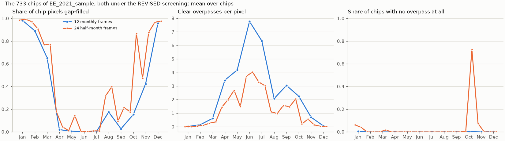

# Half-month Sentinel-2 composites, 24 frames, on a sample of Estonia: report, 13 October 2026

**Answer.** Both chip sets are built, complete and checked.

| Set | Contents | Built |
|---|---|---|
| `EE_2021_sample_24` | 733 chips with 24 half-month composites | 12.6 h on the hub, 4 workers, no failures |
| `EE_2021_sample_rev` | the same 733 chips with 12 monthly composites | cut from the re-export `EE_2021_rev`, with its own manifest |

The two sets differ only in the temporal grid. Every chip has:
- the same split lists;
- the same `REVISED` screening;
- the same composite window, hence identical resampling;
- identical labels.

Halving the frame halves the clear observations per frame: in June, 3.7 to 4.0 clear overpasses per pixel per half month against 7.8 per month. It also opens gaps that a month hides:
- **16 to 31 October:** no acquisition at all for 73 % of the chips (532 of 733), and 87 % of chip pixels gap-filled.
- **August:** 32 and 40 % of pixels filled per half month, against 17 % for the month.
- **Overall:** 545 of the 733 chips have at least one half month with no acquisition; only 9 have a month with none.

The sets were used by the TerraMind comparison in
[`../2026-10-12_terramind_12v24/REPORT.md`](../2026-10-12_terramind_12v24/REPORT.md).

## Setup

| | |
|---|---|
| Purpose | The input of a comparison of 12 monthly and 24 half-month frames for frozen encoders |
| Chips | The 733 chips of `EE_2021_sample`: whole 4 x 4 blocks of `EE_2021`'s split `blocks4_buf1600_seed0__6b0eb4cb`; its lists hold 413 training, 88 validation and 207 test chips |
| 24 frames | `s2_periods.composite_window`: the core compositor with an acquisition assigned to its half month (days 1 to 15, 16 to the month's end) instead of its month; [`PROCESS.md`](PROCESS.md) |
| 12 frames | The monthly composites of `EE_2021_rev`, the re-export under `REVISED` ([`../2026-10-12_s2_revised_export/`](../2026-10-12_s2_revised_export/README.md)). Its first pass exported these 733 chips in 3.9 h. `make_sample_rev.py` cut the set as links with `EE_2021_sample`'s blocks and gave it its own manifest |
| Shared | `REVISED` screening, one observation per overpass, per-pixel median, linear gap filling along the frames, 2 x 2 chip groups per read, int16 reflectance x 10000; labels, Sentinel-1, TESSERA and AlphaEarth linked from `EE_2021` |
| Runs | Hub. 24 frames: `build.py --workers 4 --group-size 2`, 12 October 2026, 00:10 to 12:50 UTC (a one-group trial first), 731 chips built plus 2 from the trial, 0 failed. 12 frames: re-export first pass, 733 chips, 0 failed |

## Results

### Checks

`report.py` compares the two sets chip by chip.

| Check | Result |
|---|---|
| Chips | 733 in each, the same list |
| Split lists | identical |
| Screening recorded in every chip's report | `REVISED`, 733 of 733 |
| Composite window | identical, 733 of 733. A lone chip's window is the chip itself; the core export records a window only for groups of two or more, so a missing window is read as the chip's bounds |
| Label rasters | identical, 733 of 733 |
| Bands | 288 in every 24-frame composite, described `P01_COASTAL_AEROSOL` to `P24_SWIR_2` |

### Frames

Mean over the 733 chips. Filled is the share of a chip's pixels without a clear observation in the frame. The
table shows the months where the two grids part; all frames are in [`figures/tables.md`](figures/tables.md).

| Month | Filled, 1st half | Filled, 2nd half | Filled, month | Clear overpasses per pixel, 1st half / 2nd half / month | Chips with no acquisition, 1st half / 2nd half / month |
|---|---|---|---|---|---|
| Mar | 77 % | 77 % | 65 % | 0.26 / 0.36 / 0.62 | 0 / 12 / 0 |
| Apr | 18 % | 5 % | 2 % | 1.45 / 1.99 / 3.44 | 0 / 0 / 0 |
| May | 1 % | 14 % | 1 % | 2.69 / 1.49 / 4.19 | 0 / 0 / 0 |
| Jun | 0 % | 0 % | 0 % | 3.73 / 4.04 / 7.77 | 0 / 0 / 0 |
| Jul | 1 % | 1 % | 0 % | 3.30 / 3.03 / 6.33 | 0 / 0 / 0 |
| Aug | 32 % | 40 % | 17 % | 1.11 / 0.97 / 2.08 | 0 / 0 / 0 |
| Sep | 9 % | 21 % | 3 % | 1.57 / 1.48 / 3.05 | 0 / 0 / 0 |
| Oct | 18 % | 87 % | 15 % | 2.05 / 0.20 / 2.25 | 3 / 532 / 3 |
| Nov | 47 % | 88 % | 42 % | 0.57 / 0.14 / 0.70 | 54 / 0 / 0 |

January, February and December are almost entirely gap-filled in both grids.

## Analysis

From April to July the half months are observed: at most 18 % of pixels filled, and in June and July 3 to 4 clear
overpasses per pixel per half month. That is the window in which 24 frames can add information a month merges:
emergence, canopy closure and harvest timing.

The grid costs most in late summer and autumn.
- **August 2021:** cloudy. A half month leaves a third or more of the pixels to interpolation, against a sixth
  for the month.
- **The second half of October:** effectively missing for the whole sample. 532 chips have no acquisition under
  80 % scene cloud cover, so that frame is an interpolation between early October and the first half of
  November, itself 47 % filled.

A monthly frame absorbs such gaps because one clear date anywhere in the month is enough.

On this sample, these properties did not cost TerraMind accuracy. The 24-frame arm was slightly ahead at the two
larger label budgets and level at the smallest. The frames that a half-month grid gains, April to July, are those
that matter most for Estonian crops; the frames it loses, late October and November, matter least.

## Caveats

- **Whole-chip shares.** The gap-filled shares are over all of a chip's pixels, as the per-chip reports record
  them, not over the labelled pixels only.
- **Interpolated frames.** A frame with no acquisition is interpolated from its neighbours, which in a half-month
  grid are 15 days away rather than 30. The encoders cannot tell such a frame from an observed one.
- **One season, one sample.** 2021 and the 733 chips of one sample of Estonia. Another year could have its gaps
  elsewhere.
- **Two interim states, now resolved.** `EE_2021_sample_rev` linked to the manifest of the running re-export until
  12 October, 17:32. It now holds its own manifest. Its chips' composites are those of the re-export's first pass,
  which is complete.

## Next steps

- **24 frames for all of Estonia.** This would be a second export of about the same network time as the
  re-export, roughly a day and a half, and twice TerraMind's cache. Worth it only if more seeds settle the gain
  measured on this sample.
- **Prithvi on these sets.** It needs the period centres recorded in the manifest as `temporal_coords`.

## Reproduce

    poetry run python experiments/2026-10-12_s2_semimonthly/build.py --workers 4 --group-size 2
    poetry run python experiments/2026-10-12_s2_semimonthly/make_sample_rev.py   # after the re-export's first pass
    poetry run python experiments/2026-10-12_s2_semimonthly/report.py
