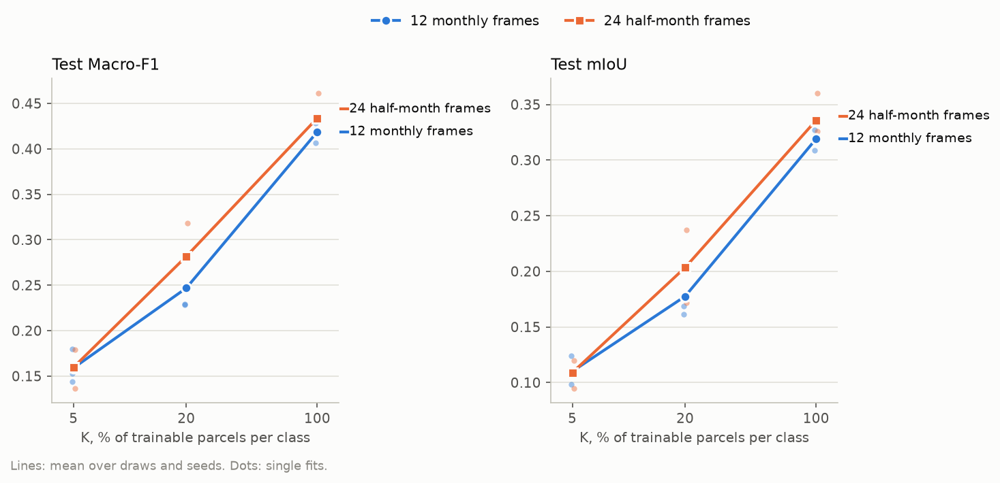
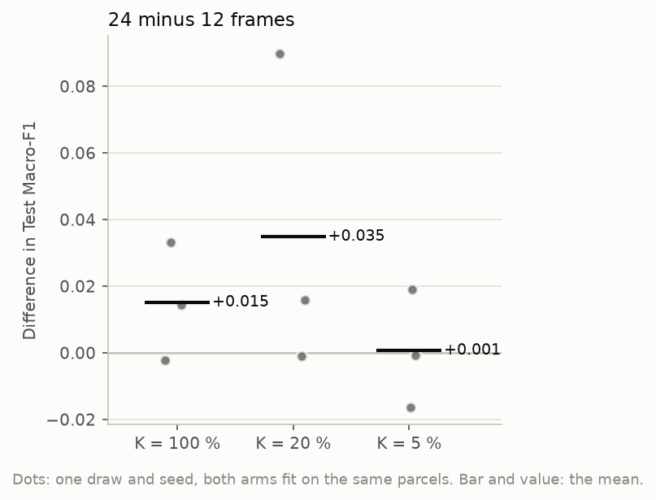
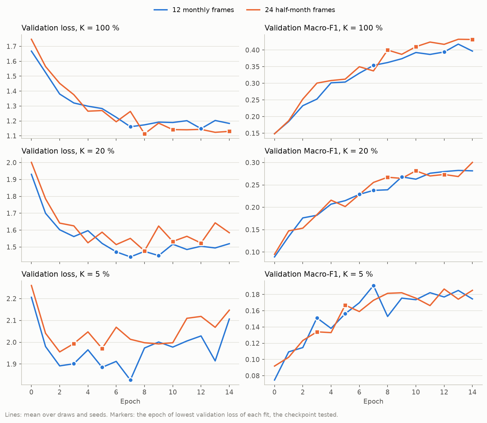
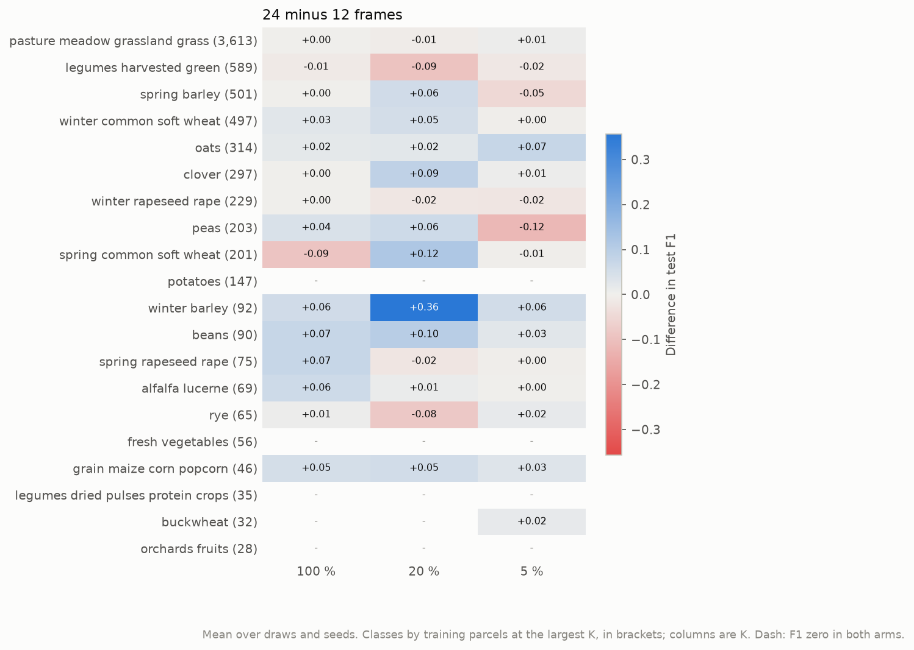

# TerraMind v1 large on 12 monthly against 24 half-month frames: report, 12 October 2026

**Answer.** On the 733 chips of the Estonian sample, 24 half-month frames give TerraMind v1 large a small and
uncertain advantage when labels are plentiful, and none when they are scarce.

| K | Test Macro-F1, 24 minus 12 | Fits won by 24 |
|---|---|---|
| 100 % | +0.015 | 2 of 3 |
| 20 % | +0.035 | 2 of 3 |
| 5 % | +0.001 | 1 of 3 |

At K = 20 % the mean rests on one fit of +0.090; the other two fits are at +0.016 and −0.001. Every difference lies
within the spread between seeds. The data show no sign that the extra, often interpolated, frames hurt, and only a
weak sign that they help.

The 24-frame arm costs twice the encoding time and twice the cache, and its bottleneck has 78 M parameters
against 40 M.

## Setup

| | |
|---|---|
| Question | Does a frozen TerraMind v1 large segment crops better from 24 half-month Sentinel-2 frames than from 12 monthly ones, and does that change with the label budget? |
| Arms | One arm, `terramind_v1_large`, on two chip sets. `EE_2021_sample_rev`: 12 monthly frames. `EE_2021_sample_24`: 24 half-month frames, days 1 to 15 and 16 to the month's end. Both use the `REVISED` screening and the same 2 x 2 composite windows. The `ChannelBottleneck` projects T x 1,024 channels to 768, so it has 40.4 M parameters at T = 12 and 78.2 M at T = 24; the UNet decoder is the same 12.9 M |
| Chip set | The chips of `EE_2021_sample`, split `blocks4_buf1600_seed0__6b0eb4cb`: 413 training, 88 validation and 207 test chips, all 20 classes. The parcels drawn at each budget are identical on both sets |
| Protocol | K = 100, 20 and 5 % of the parcels of each class (7,179, 1,444 and 369 parcels on 413, 352 and 227 chips); draw 0; seeds 0, 1 and 2; 15 epochs; checkpoint of lowest validation loss |
| Runs | UT HPC `itc-gpu`, commit `d120f69`. 12 frames: job 619877, 23 min including encoding. 24 frames: job 619878, 33 min. 18 fits, 0.7 GPU hours of fitting, no failures. `run.py` passed the frame count of the half-month set to the datamodule; the recorded bottleneck sizes confirm T = 24 |

## Results

### Headline

**Test Macro-F1**, mean ± standard deviation over 3 seeds

| Arm | K = 100 % | K = 20 % | K = 5 % |
|---|---|---|---|
| 12 monthly frames | 0.419 ± 0.011 | 0.247 ± 0.031 | 0.159 ± 0.019 |
| 24 half-month frames | **0.434** ± 0.024 | **0.282** ± 0.036 | 0.160 ± 0.021 |

**Test mIoU**, mean ± standard deviation over 3 seeds

| Arm | K = 100 % | K = 20 % | K = 5 % |
|---|---|---|---|
| 12 monthly frames | 0.319 ± 0.010 | 0.178 ± 0.022 | 0.110 ± 0.013 |
| 24 half-month frames | **0.336** ± 0.021 | **0.203** ± 0.033 | 0.109 ± 0.013 |

The 24-frame arm is ahead at K = 100 and 20 % in both metrics and level at 5 %. Its spread between seeds is about
twice that of the 12-frame arm at K = 100 %.

### Paired differences

| Pair | K = 100 % | K = 20 % | K = 5 % |
|---|---|---|---|
| 24 minus 12 frames | +0.015 ± 0.018 (2/3) | +0.035 ± 0.048 (2/3) | +0.001 ± 0.018 (1/3) |

Both arms of a pair used the same parcels, seed and test chips, so the difference removes the draw and the test
set. No mean is as large as twice its spread. The K = 20 % mean is pulled up by a single fit, seed 0, at +0.090.

### Training dynamics

| | Arm | K = 100 % | K = 20 % | K = 5 % |
|---|---|---|---|---|
| Validation Macro-F1 at the checkpoint | 12 frames | 0.389 | 0.237 | 0.173 |
| | 24 frames | 0.420 | 0.271 | 0.166 |
| Validation Macro-F1 at its best epoch | 12 frames | 0.422 | 0.286 | 0.198 |
| | 24 frames | 0.438 | 0.300 | 0.199 |

The validation partition agrees with the test: 24 frames are ahead at K = 100 and 20 % and level at 5 %. As in
earlier runs, the checkpoint of lowest validation loss comes before the epoch of highest validation Macro-F1,
often by several epochs. The checkpoints of the 24-frame arm come a little later, at epochs 8 to 14 against 6 to
12 at K = 100 and 20 %.

### Per class

- **Where the gains sit.** Mostly in the cereals and the smaller classes, such as beans, alfalfa, spring rapeseed
  and maize at K = 100 %, and winter barley at K = 20 % (+0.36, on 92 training parcels).
- **Where it loses.** Legumes harvested green lose at 20 %, and peas lose at 5 %.
- **Classes that don't move.** Grassland, the dominant class, does not move.
- **No pattern by crop.** The gains do not follow crops with short phenological events in any consistent way.
- **Potatoes.** They score an F1 of zero in both arms at every budget, so the expectation that half months resolve
  the three-week potato canopy cannot be tested on this sample.

## Analysis

The direction of the difference, positive at the two larger budgets, is what finer frames should give. A half
month separates emergence, peak and harvest dates that a month merges, and the half-month set adds this
information despite its interpolated frames: 545 of the 733 chips have at least one half month without any
acquisition.

The absence of a difference at K = 5 % fits the design. The bottleneck that mixes the frames has twice the
parameters at T = 24, and 369 parcels are little to fit it from. The extra detail would then pay only where there
are labels to learn it.

None of this is established. Three seeds and one draw on 207 test chips give differences of the same order as the
spread between seeds, and the largest mean rests on one fit.

The 12-frame numbers of this study cannot be set against earlier runs on `EE_2021_sample`, which used the export
screening and a different encoder. TerraMind's higher scores on `EE_2021_half` and on full Estonia come from 6 to
12 times more training chips.

## Caveats

- **Sample size.** Three seeds, one draw, a sample of 413 training and 207 test chips.
- **Bottleneck capacity.** It doubles with the frame count. The comparison is of 24 frames as this architecture
  handles them, not of the input alone.
- **Interpolation.** Both sets are gap-filled along their own frame axis. A 24-frame chip has more interpolated
  frames, but each interpolation spans half the time.
- **One encoder.** TerraMind runs once per frame and has no date input. Prithvi, which takes a date per frame,
  was not run: on half months it would need the period centres of the manifest, which this experiment does not
  wire.
- **Checkpoint criterion.** The lowest validation loss is used, as in every run so far (pipeline.md section 10);
  validation Macro-F1 peaks later.

## Next steps

1. **Settle the K = 20 % gain.** More seeds and draws on this sample, or the same comparison on a larger set.
   For full Estonia, 24 frames would roughly double TerraMind's 0.8 TB cache.
2. **Test a date-taking encoder.** Prithvi with the period centres as `temporal_coords`.
3. **Adding half-month frames to the main workflow** is a separate decision of the user. It would need
   `n_periods` support in the datamodule and the export.

## Reproduce

    bash scripts/cluster/submit.sh experiments/2026-10-12_terramind_12v24/experiment.yaml EE_2021_sample_rev
    bash scripts/cluster/submit.sh experiments/2026-10-12_terramind_12v24/experiment.yaml EE_2021_sample_24
    bash scripts/cluster/pull_results.sh 2026-10-12_terramind_12v24 EE_2021_sample_rev
    bash scripts/cluster/pull_results.sh 2026-10-12_terramind_12v24 EE_2021_sample_24
    poetry run python experiments/2026-10-12_terramind_12v24/report.py
