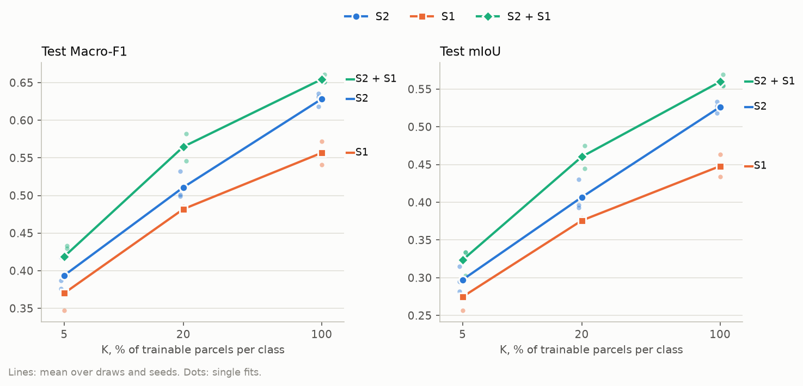
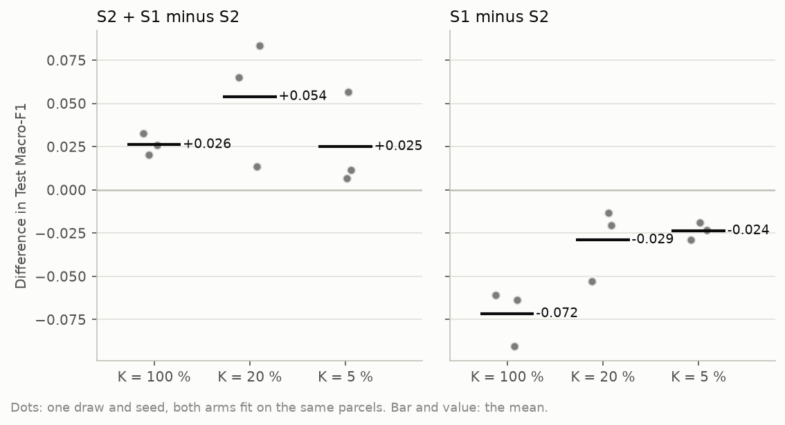
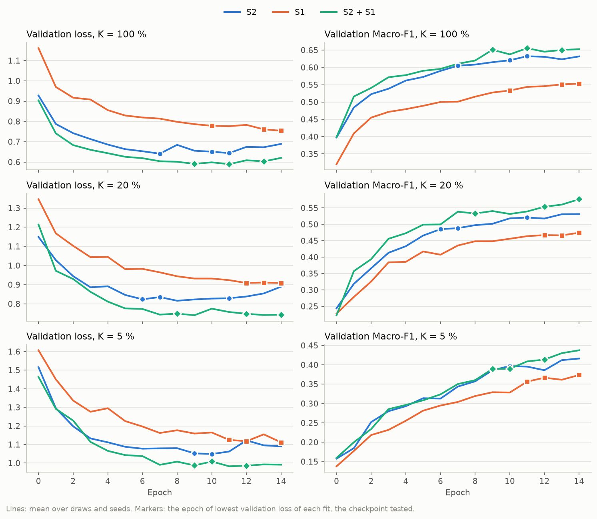
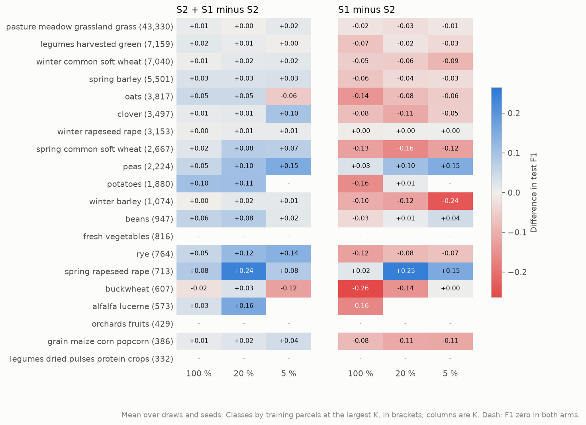

# TerraMind v1 large on Sentinel-2, Sentinel-1 and both, on all of Estonia: report, 14 October 2026

**Answer.** Adding Sentinel-1 to Sentinel-2 improves a frozen TerraMind v1 large at every label budget, on every
seed.

| K | S2 | S2 + S1 | Paired gain | Fits won by S2 + S1 |
|---|---|---|---|---|
| 100 % | 0.628 | **0.654** | +0.026 | 3 of 3 |
| 20 % | 0.511 | **0.565** | +0.054 | 3 of 3 |
| 5 % | 0.394 | **0.419** | +0.025 | 3 of 3 |

Test Macro-F1, three seeds. At K = 100 % the gain is four times its spread; at the smaller budgets it is larger in
absolute terms but noisier.

Sentinel-1 alone is weaker than Sentinel-2 alone, but not by much: 0.557, 0.482 and 0.370, that is −0.072, −0.029
and −0.024, losing every fit. Its gap narrows as labels get scarce.

The two sensors carry complementary information. Radar helps most on crops that differ in canopy structure: peas,
potatoes, spring rapeseed, rye, alfalfa and beans.

## Setup

| | |
|---|---|
| Question | How well does a frozen TerraMind v1 large segment crops from Sentinel-1 alone, and does adding Sentinel-1 to Sentinel-2 help, at each label budget? |
| Arms | `terramind_v1_large`: 12 monthly S2 composites, 12 bands; the core arm. `terramind_v1_large_s1`: 12 monthly S1 RTC composites, VV and VH in dB, through TerraMind's pretrained S1RTC patch embedding; registered by `run.py`, which drops the S2 input after the modality split. `terramind_v1_large_s2s1`: both, the tokens of the two modalities averaged at every position. All three share the token grid, the 40.4 M parameter `ChannelBottleneck` and the 12.9 M parameter UNet decoder |
| Chip set | `EE_2021_rev`, all of Estonia under the `revised` screening; split `blocks4_buf1600_seed0__6b0eb4cb`: 4,898 training, 769 validation and 1,475 test chips. The S1 composites are those of `EE_2021`, linked |
| Protocol | K = 100, 20 and 5 % of the parcels of each class: 86,909, 17,390 and 4,354 parcels on 4,898, 4,213 and 2,706 chips. Draw 0; seeds 0, 1 and 2; 15 epochs; checkpoint of lowest validation loss. The arms share the draw and the seeds, so they are compared fit by fit |
| Runs | UT HPC `itc-gpu`, node30, one job per arm. S2: job 621197, 2 h 54 min. S2 + S1: job 621198, 3 h 2 min, encoding included. S1: job 621199, 2 h 57 min. 27 fits, 6.6 GPU hours of fitting, no failure. Jobs 621197 and 621198 ran at commit `bd4cd1f`; 621199 started after another session pushed `ac3abbc`, which adds only an unrelated experiment folder, so all three arms ran the same code |

## Results

### Headline

**Test Macro-F1**, mean ± standard deviation over 3 seeds

| Arm | K = 100 % | K = 20 % | K = 5 % |
|---|---|---|---|
| S2 | 0.628 ± 0.009 | 0.511 ± 0.019 | 0.394 ± 0.021 |
| S1 | 0.557 ± 0.016 | 0.482 ± 0.003 | 0.370 ± 0.024 |
| S2 + S1 | **0.654** ± 0.006 | **0.565** ± 0.018 | **0.419** ± 0.022 |

**Test mIoU**, mean ± standard deviation over 3 seeds

| Arm | K = 100 % | K = 20 % | K = 5 % |
|---|---|---|---|
| S2 | 0.526 ± 0.007 | 0.407 ± 0.021 | 0.297 ± 0.017 |
| S1 | 0.448 ± 0.015 | 0.376 ± 0.003 | 0.275 ± 0.019 |
| S2 + S1 | **0.560** ± 0.009 | **0.460** ± 0.015 | **0.324** ± 0.018 |

The arms rank S2 + S1, S2, S1 at every budget, in both metrics.

### Paired differences

| Pair | K = 100 % | K = 20 % | K = 5 % |
|---|---|---|---|
| S2 + S1 minus S2 | +0.026 ± 0.006 (3/3) | +0.054 ± 0.036 (3/3) | +0.025 ± 0.028 (3/3) |
| S1 minus S2 | −0.072 ± 0.016 (0/3) | −0.029 ± 0.021 (0/3) | −0.024 ± 0.005 (0/3) |

Within a pair, both arms used the same parcels, seed and test chips.
- **S2 + S1 against S2:** every fit gains. At K = 100 % the gain is +0.020 to +0.032.
- **S1 against S2:** every fit loses, by more with more labels.

### Training dynamics

| | S2 | S1 | S2 + S1 |
|---|---|---|---|
| Validation Macro-F1 at the checkpoint, K = 100 / 20 / 5 % | 0.629 / 0.505 / 0.394 | 0.552 / 0.479 / 0.368 | 0.655 / 0.566 / 0.414 |
| Checkpoint epochs, all budgets | 6 to 11 | 10 to 14 | 8 to 14 |

The validation partition agrees with the test.

The arms with Sentinel-1 reach their lowest validation loss later. The S1 arm does so at epochs 10 to 14 of 15,
and its validation Macro-F1 still peaks at the last epochs, so it is probably still learning when the fit stops.
15 epochs may understate it more than the S2 arm, which reaches its lowest validation loss at epochs 6 to 11.

### Per class

**Adding S1 to S2** helps most where crops differ in canopy structure and moisture rather than in colour.

| Crop | K = 100 % | K = 20 % | K = 5 % |
|---|---|---|---|
| Peas | +0.05 | +0.10 | +0.15 |
| Potatoes | +0.10 | +0.11 | |
| Spring rapeseed | +0.08 | +0.24 | +0.08 |
| Rye | +0.05 | +0.12 | +0.14 |
| Alfalfa | | +0.16 | |
| Spring wheat | | +0.08 | +0.07 |
| Beans | +0.06 | +0.08 | |

Grassland, the dominant class, moves by at most 0.02. The few losses are at K = 5 % in small classes: buckwheat
−0.12, oats −0.06.

**Sentinel-1 alone** is worse than Sentinel-2 on most crops, and by most on the cereals and on potatoes at
K = 100 %. Two crops are exceptions:
- **Peas:** better from radar alone, +0.03, +0.10 and +0.15.
- **Spring rapeseed:** +0.25 at 20 % and +0.15 at 5 %.

## Analysis

The result is the clearest of the recent experiments, and the gain from Sentinel-1 is real in this setting.
- **Consistent.** S2 + S1 wins all nine paired fits.
- **Measurable at every budget.** At K = 100 % the gain is four times its spread. At K = 20 % it is largest:
  +0.054, about 11 % of the S2 score.
- **Not a capacity effect.** The arms have identical trainable parts: TerraMind averages the two modalities'
  tokens into the same grid, so the decoder has no more parameters to fit.

The per-class pattern explains the gain. Radar backscatter responds to canopy structure, water content and
surface roughness, which separate crops that look alike in a monthly optical composite:
- **Legumes against cereals:** peas, beans and alfalfa.
- **Rapeseed:** spring rapeseed against winter rapeseed and the cereals.
- **Potatoes:** their ridged rows.

Radar also observes every month, whereas the optical stack is interpolated through the cloudy August and most of
the winter. On peas and spring rapeseed, radar alone already beats optics alone.

**For the thesis:**
- **The optical-only arms understate the encoders that can take radar.** TerraMind with S2 + S1 at K = 100 %
  (0.654) is above TESSERA on the old grid (0.631). TESSERA embeds Sentinel-1 upstream, which may explain part of
  its earlier lead over the optical-only token-grid arms. That comparison is not paired and TESSERA has not run on
  `EE_2021_rev`.
- **A modality question for the model set.** Whether to make TerraMind S2 + S1 an arm of the main workflow, and to
  wire THOR's Sentinel-1 input, is a question for the arms of RQ1, not only for this experiment.

The S2 arm is also the main workflow's TerraMind on the new chip set. Against the 2 October grid on `EE_2021`
(0.586, 0.479 and 0.362, one fit), its three seeds are all higher at every budget. That comparison is not paired
and mixes the change of screening with code changes since then.

## Caveats

- **Sample size.** Three seeds and one draw. The K = 20 and 5 % gains have spreads of 0.03 to 0.04.
- **Fit length.** 15 epochs with the checkpoint of lowest validation loss. The S1 arm seems to be still improving
  at the end, so its gap to S2 may be overstated.
- **The S1 composites were not reviewed** as the S2 ones were: monthly medians in linear power, both orbit
  directions mixed, which can shift backscatter by several dB.
- **Fusion by averaging.** S2 + S1 is TerraMind's mean of the two modalities' tokens. Other fusions, such as
  concatenation or separate bottlenecks, were not tried.
- **One encoder.** THOR also accepts Sentinel-1 but is not wired for it. Prithvi cannot take it.

## Next steps

1. **Settle the K = 20 and 5 % gains** with more draws.
2. **Wire Sentinel-1 into THOR** and repeat for it.
3. **Decide on S2 + S1 arms for the main K-shot workflow.** A decision of the user: it changes the arms of RQ1
   and the decoder-matching argument of `protocol.md`.
4. **Review the S1 composites:** orbit direction, and monthly median against mean.

## Reproduce

    bash scripts/cluster/submit.sh experiments/2026-10-13_terramind_s1_s2/experiment.yaml EE_2021_rev
    bash scripts/cluster/pull_results.sh 2026-10-13_terramind_s1_s2 EE_2021_rev
    poetry run python experiments/2026-10-13_terramind_s1_s2/report.py --chips EE_2021_rev
