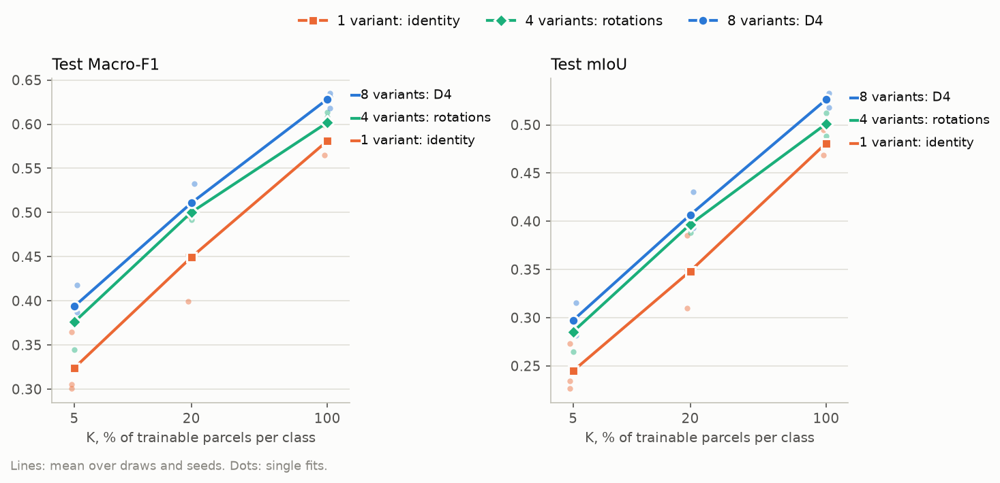
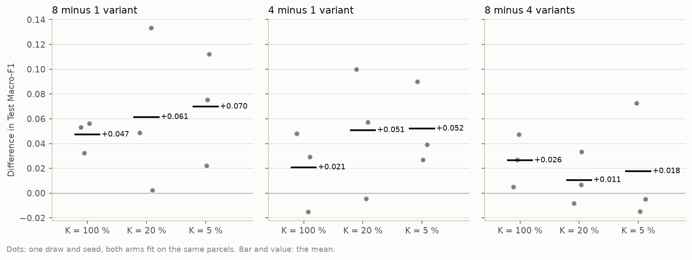
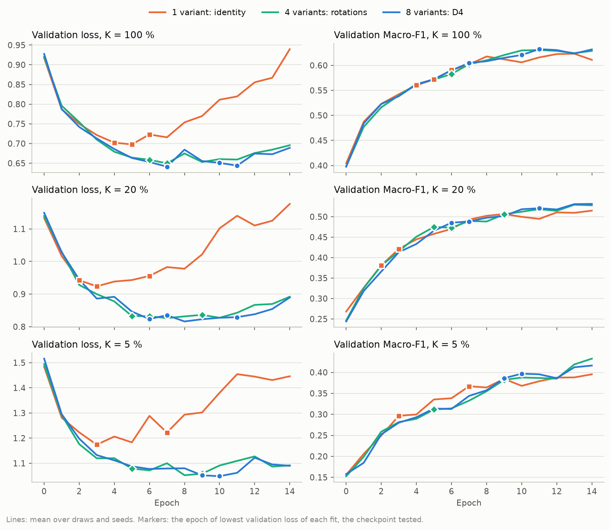
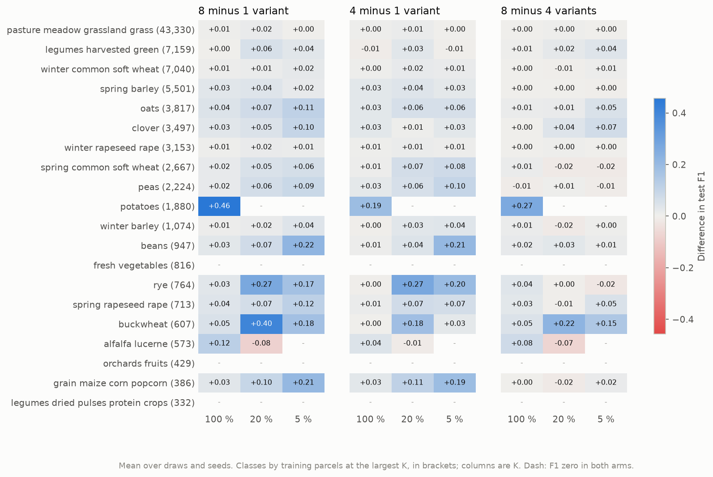

# How many D4 variants does TerraMind's decoder need? Full Estonia, EE_2021_rev: report, 14 October 2026

**Answer.** Yes, the augmentation adds on the main workflow's chip set, at every budget. Training the decoder on
all eight D4 variants instead of the identity alone raises test Macro-F1 by 0.047 at K = 100 %, 0.061 at 20 % and
0.070 at 5 %, in every seed. At 100 % the gain is almost four times its spread; at 20 % and 5 % it varies from
0.002 to 0.133 between seeds. As on half of Estonia (`../2026-10-09_terramind_d4_count`), most of it comes through
the checkpoint of lowest validation loss. Without augmentation the validation loss turns upward after epoch 2 to 7,
so the unaugmented decoder is tested early. On validation, the gaps of 0.048, 0.059 and 0.067 at the epochs kept
shrink to 0.015 to 0.017 at each fit's best epoch. Half of the gain at K = 100 % is one class: validation
potato IoU rises from zero only at epoch 5 to 8, while the identity arm's checkpoints sit at epochs 4 to 6. The
main workflow should keep all eight variants. How much they are worth depends on the checkpoint criterion, which is
still open.

## Setup

| | |
|---|---|
| Question | Does the D4 augmentation of the two-stage fit add to the results on full Estonia under the revised screening, and are four rotations enough? |
| Arms | TerraMind v1 large, frozen, `ChannelBottleneck` and the 12.9 M parameter UNet decoder, as the core arm. Only the variants drawn in training differ: **1 variant** (`terramind_v1_large_d4x1`, identity), **4 variants** (`terramind_v1_large_d4x4`, the quarter turns), **8 variants** (`terramind_v1_large`, the core arm, all of D4). Validation and test always read the identity |
| Chip set | `EE_2021_rev`, the main workflow's since 13 October: split `blocks4_buf1600_seed0__6b0eb4cb`, 4,898 training, 769 validation and 1,475 test chips. The test chips are those of the half-Estonia study and of the 2 October grid |
| Protocol | K = 100, 20 and 5 % of the trainable parcels of each class (86,909, 17,390 and 4,354 parcels on 4,898, 4,213 and 2,706 training chips), draw 0, seeds 0, 1 and 2, 15 epochs, checkpoint of lowest validation loss. 27 fits; the arms share draw and seeds, so they are compared fit by fit |
| Runs | UT HPC `itc-gpu`, 14 October 2026, at commit `53f7783`, one job per arm: 621979 (1 variant, node30, 3 h 36 min), 621980 (4 variants, node29, 3 h 23 min) and 621981 (8 variants, node29, 3 h 23 min). No failure |
| Cost | Each job encoded its own cache, 41,428 chip encodings (about 0.8 TB on the node's `/local`), in 26 min. A fit takes 0.30 h with 1, 4 or 8 variants alike; 8.2 GPU hours of fitting in all |
| Cross-check | The core arm's test Macro-F1, 0.628, 0.511 and 0.394, is that of the S2 arm of `../2026-10-13_terramind_s1_s2` to the third decimal: the same arm, chip set, draw and seeds, fitted in another job, give the same result |

## Results

### Headline

The three arms are ordered at every budget: identity, then four rotations, then all eight. The identity lies
0.05 to 0.07 below the eight-variant arm, and its fits scatter the most.

**Test Macro-F1**, mean +- standard deviation over three seeds

| Arm | K = 100 % | K = 20 % | K = 5 % |
|---|---|---|---|
| 1 variant: identity | 0.581 +- 0.017 | 0.449 +- 0.049 | 0.324 +- 0.036 |
| 4 variants: rotations | 0.602 +- 0.016 | 0.500 +- 0.009 | 0.376 +- 0.027 |
| 8 variants: D4 | 0.628 +- 0.009 | 0.511 +- 0.019 | 0.394 +- 0.021 |

**Test mIoU**, mean +- standard deviation over three seeds

| Arm | K = 100 % | K = 20 % | K = 5 % |
|---|---|---|---|
| 1 variant: identity | 0.481 +- 0.013 | 0.348 +- 0.038 | 0.245 +- 0.025 |
| 4 variants: rotations | 0.501 +- 0.012 | 0.397 +- 0.009 | 0.285 +- 0.018 |
| 8 variants: D4 | 0.526 +- 0.007 | 0.407 +- 0.021 | 0.297 +- 0.017 |

### Paired differences

Each dot is one seed, both arms trained on the same labelled parcels from the same initialisation. Eight variants
beat the identity in all nine pairs. The size varies a lot at the lower budgets: at 20 % the three seeds give
+0.048, +0.133 and +0.002, at 5 % +0.022, +0.075 and +0.112. Four rotations beat the identity in seven of nine
pairs. Eight variants beat four in all three seeds at 100 %, by +0.026; below that the flips add +0.011 and +0.018
on average, within the noise.

**Paired difference in test Macro-F1**, mean +- standard deviation (seeds won by the first arm)

| Pair | K = 100 % | K = 20 % | K = 5 % |
|---|---|---|---|
| 8 minus 1 variant | +0.047 +- 0.013 (3/3) | +0.061 +- 0.066 (3/3) | +0.070 +- 0.045 (3/3) |
| 4 minus 1 variant | +0.021 +- 0.032 (2/3) | +0.051 +- 0.052 (2/3) | +0.052 +- 0.034 (3/3) |
| 8 minus 4 variants | +0.026 +- 0.021 (3/3) | +0.011 +- 0.021 (2/3) | +0.018 +- 0.048 (1/3) |

### Training dynamics

The picture of the half-Estonia study, sharper. Without augmentation the validation loss reaches its minimum at
epoch 2 to 7 and then climbs: at K = 20 % from 0.92 at epoch 3 to 1.18 at epoch 14. With four or eight variants
it keeps falling until epoch 7 to 10 and rises only slightly afterwards. Validation Macro-F1, meanwhile, rises
almost identically in the three arms until epoch 9 or 10; only then does the identity fall behind, by about 0.02.
The checkpoint of lowest validation loss therefore tests the identity arm at epoch 2 to 7 and the eight-variant
arm at epoch 6 to 11. Within the identity arm the test score follows the epoch kept: at 20 %, checkpoints at
epochs 3, 2 and 6 give 0.453, 0.399 and 0.496. That is why the paired differences at 20 % range from +0.002
to +0.133.

**Epochs per fit**: the checkpoint (lowest validation loss) / the highest validation Macro-F1

| Arm | K = 100 % | K = 20 % | K = 5 % |
|---|---|---|---|
| 1 variant: identity | 5, 6, 4 / 13, 13, 12 | 3, 2, 6 / 9, 14, 11 | 3, 3, 7 / 12, 13, 14 |
| 4 variants: rotations | 7, 6, 7 / 14, 10, 12 | 9, 5, 6 / 14, 13, 13 | 9, 5, 9 / 14, 14, 14 |
| 8 variants: D4 | 11, 10, 7 / 11, 12, 12 | 6, 11, 7 / 13, 14, 14 | 9, 10, 9 / 13, 13, 14 |

**Validation Macro-F1** at the checkpoint / the best epoch / the last epoch, mean over seeds

| Arm | K = 100 % | K = 20 % | K = 5 % |
|---|---|---|---|
| 1 variant: identity | 0.581 / 0.626 / 0.611 | 0.446 / 0.523 / 0.515 | 0.327 / 0.404 / 0.395 |
| 4 variants: rotations | 0.601 / 0.635 / 0.629 | 0.497 / 0.532 / 0.528 | 0.371 / 0.433 / 0.433 |
| 8 variants: D4 | 0.629 / 0.641 / 0.632 | 0.505 / 0.538 / 0.531 | 0.394 / 0.421 / 0.416 |

On validation, eight variants minus the identity is +0.048, +0.059 and +0.067 at the checkpoints kept (100, 20
and 5 %). At each fit's best epoch it is +0.015, +0.015 and +0.017, and at the last epoch +0.021, +0.016 and
+0.021. At 5 % the four-variant arm reaches the highest best-epoch score of the three, 0.433.

### Per class

**Potatoes carry half of the gain at K = 100 %.** The eight-variant arm predicts them with test F1 0.66, 0.65
and 0.61 in the three seeds. The identity arm gets 0.09, 0.46 and 0.00, and the four-variant arm 0.55, 0.06 and
0.50. That one class adds +0.46 to the per-class difference and +0.023 to the Macro-F1 difference over 20 classes.
Without potatoes, eight variants minus the identity at 100 % is +0.026 +- 0.003. The validation curves show why.
In every arm and seed, validation potato IoU is zero until epoch 4 and reaches 0.3 to 0.6 only from epoch 7 or 8 on.
The identity arm's checkpoints at epochs 4, 5 and 6 hold 0.00, 0.04 and 0.32; the eight-variant arm's at epochs 7,
10 and 11 hold 0.48 to 0.55. Potatoes are learnable at K = 100 % in every arm; the checkpoint decides whether the
tested decoder has learnt them. At 20 % and 5 % no arm learns them.

Apart from potatoes, the gains follow class size, as on half of Estonia. The largest classes move little:
grassland, winter wheat, spring barley and winter rapeseed by 0.00 to 0.04, legumes harvested green by up to 0.06. The classes with a few hundred to a few
thousand parcels gain most at the lower budgets: at 20 %, buckwheat +0.40, rye +0.27 and maize +0.10; at 5 %,
beans +0.22, maize +0.21, buckwheat +0.18, rye +0.17, spring rapeseed +0.12, oats +0.11 and clover +0.10. The one
loss is alfalfa at 20 %, -0.08. Three classes (fresh vegetables, orchards, dried pulses) score zero in every arm
at every budget, as on half of Estonia.

## Analysis

**The mechanism is the half-Estonia study's.** With the identity alone the decoder fits its training chips within
a few epochs. Its predictions on unseen chips become overconfident, so the validation loss rises while the
validation Macro-F1 still improves. Augmentation shows each chip in up to eight geometries, delays that
memorisation and keeps the validation loss falling for longer. The checkpoint criterion turns this into a test
gap: on validation, the gap at each fit's best epoch is a quarter to a third of the gap at the epochs kept, at
every budget. A smaller, real gain remains. The augmented arms reach a higher best validation Macro-F1 at every
budget, by 0.009 to 0.029, and both augmented arms beat the identity on the last epoch too.

**Twice the training chips did not shrink the gain.** The half-Estonia study gave +0.033, +0.070 and +0.020 for
eight variants minus the identity; full Estonia gives +0.047, +0.061 and +0.070. The expectation that more chips
would slow memorisation does not show: the identity arm's validation loss turns at the same epochs as on half of
Estonia (3 to 6 in the mean curves) and rises about as steeply, by a third from its minimum to epoch 14 at
K = 100 %. The checkpoint therefore still falls before the classes that are learnt late, potatoes most of all.
Without potatoes, the gain at 100 % is +0.026, below the half-Estonia +0.033. At 5 %, the full set's 4,354 labelled parcels are
twice the half set's, and the gain stands clear of the noise in every seed, which it did not on half of Estonia.

**Four rotations recover most, not all.** At 20 % and 5 % the four-variant arm is within 0.011 and 0.018 of the
eight, and at 5 % it reaches the best validation score of the three. At 100 % the flips add +0.026 in every seed,
about half of it through potatoes, which the four-variant arm missed in one seed. Halving the training cache with
four variants would cost about 0.01 to 0.03 test Macro-F1 under the current checkpoint criterion.

**Agreement with the earlier runs.** The order 1 < 4 < 8 of the 8 October ablation (full `EE_2021`, K = 5 %,
0.304, 0.335 and 0.358) holds again here at 5 %, with 0.324, 0.376 and 0.394, under the revised screening. The core
arm's 0.628, 0.511 and 0.394 are 0.03 to 0.04 above the single-seed TerraMind cells of the 2 October grid on
`EE_2021` (0.586, 0.479, 0.362), and repeat the S2 arm of `../2026-10-13_terramind_s1_s2` exactly.

**What it means for RQ1.** As concluded on half of Estonia: the augmentation is part of what each frozen encoder
is credited with, and it must be applied equally to every token-grid arm, which the workflow does. The potato
case adds a sharper warning. Under the checkpoint of lowest validation loss, a class can be present in one fit and
absent from the next, depending on which side of its learning epoch the checkpoint falls. That moves Macro-F1 over
20 classes by up to 0.03 for a single class. Comparisons between arms whose validation losses turn at different
epochs are exposed to it.

## Caveats

* Three seeds and one draw. The spread of the identity arm at 20 % (0.399 to 0.496) comes from its checkpoint
  epoch, so its mean is unstable, and so is every paired difference against it.
* The best-epoch comparison is on validation and picks the maximum of 15 noisy values per fit, which flatters
  every arm. It shows where the gap comes from, not what a validation Macro-F1 checkpoint would score on test.
* The chip set differs from the half-Estonia study in two ways, twice the training chips and the revised
  Sentinel-2 screening, so the comparison between the two studies does not separate them.
* TerraMind only. Prithvi and THOR are fit the same way and likely behave alike; that is not tested here.

## Next steps

* **Checkpoint criterion.** Rerun these 27 fits with the checkpoint of highest validation Macro-F1 (a `run.py`
  override of the `ModelCheckpoint` monitor in a new experiment), on `EE_2021_rev`. That separates the
  augmentation's own effect from the criterion's, and settles whether late-learnt classes such as potatoes
  survive in every arm. It informs the open choice of pipeline.md section 10, now with two studies behind it.
* **Record.** An entry in pipeline.md section 11 for both D4 count studies, and an update of the
  `AUGMENT_SYMMETRIES` comment in `src/gfm4agri/benchmark/segmentation_data.py`, which still quotes the 8 October
  numbers; both only once agreed.

## Reproduce

    poetry run python experiments/2026-10-14_terramind_d4_count_ee_rev/run.py -e experiments/2026-10-14_terramind_d4_count_ee_rev/experiment.yaml --chips data/eurocrops_chips/EE_2021_rev   # hub
    TIME=0-12:00:00 bash scripts/cluster/submit.sh experiments/2026-10-14_terramind_d4_count_ee_rev/experiment.yaml EE_2021_rev                                                   # cluster
    bash scripts/cluster/pull_results.sh 2026-10-14_terramind_d4_count_ee_rev EE_2021_rev
    poetry run python experiments/2026-10-14_terramind_d4_count_ee_rev/report.py --chips EE_2021_rev
