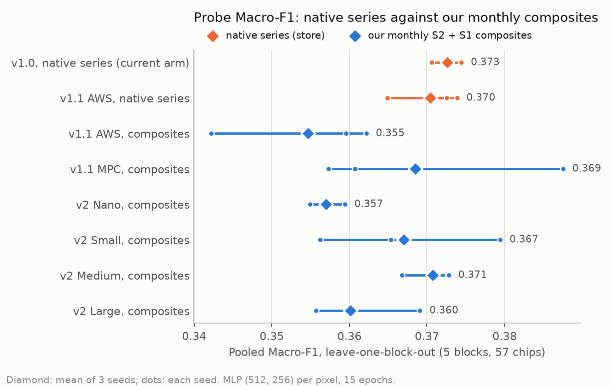
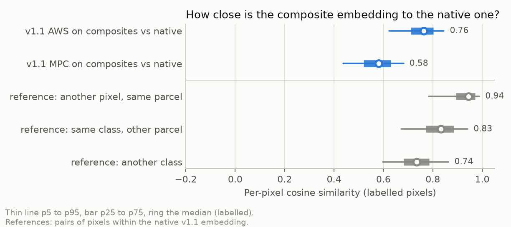
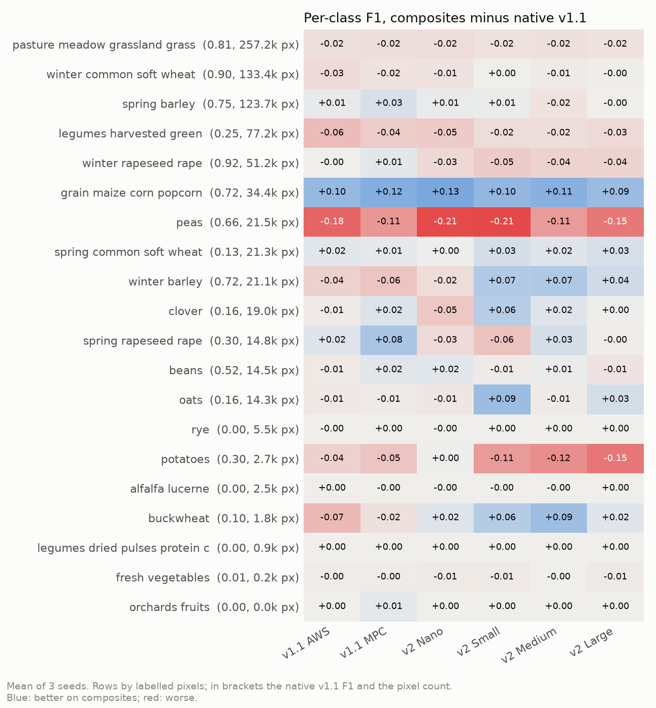

# TESSERA driven from our monthly composites: report, 14 October 2026

This report covers **stage 1**, the feasibility spike, and the **pilot of stage 2**. Stage 2 on all of Estonia will
be added once it has run on the cluster.

**Answer.** Yes, TESSERA can run on our composites. Frozen and fed the twelve monthly Sentinel-2 and Sentinel-1
composites every arm already reads, it separates crops on the pilot about as well as from its native
per-acquisition series.
- **Probe Macro-F1:** v2 Medium on composites 0.371 ± 0.003, against 0.370 ± 0.004 for the v1.1 native-series
  store and 0.373 ± 0.002 for the v1.0 store our arm uses today. Every composite variant lands within 0.018 of
  native.
- **The vector itself moves:** for the same v1.1 checkpoint, composite and native embeddings of a pixel have a
  median cosine of 0.76. That is the similarity of two pixels of different classes in the native embedding. So
  the composites give a different but about equally informative representation.
- **What it settles:** fine-tuning TESSERA on our own inputs needs no new imagery.
- **What it does not settle:** this is one small chip set at K = 100 %, so it says nothing about the label-budget
  curve.

## Setup

| | |
|---|---|
| Question | Does the TESSERA encoder still separate crops when fed our 12 monthly composites instead of its native series? |
| Representations | 2 native, read from the stores: `store_v10` (v1.0, `_tessera.tif`, our current arm) and `store_v11` (v1.1 store, AWS v1.1 checkpoint). 6 on composites, encoded here, frozen: v1.1 AWS, v1.1 MPC, v2 Nano, Small, Medium and Large |
| Chip set | `EE_2021_rev_mini`: 57 chips in 5 blocks. Pool blocks of 16, 3 and 13 chips; validation block of 16; test block of 9. 817,086 labelled pixels, 1,692 parcels, 20 classes |
| Measures | (1) per-pixel cosine to `store_v11`; (2) ridge map onto `store_v11`, fitted on the pool blocks and scored as R2 on the other two; (3) per-pixel MLP probe (512, 256; ReLU, batch norm, dropout 0.2; AdamW 1e-3, weight decay 0.05; 15 epochs), leave-one-block-out over the 5 blocks, 3 seeds, pooled Macro-F1 over every labelled pixel |
| Runs | Hub, RTX A4000 shared with another job. v1.1 store read: about 1 h (90 s per chip, 6 threads). Encoding: 6.5 to 7 min per v1.1 checkpoint, 11 to 19 min per v2 student. Probe: about 40 min. No failures |

**From our composites to TESSERA's input.** The spike checked each point against TESSERA's preprocessing and
inference code (commit `e368539`):

| | Ours | Given to TESSERA |
|---|---|---|
| S2 bands | 12, wavelength order | 10, in TESSERA's order B04 B02 B03 B08 B8A B05 B06 B07 B11 B12 (ours at indices 3 1 2 7 8 4 5 6 10 11) |
| S2 scale | DN = reflectance x 10000, BOA offset removed | the same convention; raw values, standardised with the checkpoint's statistics |
| S1 | 10 log10 of the linear-power median, dB, both orbit directions merged | TESSERA stores (20 log10(power) + 50) x 200 as int16, so (2 dB + 50) x 200 clipped to [0, 32767]. The 12 frames go in as the ascending stream with its statistics. TESSERA's own means decode to -11.0 dB for VV and -17.4 dB for VH, which confirms the 20 log10 |
| Dates | 12 months | day of year of the 15th of each month, raw integers |
| Validity | composites are gap filled | every month marked valid |
| Sequence | 12 frames | resampled to the 16-step bucket by each version's own rule (`build_resample_indices` for v1.1, `encode_pixels` for v2) |

## Results

### Headline

| Representation | Input | Probe Macro-F1, mean ± sd (3 seeds) | Ridge R2 onto `store_v11` |
|---|---|---|---|
| v1.0 store (current arm) | native series | 0.373 ± 0.002 | 0.577 |
| v1.1 store, AWS | native series | 0.370 ± 0.004 | (target) |
| v1.1 AWS | composites | 0.355 ± 0.009 | 0.670 |
| v1.1 MPC | composites | 0.369 ± 0.014 | 0.678 |
| v2 Nano (1.1 M) | composites | 0.357 ± 0.002 | 0.597 |
| v2 Small (7.1 M) | composites | 0.367 ± 0.010 | 0.622 |
| **v2 Medium (21.0 M)** | composites | **0.371 ± 0.003** | 0.630 |
| v2 Large (43.8 M) | composites | 0.360 ± 0.006 | 0.624 |

The two native representations and the best composite ones (v2 Medium, v1.1 MPC) are level. The worst composite
ones (v1.1 AWS, v2 Nano) are 0.015 to 0.018 below. Seed spread runs from 0.002 to 0.014, so only those last gaps are
clearly larger than the noise.

### How far the embedding moves

- **The reference scales**, from the native v1.1 embedding alone: two pixels of the same parcel sit at a median
  0.94, of the same class in different parcels at 0.83, of different classes at 0.74.
- **The same AWS checkpoint** on composites lands at 0.76 from its native output. A composite embedding is
  therefore not a substitute for the store's: a head trained on one would not carry over to the other.
- **A linear relation remains:** a ridge map from composite to native embeddings explains 67 % of the variance on
  held-out blocks, more than v1.0 native explains of v1.1 native (58 %).
- **The MPC checkpoint** lies further from the AWS-native store (0.58), as expected of a different checkpoint, yet
  probes as well as native.

### Per class

- **Losses on composites:**
  - **Peas** for every encoder, by 0.11 to 0.21.
  - **Harvested green legumes**, by 0.02 to 0.06.
  - **Potatoes** for the three larger v2 students, by 0.11 to 0.15. With 2,675 pixels this is the noisiest row.
  - **Grassland** by 0.02 for every encoder, the largest class.
- **Gains:** **grain maize** gains 0.09 to 0.13 everywhere. **Winter barley** gains for the v2 students from Small
  up and loses for v1.1.
- **No change:** rye, alfalfa, dried pulses, vegetables and orchards score near zero in both, for lack of training
  parcels.

## Analysis

**The information survives the compositing.** Medians over a month, with gaps interpolated, keep what a frozen
TESSERA needs to separate most crops. Composite and native representations probe level to within about 0.015. This
fits how TESSERA was pretrained: Barlow Twins aligns the embeddings of two random sparse subsets of a pixel's series,
so the encoder is built to give a stable answer from incomplete observations. Twelve frames sits inside the range it
was trained on, whose smallest bucket is 8.

**The losses are short events.** Peas and potatoes have short canopies, and harvested green legumes are cut more
than once. A monthly median smears those events, and it removes most of the Sentinel-1 frames: about 200
acquisitions per pixel natively against 12 here. These same crops gained most from Sentinel-1 in
[`../2026-10-13_terramind_s1_s2/`](../2026-10-13_terramind_s1_s2/REPORT.md). Fine-tuning can only partly undo this,
because the frames are gone from the input. That is a reason to test whether the 24 half-month composites of
[`../2026-10-12_s2_semimonthly/`](../2026-10-12_s2_semimonthly/README.md) narrow the gap. The 12 against 24 comparison
for TerraMind gained little ([`../2026-10-12_terramind_12v24/`](../2026-10-12_terramind_12v24/REPORT.md)).

**Which encoder to build on.**
- **v2 Medium** is the best and steadiest composite representation: 0.371 ± 0.003, from 21 M parameters.
- **v2 Large** is lower (0.360); a larger student buys nothing on 12 frames.
- **v1.1 MPC** ties with v2 Medium on the mean but varies about five times more between seeds, and has 57.7 M parameters.

The user chose v2 for stage 2 on 14 October 2026; this spike supports v2 Medium as its default.

**What it means for the current TESSERA arm.** The arm's advantage over the token-grid models at low budget
(0.568 against about 0.36 at 5 % on full Estonia) does not come from TESSERA's native input alone. On this pilot
the same family of encoders is about as informative from our composites. If that holds at scale, most of the
advantage would sit in the encoder and its per-pixel, 10 m design rather than in denser input. Stage 2, which puts
the encoder in our own fit, can test that directly.

## Caveats

- **Pilot scale.** 57 chips, one draw, K = 100 % only. Absolute Macro-F1 sits near 0.37 because 20 classes are
  learned from a few blocks, and the blocks hold unequal numbers of chips (3 to 16). These numbers do not compare
  with the full-Estonia grid.
- **The probe is not the arm's fit.** It trains a per-pixel MLP on labelled pixels, not the chip-level fit of the
  main workflow.
- **The Macro-F1 differs slightly from the main workflow's.** It averages over the classes present in the
  reference (scikit-learn); `per_class_scores` also counts a class that is only predicted.
- **The composite input is an approximation of TESSERA's:**
  - every month is marked valid, though a Baltic December is mostly interpolated;
  - Sentinel-1 orbit directions are merged and handed over as the ascending stream;
  - dates are fixed at the 15th of each month.
- **The v1.0 store on disk is the earlier version.** It was read before the 7 October 2026 rewrite of the store.
- **v2's input is undocumented.** The data source v2 was trained on is not stated, and its normalisation
  statistics match neither the MPC nor the AWS statistics of v1.1. v2's own were used.
- **Timings are indicative.** The GPU was shared with another job.

## Next steps

- **Stage 2.** Build the fit: the v2 encoder (Medium by default) on the composites, inside our pipeline, with one
  switch to keep it frozen or train it. Compare the two fit by fit on the same draws, on `EE_2021_rev_mini` first
  and then all of Estonia, at K = 100, 20 and 5 %.
- **Half-month composites.** Optional: run v2 Medium on the 24 half-month composites to see whether peas and
  potatoes recover.
- **For the main workflow.** The v1.1 store covers western Saaremaa, where v1.0 has no embedding (0.66 % of test
  pixels). This belongs in `pipeline.md` section 10 if the user agrees.

## Stage 2 pilot: frozen against fine-tuned on `EE_2021_rev_mini`, 14 October 2026

This pilot tests the stage 2 pipeline end to end ([DESIGN.md](DESIGN.md)); it is not the answer. It ran all
18 cells on the hub (commit `d91dae9`, 0.2 GPU hours), with tables from `report.py` and figures in
`results/2026-10-14_tessera_composites/EE_2021_rev_mini/figures/` (not committed).

| Test Macro-F1, mean ± sd (3 seeds) | K = 100 % | K = 20 % | K = 5 % |
|---|---|---|---|
| v2 Medium, frozen | 0.168 ± 0.014 | 0.166 ± 0.016 | 0.150 ± 0.011 |
| v2 Medium, fine-tuned | 0.191 ± 0.003 | 0.176 ± 0.020 | 0.153 ± 0.012 |
| **Fine-tuned minus frozen, paired** | **+0.023 ± 0.016 (3/3)** | **+0.010 ± 0.006 (3/3)** | **+0.003 ± 0.002 (3/3)** |

- **The pipeline works.** All 18 cells finished and the checks of DESIGN.md passed beforehand. The frozen
  K = 100 % scores (0.15 to 0.18) sit where the main workflow's TESSERA v1 arm scored on its pilot's 9 test
  chips (0.164).
- **Fine-tuning helps in every paired fit, and the gain shrinks with the budget.** On the pilot that shrinking is
  partly mechanical. At K = 5 % the sampler draws 2,387 pixels per epoch: one optimiser step per epoch, 15 steps
  in all, against 10 per epoch at K = 100 %. On all of Estonia, K = 5 % gives about 50 steps per epoch.
- **The encoder moves gently.** The checkpoint epochs are the same in both arms (3, 9 to 10, 14), so at learning
  rate 1e-5 fine-tuning shifts the optimum's level, not its timing. DESIGN.md held a learning-rate trial in
  reserve should full fine-tuning diverge or not move; neither happened, so it was not run.
- **Speed.** A fine-tuned cell took 2.6 to 2.8 min at K = 100 % on the shared A4000 (40,000 pixels per epoch);
  a frozen cell under 10 s. Scaled to all of Estonia, a fine-tuned K = 100 % cell should take a few hours on the
  cluster GPU.

## Reproduce

    git clone https://github.com/ucam-eo/tessera data/external/tessera
    git -C data/external/tessera checkout e368539f7c4711e5f16fdd09801573830e34baf9
    # weights into data/weights/tessera/{v1_1,v2}/, checked against data/weights/tessera/SHA256SUMS (see README.md)
    poetry run python experiments/2026-10-14_tessera_composites/spike/fetch_store.py
    poetry run python experiments/2026-10-14_tessera_composites/spike/embed_composites.py
    poetry run python experiments/2026-10-14_tessera_composites/spike/compare.py
    poetry run python experiments/2026-10-14_tessera_composites/spike/figures.py
    # stage 2
    poetry run python experiments/2026-10-14_tessera_composites/check.py
    poetry run python experiments/2026-10-14_tessera_composites/run.py -e experiments/2026-10-14_tessera_composites/experiment.yaml --chips data/eurocrops_chips/EE_2021_rev_mini
    poetry run python experiments/2026-10-14_tessera_composites/report.py --chips EE_2021_rev_mini --out results/2026-10-14_tessera_composites/EE_2021_rev_mini/figures
