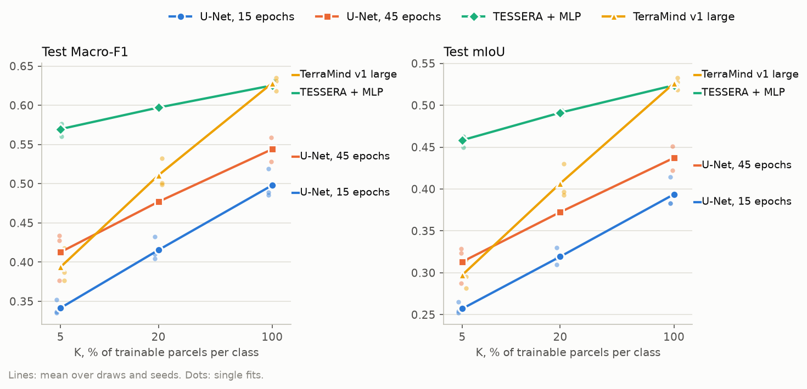
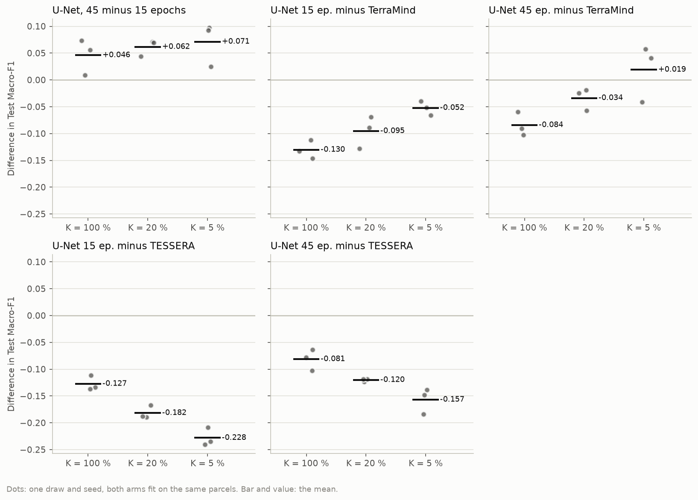
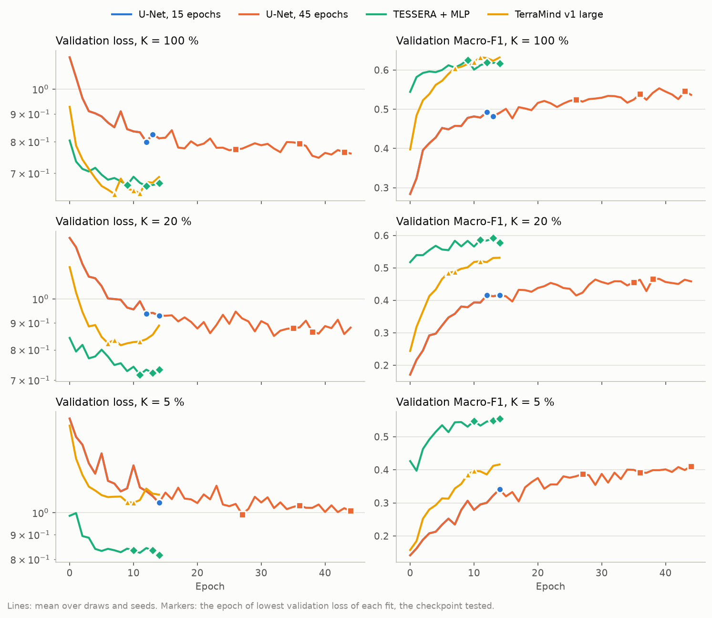
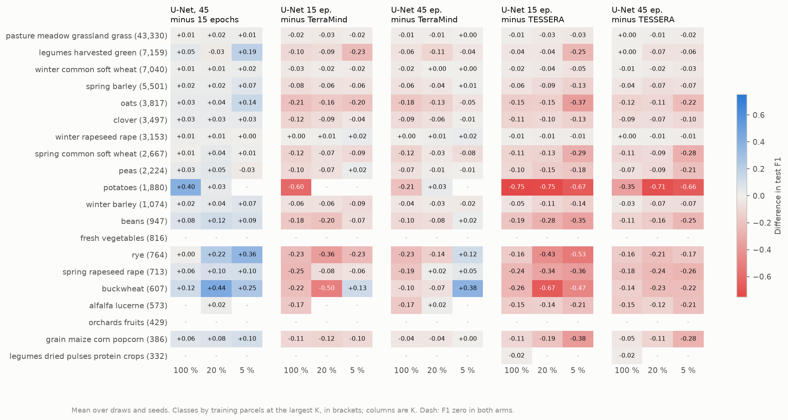

# <Title of the study>: report, <date>

Written once the results are in, from the figures and tables of `report.py` (`figures/`). Every experiment ends
with this file. Replace the guidance in each section; keep the sections.

**Answer.** Two or three sentences that answer the README's question with the numbers that carry it, and how
sure the answer is.

## Setup

| | |
|---|---|
| Question | as in README.md |
| Arms | which, and what differs between them |
| Chip set | name, training, validation and test chips |
| Protocol | budgets K, draws, seeds, epochs, checkpoint criterion |
| Runs | machine, jobs, commit(s), wall time; any failure and what was done about it |

## Results

### Headline

The mean table from `figures/tables.md`, and one sentence on what the figure shows.

### Paired differences

Only when arms share draws and seeds (`PAIRS` in `report.py`). The paired table, and which differences are larger
than their spread.

### Training dynamics

What the validation curves and the checkpoint epochs say: overfitting, the epoch kept, how it varies by seed.

### Per class

Which classes move, and whether that follows their number of training parcels.

## Analysis

What the results mean for the question and for the thesis, argued from the figures above: what is solid, what is
within the noise, and what explains the pattern. Comparisons with earlier runs name those runs.

## Caveats

What limits the conclusion: number of seeds and draws, chip set, choices that move the numbers (pipeline.md
section 10), anything that went wrong in the run.

## Next steps

What would settle what is still open, and whether something here should be added to the main workflow (a
separate decision of the user).

## Reproduce

    poetry run python experiments/<folder>/run.py -e experiments/<folder>/experiment.yaml --chips data/eurocrops_chips/<set>   # or scripts/run_kshot.py
    bash scripts/cluster/pull_results.sh <name> <set>                                                                     # if run on the cluster
    poetry run python experiments/<folder>/report.py --chips <set>
