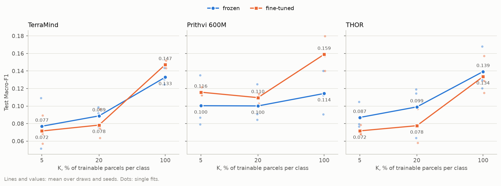
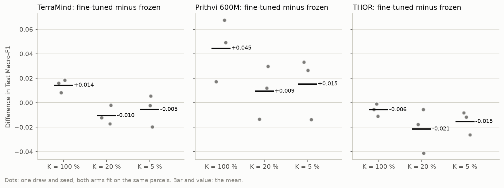
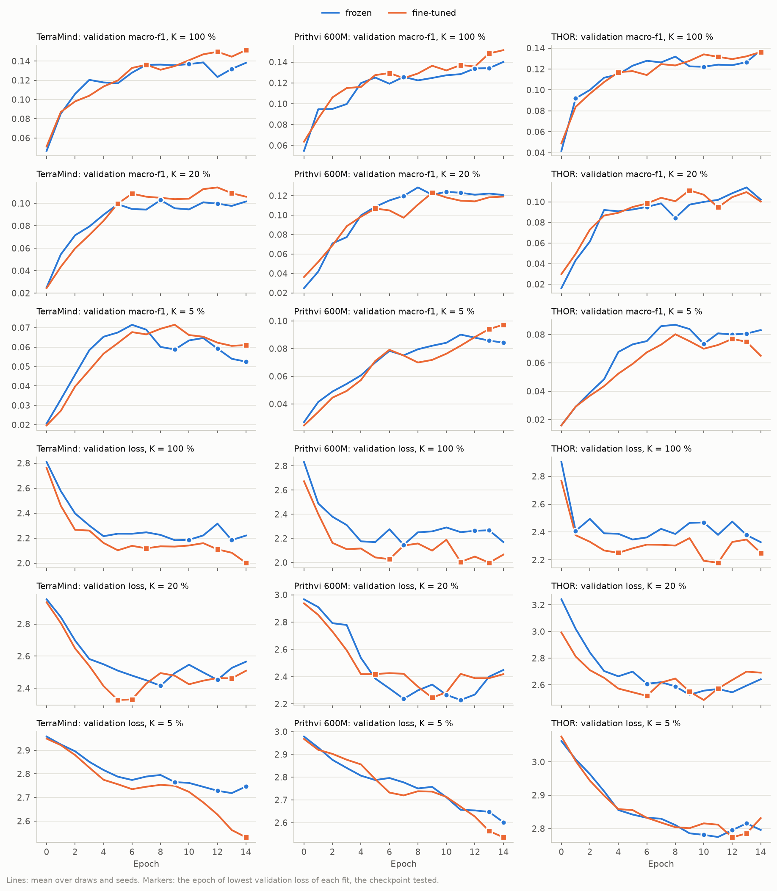
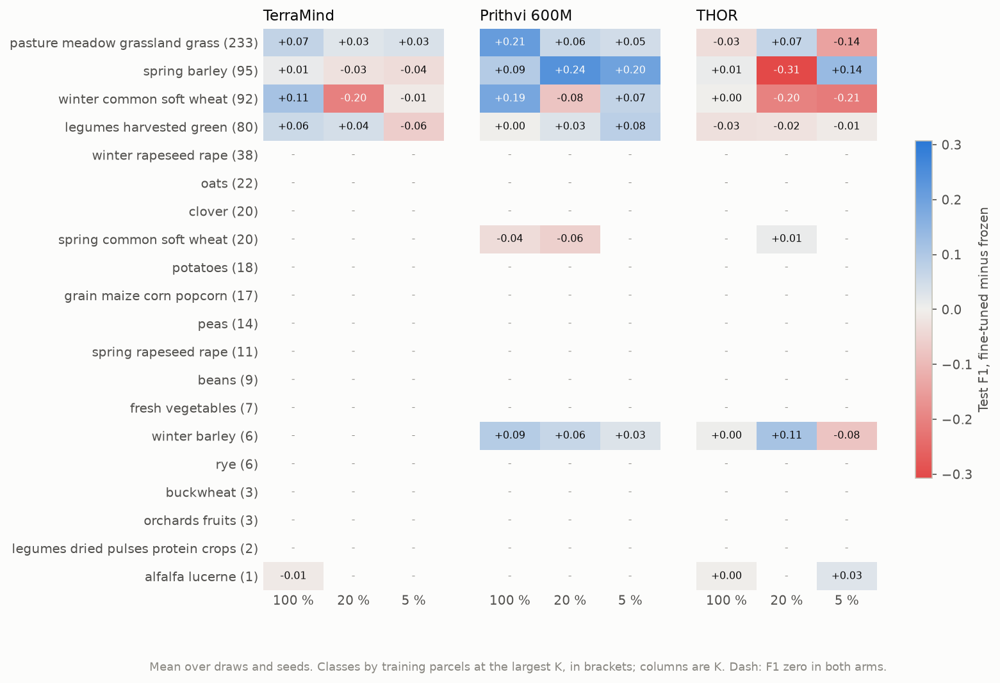

# The token-grid encoders frozen or fine-tuned: report, 15 October 2026

Stage 1 of 2: the readiness checks and the pilot on `EE_2021_rev_mini`. The run on all of Estonia (`EE_2021_rev`)
waits for the user's go; its results will be added here as stage 2.

**Answer, so far.** The fine-tuning workflow is ready. The three readiness checks of DESIGN.md pass for all three
models on the cluster. All 54 pilot cells ran without a numeric fault, and every cell's saved test predictions
reproduce its logged test accuracy. On 32 training chips the pilot cannot tell whether fine-tuning helps: the
paired differences range from +0.045 (Prithvi, K = 100 %) to -0.021 (THOR, K = 20 %), and most are within their
spread over three seeds.

## Setup

| | |
|---|---|
| Question | as in README.md: what each token-grid model gains, per K, when its encoder trains with the decoder |
| Arms | `terramind_v1_large`, `prithvi_eo_v2_600_tl`, `thor_v1_large` (core arms, frozen, cache route) and their `_ft` copies (`arms_run/`: end to end, encoder trained at 1e-5 with a one-epoch linear warm-up and held in eval mode, decoder at 1e-4, batch 2 x accumulate 2, fp16 mixed precision) |
| Chip set | `EE_2021_rev_mini`: 32 training, 16 validation, 9 test chips |
| Protocol | K = 100, 20, 5 %; draw 0; seeds 0, 1, 2; 15 epochs; checkpoint of lowest validation loss; a second checkpoint (highest validation Macro-F1) scored on test as a secondary readout, then deleted |
| Runs | UT HPC `itc-gpu`, RTX PRO 6000 Blackwell; commit e12ab2a. Checks: jobs 623253 to 623255 (about 2 min each). Pilot: jobs 623256 to 623261, frozen 11 to 13 min, fine-tuned 27 min (TerraMind), 45 min (Prithvi), 34 min (THOR). All exit 0 |

## Readiness checks

`check.py`, on the cluster for the three fine-tuned arms and on the hub for TerraMind.

| Check | TerraMind | Prithvi 600M | THOR |
|---|---|---|---|
| 1. Step-0 features at the bottleneck input against the core's cache, 164 chip-layers | identical at float16 | identical | identical |
| 2. Switch, frozen: encoder tensors moved | 0 of 171 | 0 of 391 | 0 of 392 |
| 2. Switch, trainable: encoder tensors moved | 171 of 171 | 391 of 391 | 308 of 392 (see below) |
| 2. Decoder tensors moved, both modes | 46 of 46 | 46 of 46 | 46 of 46 |
| 2. Encoder in train mode in any of 16 training forwards | no | no | no |
| 2. Encoder learning rate over the warm-up (8 optimiser steps) | 1.25e-6 to 1e-5 | same | same |
| 3. Seconds per training chip, fine-tuned (frozen) | 0.049 (0.021) | 0.108 (0.032) | 0.076 (0.031) |
| 3. Peak GPU memory, fine-tuned (frozen) | 13.2 GB (3.9) | 23.1 GB (5.2) | 19.6 GB (4.1) |
| 3. Estimate for the nine fine-tuned cells on `EE_2021_rev` | 7.9 h | 17.1 h | 12.3 h |

THOR's 84 unmoved encoder tensors (9.5 M of 314 M parameters) are all expected: 72 are the patch embeddings of
bands we do not feed (Sentinel-1, Sentinel-3, B01 and B09), 10 are the band-group embeddings that THOR fixes as
sine-cosine tables (`requires_grad_(False)` in `thor_vit.py`), and 2 are THOR's final norm, outside the layers the
neck takes. Every tensor on the path from our bands to the decoder trains.

The predictions check (`check.py --predictions`, on the hub) recomputes the pixel accuracy of each cell's
`predictions_test.npz` and compares it with the logged `test/Pixel_Accuracy`. All 54 cells agree within 1e-3. The
27 frozen cells agree to the fifth decimal. The 27 fine-tuned cells differ by up to 6e-4, which comes from fp16
autocast on the hub's A4000 against the cluster's Blackwell. The fine-tuned checkpoints load strictly, so the
predictions use the trained encoder and not the pretrained one.

No log shows a NaN, an overflow or a failed step. The one warning, a scheduler step before the first optimiser
step, is the gradient scaler of fp16 mixed precision skipping the first step at its initial scale of 2^16; it
shifts the warm-up by at most one step.

## Results

### Headline

| Arm | K = 100 % | K = 20 % | K = 5 % |
|---|---|---|---|
| TerraMind, frozen | 0.133 +- 0.010 | 0.089 +- 0.012 | 0.077 +- 0.029 |
| TerraMind, fine-tuned | 0.147 +- 0.004 | 0.078 +- 0.017 | 0.072 +- 0.016 |
| Prithvi 600M, frozen | 0.114 +- 0.025 | 0.100 +- 0.022 | 0.100 +- 0.030 |
| Prithvi 600M, fine-tuned | 0.159 +- 0.020 | 0.110 +- 0.006 | 0.116 +- 0.005 |
| THOR, frozen | 0.139 +- 0.025 | 0.099 +- 0.031 | 0.087 +- 0.015 |
| THOR, fine-tuned | 0.134 +- 0.021 | 0.078 +- 0.019 | 0.072 +- 0.006 |

Test Macro-F1, mean and standard deviation over three seeds. On 32 training chips and 9 test chips the scores are
a fifth of those on all of Estonia (0.57 to 0.64 at K = 100 %), as on the earlier pilots; they test the plumbing,
not the models.

### Paired differences

| Pair | K = 100 % | K = 20 % | K = 5 % |
|---|---|---|---|
| TerraMind: fine-tuned minus frozen | +0.014 +- 0.005 (3/3) | -0.010 +- 0.008 (0/3) | -0.005 +- 0.013 (1/3) |
| Prithvi 600M: fine-tuned minus frozen | +0.045 +- 0.025 (3/3) | +0.009 +- 0.022 (2/3) | +0.015 +- 0.025 (2/3) |
| THOR: fine-tuned minus frozen | -0.006 +- 0.005 (0/3) | -0.021 +- 0.018 (0/3) | -0.015 +- 0.010 (0/3) |

In brackets, the fits that fine-tuning wins. Prithvi gains at K = 100 % in all three seeds, TerraMind gains
slightly there, and THOR loses slightly at every K. With three fits per cell over nine test chips none of this is a
finding: the differences are of the size of each arm's own spread over seeds (0.004 to 0.031).

### Training dynamics

At K = 100 % the fine-tuned validation loss runs below the frozen one from the first epochs for all three models:
the trainable encoder fits the training chips better, as it should. At K = 5 % the pilot has 21 training chips,
about five optimiser steps per epoch; the fine-tuned validation loss of TerraMind and Prithvi is still falling at
epoch 14, and their checkpoint lands on epoch 13 or 14 in all six fits. On `EE_2021_rev` the same K has about 2,700 chips and
130 times as many steps per epoch, so this says nothing about the full run.

The second checkpoint, of highest validation Macro-F1, moves the fine-tuned test Macro-F1 by -0.008 to +0.017
with no consistent sign (`figures/tables.md`).

### Per class

Only seven classes reach a non-zero F1 on the nine test chips. Their differences reach 0.3 in either direction and
change sign between K; with a handful of test parcels per class they are noise.

## Analysis

The pilot answers what it was for: the fine-tuning workflow runs, trains what it should and nothing else, and its
outputs are consistent. The step-0 features match the core cache exactly, so a fine-tuned and a frozen fit start
from the same representation, and any difference in the full run comes from training the encoder. Fine-tuning
lowers the validation loss at K = 100 % for all three models, which shows the encoder's updates reach the
decoder's objective.

Whether fine-tuning raises test Macro-F1 cannot be read from 32 training chips. The TESSERA study
(`../2026-10-14_tessera_composites/`) found +0.04 on all of Estonia in all nine pairs; its pilot had also been
inconclusive.

## Caveats

- 32 training and 9 test chips, three seeds, one draw: the pilot scores are far below the full-Estonia ones and
  their spread is of the size of the differences.
- One encoder learning rate (1e-5, chosen a priori, DESIGN.md), not tuned per model or K. A model that loses
  under fine-tuning may do better at another rate.
- Both modes share batch (2 x accumulate 2), fp16 mixed precision, decoder learning rate, weight decay and epochs.
  The frozen arms train from the cached float16 features, which check 1 shows equal to the fine-tuned model's
  features before its first step.

## Next steps

1. **Run on all of Estonia (`EE_2021_rev`), on the user's go.** Five Slurm jobs:
   - `terramind_v1_large_ft`, about 8 h;
   - `prithvi_eo_v2_600_tl_ft`, about 17 h;
   - `thor_v1_large_ft`, about 12 h;
   - `prithvi_eo_v2_600_tl` and `thor_v1_large`, frozen, about 4 h each. Each builds its cache, about 1.1 and
     1.4 TB, on the node's local NVMe (about 6.4 TB free per node), as frozen TerraMind did in 2.9 h on 13 October.

   Frozen TerraMind is not refitted. Its nine cells from `../2026-10-13_terramind_s1_s2/` (`EE_2021_rev`, commit
   bd4cd1f) are copied into this experiment's results. Their configuration equals this experiment's frozen arm in
   everything but paths, and no commit since has touched the core. The fine-tuned checkpoints add about 50 GB to
   the cluster home (564 GB free).
2. Pull, run `check.py --predictions` and `report.py --chips EE_2021_rev`, and add stage 2 to this report.
3. Whether fine-tuning enters the main workflow is a separate decision of the user.
