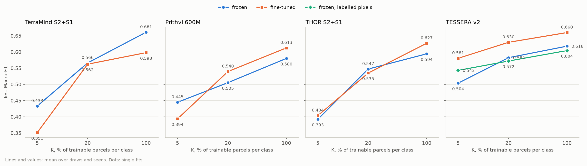
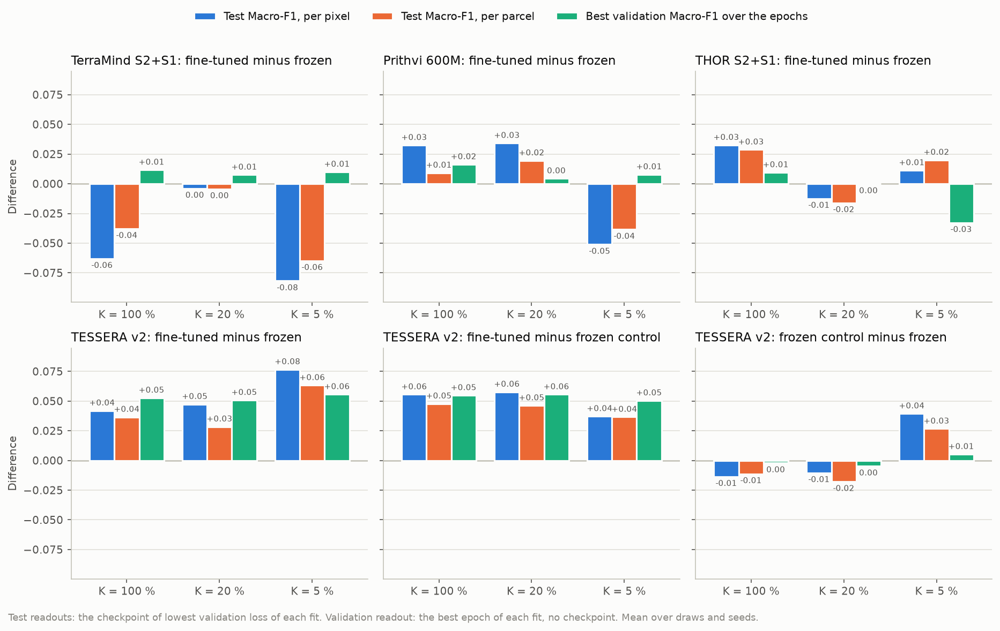
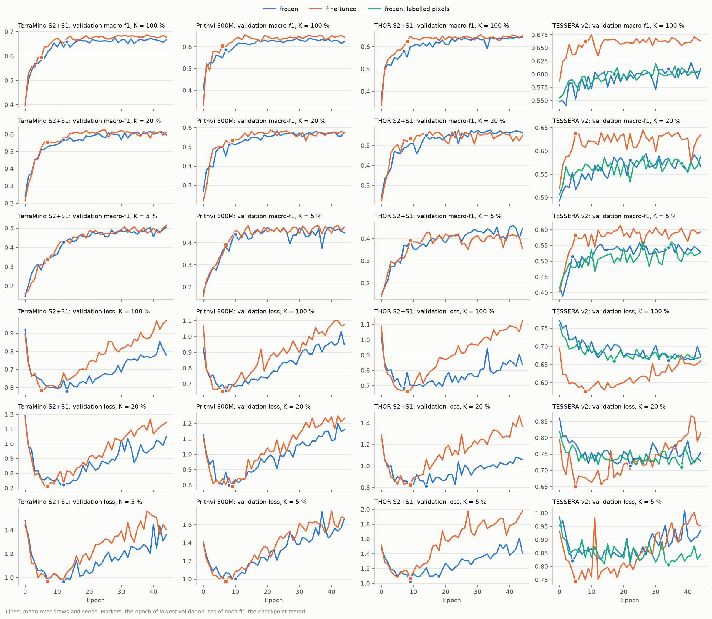
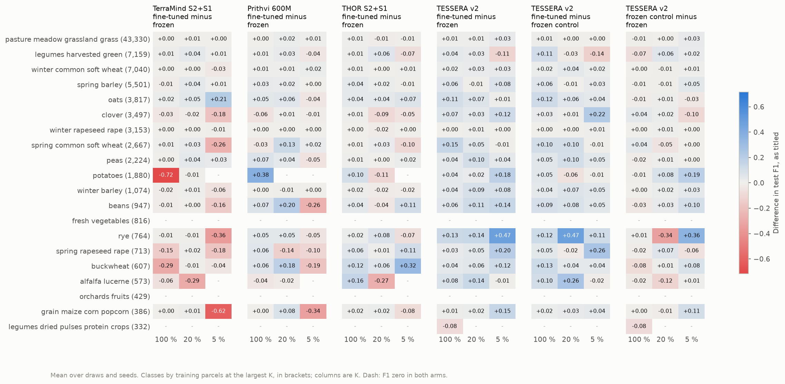

# The K-shot workflow with every encoder fine-tuned: report, 15 to 18 October 2026

Stage 2, the run on all of Estonia (`EE_2021_rev`) at 45 epochs, comes first. Stage 1, the readiness checks and the
15-epoch pilot on `EE_2021_rev_mini`, follows below, unchanged but for its figure paths.

**Answer.** Fine-tuning pays off for TESSERA v2. For the three token-grid models it does not, at this learning rate.
- **TESSERA v2:** fine-tuning raises test Macro-F1 by +0.042, +0.047 and +0.077 at K = 100, 20 and 5 %. It gains
  +0.03 to +0.06 per parcel, and +0.05 to +0.06 in best validation Macro-F1 at every K. Against the frozen control
  of its own route the gain is +0.04 to +0.06, so it comes from the trained encoder, not from the route. The
  fine-tuned arm scores 0.660, 0.630 and 0.581, the best of any arm in the main grid at K = 20 and 5 %. It ties
  frozen TerraMind (0.661) at K = 100 %.
- **TerraMind, Prithvi and THOR:** fine-tuning gains 0.000 to +0.016 in best validation Macro-F1, and THOR loses
  0.033 at K = 5 %. That is about the seed spread measured in the pilot. Under the protocol's checkpoint (lowest
  validation loss), test Macro-F1 swings from -0.082 to +0.034 with no consistent sign. The swings follow where that
  checkpoint falls, not the encoder.
- **Cost:** fine-tuning costs 4 to 9 times the frozen fitting time for the token-grid models and 15 times for
  TESSERA (34.6 h against 2.3 h for its three cells).
- **How sure:** each cell is one draw and one seed, so no difference here has an interval of its own. TESSERA's gain
  is the only one consistent across every K, readout and comparison. It also repeats the earlier composite spike
  (`../2026-10-14_tessera_composites/`): +0.037 to +0.047 on `EE_2021_rev`, with fine-tuning ahead in nine of nine
  paired fits over three seeds.

## Setup

| | |
|---|---|
| Question | as in README.md: what each model of the main workflow gains, per K, when its encoder trains with the decoder |
| Arms | `terramind_v1_large_s2s1_ft`, `prithvi_eo_v2_600_tl_ft`, `thor_v1_large_s2s1_ft` (end to end), `tessera_v2_medium_ft` and its frozen control `tessera_v2_medium_lab` (labelled pixels); encoders at 1e-5 after a one-epoch warm-up, in eval mode. Frozen side: the main workflow's 45-epoch run, `results/kshot/EE_2021_rev/` |
| Chip set | `EE_2021_rev`: 4,898 training, 769 validation, 1,475 test chips; split `blocks4_buf1600_seed0__6b0eb4cb` |
| Protocol | kshot's: K = 100, 20, 5 % (86,909, 17,390 and 4,354 training parcels, draw 0); seed 0; 45 epochs; checkpoint of lowest validation loss. Secondary readout of this folder's arms: the checkpoint of highest validation Macro-F1, tested once and deleted |
| Runs | UT HPC `itc-gpu`, RTX PRO 6000 Blackwell, one job per arm: TerraMind 624576 (11.9 h), Prithvi 624577 then 626736, THOR 624578 (12.1 h) then 626737, TESSERA 624579 (35.7 h), control 624580 (2.2 h); commits bf054eb, b2b159c, 02a10f1. Frozen side: jobs 624583 to 624588 and 626364, commits 94f87ca, b2b159c, 02a10f1. All exit 0 in the end; the incidents are below |

**Incidents.**
- **Node failures:** `itc-gpu` failed every 20 minutes or so from 12:14 to about 13:54 on 16 October. Each running
  job ended NODE_FAIL and was requeued automatically, and the requeue refitted any cell left half done. Such a
  refit leaves the interrupted fit's `best-loss.ckpt` beside its own `best-loss-v1.ckpt`.
- **Wrong checkpoint for predictions:** this folder's predictor loaded `best-loss.ckpt` by name. Prithvi K = 20 %
  and THOR K = 20 % were therefore predicted with the interrupted fit's checkpoint: their saved predictions gave
  pixel Macro-F1 0.5488 and 0.5335 against the 0.5397 and 0.5351 the fits logged. Commit 02a10f1 makes the
  predictor load the checkpoint `results.json` names, as the core does since b2b159c. The two prediction files are
  kept as `predictions_test.stale_ckpt.npz` on the cluster, and jobs 626736 and 626737 predicted the two cells
  again.
- **TESSERA K = 100 %:** this cell was refitted after a requeue and predicted by the old code too, but its fit is
  deterministic. The interrupted fit had passed its best epoch (8), and the two `best-loss` checkpoints are
  byte-identical (same MD5), so its predictions stand.
- **Shared memory crash:** Prithvi's first job (624577) died at 23:56 on 16 October with "could not unlink the
  shared memory file" in a DataLoader worker. That was the minute the control's job ended on the same node. It was
  resubmitted as 626736, which fitted the remaining cell.
- **All cells verified:** each of the 15 cells' `predictions_test.npz` reproduces the test pixel accuracy the fit
  logged (`check.py --predictions`), and its pixel Macro-F1 within 0.002 (`predictions_match` in `summary.csv`).

## Results

### Headline

| Test Macro-F1, per pixel / per parcel | K = 100 % | K = 20 % | K = 5 % |
|---|---|---|---|
| TerraMind S2+S1, frozen | 0.661 / 0.583 | 0.566 / 0.515 | 0.433 / 0.381 |
| TerraMind S2+S1, fine-tuned | 0.598 / 0.545 | 0.562 / 0.511 | 0.351 / 0.316 |
| Prithvi 600M, frozen | 0.580 / 0.535 | 0.505 / 0.472 | 0.445 / 0.409 |
| Prithvi 600M, fine-tuned | 0.613 / 0.545 | 0.540 / 0.492 | 0.394 / 0.371 |
| THOR S2+S1, frozen | 0.594 / 0.516 | 0.547 / 0.491 | 0.393 / 0.349 |
| THOR S2+S1, fine-tuned | 0.627 / 0.545 | 0.535 / 0.475 | 0.404 / 0.369 |
| TESSERA v2, frozen | 0.618 / 0.602 | 0.582 / 0.574 | 0.504 / 0.502 |
| TESSERA v2, fine-tuned | **0.660 / 0.639** | **0.630 / 0.603** | **0.581 / 0.566** |
| TESSERA v2, frozen control (labelled pixels) | 0.604 / 0.591 | 0.572 / 0.557 | 0.543 / 0.529 |

- **TESSERA:** the fine-tuned line sits above both frozen TESSERA lines at every K. Its gap to the main grid's arm
  widens towards low K.
- **Token-grid models:** the frozen and fine-tuned lines cross. Fine-tuned TerraMind falls below frozen at K = 100
  and 5 %. Fine-tuned Prithvi and THOR are above at K = 100 % and mixed at lower K.
- **Main grid:** for scale, its U-Net baseline scores 0.616, 0.564 and 0.467 and AlphaEarth 0.523, 0.497 and 0.449
  (`results/kshot/EE_2021_rev/`).

### Paired differences under three readouts

| Fine-tuned minus frozen | Test, per pixel (100 / 20 / 5 %) | Test, per parcel | Best validation Macro-F1 |
|---|---|---|---|
| TerraMind S2+S1 | -0.063 / -0.004 / -0.082 | -0.038 / -0.004 / -0.065 | +0.012 / +0.008 / +0.010 |
| Prithvi 600M | +0.033 / +0.034 / -0.051 | +0.009 / +0.020 / -0.038 | +0.016 / +0.004 / +0.008 |
| THOR S2+S1 | +0.033 / -0.012 / +0.011 | +0.029 / -0.016 / +0.020 | +0.010 / 0.000 / -0.033 |
| TESSERA v2 | +0.042 / +0.047 / +0.077 | +0.037 / +0.028 / +0.063 | +0.053 / +0.051 / +0.056 |
| TESSERA v2, against the frozen control | +0.056 / +0.058 / +0.037 | +0.048 / +0.046 / +0.037 | +0.055 / +0.056 / +0.050 |
| TESSERA v2, frozen control minus frozen (the route alone) | -0.014 / -0.010 / +0.039 | -0.011 / -0.018 / +0.027 | -0.002 / -0.005 / +0.005 |

- **Test readouts:** both are scored at each fit's own checkpoint of lowest validation loss.
- **Validation readout:** the highest validation Macro-F1 over the 45 epochs, which needs no checkpoint. It is
  picked on the validation set, so its level flatters every arm. The difference between two arms is still a fair
  comparison, because both are picked by the same rule.
- **TESSERA:** all three readouts agree in sign and roughly in size, +0.03 to +0.08.
- **Token-grid models:** the validation readout shows a small, steady gain of about +0.01, apart from THOR at
  K = 5 %. The test readouts scatter around it by several hundredths either way.

### Training dynamics and the checkpoint

| Epoch of the checkpoint / of the best validation Macro-F1 | K = 100 % | K = 20 % | K = 5 % |
|---|---|---|---|
| TerraMind S2+S1, frozen / fine-tuned | 13 / 28; 5 / 38 | 12 / 39; 7 / 25 | 12 / 44; 7 / 44 |
| Prithvi 600M, frozen / fine-tuned | 7 / 33; 6 / 13 | 8 / 23; 9 / 21 | 10 / 39; 7 / 42 |
| THOR S2+S1, frozen / fine-tuned | 7 / 44; 8 / 31 | 14 / 34; 9 / 24 | 9 / 41; 9 / 15 |
| TESSERA v2, frozen / fine-tuned / control | 34 / 41; 8 / 10; 17 / 30 | 22 / 27; 5 / 26; 38 / 26 | 4 / 25; 5 / 19; 34 / 26 |

| Validation Macro-F1 at the checkpoint / at the best epoch | K = 100 % | K = 20 % | K = 5 % |
|---|---|---|---|
| TerraMind S2+S1, frozen | 0.659 / 0.676 | 0.569 / 0.616 | 0.428 / 0.505 |
| TerraMind S2+S1, fine-tuned | 0.595 / 0.687 | 0.554 / 0.624 | 0.339 / 0.515 |
| Prithvi 600M, frozen | 0.586 / 0.639 | 0.511 / 0.583 | 0.439 / 0.471 |
| Prithvi 600M, fine-tuned | 0.604 / 0.655 | 0.532 / 0.588 | 0.391 / 0.479 |
| THOR S2+S1, frozen | 0.580 / 0.643 | 0.553 / 0.578 | 0.389 / 0.460 |
| THOR S2+S1, fine-tuned | 0.625 / 0.653 | 0.536 / 0.578 | 0.393 / 0.427 |
| TESSERA v2, frozen | 0.610 / 0.622 | 0.581 / 0.594 | 0.515 / 0.558 |
| TESSERA v2, fine-tuned | 0.663 / 0.675 | 0.638 / 0.645 | 0.583 / 0.614 |

- **Loss turns early:** for every token-grid model, frozen or fine-tuned, validation loss reaches its minimum
  between epochs 5 and 14 and then climbs. Validation Macro-F1 peaks between epochs 13 and 44, after epoch 20 in 16
  of the 18 fits. The models grow overconfident on what they get wrong while getting more of it right.
- **Fine-tuned loss turns sooner:** with the encoder training, the loss turns at epochs 5 to 9, against 7 to 14
  frozen, and climbs faster. The checkpoint therefore lands earlier on the Macro-F1 curve, most of all for
  TerraMind (epochs 5 to 7 against 12 to 13).
- **What the checkpoint misses:** the checkpoint gives up 0.02 to 0.08 of validation Macro-F1 for the frozen
  token-grid models, and 0.03 to 0.18 for the fine-tuned ones. Fine-tuned TerraMind gives up the most, 0.092 at
  K = 100 % and 0.176 at K = 5 %.
- **TESSERA's curves:** the frozen arms' loss levels off after about epoch 10 and stays nearly flat. The fine-tuned
  arm's loss turns at epoch 5 to 8, but its validation Macro-F1 is already within 0.031 of its peak there, so the
  checkpoint costs it little.

This folder's arms also kept the checkpoint of highest validation Macro-F1 and scored it on test:

| Fine-tuned, test Macro-F1 at the loss checkpoint / at the Macro-F1 checkpoint (its epoch) | K = 100 % | K = 20 % | K = 5 % |
|---|---|---|---|
| TerraMind S2+S1 | 0.598 / 0.688 (38) | 0.562 / 0.627 (25) | 0.351 / 0.523 (44) |
| Prithvi 600M | 0.613 / 0.665 (13) | 0.540 / 0.601 (21) | 0.394 / 0.488 (42) |
| THOR S2+S1 | 0.627 / 0.647 (31) | 0.535 / 0.562 (24) | 0.404 / 0.439 (15) |
| TESSERA v2 | 0.660 / 0.671 (10) | 0.630 / 0.645 (26) | 0.581 / 0.612 (19) |
| TESSERA v2, frozen control | 0.604 / 0.620 (30) | 0.572 / 0.587 (26) | 0.543 / 0.558 (26) |

The frozen arms of the main workflow keep only the loss checkpoint, so these scores have no frozen counterpart.
They show how much the checkpoint decides. Fine-tuned TerraMind scores 0.598 or 0.688 at K = 100 %, and 0.351 or
0.523 at K = 5 %, depending on the checkpoint. Those swings (0.090 and 0.172) are larger than the differences
between frozen and fine-tuned at the loss checkpoint (0.063 and 0.082).

### Per class

- **Pasture and winter crops:** the large classes, pasture and winter wheat and rapeseed, barely move in any pair.
- **Rare classes:** the token-grid differences sit mostly in classes with fewer than about 4,000 training parcels.
  The two examples below show the early checkpoint at work.
- **Example, potatoes:** fine-tuned TerraMind at K = 100 % scores potatoes F1 0.03 at its epoch-5 checkpoint. The
  frozen arm scores 0.75 at epoch 13, and the fine-tuned model reaches 0.80 at its Macro-F1 checkpoint (epoch 38).
- **Example, maize:** at K = 5 %, fine-tuned TerraMind has not learnt grain maize by epoch 7 (F1 0.00, against 0.62
  frozen).
- **TESSERA:** fine-tuning raises almost every class. The largest gains are in the rare ones: rye +0.47 at K = 5 %,
  spring rapeseed +0.20, potatoes +0.18.

### Cost

| Fitting hours per cell, frozen / fine-tuned | K = 100 % | K = 20 % | K = 5 % | Total | Peak GB, fine-tuned |
|---|---|---|---|---|---|
| TerraMind S2+S1 | 1.04 / 4.78 | 0.98 / 4.13 | 0.69 / 2.80 | 2.7 / 11.7 | 18.5 |
| Prithvi 600M | 1.54 / 6.69 | 1.09 / 5.89 | 0.77 / 3.88 | 3.4 / 16.5 | 22.9 |
| THOR S2+S1 | 0.89 / 8.03 | 0.82 / 7.03 | 0.57 / 4.68 | 2.3 / 19.7 | 26.5 |
| TESSERA v2 | 0.94 / 25.84 | 0.78 / 6.22 | 0.55 / 2.50 | 2.3 / 34.6 | 9.0 |

- **What the frozen hours leave out:** the frozen token-grid arms also compute their feature cache on the node, a
  cost the fine-tuned runs do not pay.
- **TESSERA's cost:** it grows with the labelled pixels, 46.6 M per epoch at K = 100 %. That cell alone ran 26 h,
  close to the readiness estimate (10.9 h for the three cells at 15 epochs, so about 33 h at 45).

## Analysis

**TESSERA: the encoder adapts.** The frozen control shows that training on labelled pixels alone does almost
nothing: -0.005 to +0.005 in best validation Macro-F1. The whole gain of the fine-tuned arm, +0.04 to +0.06 on
average under each readout, comes from letting the encoder train. TESSERA v2 was pretrained on per-observation
Sentinel-1 and Sentinel-2 time series. Here it reads twelve monthly composites, an input it never saw, and
fine-tuning at 1e-5 adapts it to that input, as the composite spike found. The gain over the main grid's arm grows
towards low K per pixel (+0.077 at K = 5 %), and it holds per parcel. At K = 5 % the fine-tuned TESSERA (0.581) is
0.077 above the best arm of the main grid (frozen TESSERA, 0.504) and 0.114 above the U-Net baseline.

**Token-grid models: not resolved at this budget and this checkpoint.**
- **Validation readout:** the readout that does not depend on the checkpoint puts the gain at about +0.01, the size
  of the seed spread, for all three models.
- **Test readouts:** at the protocol's checkpoint the differences are larger, but they are set by when validation
  loss turns, which comes earlier with the encoder training. Fine-tuned TerraMind loses 0.063 at K = 100 % largely
  because its checkpoint is epoch 5. At its Macro-F1 checkpoint it scores 0.688, 0.027 above the frozen arm's
  loss-checkpoint score. That comparison is not paired by criterion either.
- **What can be said:** fine-tuning the three large encoders at 1e-5 for 45 epochs does not change their
  validation Macro-F1 by more than the noise, and costs 4 to 9 times the fitting time. Whether it helps under a
  Macro-F1 checkpoint for both sides is open; see Next steps.
- **Why TESSERA differs:** two candidate reasons, which this run does not separate. Its encoder is small (Medium)
  and trains on 46.6 M labelled pixels per epoch, where each token-grid encoder sees 4,898 chips. And it reads
  monthly composites, which differ from the per-observation time series it was pretrained on, so it has more to
  adapt to.

**The checkpoint criterion matters more here than the encoder.** With 45 epochs, validation loss picks epochs 5 to 14
for every token-grid fit, frozen or fine-tuned, while Macro-F1 peaks at 13 to 44. This is the open choice that
CLAUDE.md and pipeline.md section 10 already list. This experiment shows it decides the sign of a comparison
between arms whose losses turn at different epochs.

## Caveats

- **One fit per cell:** one draw and one seed. The seed spread measured on the pilot chip set was 0.01 to 0.03
  (`../2026-10-15_gfm_finetune/`); no difference here has its own interval.
- **One learning rate:** one encoder learning rate (1e-5) and one warm-up, not tuned per model or K. A lower rate
  or layer-wise decay could move the token-grid result.
- **Validation readout is optimistic:** best validation Macro-F1 is chosen on the validation set. It serves for
  differences between arms, not as an estimate of test performance.
- **TESSERA's batch norm:** TESSERA's MLP sees only labelled pixels in its batch norm on this route; the control
  isolates that, and it moves little.
- **Interrupted fits:** three cells (Prithvi K = 20 %, THOR K = 20 %, TESSERA K = 100 %) were refitted after the
  node failures. Their logged scores come from the complete refit, and their predictions were checked against them.

## Next steps

1. **Settle the token-grid question on equal criteria:** refit the three frozen token-grid arms in an experiment
   that keeps their best-F1 checkpoint as this folder does, about 8 h of fitting plus the caches. This pairs both
   sides at each checkpoint rule.
2. **Seeds 1 and 2 for intervals:** they would give the TESSERA gain an interval (about 35 h per seed for the
   fine-tuned arm). The runner resumes, so this is an `experiment.yaml` change.
3. **The checkpoint criterion** of the main workflow (validation loss or Macro-F1) is a protocol decision for the
   user; this experiment is evidence for it.
4. **Fine-tuned TESSERA in the main workflow** would be a separate decision of the user. It costs about 35 h of
   GPU per seed, against 2.3 h frozen.

---

## Stage 1: readiness checks and pilot on `EE_2021_rev_mini`, 15 October 2026

The 15-epoch pilot, written before the run on all of Estonia. A first, 15-epoch submission on `EE_2021_rev` (jobs
624389 to 624393) was cancelled after about 2 h when the main workflow moved to 45 epochs; its outputs are kept in
`results/2026-10-15_kshot_finetune/_cancelled_15_epochs/`.

**Outcome.** The workflow was ready.
- **Checks:** every readiness check of DESIGN.md passes for the four fine-tuned arms on the cluster.
- **Pilot:** the 15 cells ran without a numeric fault, and each cell's saved test predictions reproduce its logged
  test accuracy.
- **Too small to answer:** the pilot's 32 training and 9 test chips cannot tell whether fine-tuning helps. Its paired
  differences run from +0.061 (Prithvi, K = 100 %) to -0.014 (TESSERA, K = 100 %), on one fit each.

### Setup

| | |
|---|---|
| Arms | as in stage 2. Frozen side: `results/kshot/EE_2021_rev_mini/` |
| Chip set | `EE_2021_rev_mini`: 32 training, 16 validation, 9 test chips |
| Protocol | kshot's at the time: K = 100, 20, 5 %; draw 0; seed 0; 15 epochs; checkpoint of lowest validation loss; a second checkpoint (highest validation Macro-F1) scored as a secondary readout |
| Runs | UT HPC `itc-gpu`, RTX PRO 6000 Blackwell, commit 4ab89e4. Checks: jobs 624304 to 624307, 2 min each. Pilot: jobs 624308 to 624312, 2 to 16 min. All exit 0. The frozen side is the main workflow's hub pilot (commit 804dd16) |

### Readiness checks

| Check | TerraMind S2+S1 | Prithvi 600M | THOR S2+S1 | TESSERA v2 |
|---|---|---|---|---|
| 1. Step-0 equivalence with the core's cache | identical at float16, 164 chip-layers | identical | identical | cosine at least 0.99998 over 436,504 labelled pixels (bf16) |
| 2. Encoder tensors moved, frozen / trainable | 0 / 173 of 173 | 0 / 391 of 391 | 0 / 312 of 392 | control has no encoder / 114 of 114 |
| 2. Decoder tensors moved | 46 of 46 | 46 of 46 | 46 of 46 | 10 of 10 |
| 2. Encoder in train mode in any training forward | no | no | no | no (220 forwards) |
| 2. Encoder learning rate over the warm-up | 1.25e-6 to 1e-5 | same | same | same |
| 3. Speed, fine-tuned | 0.064 s per chip | 0.108 s per chip | 0.113 s per chip | 36 us per labelled pixel; 0.62 s per test chip in full |
| 3. Peak GPU memory, fine-tuned | 18.7 GB | 23.1 GB | 26.7 GB | 8.8 GB |
| 3. Estimate for the three cells on `EE_2021_rev`, 15 epochs (45 epochs: about three times) | 3.5 h | 5.7 h | 6.1 h | 10.9 h, plus about 1.3 h for the raster cache |

THOR's 80 unmoved tensors are the ones `../2026-10-15_gfm_finetune/` explained, less the four of the Sentinel-1
patch embeddings, which now train since S1 is fed: patch embeddings of bands not fed (Sentinel-3, B01, B09), the
band-group embeddings THOR fixes as sine-cosine tables, and THOR's final norm, outside the layers the neck takes.

The TESSERA equivalence is not bit-exact because the student runs under bf16 autocast in groups of a different size
than the cache's; the worst pixel's cosine is 0.99998. The frozen control passed its own checks on the hub (no
encoder, MLP moving, 1.0 us per labelled pixel).

The predictions check recomputes each cell's pixel accuracy from `predictions_test.npz`: all 15 agree with the logged
`test/Pixel_Accuracy` within 2e-4. For the TESSERA cells this also shows that the full-chip prediction path gives,
on the labelled pixels, what the labelled-pixel test scored. No log shows a NaN, an overflow or a failed step.

### Pilot results

| Test Macro-F1 | K = 100 % | K = 20 % | K = 5 % |
|---|---|---|---|
| TerraMind S2+S1, frozen / fine-tuned | 0.117 / 0.142 | 0.075 / 0.070 | 0.056 / 0.068 |
| Prithvi 600M, frozen / fine-tuned | 0.092 / 0.153 | 0.111 / 0.139 | 0.106 / 0.093 |
| THOR S2+S1, frozen / fine-tuned | 0.118 / 0.153 | 0.067 / 0.077 | 0.065 / 0.055 |
| TESSERA v2, frozen / fine-tuned / frozen on labelled pixels | 0.209 / 0.195 / 0.197 | 0.192 / 0.190 / 0.187 | 0.157 / 0.168 / 0.176 |

On 32 training chips these scores are a fraction of the full-Estonia ones, and one fit per cell gives no spread; the
earlier pilot (`../2026-10-15_gfm_finetune/`) put the spread between seeds at 0.01 to 0.03 on this chip set, the size
of most differences here.
