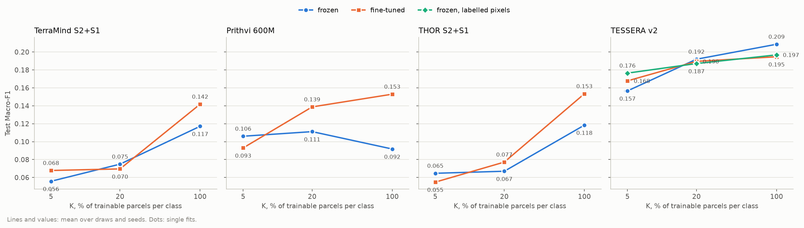
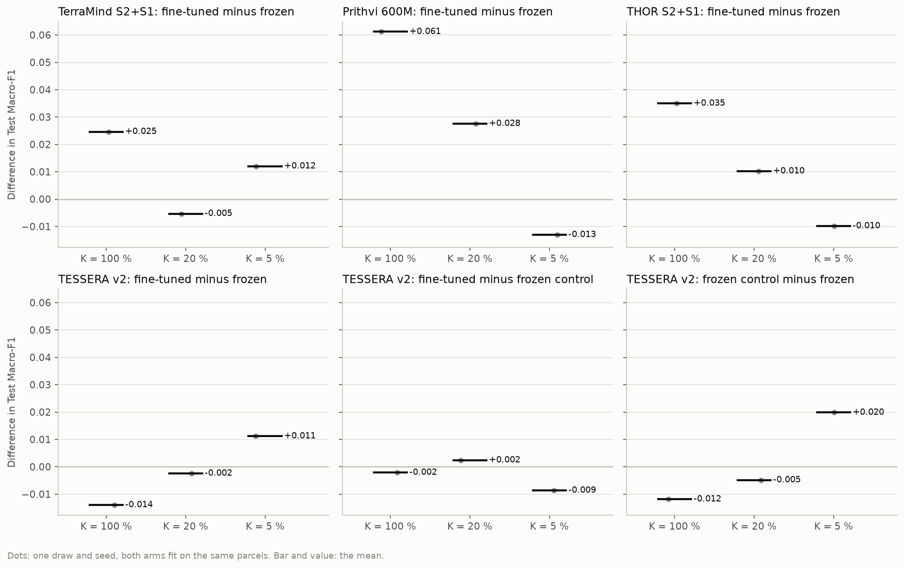

# The K-shot workflow with every encoder fine-tuned: report, 15 October 2026

Stage 1 of 2: the readiness checks and the pilot on `EE_2021_rev_mini`, at 15 epochs. The run on all of Estonia
(`EE_2021_rev`) runs at 45 epochs, the main workflow's number since the user's change of 15 October 2026; its results
will be added here as stage 2. A first, 15-epoch submission (jobs 624389 to 624393) was cancelled for that change after
about 2 h; its outputs are kept in `results/2026-10-15_kshot_finetune/_cancelled_15_epochs/`.

**Answer, so far.** The workflow is ready and running on all of Estonia.
- **Checks:** every readiness check of DESIGN.md passes for the four fine-tuned arms on the cluster.
- **Pilot:** the 15 cells ran without a numeric fault, and each cell's saved test predictions reproduce its logged
  test accuracy.
- **Too small to answer:** the pilot's 32 training and 9 test chips cannot tell whether fine-tuning helps. Its paired
  differences run from +0.061 (Prithvi, K = 100 %) to -0.014 (TESSERA, K = 100 %), on one fit each.

## Setup

| | |
|---|---|
| Question | as in README.md: what each model of the main workflow gains, per K, when its encoder trains with the decoder |
| Arms | `terramind_v1_large_s2s1_ft`, `prithvi_eo_v2_600_tl_ft`, `thor_v1_large_s2s1_ft` (end to end), `tessera_v2_medium_ft` and its frozen control `tessera_v2_medium_lab` (labelled pixels); encoders at 1e-5 after a one-epoch warm-up, in eval mode. Frozen side: `results/kshot/EE_2021_rev_mini/` |
| Chip set | `EE_2021_rev_mini`: 32 training, 16 validation, 9 test chips |
| Protocol | kshot's: K = 100, 20, 5 %; draw 0; seed 0; 15 epochs; checkpoint of lowest validation loss; a second checkpoint (highest validation Macro-F1) scored as a secondary readout |
| Runs | UT HPC `itc-gpu`, RTX PRO 6000 Blackwell, commit 4ab89e4. Checks: jobs 624304 to 624307, 2 min each. Pilot: jobs 624308 to 624312, 2 to 16 min. All exit 0. The frozen side is the main workflow's hub pilot (commit 804dd16) |

## Readiness checks

| Check | TerraMind S2+S1 | Prithvi 600M | THOR S2+S1 | TESSERA v2 |
|---|---|---|---|---|
| 1. Step-0 equivalence with the core's cache | identical at float16, 164 chip-layers | identical | identical | cosine at least 0.99998 over 436,504 labelled pixels (bf16) |
| 2. Encoder tensors moved, frozen / trainable | 0 / 173 of 173 | 0 / 391 of 391 | 0 / 312 of 392 | control has no encoder / 114 of 114 |
| 2. Decoder tensors moved | 46 of 46 | 46 of 46 | 46 of 46 | 10 of 10 |
| 2. Encoder in train mode in any training forward | no | no | no | no (220 forwards) |
| 2. Encoder learning rate over the warm-up | 1.25e-6 to 1e-5 | same | same | same |
| 3. Speed, fine-tuned | 0.064 s per chip | 0.108 s per chip | 0.113 s per chip | 36 us per labelled pixel; 0.62 s per test chip in full |
| 3. Peak GPU memory, fine-tuned | 18.7 GB | 23.1 GB | 26.7 GB | 8.8 GB |
| 3. Estimate for the three cells on `EE_2021_rev`, 15 epochs (45 epochs: about three times) | 3.5 h | 5.7 h | 6.1 h | 10.9 h, plus about 1.3 h for the raster cache |

THOR's 80 unmoved tensors are the ones `../2026-10-15_gfm_finetune/` explained, less the four of the Sentinel-1
patch embeddings, which now train since S1 is fed: patch embeddings of bands not fed (Sentinel-3, B01, B09), the
band-group embeddings THOR fixes as sine-cosine tables, and THOR's final norm, outside the layers the neck takes.

The TESSERA equivalence is not bit-exact because the student runs under bf16 autocast in groups of a different size
than the cache's; the worst pixel's cosine is 0.99998. The frozen control passed its own checks on the hub (no
encoder, MLP moving, 1.0 us per labelled pixel).

The predictions check recomputes each cell's pixel accuracy from `predictions_test.npz`: all 15 agree with the logged
`test/Pixel_Accuracy` within 2e-4. For the TESSERA cells this also shows that the full-chip prediction path gives,
on the labelled pixels, what the labelled-pixel test scored. No log shows a NaN, an overflow or a failed step.

## Pilot results

| Test Macro-F1 | K = 100 % | K = 20 % | K = 5 % |
|---|---|---|---|
| TerraMind S2+S1, frozen / fine-tuned | 0.117 / 0.142 | 0.075 / 0.070 | 0.056 / 0.068 |
| Prithvi 600M, frozen / fine-tuned | 0.092 / 0.153 | 0.111 / 0.139 | 0.106 / 0.093 |
| THOR S2+S1, frozen / fine-tuned | 0.118 / 0.153 | 0.067 / 0.077 | 0.065 / 0.055 |
| TESSERA v2, frozen / fine-tuned / frozen on labelled pixels | 0.209 / 0.195 / 0.197 | 0.192 / 0.190 / 0.187 | 0.157 / 0.168 / 0.176 |

On 32 training chips these scores are a fraction of the full-Estonia ones, and one fit per cell gives no spread; the
earlier pilot (`../2026-10-15_gfm_finetune/`) put the spread between seeds at 0.01 to 0.03 on this chip set, the size
of most differences here. Fine-tuning raises Macro-F1 at K = 100 % for the three token-grid models, as it lowered
their validation loss in the earlier pilot, but none of this is a finding yet. For TESSERA, the fine-tuned arm and the
control land within 0.01 of each other at every K.

## Caveats

- 32 training and 9 test chips, one draw, one seed: the pilot tests the workflow, not the models.
- One encoder learning rate (1e-5), not tuned per model or K.
- TESSERA's MLP sees only labelled pixels in its batch norm on this route; the control measures that (DESIGN.md).
- The full-Estonia run has one seed per cell, as kshot: its differences will carry no interval of their own.

## Next steps

1. Stage 2: when the 45-epoch jobs finish, pull, run `check.py --predictions` and
   `report.py --chips EE_2021_rev` (with the main workflow's 45-epoch `results/kshot/EE_2021_rev/` beside it; the report
   pairs only fits of equal epochs), and add the results here.
2. Seeds 1 and 2 would give the differences a spread; the runner resumes, so they are an `experiment.yaml` change.
3. Whether fine-tuning enters the main workflow is a separate decision of the user.
