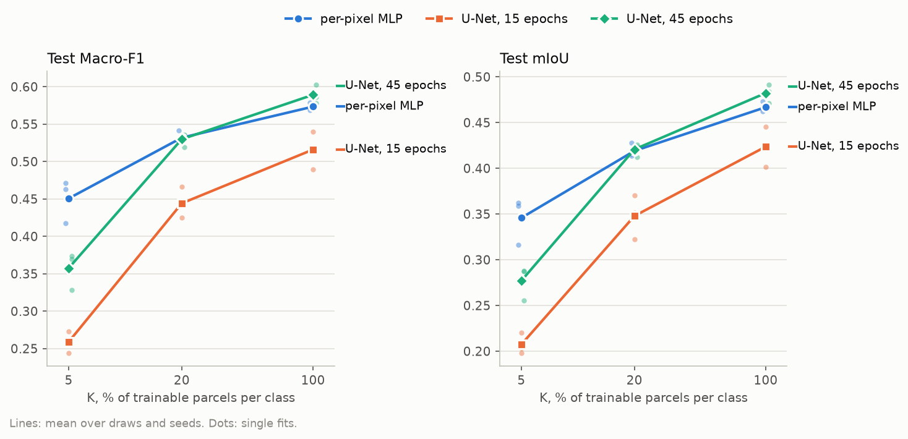
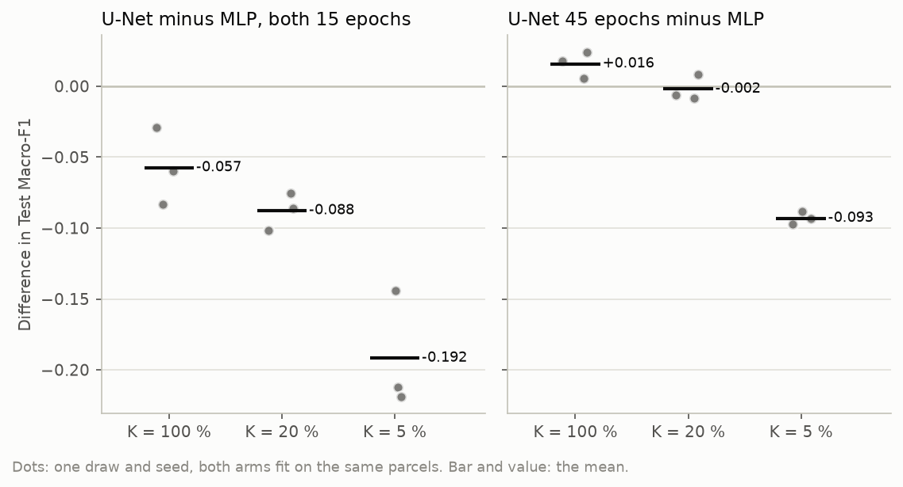
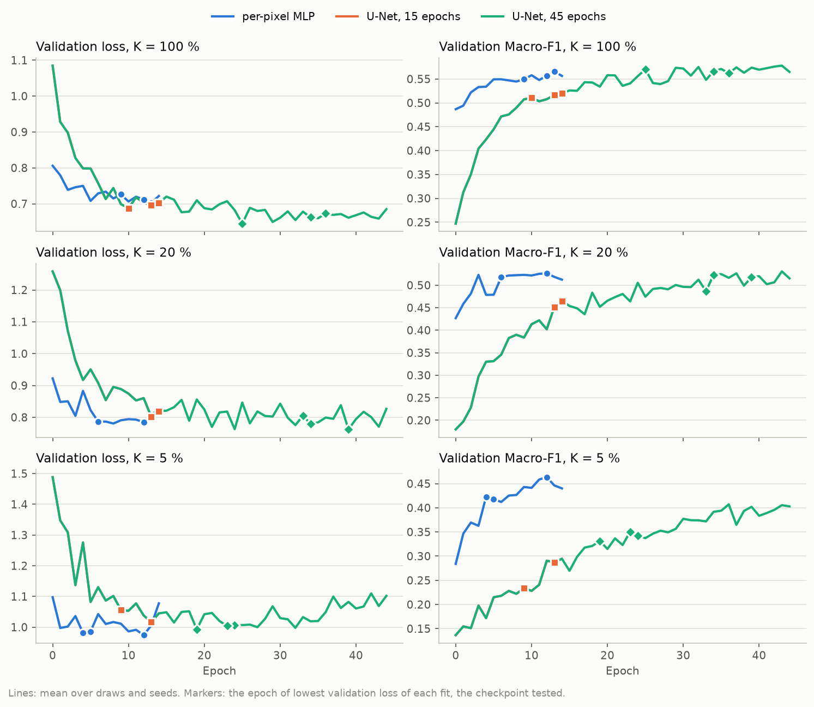
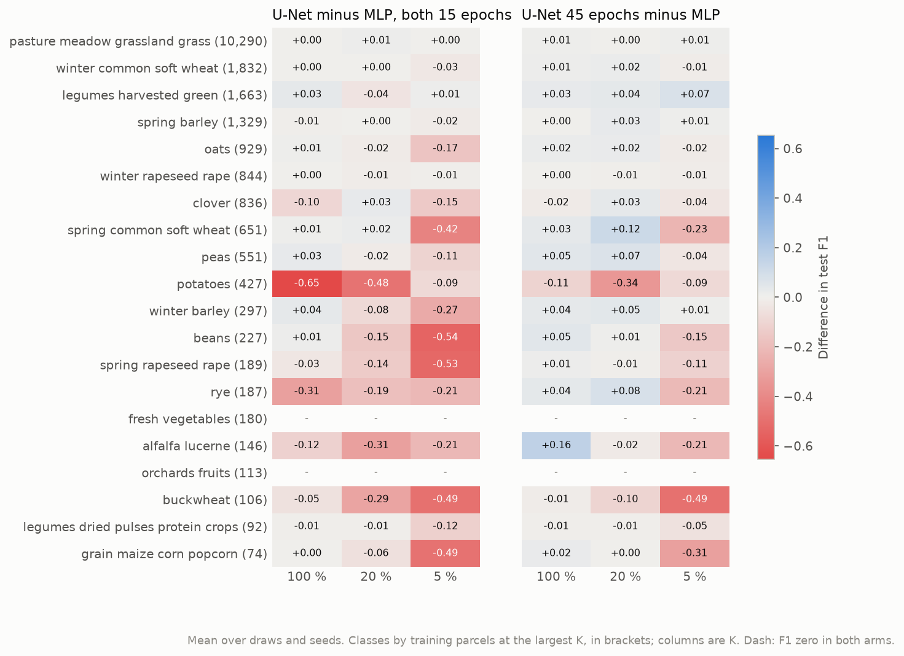
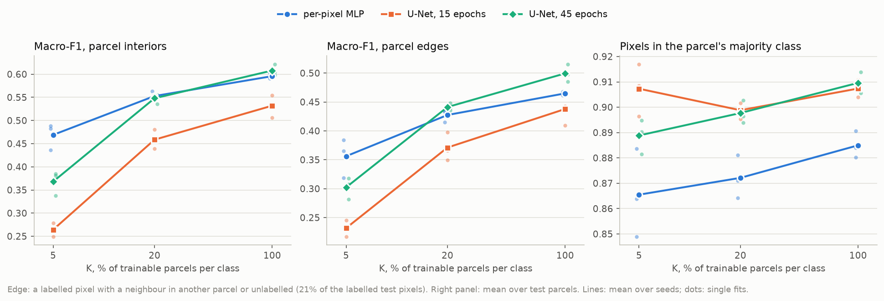
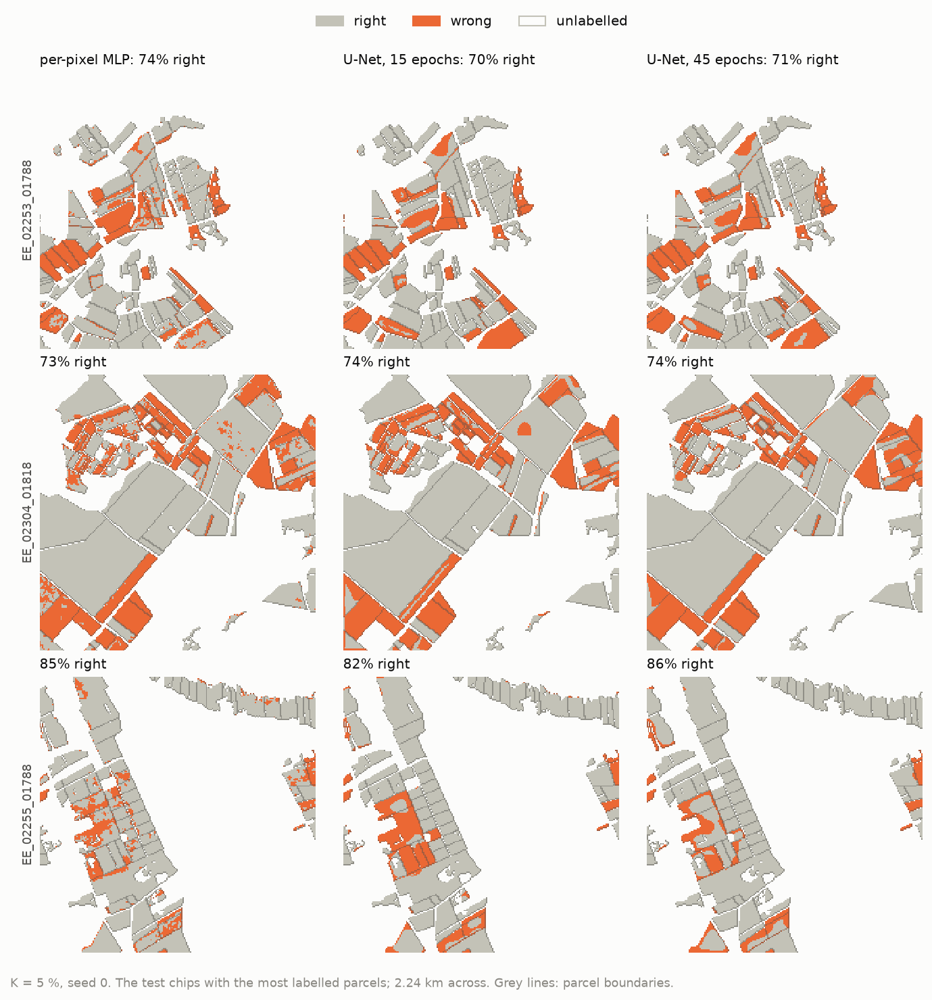

# A U-Net or a per-pixel MLP on frozen TESSERA embeddings: report, 15 October 2026

**Answer.** No: on frozen TESSERA v2 Medium embeddings, a spatial U-Net decoder does not recognise crops better than
the per-pixel MLP where the thesis needs it, under label scarcity.
- **At the protocol's 15 epochs the U-Net loses every paired fit:** test Macro-F1 0.516 against 0.573 at K = 100 %,
  0.444 against 0.532 at 20 %, 0.259 against 0.451 at 5 %.
- **Trained three times as long, it catches up only with every label:** +0.016 at K = 100 % (3 of 3 fits), level at
  20 % (-0.002), and still 0.093 behind at 5 % (0 of 3).
- **What the U-Net does add is spatial coherence:** a larger share of each parcel in one class (0.89 to 0.91 against
  0.87 to 0.89), and better parcel edges once trained long enough. The price is whole small parcels lost, concentrated in the
  rare classes, which Macro-F1 weighs as much as grassland.

The user chose the MLP for the main workflow's 10 m group on the first results, the same day; the 45-epoch arm, which
came in later, does not change that.

## Setup

| | |
|---|---|
| Question | Does a spatial U-Net decoder add value over the per-pixel MLP on frozen TESSERA embeddings, at each label budget? |
| Arms | `tessera_v2m_mlp`: the core's `PixelMLPDecoder` (512, 256), 0.2 M trainable parameters, head dropout 0.2. `tessera_v2m_unet`: `segmentation_models_pytorch` U-Net, ResNet-18 down path, random initialisation, 14.7 M parameters, head dropout 0.1, the network of the from-scratch baseline. `tessera_v2m_unet_45ep`: the same U-Net for 45 epochs. All three on the same frozen TESSERA v2 Medium rasters (128 dims at 10 m), encoded from the 12 monthly S2 + S1 composites by `rasters.py`; AdamW at 1e-3, weight decay 0.05, batch 4, D4, training-chip normalisation |
| Chip set | `EE_2021_rev_quarter`, made for this experiment: 116 pool, 16 validation and 32 test blocks of `EE_2021_rev`, as links; 1,190 training, 169 validation and 411 test chips; split `blocks4_buf1600_seed0__6b0eb4cb` |
| Protocol | K = 100, 20 and 5 % (20,963, 4,202 and 1,058 parcels on 1,190, 1,018 and 641 chips), draw 0, seeds 0 to 2, 15 epochs (45 for the long arm), checkpoint at the lowest validation loss |
| Runs | Cluster, `itc-gpu`, `hpc-node29`, commit `0ab085d`, one job per arm: 623444 (MLP) 1 h 19 min, 623445 (U-Net) 1 h 26 min, 623446 (U-Net, 45 epochs) about 2 h 30 min. Each job encoded the 1,770 chips in 19 min. 27 fits, 4.1 GPU hours of fitting, no failure. The hub pilot on `EE_2021_rev_mini` ran all 27 cells beforehand |

**Why v2 rasters and not the v1.0 store.** The on-disk v1.0 store rasters sit about 0.7 px east and 0.4 px south of
the chip grid: ridge maps from the shifted v1.0 raster onto three grid-aligned references (v2 Medium and v1.1 AWS on
our composites, the v1.1 store read afresh) all fit best one pixel east. An offset favours a decoder that can look
across a pixel, so the v1.0 rasters would have biased this test towards the U-Net. The v2 rasters are encoded on the
chip's own grid; they reproduce the composites experiment's embeddings (median cosine 0.9999).

## Results

### Headline

| Test Macro-F1, mean ± sd (3 seeds) | K = 100 % | K = 20 % | K = 5 % |
|---|---|---|---|
| **Per-pixel MLP** | 0.573 ± 0.005 | **0.532 ± 0.008** | **0.451 ± 0.029** |
| U-Net, 15 epochs | 0.516 ± 0.025 | 0.444 ± 0.021 | 0.259 ± 0.014 |
| U-Net, 45 epochs | **0.589 ± 0.013** | 0.530 ± 0.009 | 0.358 ± 0.025 |

Test mIoU follows the same order: 0.467, 0.419 and 0.346 for the MLP; 0.482, 0.421 and 0.277 for the U-Net at 45
epochs.

The U-Net's curve is far steeper. From K = 100 to 5 % the MLP loses 0.122 Macro-F1, the U-Net at 45 epochs 0.231,
at 15 epochs 0.257.

### Paired differences

| U-Net minus MLP, test Macro-F1 | K = 100 % | K = 20 % | K = 5 % |
|---|---|---|---|
| both 15 epochs | -0.057 ± 0.027 (0/3) | -0.088 ± 0.013 (0/3) | -0.192 ± 0.041 (0/3) |
| U-Net 45 epochs | +0.016 ± 0.009 (3/3) | -0.002 ± 0.009 (1/3) | -0.093 ± 0.004 (0/3) |

Every difference at 15 epochs, and the 45-epoch one at K = 5 %, is several times its spread between seeds. The
45-epoch gain at K = 100 % is about twice its spread; the K = 20 % difference is within the noise.

### Training dynamics

- **The MLP converges in a few epochs.** Its validation Macro-F1 is at 0.49 after the first epoch at K = 100 % and
  plateaus by epoch 5; its checkpoints fall at epochs 4 to 13.
- **The U-Net learns slowly.** It starts at 0.25 and climbs through all 45 epochs at K = 5 %. Its checkpoints at 15
  epochs fall at epochs 9 to 14, the last few epochs, so the protocol's 15 epochs undertrain it, as they undertrain
  the from-scratch baseline on raw composites (`../2026-10-14_unet_baseline/`).
- **The two U-Net arms share their first 15 epochs.** Same seed, same data order, constant learning rate: the 15-epoch
  arm is the 45-epoch run cut short, with its checkpoint chosen among those epochs.
- **Even at its best epoch, the U-Net trails at K = 5 %:** validation Macro-F1 0.422 at its best epoch against the
  MLP's 0.468. A Macro-F1 checkpoint criterion would not close the gap.

### Per class

- **Large classes barely move:** grassland, winter wheat, spring barley and winter rapeseed are within 0.03 in both
  comparisons; legumes harvested green moves by up to 0.04 at 15 epochs and gains up to 0.07 at 45.
- **The losses are in the small classes, and grow as labels get scarce.** At K = 5 % and 45 epochs: buckwheat
  -0.49, maize -0.31, spring wheat -0.23, rye -0.21, alfalfa -0.21, beans -0.15, spring rapeseed -0.11. At 15 epochs
  these reach -0.42 to -0.54.
- **Potatoes is the U-Net's worst class:** -0.65 and -0.48 at 15 epochs, still -0.34 at K = 20 % with 45 epochs.
- **Where the U-Net gains, it gains with every label and long training:** alfalfa +0.16, peas +0.05 to +0.07, spring
  wheat +0.12 at K = 20 %.

### Spatial: parcel interiors, edges and coherence

Edge pixels (a labelled pixel with a neighbour in another parcel or unlabelled) are 21.2 % of the labelled test
pixels.

| Test Macro-F1 | | K = 100 % | K = 20 % | K = 5 % |
|---|---|---|---|---|
| Interiors | MLP | 0.596 | 0.553 | 0.469 |
| | U-Net, 45 epochs | 0.608 | 0.548 | 0.368 |
| Edges | MLP | 0.465 | 0.428 | 0.356 |
| | U-Net, 45 epochs | 0.499 | 0.441 | 0.302 |

| Share of a test parcel's pixels in its majority predicted class | K = 100 % | K = 20 % | K = 5 % |
|---|---|---|---|
| MLP | 0.885 | 0.872 | 0.865 |
| U-Net, 15 epochs | 0.907 | 0.899 | 0.907 |
| U-Net, 45 epochs | 0.910 | 0.898 | 0.889 |

- **Edges are where the U-Net helps,** once trained long enough: +0.034 at K = 100 % and +0.013 at 20 %. A per-pixel
  head has nothing to go on at a mixed boundary pixel; the U-Net sees which side of the boundary dominates.
- **In parcel interiors the two are within 0.012 at K = 100 and 20 %,** and the U-Net is 0.10 behind at 5 %.
- **The U-Net's predictions are more coherent** at every budget: 0.89 to 0.91 of a parcel in one class against 0.87 to
  0.89. Coherence is not correctness: a parcel predicted wholly wrong is fully coherent.

### Error maps

The three test chips with the most labelled parcels, seed 0 (also at K = 20 and 100 %: `figures/error_maps_K20.png`,
`figures/error_maps_K100.png`).
- **The MLP's errors are speckle:** scattered wrong pixels inside parcels and along their edges.
- **The U-Net's errors are blobs:** whole parcels, or regions that run across parcel boundaries, wrong together. On
  the third chip a cluster of small parcels is lost as one blob.

## Analysis

**Spatial context is not what TESSERA lacks under label scarcity.** TESSERA encodes each pixel's own series, so the
MLP arm sees no neighbour at all, and a U-Net is the only place spatial context could enter. With every label and
three times the training it buys +0.016 Macro-F1, almost all of it at parcel edges. With 5 % of the labels it costs
0.09 to 0.19. The per-pixel embedding is already separable enough that a 0.2 M parameter head fitted per pixel
generalises from about a thousand parcels; a 14.7 M parameter network learned from scratch on the same parcels
does not.

**Why the U-Net fails on the small classes.** Three mechanisms fit the pattern:
- **Too few examples for its capacity.** At K = 5 % a class with 106 training parcels (buckwheat) has 6. The MLP sees
  each of their pixels as an independent sample of the class's time series; the U-Net has to learn the class's
  spatial appearance from 6 patches.
- **Smoothing.** Small and narrow parcels sit next to large grassland and cereal parcels; a receptive field that
  spans them pulls their pixels towards the neighbour's class. The error maps show exactly this.
- **Training length.** The U-Net is still improving at epoch 45 on K = 5 %, where the MLP has converged by epoch 12.

**For RQ1 and the main workflow.**
- **The per-pixel MLP stays the 10 m group's decoder** (the user's decision of 15 October 2026, now in the main
  workflow's `tessera_v2_medium` arm). It is also the fairer choice under the protocol's equal training budget: the
  U-Net only catches up with three times the epochs.
- **The cross-group comparison keeps a known asymmetry.** The token-grid arms have spatial context in their encoder
  and their UNet decoder; the 10 m arms have none (TESSERA) or only in their encoder (AlphaEarth). This experiment
  bounds what that asymmetry is worth to TESSERA: at most about +0.02 Macro-F1 with every label, and negative under
  scarcity. The protocol should state it beside the decoder input resolution (D20, D21).
- **Coherence could still matter for maps.** If Phase 3 reports per-parcel decisions, the MLP's speckle is better
  handled by a per-parcel vote after prediction than by a spatial decoder.

## Caveats

- **A quarter of Estonia, one draw, three seeds.** The draw-to-draw spread is unknown; the K = 20 % and the 45-epoch
  K = 100 % differences are within about twice the seed spread.
- **One U-Net configuration.** A ResNet-18 U-Net from scratch at lr 1e-3 with no schedule. A lighter spatial head (a
  few 3 x 3 convolutions on top of the MLP), a pretrained down path or a learning-rate schedule were not tried.
- **Equal epochs, not equal steps per class.** A quarter of the chips gives a quarter of the steps per epoch; on all
  of Estonia the U-Net would train four times longer per epoch, which would narrow the gap at high K.
- **Checkpoint at the lowest validation loss.** It picks early epochs for the 45-epoch U-Net at K = 5 % (19 to 24)
  while validation Macro-F1 keeps rising; at its best epoch the U-Net is still behind the MLP.
- **Head dropout differs** (0.2 for the MLP, 0.1 for the U-Net), as each decoder's established setting.

## Next steps

- **Nothing is needed for the main workflow:** the MLP is already the 10 m decoder there.
- **Optional, a light spatial head on the MLP** (one or two 3 x 3 convolutions over its hidden features), the
  cheapest way to buy the edge gain without learning 14.7 M parameters from scratch.
- **For `pipeline.md`, if the user agrees:** section 10, the spatial-context asymmetry between the groups and its
  measured bound; section 11, this experiment's outcome.

## Reproduce

    poetry run python experiments/2026-10-15_tessera_decoder/run.py -e experiments/2026-10-15_tessera_decoder/experiment.yaml --chips data/eurocrops_chips/EE_2021_rev_mini
    bash scripts/cluster/submit.sh experiments/2026-10-15_tessera_decoder/experiment.yaml EE_2021_rev_quarter
    bash scripts/cluster/pull_results.sh 2026-10-15_tessera_decoder EE_2021_rev_quarter
    poetry run python experiments/2026-10-15_tessera_decoder/report.py --chips EE_2021_rev_quarter
