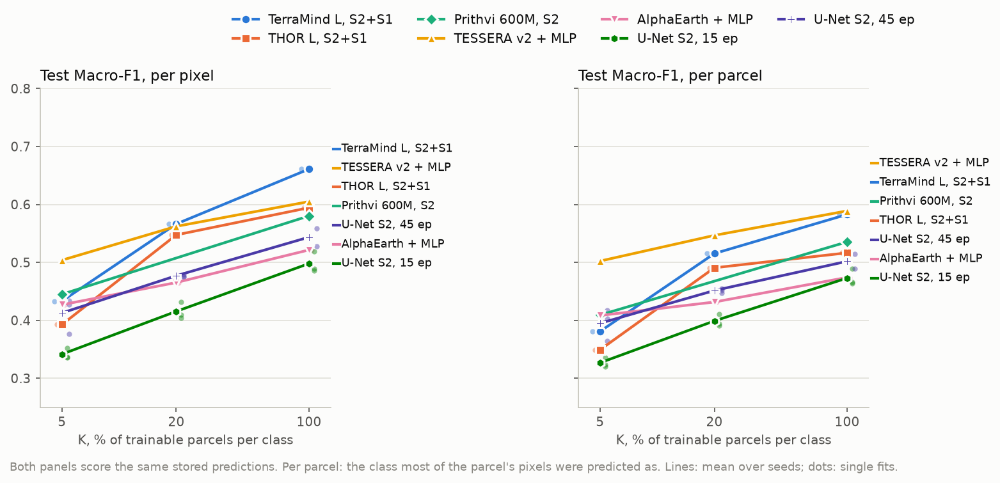
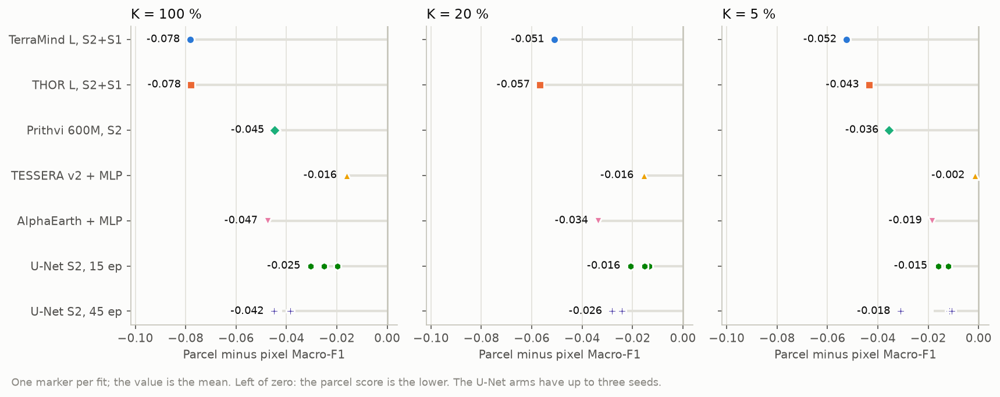
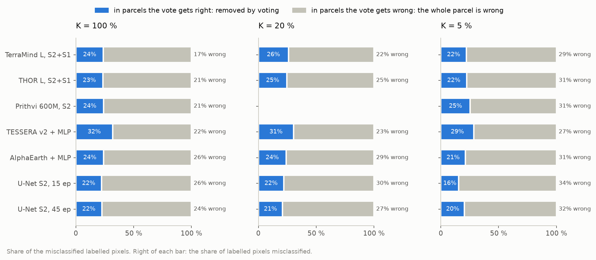
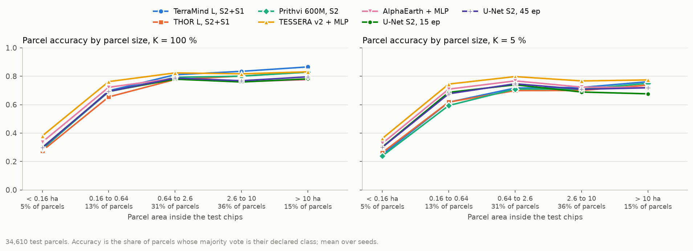
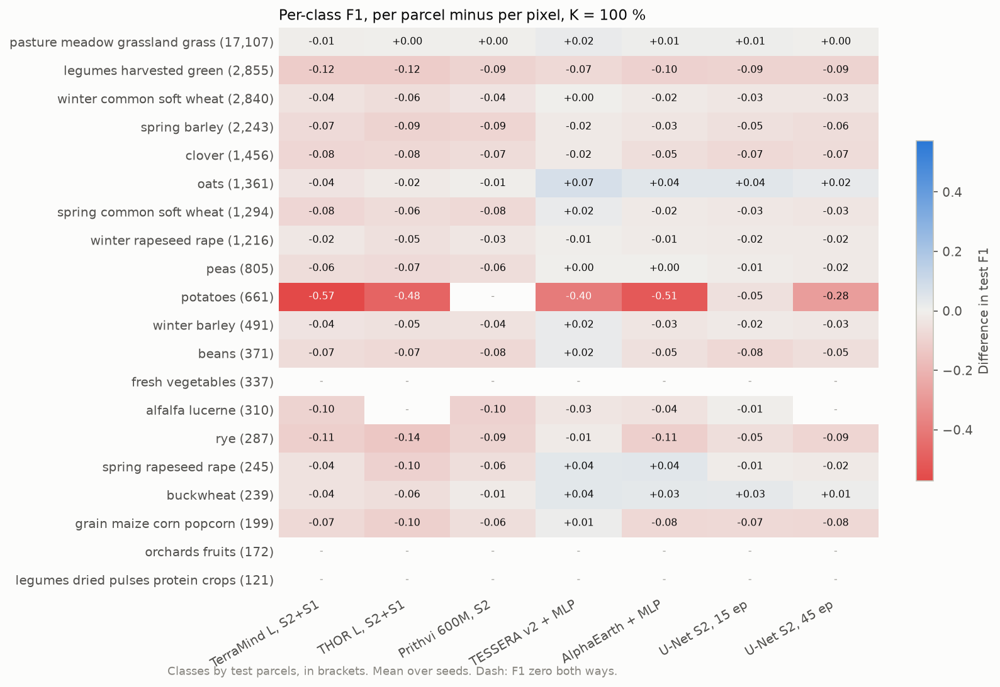

# Parcel-level test metrics beside the pixel-level ones, on all of Estonia: report, 16 October 2026

**Answer.** Scored per parcel, every arm is **lower** than per pixel at every budget, by 0.002 to 0.078 test
Macro-F1. The two scores weigh different things. The pixel score is dominated by large parcels; the parcel score
gives every declaration the same weight, and small parcels are classified far worse. A parcel under 0.16 ha is
voted its declared class 24 to 38 % of the time, against 67 to 87 % above 0.64 ha. The token-grid models lose the
most (TerraMind and THOR 0.04 to 0.08), TESSERA the least (0.002 to 0.016). Per parcel, TESSERA therefore
**overtakes TerraMind at K = 100 and 20 %**, which per pixel lead by 0.056 and 0.004.

| K | TerraMind L, S2+S1 | THOR L, S2+S1 | Prithvi 600M, S2 | TESSERA v2 + MLP | AlphaEarth + MLP | U-Net S2, 45 ep |
|---|---|---|---|---|---|---|
| 100 % | 0.661 / 0.583 | 0.594 / 0.516 | 0.580 / 0.535 | 0.605 / **0.589** | 0.521 / 0.474 | 0.544 / 0.502 |
| 20 % | 0.566 / 0.515 | 0.547 / 0.491 | n/a | 0.562 / **0.547** | 0.465 / 0.432 | 0.477 / 0.451 |
| 5 % | 0.433 / 0.381 | 0.393 / 0.349 | 0.445 / 0.409 | 0.504 / **0.502** | 0.427 / 0.408 | 0.413 / 0.395 |

Test Macro-F1 per pixel / per parcel, the same stored predictions scored both ways. One seed for the GFM arms,
the mean of up to three for the U-Net. Prithvi at 20 % is left out (see the fault below).

The voting rule is robust. Letting only interior pixels vote moves the parcel Macro-F1 by at most 0.009, and
leaving out the parcels cut by the test area by at most 0.006. Leaving out the 5 % of parcels under 16 pixels
raises it by 0.005 to 0.022, under a third of the gap for the token-grid models.

**A fault found on the way.** The test predictions of two fits came from a stale checkpoint. A cell fitted again
after an interrupted fit keeps the old `best-loss.ckpt` beside the new `best-loss-v1.ckpt`. The fit was tested
with the new one, but `FitPredictor` always loaded `best-loss.ckpt`. Those predictions reproduce a pixel Macro-F1
of 0.5014 against the 0.5054 logged (Prithvi, 20 %) and 0.5574 against 0.5449 (U-Net 45 epochs, 100 %, seed 0).
They are left out here. The other 31 fits reproduce their logged pixel Macro-F1 exactly. The core now loads the
checkpoint `results.json` records.

## Setup

| | |
|---|---|
| Question | Per parcel, what are the test Macro-F1, accuracy and kappa of the full-Estonia fits, how far from the pixel scores, does the ranking change, and is the voting rule robust? |
| Rule | Every parcel of the test chips is pooled over every test chip it touches, through the global identifier of `<chip>.parcels.tif`, and takes the class most of its labelled pixels were predicted as. Ties go to the lowest class index, and pixels of classes outside the scheme do not vote. The parcels are then scored like pixels: per-class F1, its mean over the classes (Macro-F1), overall accuracy, Cohen's kappa |
| Variants | Interior pixels vote (pixels whose four neighbours lie in the same parcel; a parcel without any keeps all its pixels). Parcels reaching outside the test chips (3,370) left out. Parcels under 16 labelled pixels, 0.16 ha (1,724), left out |
| Fits | The 15-epoch grid of the current arms, `results/kshot_15ep/EE_2021_rev/` (cluster, 15 October, commit `27a51a8`): TerraMind v1 large and THOR v1 large on S2 + S1 (160 m tokens, `ChannelBottleneck` and UNet decoder), Prithvi-EO-2.0 600M TL on S2, TESSERA v2 Medium and AlphaEarth with the per-pixel MLP; draw 0, seed 0. The Sentinel-2 U-Net baseline at 15 and 45 epochs, `results/2026-10-14_unet_baseline/EE_2021_rev/`, draw 0, seeds 0 to 2. This U-Net takes Sentinel-2 only, not the S2 + S1 of the main workflow's baseline |
| Chip set | `EE_2021_rev`, split `blocks4_buf1600_seed0__6b0eb4cb`: 1,475 test chips, 34,610 test parcels with labelled pixels |
| Protocol | K = 100, 20 and 5 %; checkpoint of lowest validation loss. Nothing is refitted: the stored `predictions_test.npz` are scored |
| Runs | JupyterHub CPU, 2 min 40 s for 33 fits. 31 scored; 2 left out for the stale checkpoint above |

## Results

### Pixel and parcel Macro-F1

**Test Macro-F1 per pixel / per parcel**

| Arm | K = 100 % | K = 20 % | K = 5 % |
|---|---|---|---|
| TerraMind L, S2+S1 | 0.661 / **0.583** | 0.566 / **0.515** | 0.433 / **0.381** |
| THOR L, S2+S1 | 0.594 / **0.516** | 0.547 / **0.491** | 0.393 / **0.349** |
| Prithvi 600M, S2 | 0.580 / **0.535** |  | 0.445 / **0.409** |
| TESSERA v2 + MLP | 0.605 / **0.589** | 0.562 / **0.547** | 0.504 / **0.502** |
| AlphaEarth + MLP | 0.521 / **0.474** | 0.465 / **0.432** | 0.427 / **0.408** |
| U-Net S2, 15 ep | 0.498 / **0.473** | 0.415 / **0.399** | 0.342 / **0.327** |
| U-Net S2, 45 ep | 0.544 / **0.502** | 0.477 / **0.451** | 0.413 / **0.395** |

The per-parcel panel compresses the arms. The token-grid models fall onto the others, and TESSERA's curve stays
nearly where it was.

The gap separates the arms by how they see space:

| Arm | Gap at K = 100 / 20 / 5 % | Decoder input |
|---|---|---|
| TerraMind, THOR | -0.078 / -0.051 to -0.057 / -0.043 to -0.052 | 160 m token grid, upsampled |
| Prithvi | -0.045 / n/a / -0.036 | 160 m token grid, upsampled |
| AlphaEarth | -0.047 / -0.034 / -0.019 | 10 m embedding, per-pixel MLP |
| U-Net, 45 epochs | -0.042 / -0.026 / -0.018 | 10 m stack, U-Net from scratch |
| TESSERA | -0.016 / -0.016 / -0.002 | 10 m embedding of each pixel's own series, per-pixel MLP |

TESSERA encodes every pixel's time series alone, so a small parcel is not blurred into its neighbours. A 160 m
token covers 2.6 ha, the size of the median test parcel, so the token-grid models cannot resolve the smaller half.

### Parcel accuracy and kappa

| Arm | Parcel OA / kappa, K = 100 % | 20 % | 5 % | Pixel OA / kappa, K = 100 % |
|---|---|---|---|---|
| TerraMind L, S2+S1 | 0.787 / 0.698 | 0.742 / 0.639 | 0.689 / 0.563 | 0.830 / 0.797 |
| THOR L, S2+S1 | 0.753 / 0.650 | 0.727 / 0.613 | 0.673 / 0.540 | 0.790 / 0.750 |
| Prithvi 600M, S2 | 0.763 / 0.661 |  | 0.677 / 0.557 | 0.792 / 0.751 |
| TESSERA v2 + MLP | 0.793 / 0.699 | 0.779 / 0.681 | 0.755 / 0.638 | 0.784 / 0.741 |
| AlphaEarth + MLP | 0.745 / 0.632 | 0.723 / 0.613 | 0.715 / 0.595 | 0.738 / 0.686 |
| U-Net S2, 15 ep | 0.738 / 0.624 | 0.709 / 0.586 | 0.683 / 0.531 | 0.745 / 0.695 |
| U-Net S2, 45 ep | 0.746 / 0.638 | 0.730 / 0.610 | 0.698 / 0.565 | 0.759 / 0.713 |

Grassland is 49 % of the test parcels, so parcel accuracy stays high while Macro-F1 falls. As a reference only:
EuroCropsML reports a parcel OA of 0.787 for Estonia with all labels (Reuss et al. 2026). That number is for 127
classes, a random split and a Transformer on parcel medians, so it sits beside these numbers, not on their scale.

### Where the pixel errors sit

Voting corrects 15 to 32 % of the misclassified pixels: those scattered inside parcels the vote gets right. The
other 68 to 85 % lie in parcels voted wrong as a whole, so most of the error is confusion between crops, not
speckle. TESSERA has the most speckle (29 to 32 %), as a per-pixel model without spatial context would. The
token-grid models have the least, because their errors are already spatially smooth. In exchange, 2 to 5 % of
the correctly classified pixels sit in parcels the vote gets wrong.

### Parcel size

Parcel accuracy rises steeply up to 0.64 ha and is flat above. Under 0.16 ha it is 0.24 to 0.38; from 0.16 to
0.64 ha it is 0.59 to 0.76; above, 0.67 to 0.87. Those under 0.64 ha are 18 % of the test parcels but carry few
pixels, so the pixel score hardly sees them. On the largest parcels the ranking flips back: above 10 ha TerraMind
is the best arm (0.866 at K = 100 %), ahead of TESSERA, THOR and Prithvi (0.83).

### Per class

The gap concentrates in classes made of small plots. **Potatoes** fall by 0.26 F1 on average at K = 100 %, by 0.57
for TerraMind (0.751 per pixel, 0.180 per parcel). The median test potato parcel has 12 pixels (0.12 ha) and 60 %
have fewer than 16, yet 85 % of potato pixels lie in parcels of 2.6 ha or more. The pixel score measures the
commercial potato fields; the parcel score measures the household plots. Legumes harvested green (-0.10), rye
(-0.08), maize (-0.07) and clover (-0.07) follow. Grassland barely moves.

### Ranking

| K | Per pixel | Per parcel |
|---|---|---|
| 100 % | TerraMind > TESSERA > THOR > Prithvi > U-Net 45 > AlphaEarth > U-Net 15 | TESSERA > TerraMind > Prithvi > THOR > U-Net 45 > AlphaEarth > U-Net 15 |
| 20 % | TerraMind > TESSERA > THOR > U-Net 45 > AlphaEarth > U-Net 15 | TESSERA > TerraMind > THOR > U-Net 45 > AlphaEarth > U-Net 15 |
| 5 % | TESSERA > Prithvi > TerraMind > AlphaEarth > U-Net 45 > THOR > U-Net 15 | TESSERA > Prithvi > AlphaEarth > U-Net 45 > TerraMind > THOR > U-Net 15 |

### Sensitivity of the rule

| Variant | Change in parcel Macro-F1, over 31 fits |
|---|---|
| Only interior pixels vote | -0.001 to +0.009 (TESSERA +0.006 to +0.009, the rest at most +0.005) |
| Parcels reaching outside the test chips left out (3,370) | -0.001 to +0.006 |
| Parcels under 16 pixels left out (1,724) | +0.005 to +0.022 |

The full table per arm and K is in `figures/tables.md`.

## Analysis

- **The parcel and pixel scores answer different questions, and the thesis needs both.** The pixel score asks how
  much of the area is mapped right, so large parcels dominate it. The parcel score asks how many declarations are
  classified right, as an agency checking claims would, so every parcel counts once. In Estonia they part ways
  because a fifth of the parcels are under 0.64 ha and are classified badly by every model.
- **The parcel score penalises the coarse decoder input.** The token-grid models (D20) lose two to five times more
  than TESSERA, because a 160 m token cannot resolve a parcel smaller than itself. The comparison within resolution
  groups (D21) is unaffected, but the comparison across them, and against the baseline, changes with the metric:
  per parcel, TESSERA leads at every budget.
- **Majority voting is not the post-processing gain it is often assumed to be here.** It removes a quarter of the
  pixel errors, but those are cheap ones inside parcels that are already right. The errors that matter per parcel
  are whole-parcel confusions and small parcels, which voting cannot fix.
- **The rule needs no tuning.** Interior pixels and parcels cut by the test area change the result by less than
  0.01, so the simple rule (all labelled pixels, cut parcels on their visible part) stays.

## Caveats

- One draw and one seed for the GFM arms, no bootstrap interval. Differences under about 0.02 are within the
  spread seen between seeds (the U-Net seeds differ by up to 0.05 per parcel at 5 %).
- The grid trained 15 epochs; the main workflow now trains 45 (D27). The 45-epoch grid gets its parcel scores from
  the runner.
- The U-Net here is the Sentinel-2 one of `2026-10-14_unet_baseline`, not the main workflow's S2 + S1 baseline.
- Hard majority vote. A soft vote over predicted probabilities would need the probabilities, which the fits do not
  store.
- Two fits left out for the stale checkpoint; Prithvi at 20 % has no parcel score here.

## Next steps

- In the main workflow (done with this experiment): every fit records `parcel_metrics` in `results.json`, and
  `summary.csv` carries `parcel_macro_f1`, `parcel_accuracy`, `parcel_kappa`, `test_parcels` and
  `predictions_match`. `run_kshot.py --summarise` scores finished cells that lack them, such as cells pulled from
  the cluster. Protocol D28 records the rule.
- The block bootstrap, when built, resamples parcels with their blocks for the parcel score as for the pixel one.
- A size-stratified parcel score (for example parcels above and below 0.64 ha) would separate model quality on
  the large fields from the small-plot problem, which is shared by every model.
