# Parcel delineation by a boundary head trained beside the crop-type head: report, 19 October 2026

Reordered on 30 October 2026 to follow the method: first the two heads, the intermediate outputs, then the parcels
built from them, the final output.

**Answer.** Trained jointly under the label budget, the boundary head does **not** delineate parcels beyond what the
true parcel extent gives on its own, except for the U-Net baseline.

* **The two heads.** The boundary head is cautious. What it marks is mostly boundary (precision 0.51 to 0.77), but
  it marks at most 58 % of the boundary pixels (recall 0.02 to 0.58). Its F1 is 0.55 to 0.66 for the 10 m arms and
  the U-Net at every K, and falls with K for the token-grid models (THOR from 0.29 to 0.04). Between two parcels of
  the same class, the boundaries the head exists for, it marks at most 17 % of the pixels. Training the boundary head
  beside the crop-type head does not harm the crop types: the pixel Macro-F1 moves by +0.003 on average over the 18
  paired fits, between −0.044 and +0.044, within the run-to-run spread of these fits.
* **The parcels, geometry alone (class-agnostic PQ).** The extent's connected regions, with nothing predicted, score
  **0.486** on the 1,475 test chips. The boundary parcels of the five GFM arms score 0.462 to 0.512 at the agreed
  threshold of 0.5, that is 0.024 below to 0.026 above that floor. The U-Net trained from scratch is the only arm
  above it at every K, with 0.524 to 0.561.
* **Where the parcels fail.** 43 % of the test parcels touch a parcel of their own class. The heads find 13 to 30 %
  of those, against 12.7 % for the extent alone and 20 to 24 % for the crop-type map. What they do split is paid for
  with false parcels: 1.5 to 8 times as many unmatched predicted parcels as the extent, a quarter to two thirds of
  them slivers under 20 pixels.
* **The parcels with their class.** Class-aware PQ is highest for the U-Net (0.338 at K = 100 %) and TESSERA
  (0.307), and TESSERA loses the least to the budget (0.263 at 5 %). The parcel Macro-F1 at IoU > 0.5 (RQ) falls by
  0.12 to 0.22 when the parcels come from the head instead of from the parcel layer: 0.13 to 0.22 for the GFM arms,
  0.12 to 0.13 for the U-Net.

One draw and one seed per cell, so single differences under about 0.04 are not resolved. The pattern itself (head
near the floor, U-Net above it) holds at all three budgets and for every arm. The fixed threshold understates the
token-grid heads: at 0.3, TerraMind and Prithvi rise 0.02 to 0.08 above the floor (Prithvi 0.565 at K = 100 %, level
with the U-Net), while TESSERA and AlphaEarth stay on it.

## Setup

| | |
|---|---|
| Question | With one boundary logit beside each arm's crop-type head, trained jointly under the same label budget, how well does each arm delineate the test parcels (PQ), how much parcel F1 is lost when the parcels come from the model, does the head add anything over the crop-type map, and does it change the pixel Macro-F1 of RQ1? (README.md) |
| Arms | The six of `configs/experiments/kshot.yaml`, unchanged: TerraMind v1 large and THOR v1 large on S2 + S1 and Prithvi-EO-2.0 600M TL on S2 (160 m tokens, `ChannelBottleneck` and UNet decoder, from cached features); TESSERA v2 Medium and AlphaEarth (10 m embeddings, per-pixel MLP); the U-Net trained from scratch on S2 + S1 (the baseline, end to end) |
| What is added | **Target**: a labelled parcel pixel with a 4-neighbour inside the chip of another parcel or of none; only the drawn parcels carry it. **Head**: one logit on the decoder features, built like the arm's classifier (a 1 x 1 layer for the MLP arms). **Loss**: cross-entropy plus 1.0 x binary cross-entropy, for every arm; `val/loss`, the checkpoint criterion, is their sum |
| Outputs | Per test chip, two intermediate maps, one per head: the boundary probability and the crop type of every pixel. The final output is built from both: inside the true parcel extent, seeds where the boundary probability is below 0.5, grown by watershed; each parcel takes the majority class of its pixels (D28) |
| Scores | Boundary head: pixel precision, recall and F1 at 0.5 against the dense target. Crop-type head: pixel Macro-F1, as in RQ1. Parcels: matched to the 55,575 true parcel pieces at IoU > 0.5; PQ = SQ x RQ, class-aware (mean over classes) and class-agnostic. Reference parcels on the same units: `oracle` (true pieces, class predicted), `extent` (connected regions of the extent, the floor), `semantic` (connected regions of one predicted class), `combined` (seeds also cut where the class changes); thresholds 0.3 and 0.7 as a check. Details in the next section |
| Chip set | `EE_2021_rev`, split `blocks4_buf1600_seed0__6b0eb4cb`: 4,898 training, 769 validation, 1,475 test chips |
| Protocol | K = 100, 20 and 5 % (86,909, 17,390 and 4,354 training parcels), draw 0, seed 0, 45 epochs, checkpoint of lowest validation loss. Compared fit by fit with the main workflow's crop-type-only fits on the same draw and seed, `results/kshot/EE_2021_rev/` |
| Runs | Pilot on `EE_2021_rev_mini`, cluster jobs 628975 to 628980, 18 October, all exit 0. Full Estonia: cluster jobs 629034 to 629039, commit `faec7ea`, 18 October; 17.3 GPU hours of fitting. Prithvi's job (629035) failed in its 20 % fit when a data-loader worker could not unlink a shared-memory file, one minute after THOR's job ended on the same node, the fault of 15 and 16 October (pipeline.md section 11); it was resubmitted as 629189 on the other node and finished. Its 20 % cell keeps the crashed fit's `best-loss.ckpt` beside the new `best-loss-v1.ckpt`; `results.json` names the new one, and every stored prediction reproduces its logged score (`predictions_match`) |

## How the outputs are scored

The model has two outputs, one per head, and the parcels are built from both. Each of the three is scored on the
1,475 test chips. Every parcel of a test chip is labelled, since the label budget applies to training only.

### The boundary head

The head gives every pixel of the chip a probability that it lies on a parcel boundary (row 1 of the examples). It
is scored against the target it was trained on, now complete: a pixel of a labelled parcel is a boundary pixel when
one of its four neighbours inside the chip belongs to another parcel or to none. A probability of 0.5 or more counts
as a boundary. Inside the true parcel extent, pooled over all test chips, every pixel is then a true positive (a
boundary marked), a false positive (an interior pixel marked) or a false negative (a boundary missed), and

* precision = TP / (TP + FP), the share of the marked pixels that are boundaries;
* recall = TP / (TP + FN), the share of the boundary pixels that are marked;
* F1 = 2 TP / (2 TP + FP + FN).

Outside the extent there is no truth, and nothing is scored. The same F1 is logged on the validation chips during
training. `diagnose.py` splits the recall by what lies across each boundary pixel, and adds the share of interior
pixels marked, the false-alarm rate. Across a boundary pixel can lie:

* a parcel of the same class: only the boundary head can find these;
* a parcel of another class: the crop-type map also finds these;
* non-parcel land (the outer edge): the extent gives these for free.

The match is exact to the pixel. A boundary drawn one pixel beside the true one counts once as a false positive and
once as a false negative. Delineation studies often allow a tolerance of one or two pixels. Here the pixel F1 only
diagnoses the head; the geometry itself is scored on the parcels.

### The crop-type head

As in the main workflow: the pixel Macro-F1 over the labelled pixels of the test chips, the primary metric of RQ1,
and the parcel Macro-F1 of protocol D28 on the declared parcels. Each joint fit is compared with the main workflow's
crop-type-only fit of the same arm, budget, draw and seed.

### The parcels: panoptic quality

The final output is one layer of parcels, each with one class (row 3 of the examples). It is built inside the true
parcel extent of each test chip in three steps (`panoptic.py`):

1. **Seeds.** The pixels with a boundary probability below 0.5 are parcel interiors; each 4-connected piece of
   them is one seed.
2. **Growth.** A watershed on the boundary probability grows the seeds over the rest of the extent, lowest
   probability first, so the line between two seeds settles on the ridge of probability between them. A connected
   region of the extent that holds no seed becomes a parcel of its own. Every pixel of the extent then belongs to
   exactly one parcel.
3. **Class.** Each parcel takes the class most of its pixels were predicted as, ties to the lowest class index
   (the vote of protocol D28).

These parcels are compared with the true parcel pieces: the 4-connected pieces of each declared parcel inside the
extent of a chip, 55,575 in the test chips. A parcel cut by the chip edge counts once per chip, as PASTIS scores
its patches. The score is the panoptic quality of Kirillov et al. (2019), as the utae-paps code computes it for
PASTIS:

* **Matching.** A predicted and a true parcel match when their intersection over union (IoU) exceeds 0.5. Above
  0.5 a parcel can match at most one parcel on the other side, so no assignment step is needed.
* **Counts.** A match is a true positive (TP), a predicted parcel without a match a false positive (FP), a true
  parcel without a match a false negative (FN).
* **SQ**, the segmentation quality: the mean IoU of the matches, how well the parcels that are found fit.
* **RQ**, the recognition quality: TP / (TP + FP/2 + FN/2), the F1 of finding parcels.
* **PQ** = SQ x RQ = (sum of the IoU of the matches) / (TP + FP/2 + FN/2).

The counts are summed over all test chips before the ratios are taken. The score is computed two ways:

* **Class-aware:** a match must also agree on the class. A parcel with the right outline and the wrong class
  therefore counts as a false negative of its true class and a false positive of the predicted one. SQ, RQ and PQ
  are computed per class and averaged over the classes that occur.
* **Class-agnostic:** the class is ignored, which scores the geometry alone.

For example, take a chip with 10 true parcels, divided into 12 parcels of which 7 match with a mean IoU of 0.80.
There are 5 false positives and 3 false negatives, so RQ = 7 / (7 + 2.5 + 1.5) = 0.64, SQ = 0.80 and PQ = 0.51.

The same score is computed for reference parcels on the same units:

* `oracle`: the true parcels, classed by the vote. Its RQ is the parcel Macro-F1 at IoU > 0.5 with the true
  geometry.
* `extent`: the connected regions of the extent, with nothing predicted. This is the floor.
* `semantic`: the connected regions of one predicted class, which is what the crop-type map gives on its own.
* `combined`: the boundary seeds, also cut where the predicted class changes.

## Results

### Examples: from the two heads to the parcels

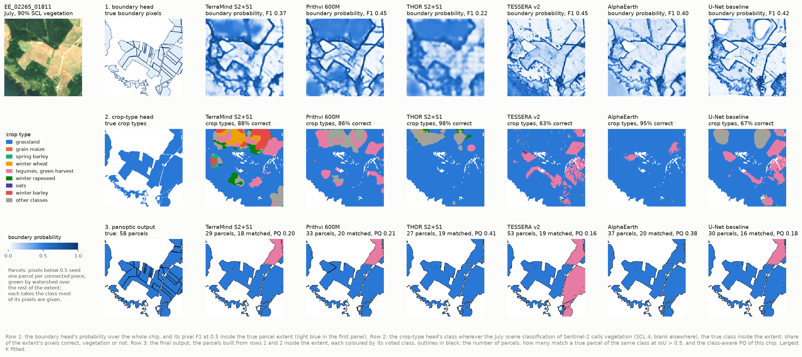

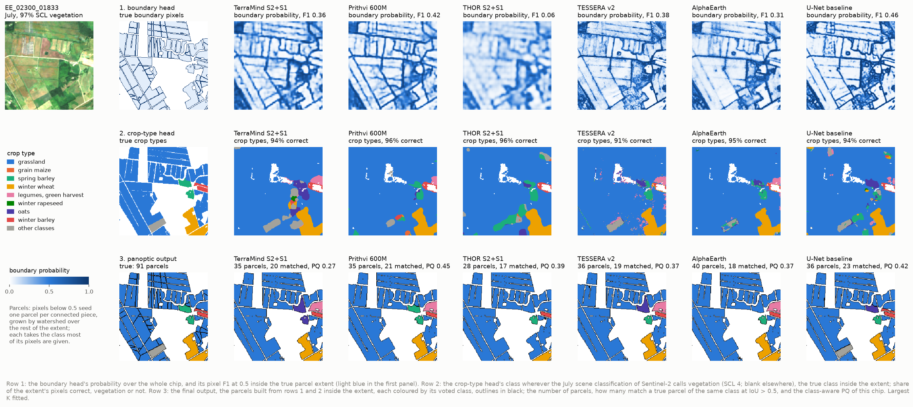

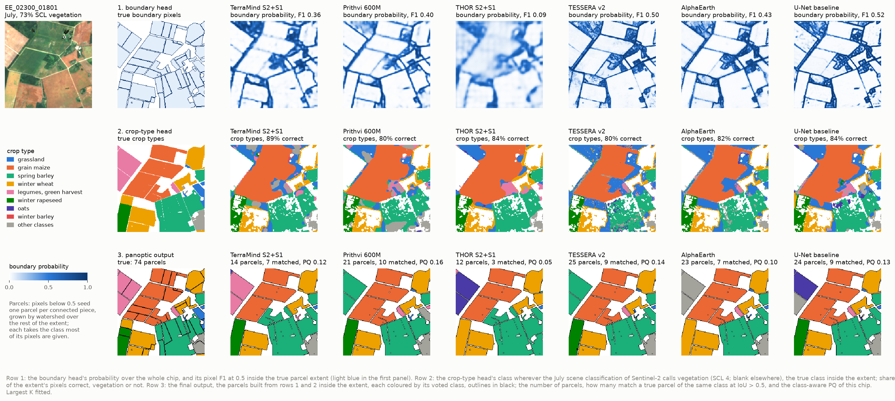

The three test chips with the most contacts between parcels of one class, at K = 100 %. Each figure has one row per
stage of the method.

**Row 1, the boundary head.** Every head draws the outer edges of the fields, against forest, roads and farmyards,
as its darkest lines. It draws the internal lines between strips of one crop faintly or not at all. The texture
shows how each arm decodes:

* **Token-grid heads** (TerraMind, Prithvi, THOR): smooth bands several pixels wide, blurred at the scale of a 160 m
  token. THOR's map is a haze in which only the strongest edges stand out (F1 0.06 to 0.22 on these chips). Many
  internal lines are visible in TerraMind's and Prithvi's maps but stay below 0.5, which is why a threshold of 0.3
  helps them.
* **10 m per-pixel heads** (TESSERA, AlphaEarth): sharp but grainy lines, with speckle inside the fields.
* **U-Net:** the sharpest and most continuous lines, among them part of the internal strips of the second chip.

**Row 2, the crop-type head.** Neighbouring parcels of one class form one block of colour, as the grassland strips
of the first two chips do. The map alone cannot separate them, so the parcels drawn from it merge them. The errors
take a different form in each group:

* **Token-grid models:** they confuse classes in rounded patches a few tokens wide that ignore the parcel outlines,
  as TerraMind and Prithvi do on the first chip, where grassland becomes legumes harvested green.
* **TESSERA:** its errors are scattered pixels inside a parcel, such as the spring wheat (13 %) and oats (9 %) in
  the spring barley block of the third chip.

These chips were chosen for their same-class contacts and are mostly grassland. Their pixel accuracy (63 to 98 %)
does not estimate that of the test set.

**Row 3, the parcels.** Every arm returns far fewer parcels than there are, and only a minority of them match a
true parcel of the same class:

| Chip | True parcels | Predicted parcels | Matched |
|---|---|---|---|
| 1 | 58 | 27 to 53 | 16 to 20 |
| 2 | 91 | 28 to 40 | 17 to 23 |
| 3 | 74 | 12 to 25 | 3 to 10 |

The outer outline of each block, which the extent gives, is kept. The internal lines of the strips and blocks are
almost all lost: a single gap below 0.5 in a boundary line lets one seed run through into the next field. What the
heads add are small closed rings of high probability, which become slivers, visible as black specks.

The vote cleans the class. TESSERA's speckle disappears, and each parcel takes one class. A wrong class then covers
a whole parcel, as with the three legumes parcels at the top left of the third chip:

* TerraMind is the only arm that votes legumes for all three;
* Prithvi and TESSERA vote spring barley;
* THOR votes oats;
* AlphaEarth votes peas;
* the U-Net votes oats for two and spring wheat for one.

The class-aware PQ of a single chip (0.05 to 0.45) swings with single parcels like these, and is not an estimate
for the test set.

**What the maps show and the scores do not.** The predicted crop types are shown wherever the July scene
classification of Sentinel-2 (SCL) calls a pixel vegetation (class 4), inside the extent or not; the true ones only
inside the extent. `fetch_scl.py` reads the SCL for these chips: a pixel takes its most frequent class among the
July acquisitions that see it as vegetation, bare soil or water. The mask removes water, roads and farmyards, but it
keeps forest, and it removes much of the cropland as well. In the third chip a third of the labelled pixels are bare
in July, among them 89 % of the legumes harvested green, 67 % of the winter wheat and 65 % of the grassland, which
are mown or ripening. That is why the three legumes parcels are blank in row 2.

Outside the extent, which holds 74 % of the test pixels, every arm still names a crop, since the scheme has no
background class:

* TESSERA and AlphaEarth call 86 % of those pixels grassland, and the U-Net 65 %;
* the token-grid models call only 39 to 45 % grassland and spread other crops over forest and settlements. On the
  vegetation outside the extent of the first chip, mostly forest, TerraMind names winter barley (13 %), winter wheat
  (10 %) and winter rapeseed (7 %).

None of this enters a score, since every metric is computed inside the extent, over all its pixels, whatever their
SCL class. The boundary probability outside the extent is likewise shown but not scored. It matters for a map of a
whole region, which would need the cropland mask of stage 1 first.

### The intermediate outputs: the two heads

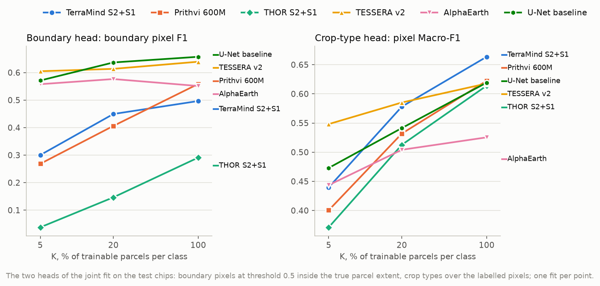

#### The boundary head

**Boundary pixels at 0.5** against the dense target, inside the extent of the test chips

| Arm | precision, 100 % | recall, 100 % | F1, 100 % | precision, 20 % | recall, 20 % | F1, 20 % | precision, 5 % | recall, 5 % | F1, 5 % |
|---|---|---|---|---|---|---|---|---|---|
| TerraMind S2+S1 | 0.677 | 0.392 | 0.497 | 0.620 | 0.353 | 0.449 | 0.536 | 0.209 | 0.300 |
| Prithvi 600M | 0.692 | 0.468 | 0.559 | 0.638 | 0.298 | 0.406 | 0.538 | 0.179 | 0.269 |
| THOR S2+S1 | 0.597 | 0.193 | 0.291 | 0.547 | 0.085 | 0.147 | 0.510 | 0.020 | 0.038 |
| TESSERA v2 | 0.754 | 0.555 | 0.639 | 0.774 | 0.508 | 0.614 | 0.742 | 0.510 | 0.605 |
| AlphaEarth | 0.762 | 0.432 | 0.551 | 0.722 | 0.480 | 0.577 | 0.705 | 0.461 | 0.558 |
| U-Net baseline | 0.755 | 0.582 | **0.657** | 0.725 | 0.568 | **0.637** | 0.647 | 0.512 | 0.571 |

Every head is cautious: at every K, half or more of what it marks is boundary, but it misses at least 42 % of the
boundary pixels. Two patterns appear with K:

* **10 m arms and the U-Net:** F1 holds at 0.55 to 0.66 at every K.
* **Token-grid heads:** F1 falls as K falls, mainly through recall. THOR's head almost stops marking boundaries
  (recall 0.02 at 5 %).

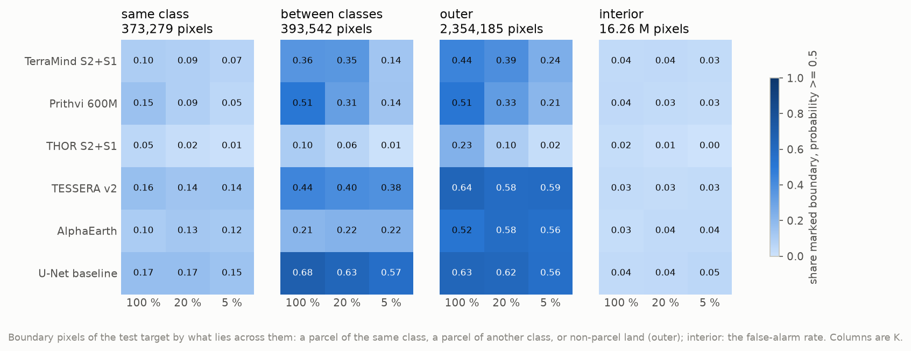

**Boundary pixels of the target marked by the head at 0.5**, by what lies across them; interior is the false-alarm
rate. K = 100 % and, in brackets, 5 %.

| Arm | same class | between classes | outer | interior |
|---|---|---|---|---|
| TerraMind S2+S1 | 0.100 (0.067) | 0.361 (0.136) | 0.444 (0.243) | 0.036 (0.035) |
| Prithvi 600M | 0.154 (0.054) | 0.508 (0.137) | 0.512 (0.206) | 0.040 (0.030) |
| THOR S2+S1 | 0.052 (0.008) | 0.104 (0.007) | 0.230 (0.024) | 0.025 (0.004) |
| TESSERA v2 | 0.165 (0.144) | 0.436 (0.379) | 0.637 (0.590) | 0.035 (0.034) |
| AlphaEarth | 0.102 (0.118) | 0.205 (0.224) | 0.522 (0.555) | 0.026 (0.037) |
| U-Net baseline | **0.169** (0.148) | **0.683** (0.570) | 0.631 (0.560) | 0.036 (0.054) |

The recall depends on what lies across the boundary:

* **Same class:** at most one boundary pixel in six is marked, at every K. These are the boundaries the head is
  for.
* **Between classes:** better, since there the class signal helps.
* **Outer edges:** learnt best. They make up three quarters of the target, and the scoring does not need them.

The false alarms are few per pixel (0.4 to 5.4 %), but they matter for the parcels, as the next section shows.

#### The crop-type head

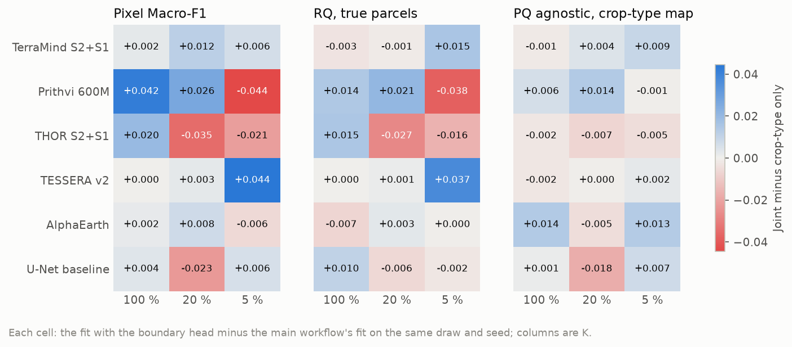

**Pixel Macro-F1**: the main workflow's fit, the joint fit, the difference; and the difference in parcel Macro-F1 (D28)

| Arm | ref., 100 % | joint, 100 % | diff. | D28 diff. | ref., 20 % | joint, 20 % | diff. | D28 diff. | ref., 5 % | joint, 5 % | diff. | D28 diff. |
|---|---|---|---|---|---|---|---|---|---|---|---|---|
| TerraMind S2+S1 | 0.661 | 0.664 | +0.002 | −0.002 | 0.566 | 0.578 | +0.012 | +0.001 | 0.433 | 0.440 | +0.006 | +0.014 |
| Prithvi 600M | 0.580 | 0.622 | +0.042 | +0.016 | 0.505 | 0.532 | +0.026 | +0.020 | 0.445 | 0.400 | −0.044 | −0.043 |
| THOR S2+S1 | 0.594 | 0.614 | +0.020 | +0.020 | 0.547 | 0.513 | −0.035 | −0.030 | 0.393 | 0.371 | −0.021 | −0.016 |
| TESSERA v2 | 0.618 | 0.618 | −0.000 | +0.003 | 0.582 | 0.585 | +0.003 | +0.000 | 0.504 | 0.548 | +0.044 | +0.035 |
| AlphaEarth | 0.523 | 0.525 | +0.002 | −0.009 | 0.497 | 0.504 | +0.008 | +0.006 | 0.449 | 0.444 | −0.006 | −0.001 |
| U-Net baseline | 0.616 | 0.619 | +0.004 | +0.009 | 0.564 | 0.541 | −0.023 | −0.011 | 0.467 | 0.473 | +0.006 | +0.003 |

The differences have no consistent sign:

* 12 of the 18 are positive, and the mean is +0.003.
* The large ones (Prithvi ±0.04, THOR −0.035, TESSERA +0.044 at 5 %) are as large as the spread between refits of
  the same cell seen before (up to 0.038 for the token-grid models, pipeline.md section 11).
* The crop-type map's own parcels (right panel of the figure) move by at most 0.018.

Training the boundary head neither helps nor harms the crop-type answer of RQ1.

### The final output: parcels with a class

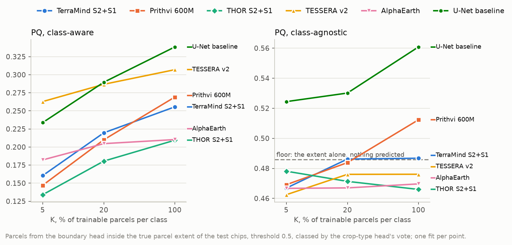

**Panoptic quality of the boundary parcels** (threshold 0.5), class-aware

| Arm | PQ, 100 % | SQ, 100 % | RQ, 100 % | PQ, 20 % | SQ, 20 % | RQ, 20 % | PQ, 5 % | SQ, 5 % | RQ, 5 % |
|---|---|---|---|---|---|---|---|---|---|
| TerraMind S2+S1 | 0.256 | 0.756 | 0.288 | 0.220 | 0.755 | 0.249 | 0.160 | 0.712 | 0.181 |
| Prithvi 600M | 0.269 | 0.757 | 0.303 | 0.210 | 0.711 | 0.237 | 0.147 | 0.673 | 0.165 |
| THOR S2+S1 | 0.209 | 0.750 | 0.237 | 0.181 | 0.712 | 0.204 | 0.134 | 0.665 | 0.151 |
| TESSERA v2 | 0.307 | 0.813 | 0.340 | 0.287 | 0.766 | 0.318 | **0.263** | 0.772 | 0.292 |
| AlphaEarth | 0.210 | 0.762 | 0.236 | 0.205 | 0.759 | 0.230 | 0.182 | 0.749 | 0.206 |
| U-Net baseline | **0.338** | 0.777 | 0.371 | **0.290** | 0.727 | 0.320 | 0.234 | 0.668 | 0.262 |

The two panels of the figure separate the class from the geometry.

* **Class-aware (left).** The arms rank much as they do on the parcel Macro-F1 of D28. The U-Net leads at 100 and
  20 %, and TESSERA at 5 %, where its curve is the flattest. The token-grid models fall fastest with K.
* **Class-agnostic (right).** Without the class, only the U-Net separates from the rest.

Split into its two factors, the class-agnostic PQ depends on how many parcels are found, not on how well they fit:

* **SQ:** the matched parcels of every arm fit closely, 0.90 to 0.92, against 0.93 for the extent.
* **RQ:** 0.51 to 0.57 for the GFM arms and 0.58 to 0.62 for the U-Net, against 0.52 for the extent.
* **Number of parcels:** every arm predicts fewer parcels than there are, 24,615 to 48,155 against 55,575 true
  pieces; the extent alone gives 23,146.

The boundary pixel F1 of the previous section does not predict the parcels. AlphaEarth and TESSERA mark boundary
pixels about as well as the U-Net (0.55 to 0.64), yet sit at or below the floor. THOR barely learns the boundary
(F1 0.04 at 5 %) and still lands near the floor.

#### Against the floor and the crop-type map

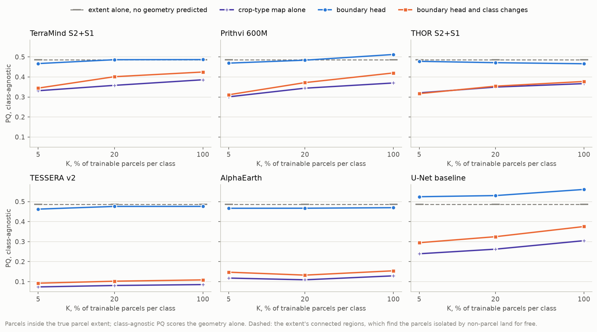

**Class-agnostic PQ**: the extent alone (floor), the crop-type map, the boundary head, both

| Arm | floor | map, 100 % | head, 100 % | both, 100 % | map, 20 % | head, 20 % | both, 20 % | map, 5 % | head, 5 % | both, 5 % |
|---|---|---|---|---|---|---|---|---|---|---|
| TerraMind S2+S1 | 0.486 | 0.386 | 0.487 | 0.425 | 0.358 | 0.486 | 0.401 | 0.331 | 0.467 | 0.344 |
| Prithvi 600M | 0.486 | 0.370 | **0.512** | 0.420 | 0.344 | 0.484 | 0.372 | 0.301 | 0.469 | 0.311 |
| THOR S2+S1 | 0.486 | 0.367 | 0.466 | 0.377 | 0.349 | 0.471 | 0.354 | 0.320 | 0.478 | 0.317 |
| TESSERA v2 | 0.486 | 0.085 | 0.476 | 0.109 | 0.081 | 0.476 | 0.102 | 0.074 | 0.462 | 0.092 |
| AlphaEarth | 0.486 | 0.129 | 0.470 | 0.154 | 0.109 | 0.467 | 0.133 | 0.118 | 0.467 | 0.147 |
| U-Net baseline | 0.486 | 0.305 | **0.561** | 0.375 | 0.262 | **0.530** | 0.325 | 0.239 | **0.524** | 0.295 |

Three things are clear:

1. Every arm's crop-type map gives worse parcels than the extent alone (0.07 to 0.39). Cutting where the predicted
   class changes fragments the parcels more than it separates them. The 10 m per-pixel arms suffer most, because
   their maps are speckled (0.07 to 0.13).
2. The boundary head lies on the floor for the five GFM arms, and above it for the U-Net only.
3. Adding the class changes to the head's seeds (`combined`) always lowers the score, for the same reason as (1).

#### What the parcels find, and what they miss

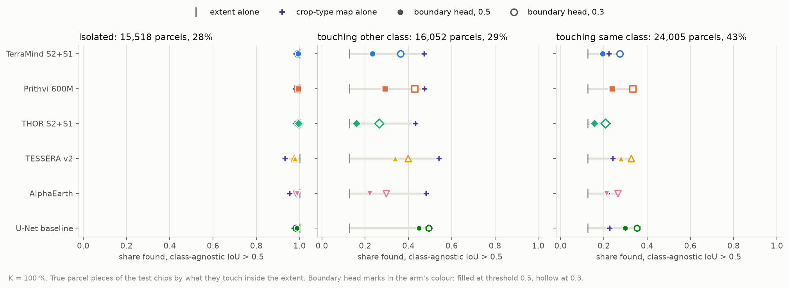

The 55,575 true parcel pieces of the test chips split three ways (titles of the figure):

* 28 % touch no other parcel inside the extent;
* 29 % touch only parcels of other classes;
* 43 % touch at least one parcel of their own class.

(The 52 % of the study of 16 October counted whole parcels touching a same-class neighbour anywhere, on 300
chips.) The extent alone finds every isolated parcel and one in eight of the others, those that fill most of their
connected region.

**True parcels found** at K = 100 %, class-agnostic IoU > 0.5: by the crop-type map, the boundary head at 0.5 and at
0.3; and the predicted parcels of the head at 0.5 that match no true parcel. The extent alone finds 100 %, 12.6 % and
12.7 % and leaves 2,558 parcels unmatched. Every K is in `figures/tables.md`.

| Arm | isolated, head 0.5 | other class: map | head 0.5 | head 0.3 | same class: map | head 0.5 | head 0.3 | unmatched, of which slivers |
|---|---|---|---|---|---|---|---|---|
| TerraMind S2+S1 | 0.993 | 0.472 | 0.233 | 0.364 | 0.224 | 0.195 | 0.273 | 9,371 / 4,242 |
| Prithvi 600M | 0.993 | 0.474 | 0.291 | 0.429 | 0.234 | 0.238 | 0.334 | 9,702 / 4,295 |
| THOR S2+S1 | 0.995 | 0.432 | 0.160 | 0.263 | 0.219 | 0.157 | 0.207 | 7,864 / 3,610 |
| TESSERA v2 | 0.979 | 0.540 | 0.339 | 0.398 | 0.242 | 0.280 | 0.326 | 20,801 / 13,538 |
| AlphaEarth | 0.988 | 0.482 | 0.221 | 0.296 | 0.215 | 0.212 | 0.265 | 12,780 / 7,406 |
| U-Net baseline | 0.987 | 0.499 | **0.448** | **0.494** | 0.226 | **0.299** | **0.353** | 11,050 / 5,616 |

The heads keep the isolated parcels (98 to 99.9 %) and add some of the touching ones, but few. Between classes,
every arm's crop-type map alone still finds more of those parcels (43 to 54 %) than its head at 0.5.

The few false alarms of the head become false parcels. A short run of them across a field, or a ring around a mixed
pixel, makes a seed and so a parcel. The heads leave 7,900 to 20,800 predicted parcels unmatched, against 2,558 for
the extent.

* **TESSERA** shows the trade-off most clearly. It finds the second most same-class parcels, but its per-pixel head
  also cuts the most slivers (13,500 under 20 pixels), and it lands below the floor.
* **The U-Net** finds the most touching parcels of both kinds, with no more false parcels than AlphaEarth, and it
  alone clears the floor.

#### The cost of predicted geometry

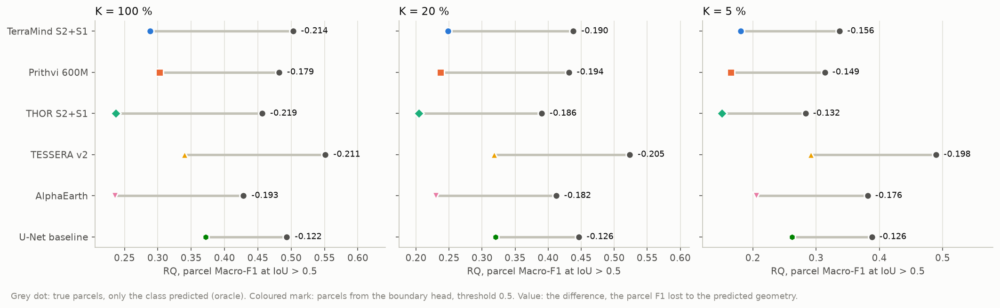

**Parcel Macro-F1 at IoU > 0.5 (RQ)**: with the true parcels, with the boundary parcels, the difference

| Arm | true, 100 % | pred., 100 % | diff., 100 % | true, 20 % | pred., 20 % | diff., 20 % | true, 5 % | pred., 5 % | diff., 5 % |
|---|---|---|---|---|---|---|---|---|---|
| TerraMind S2+S1 | 0.503 | 0.288 | −0.214 | 0.438 | 0.249 | −0.190 | 0.337 | 0.181 | −0.156 |
| Prithvi 600M | 0.482 | 0.303 | −0.179 | 0.431 | 0.237 | −0.194 | 0.314 | 0.165 | −0.149 |
| THOR S2+S1 | 0.456 | 0.237 | −0.219 | 0.390 | 0.204 | −0.186 | 0.283 | 0.151 | −0.132 |
| TESSERA v2 | 0.551 | 0.340 | −0.211 | 0.524 | 0.318 | −0.205 | 0.490 | 0.292 | −0.198 |
| AlphaEarth | 0.428 | 0.236 | −0.193 | 0.412 | 0.230 | −0.182 | 0.381 | 0.206 | −0.176 |
| U-Net baseline | 0.493 | 0.371 | **−0.122** | 0.446 | 0.320 | **−0.126** | 0.388 | 0.262 | **−0.126** |

* **With the true parcels**, TESSERA leads at every K, as it does per parcel under D28.
* **With predicted parcels**, 38 to 47 % of that parcel F1 is lost for the GFM arms, and 25 to 32 % for the U-Net.
  That puts the U-Net ahead of TESSERA at 100 % and level with it at 20 %.

The loss is smaller at low K for the token-grid models only because there is less left to lose.

#### Threshold

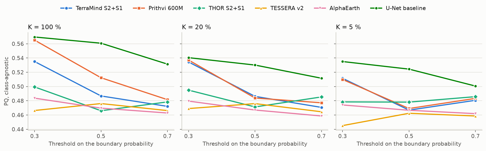

**Class-agnostic PQ of the boundary parcels at 0.3, 0.5 and 0.7**

| Arm | 0.3, 100 % | 0.5, 100 % | 0.7, 100 % | 0.3, 20 % | 0.5, 20 % | 0.7, 20 % | 0.3, 5 % | 0.5, 5 % | 0.7, 5 % |
|---|---|---|---|---|---|---|---|---|---|
| TerraMind S2+S1 | 0.535 | 0.487 | 0.472 | 0.534 | 0.486 | 0.471 | 0.512 | 0.467 | 0.481 |
| Prithvi 600M | 0.565 | 0.512 | 0.482 | 0.537 | 0.484 | 0.477 | 0.510 | 0.469 | 0.483 |
| THOR S2+S1 | 0.499 | 0.466 | 0.478 | 0.495 | 0.471 | 0.485 | 0.478 | 0.478 | 0.486 |
| TESSERA v2 | 0.466 | 0.476 | 0.466 | 0.469 | 0.476 | 0.465 | 0.445 | 0.462 | 0.459 |
| AlphaEarth | 0.484 | 0.470 | 0.463 | 0.480 | 0.467 | 0.459 | 0.474 | 0.467 | 0.462 |
| U-Net baseline | 0.570 | 0.561 | 0.531 | 0.541 | 0.530 | 0.512 | 0.535 | 0.524 | 0.501 |

Lowering the threshold to 0.3 lifts the arms unevenly:

* TerraMind and Prithvi by 0.04 to 0.05, to 0.51 to 0.57;
* THOR by up to 0.03;
* the U-Net by about 0.01;
* TESSERA and AlphaEarth by less than 0.02, TESSERA downwards.

The fixed 0.5 was agreed to keep the arms comparable without tuning on the test set. The check shows that it
understates the token-grid heads, whose probabilities are low, but it would not change the conclusion for the 10 m
arms. A threshold chosen on the validation chips is the fair way to use it.

### Training dynamics

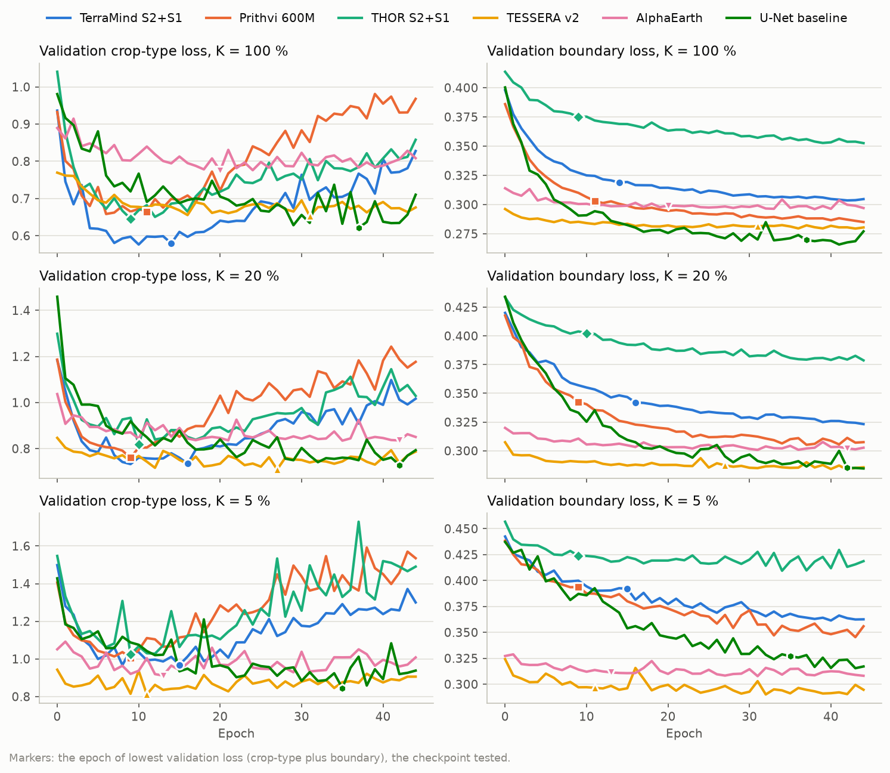

The checkpoint is the epoch of lowest summed loss, and the crop-type loss sets it.

* **Token-grid models:** that loss turns up after epoch 8 to 16, so their checkpoints fall at epochs 9 to 16 (as in
  the main workflow, 7 to 14), while their boundary loss is still falling at epoch 45. Their heads are therefore
  tested part-trained: TerraMind's boundary loss at K = 100 % is about 0.318 at its checkpoint and 0.305 at epoch 45.
* **U-Net:** its checkpoints fall at epochs 35 to 42, where both losses are low.
* **10 m per-pixel arms:** they reach their boundary loss within a few epochs and stay there (0.28 to 0.33). A
  per-pixel MLP sees no neighbour, so it can mark a boundary only from what one pixel's embedding holds.
* **THOR:** its boundary loss stays the highest of all (0.35 to 0.42).

## Analysis

**The head is not the missing piece; a spatial decoder at 10 m is.** Every GFM arm meets the same limit from a
different side.

* **Token-grid models.** They decode from 160 m tokens, one per 16 x 16 pixels, through a light UNet decoder with
  no 10 m input. A boundary between two parcels of one crop is a line one or two pixels wide inside a token, with no
  class change to betray it, and that decoder has nothing to place it with. TerraMind, Prithvi and THOR mark 1 to
  15 % of those pixels, and lose even the outer edges as K falls (Prithvi 0.51 to 0.21).
* **10 m arms.** They see every pixel, but only one at a time, since the per-pixel MLP of the matched design has no
  neighbourhood. They mark an edge where the embedding of a mixed pixel differs. That works where land cover
  changes (outer edges 0.52 to 0.64) and seldom where it does not (same class 0.10 to 0.17). Because nothing smooths
  the decision, they cut slivers. This is also why their boundary loss flattens within a few epochs and why their
  scores barely move with K: what the embedding does not hold, more labels cannot add.
* **The U-Net.** It is the only arm that works spatially at 10 m from input to output, and the only one whose head
  adds geometry beyond the extent (+0.04 to +0.075 class-agnostic PQ). That it does so without pretraining and
  under the same budgets suggests the limit lies in how the GFM features are decoded here, not in the amount of
  labelled geometry.

**A good boundary map is not enough.** The pixel F1 of the head and the PQ of its parcels rank the arms
differently. A parcel needs a closed line: one gap merges two parcels, and one closed ring of false alarms makes a
sliver. A head that marks most boundary pixels, but leaves gaps and marks scattered interior pixels, as the 10 m
arms do, can score well per pixel and still fail per parcel. The pixel F1 therefore diagnoses the head, and PQ is
the measure of the result.

**The floor explains the first impression.** Without the `extent` variant, the head would look like a large gain:
its parcels beat the crop-type map's by 0.10 to 0.40 class-agnostic PQ for every arm. Almost all of that gain is
the extent's, the parcels separated by non-parcel land, which any method inside a perfect first-stage mask gets for
free. Measured against the extent, the five GFM heads add between −0.024 and +0.026, and +0.08 at most at a lower
threshold.

**What the parcel layer is worth.** With the true parcels, the arms' parcel F1 at IoU > 0.5 is 0.28 to 0.55; with
their own parcels, 0.15 to 0.37. The declared parcel layer is therefore worth 0.12 to 0.22 parcel F1 for every
arm, more than any difference between the arms at a given K. For the thesis this supports keeping the parcel as the
unit of the parcel-level scores (protocol D28) and of later reporting, taken from the declarations, not predicted.

**RQ1 is unaffected.** Joint training leaves the pixel Macro-F1 where it was (mean +0.003, no consistent sign).
The delineation question and the label-budget curves of RQ1 can therefore be kept apart: nothing here argues for
changing the main workflow's heads or loss.

**Against the PaPs alternative.** The study of 16 October preferred a boundary head to PaPs because it keeps the
label budget and the matched decoders. The result does not reopen that choice. PaPs would sit on the same decoders
and see the same features, and the diagnosis points to what those features and decoders can resolve at 10 m, not to
how the parcels are assembled from them.

## Caveats

* **One draw and one seed per cell.** Differences under about 0.04 between two fits are not resolved; the
  conclusions rest on patterns across six arms and three budgets, not on single cells.
* **The checkpoint favours the crop-type head.** The summed validation loss picks early epochs for the token-grid
  models, where their boundary heads are part-trained. A checkpoint per head, or the boundary head's own best epoch,
  would give them a fairer test; the U-Net is not affected.
* **The threshold is fixed at 0.5.** It understates the token-grid heads by 0.04 to 0.05 class-agnostic PQ
  (threshold section); it does not change the result for the 10 m arms.
* **Scored inside the true extent.** Every variant, the floor included, is given the true parcel extent, the
  perfect first stage of the two-stage design, which is not built. Without it every score here would be lower, and
  the outer edges the heads mark would start to matter.
* **The target counts the outer edges.** Three in four boundary pixels of the target lie against non-parcel land,
  so the boundary loss and the boundary F1 are dominated by edges the scoring does not need. A target and a loss
  that weigh the boundaries between parcels would train a different head.
* **The boundary F1 is exact to the pixel.** A boundary one pixel off counts as a miss and a false alarm, so the
  pixel scores of the head are lower than a tolerance-based boundary score would give. The parcels, scored by IoU,
  are not affected.
* **Boundaries the data may not show.** Two adjacent parcels of the same crop under one manager can be one field
  on the ground; part of the same-class boundaries may not be visible in 10 m imagery at all. That limit applies to
  every method, PaPs included, and this experiment cannot separate it from the head's limits.

## Next steps

* **Main workflow: no change.** The boundary head is not worth adding to `kshot` as it stands. Parcel-level scores
  stay on the declared parcels (D28).
* **If delineation is pursued, in this order:**
  1. a target and loss that weigh the boundaries between parcels: drop the outer edges from the target, or weight
     the boundary class, so the head learns what the scoring needs;
  2. a checkpoint for the boundary head of its own, and a threshold chosen on the validation chips, which costs
     nothing and lifts the token-grid heads by about 0.05;
  3. a minimum parcel size, merging slivers under about 20 pixels into their neighbour, which mainly helps the
     10 m arms;
  4. a decoder with 10 m context for the GFM arms (for example the GFM features joined to the U-Net's 10 m path).
     That departs from the matched decoders of the RQ1 design and is the user's decision.
* **How much of the same-class boundaries the imagery shows at all.** A check of the image contrast across those
  boundaries against field interiors would bound what any method, PaPs included, can recover at 10 m.
* **Docs.** An entry for pipeline.md section 11 is proposed separately; nothing in the docs was changed.

## Reproduce

    poetry run python experiments/2026-10-18_parcel_delineation/check.py
    poetry run python experiments/2026-10-18_parcel_delineation/run.py -e experiments/2026-10-18_parcel_delineation/experiment.yaml --chips data/eurocrops_chips/EE_2021_rev --dry-run
    bash scripts/cluster/submit.sh experiments/2026-10-18_parcel_delineation/experiment.yaml EE_2021_rev      # on the cluster
    bash scripts/cluster/pull_results.sh 2026-10-18_parcel_delineation EE_2021_rev
    poetry run python experiments/2026-10-18_parcel_delineation/diagnose.py --chips EE_2021_rev
    poetry run python experiments/2026-10-18_parcel_delineation/fetch_scl.py --chips EE_2021_rev
    poetry run python experiments/2026-10-18_parcel_delineation/report.py --chips EE_2021_rev
