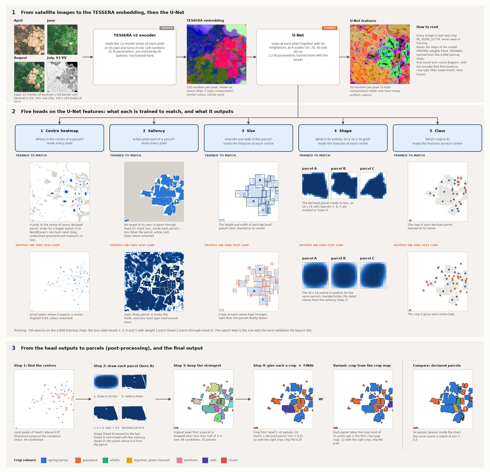
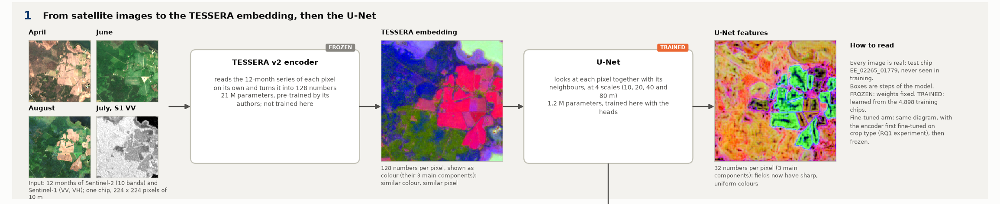
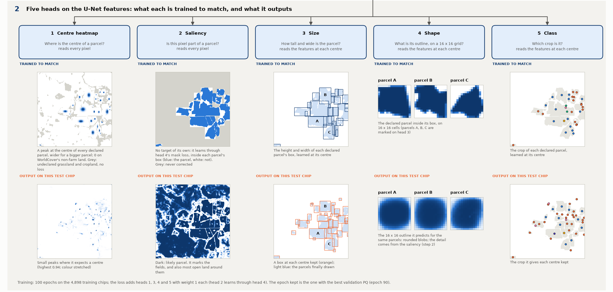
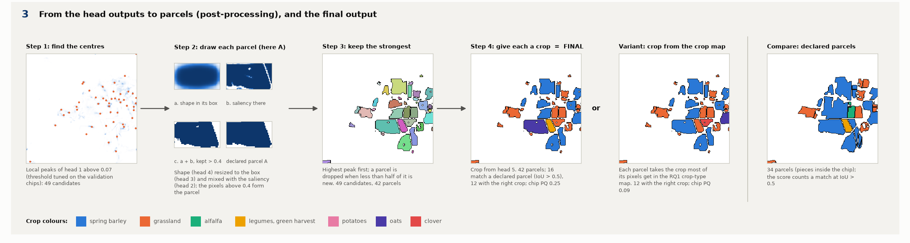

# PaPs on TESSERA: the architecture, step by step

**In one sentence.** PaPs (Parcels-as-Points, Garnot and Landrieu, ICCV 2021) finds every parcel as a *point*, its
centre, and then draws the parcel around that point; here it works on the TESSERA embedding instead of raw
satellite images.

**Every image in the diagram is real.** They all come from one test chip, `EE_02265_01779`, which holds 34 declared
parcels (counted as the pieces inside the chip) and was never seen in training. The model is the frozen-TESSERA arm's kept checkpoint (epoch 90). The
script that draws the diagram runs that checkpoint again on the chip and gets the stored test result back: the same
42 parcels, 99.98 % of the pixels identical.

**The chain in one line:**

    Sentinel-2 + Sentinel-1, 12 months  →  TESSERA encoder (frozen)  →  128 numbers per pixel
      →  U-Net (trained)  →  five heads  →  post-processing  →  parcels, each with a crop

The diagram has three parts, shown larger below.

---

## Part 1. From satellite images to features

1. **Input.** One chip of 224 x 224 pixels of 10 m (2.24 km a side). Each pixel has 12 monthly Sentinel-2 images
   (10 bands) and 12 monthly Sentinel-1 radar images (VV and VH). The diagram shows three months of Sentinel-2 in
   true colour and July's radar.
2. **TESSERA encoder (frozen).** A pre-trained model with 21 M parameters. It reads the 12-month series of **one
   pixel at a time** and turns it into **128 numbers**: the embedding. We do not change its weights.
3. **The embedding.** 128 numbers per pixel can't be drawn directly, so the image shows the 3 main directions of
   variation as red, green and blue. Pixels with similar colours behaved similarly over the year.
4. **U-Net (trained).** TESSERA never looks at a pixel's neighbours, but a parcel's centre, size and outline are
   about neighbourhoods. The U-Net mixes each pixel with its neighbours at 4 scales (10, 20, 40 and 80 m). It is the
   spatial part of U-TAE, the model PaPs was published with; U-TAE's temporal part is left out because TESSERA has
   already summarised the year. U-Net and heads together have 1.23 M parameters, all trained here.
5. **U-Net features.** 32 numbers per pixel (again 3 shown as colour). Fields now stand out as uniform patches with
   sharp edges.

---

## Part 2. The five heads: what each learns, and what it outputs

Each column is one head. The **upper** image is what the head is **trained to match** (drawn for this chip, for
comparison), and the **lower** image is what it **outputs** on this test chip.

| Head | Question it answers | Reads | Trained to match | Loss |
|---|---|---|---|---|
| 1 Centre heatmap | Where is the centre of a parcel? | every pixel | a peak at the centre of each declared parcel (the pixel nearest its middle), wider for a bigger parcel; 0 on WorldCover's non-farm land | focal loss of CornerNet |
| 2 Saliency | Is this pixel part of a parcel? | every pixel | nothing of its own: it learns through head 4's loss, inside each parcel's box | through head 4 |
| 3 Size | How tall and wide is the parcel? | the features at each centre | the height and width of the declared parcel's box | relative L1 error |
| 4 Shape | What is its outline? | the features at each centre | the declared parcel inside its box, on a 16 x 16 grid | cross-entropy of the drawn mask (shape plus saliency) against the parcel |
| 5 Class | Which crop is it? | the features at each centre | the declared crop | cross-entropy |

"The features at each centre" means the U-Net features of the centre pixel, taken from all four scales (256
numbers). So heads 3, 4 and 5 describe a whole parcel from one point.

**Where WorldCover comes in.** The targets use only two sources: the declared parcels and the public ESA WorldCover
map. Land that WorldCover calls forest, water, built-up and so on is *background*: head 1 learns "no centre here".
WorldCover grassland and cropland outside the declared parcels is *unknown* (grey in the targets) and gets no loss,
because an undeclared field may still be a field.

**What to notice in the outputs:**

* **Head 1** gives small, sharp peaks. The highest on this chip is 0.94, but most are far lower, which is why the
  threshold of step 1 below is only 0.07.
* **Head 2** marks the fields, and also most of the open land around them. It is only ever corrected inside the
  boxes of declared parcels, so nothing tells it that open land far from any parcel is not a field. That is where
  PaPs' false parcels come from.
* **Head 3** puts a box at every centre it keeps. The letters A, B and C mark three parcels, followed in head 4 and
  in step 2.
* **Head 4** predicts soft, rounded blobs: a 16 x 16 grid can't hold much detail. The detail comes from the saliency
  in step 2.
* **Head 5** gives one crop per centre, shown as a coloured dot.

**Training.** 100 epochs on the 4,898 training chips, batches of 4 chips, Adam at a learning rate of 0.01 (x 0.3
after epochs 60 and 80), the first 5 epochs on head 1 alone, random flips and rotations. The loss adds heads 1, 3, 4
and 5 with weight 1 each. Every 5 epochs the model is checked on the validation chips. The threshold of step 1 is
tuned there, and the epoch kept is the one with the best validation PQ (epoch 90 for frozen TESSERA, epoch 70 for
fine-tuned).

---

## Part 3. From head outputs to parcels

No head outputs a parcel. Parcels exist only after these four steps (PaPs' "pseudo non-maximum suppression"):

1. **Find the centres.** Every local peak of head 1 (the highest pixel of its 3 x 3 neighbourhood) above **0.07**
   is a candidate centre. The threshold was tuned on the validation chips. This chip has 49 candidates.
2. **Draw each parcel.** For each candidate, head 3 gives a box around the centre and head 4's 16 x 16 shape is
   stretched to fill it (a). The saliency inside the box (b) is added, a small trained filter (three convolutions)
   refines the result, and the pixels above 0.4 form the parcel (c). For parcel A the result is close to the declared parcel.
3. **Keep the strongest.** Candidates are taken from the highest peak down. A new parcel is dropped if it overlaps
   parcels already drawn and less than half of it is new; otherwise it keeps only its new pixels. Here 49 candidates
   become 42 parcels.
4. **Give each a crop.** Each parcel takes head 5's crop. **This is the final output**: a map where every pixel
   belongs to one parcel or to none, and every parcel has a crop.

**Variant: the crop from the crop map.** Instead of head 5, each parcel can take the crop that most of its pixels get
in the crop-type map of RQ1: the TESSERA + MLP of the main workflow (for the fine-tuned arm, the fine-tuned
one). The parcels stay the same; only their
crop changes.

**On this chip.** 42 parcels; 16 match a declared parcel (overlap IoU above 0.5) and 12 of those have the right crop.
Chip PQ is 0.25 with head 5's crops and 0.09 with the crop map's. Both get 12 crops right, but class-aware PQ
averages over the crops on the chip, so one parcel can swing it: the crop map misses the one legume parcel that head
5 gets right, and adds a clover parcel that does not exist. Over all 1,475 test chips the crop map's crops are the
better ones:

| All test chips, whole chip, no area given | Frozen TESSERA | Fine-tuned TESSERA |
|---|---|---|
| PQ with head 5's crop (crop ignored) | 0.303 (0.336) | 0.357 (0.366) |
| PQ with the crop map's crop | 0.322 | 0.361 |

---

## The fine-tuned arm

The diagram is the same. Only the encoder changes: the TESSERA student that was fine-tuned on crop type in
`../2026-10-15_kshot_finetune` (K = 100 %, draw 0, seed 0) re-encodes every chip once, and is then frozen. The U-Net
and the five heads are trained from scratch in the same way. Its kept epoch is 70 and its threshold 0.09.

## How PaPs differs from the boundary head

| | PaPs | Boundary head ([its architecture](../2026-11-05_parcel_extent/ARCHITECTURE.md)) |
|---|---|---|
| After TESSERA | U-Net: sees neighbours | per-pixel MLP: one pixel at a time |
| Heads | 5: centre, saliency, size, shape, crop | 2: crop, edge |
| Learns from | declared parcels, plus WorldCover's non-farm land as background | declared parcels only |
| A parcel is | one detected centre with a mask drawn around it | a region between predicted edges |
| Land with no parcel | stays empty | impossible: every pixel of the area ends in some parcel |

## Reproduce

    poetry run python experiments/2026-11-05_paps_tessera/architecture.py --chip EE_02265_01779

It needs the frozen arm's `best-pq.pt`, the pilot TESSERA cache on the hub and the stored test predictions. The chip
must be one of the nine pilot test chips (the only ones with a TESSERA raster on the hub). The script writes
`figures/architecture.png` and its three parts (`architecture_1.png` to `architecture_3.png`).
