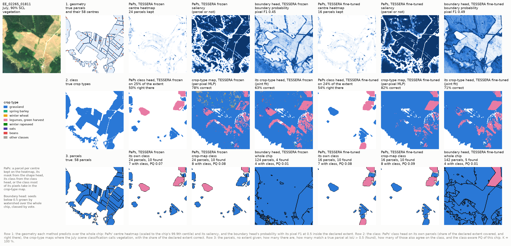
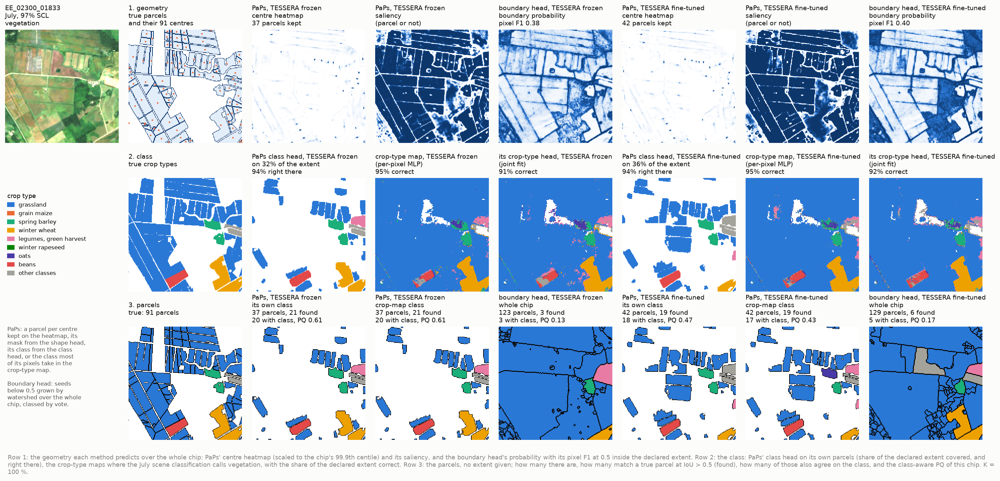
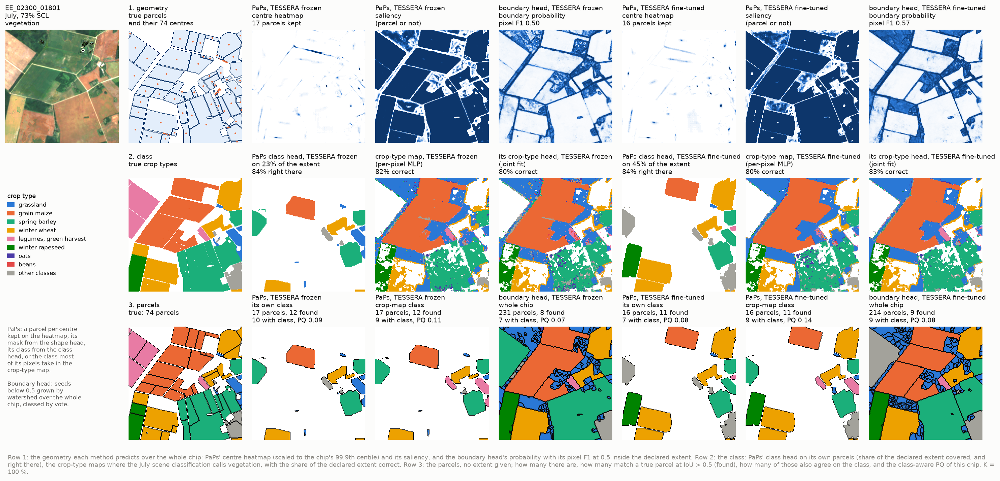
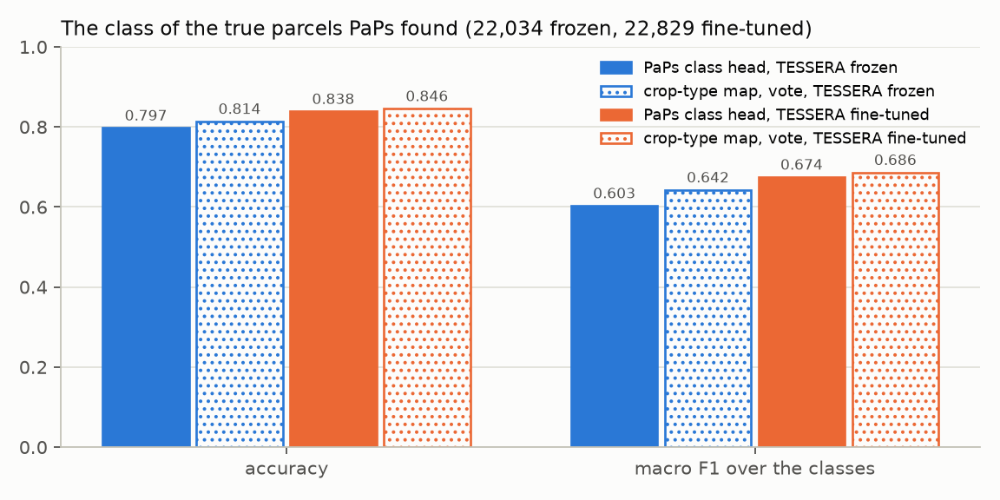
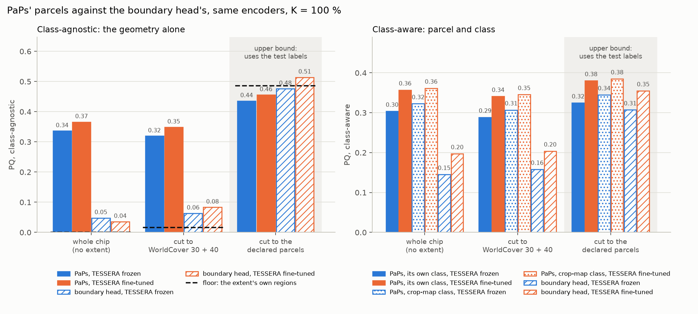
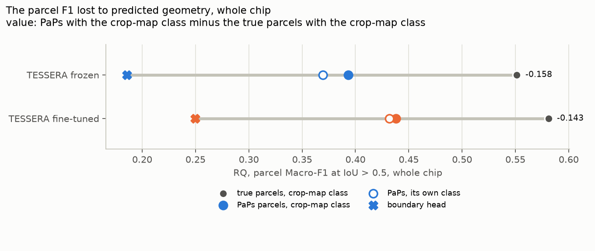
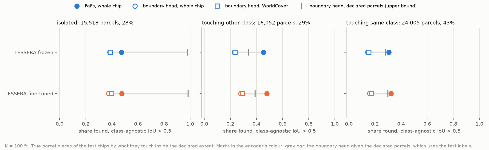
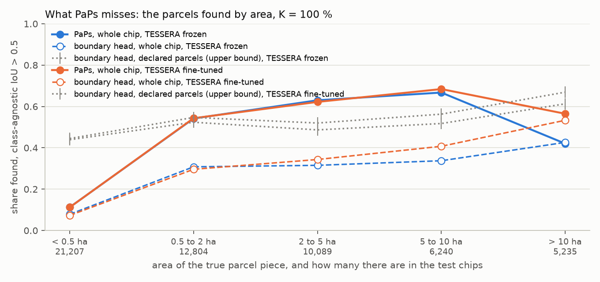
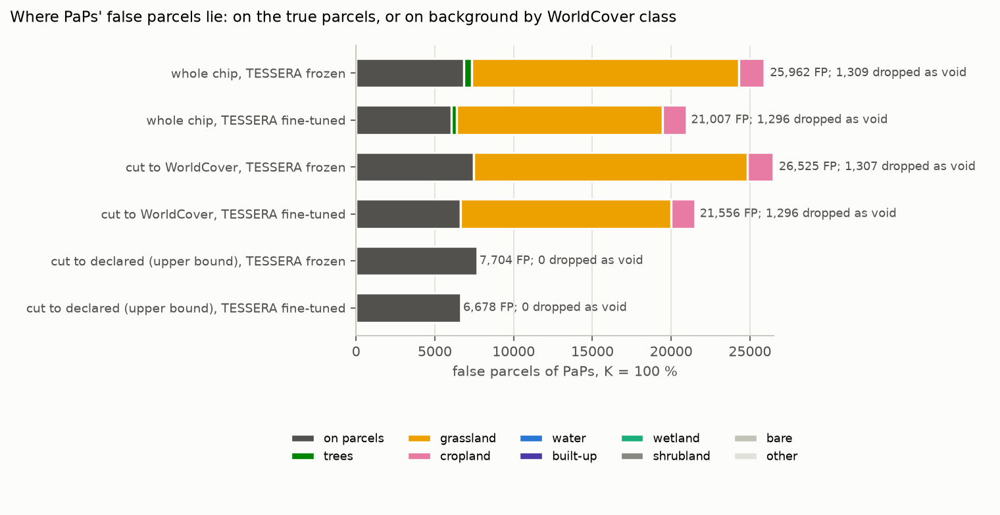
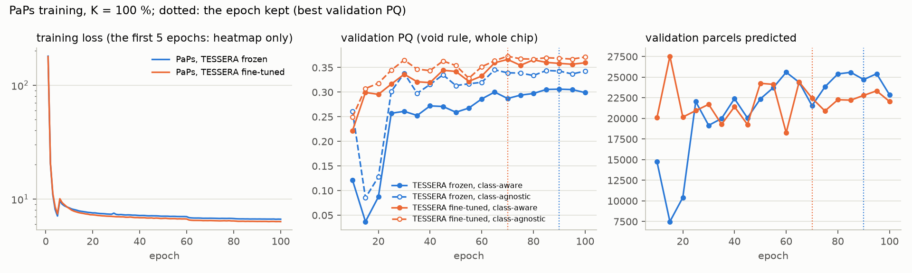

# Full PaPs (utae-paps) on TESSERA, frozen and fine-tuned: report, 5 November 2026

Updated on 6 November 2026 with the fine-tuned boundary head of
[`../2026-11-05_parcel_extent/`](../2026-11-05_parcel_extent/REPORT.md) (cluster job 678194); every number here is
final. How each method works, step by step on one test chip: [ARCHITECTURE.md](ARCHITECTURE.md) and the boundary
head's [ARCHITECTURE.md](../2026-11-05_parcel_extent/ARCHITECTURE.md).

**Answer.** Yes, PaPs takes us somewhere. With no parcel extent given, only TESSERA's embedding of the chip, it
delineates the test parcels of Estonia with a **class-aware PQ of 0.303 on the frozen encoder and 0.357 on the
fine-tuned one**. The boundary head, scored the same way, reaches 0.145 frozen and 0.197 fine-tuned, and 0.048 and
0.036 class-agnostic against PaPs' 0.336 and 0.366. Frozen PaPs without an extent is level with what the frozen
boundary head reached when it was given the declared parcels (0.307). **PaPs on the fine-tuned encoder, with each
parcel classed by the crop-type map, is the best system without test labels: PQ 0.361, class-agnostic 0.366.**

* **The geometry (class-agnostic PQ).** 0.336 frozen and 0.366 fine-tuned over the whole chip. The boundary head
  reaches 0.048 frozen and 0.036 fine-tuned, and its floor, the chip as one region, 0.000. PaPs proposes 44,000 to
  48,000 parcels for the 55,575 true ones; the boundary head proposes 352,000 frozen and 535,000 fine-tuned.
* **What it finds and misses.** PaPs finds 40 % (frozen) and 41 % (fine-tuned) of the true parcels. On parcels that
  touch another parcel it finds more than the boundary head given the declared extent: 46 against 34 % of those
  touching another class, 31 against 28 % of those touching their own class (fine-tuned: 48 against 39 % and 32
  against 30 %). Its misses are the small pieces: 38 % of
  the true pieces are under 0.5 ha, and PaPs finds 11 % of them, against 54 to 68 % of the pieces between 0.5 and
  10 ha.
* **The false parcels.** 26,000 frozen and 21,000 fine-tuned. About two thirds lie on land that WorldCover calls
  grassland and that no parcel declares, about a quarter on the true parcels (a wrong split or a poor fit), almost none
  on forest or water. Cutting PaPs' parcels to WorldCover 30 + 40 therefore removes almost none of them, cuts true
  parcels where WorldCover misses them, and costs a little (PQ 0.289 instead of 0.303).
* **The class.** PaPs' parcels can take their class from the crop-type map of RQ1 instead of PaPs' own class head.
  On the true parcels PaPs found, the crop map's majority class is right for 81.4 % (macro F1 0.642), PaPs' class
  head for 79.7 % (0.603) on the frozen encoder; on the fine-tuned one 84.6 against 83.8 %. With the crop map's class
  the whole-chip PQ is 0.322 frozen and 0.361 fine-tuned. Geometry from PaPs and class from the crop-type model is the
  better of the two designs, and it keeps the pixel crop map of RQ1 as the source of every class.
* **The cost of predicted geometry.** The parcel Macro-F1 at IoU > 0.5 (class-aware RQ) falls from 0.551 with the
  true parcels to 0.393 with PaPs' parcels, both classed by the frozen crop map (−0.158), and from 0.581 to 0.438
  fine-tuned (−0.143). The boundary head lost 0.211 for TESSERA in the delineation report while being given the
  declared parcels; here it falls to 0.186 over the whole chip (0.250 fine-tuned).

One draw and one seed per arm, K = 100 % only (no budget sweep at this stage, user, 5 November 2026), so differences
under about 0.04 are not resolved. The gap between PaPs and the boundary head over the whole chip, 0.16 to 0.33 in
PQ, is far larger.

## Setup

| | |
|---|---|
| Question | Does the Parcels-as-Points module, trained as its authors train it, delineate the parcels of Estonia from TESSERA's 10 m embedding with no extent given; does an encoder fine-tuned on crop type do better; how does it compare with the boundary head in the same extents (README.md) |
| Arms | `paps_tessera_v2_frozen`: the frozen TESSERA v2 Medium raster of the main workflow. `paps_tessera_v2_ft`: every chip re-encoded with the TESSERA student fine-tuned on crop type in `2026-10-15_kshot_finetune` (K = 100 %, draw 0, seed 0; checkpoint SHA-256 `5664d5e7...`), then frozen (the user's choice, 5 November 2026) |
| Model | U-TAE's spatial encoder and decoder (widths 64-64-64-128 down, 32-32-64-128 up) without its temporal attention, which TESSERA's embedding replaces; PaPs as published (`paps_model.py`, vendored from utae-paps, MIT): centre heatmap, saliency, and per centre the box size, a 16 x 16 shape and the class; pseudo-NMS. 1.23 M trainable parameters |
| Training | utae-paps' defaults (`fit_paps.py`): Adam at 0.01, x 0.3 after epochs 60 and 80, 100 epochs, batch 4, 5 warm-up epochs on the heatmap alone, D4 augmentation. Validation every 5 epochs from epoch 10: the confidence threshold of the pseudo-NMS is tuned on the validation chips and the checkpoint is the epoch of best validation PQ (void rule, whole chip) |
| Targets | The 4-connected pieces of the drawn in-scheme parcels; a centre at the pixel nearest each piece's centroid; Gaussian kernels of 1/20 of the box. The only background is WorldCover's non-agricultural land; WorldCover grassland and cropland outside the drawn parcels is unknown, neither parcel nor background (`targets.py`). The declared parcel layer never says where background is |
| Chip set | `EE_2021_rev`, split `blocks4_buf1600_seed0__6b0eb4cb`: 4,898 training, 769 validation, 1,475 test chips; 86,909 training parcels at K = 100 % |
| Runs | Cluster jobs 678198 (frozen) and 678199 (fine-tuned), commit `c1d196d`, 5 November 2026, on hpc-node29. Each encoded its raster on the node (75 and 80 min) and fitted for 5.1 h. Job 678198 was killed after its fit had written `results.json`, the predictions and the checkpoint: the scorer read the prediction file once per chip and reached 219 GB (fixed in `017620e`). Its cell was scored on the hub with the fix, in 12 s; job 678199 loaded the fixed scorer, so its `results.json` names `c1d196d` but was scored by `017620e`'s `score_paps.py`, which changes memory use only |

## How the outputs are scored

PaPs' output is one layer of parcels over the whole chip, each with one class. The parcels are matched to the 55,575
true parcel pieces of the test chips by the panoptic quality of Kirillov et al. (2019): a match at IoU > 0.5,
PQ = SQ x RQ, class-aware (mean over the classes) and class-agnostic, counts summed over all test chips. The
delineation report defines these step by step.

Without an extent, two rules are needed that the delineation experiment did not need (`panoptic_x.py`, after the
handoff note `../2026-10-18_parcel_delineation/NEXT_non_oracle_extent.md`):

* **Void.** Declared parcels outside the 20-class scheme have no label. Their pixels leave every predicted parcel
  before its IoU is computed, and a predicted parcel without a match that lies mostly on them is dropped rather than
  counted as false (1,309 frozen, 1,296 fine-tuned). This is the void rule of the panoptic metric, and it is the only
  use of the declared layer in scoring beyond the true parcels themselves.
* **Background.** Every other unmatched predicted parcel is a false positive, wherever it lies, also on land that no
  one declared.

The same parcels are scored in three extents:

* **whole chip**: PaPs as it is, no extent;
* **cut to WorldCover 30 + 40**: each parcel keeps only its pixels on ESA WorldCover 2021 grassland or cropland, an
  independent map, no test label (30 + 40 + 90, with herbaceous wetland, as a check);
* **cut to the declared parcels**: each parcel keeps only its pixels on declared in-scheme parcels. This uses the test
  labels; it is an upper bound, what a perfect field mask would add, and not a result.

Each is scored with two classes per parcel: **PaPs' own class** (its class head at the centre) and the **crop-map
class**, the class most of the parcel's pixels take in the crop-type map of the same encoder (the per-pixel MLP of the
main workflow on frozen TESSERA, test pixel Macro-F1 0.618; the fine-tuned student of `2026-10-15_kshot_finetune`,
0.660), by the vote of protocol D28 (`analyse.py`).

The reference is the boundary head on the same encoder (`../2026-11-05_parcel_extent/`): its parcels grown by
watershed from the boundary probability at 0.5 inside each extent, each with the class most of its pixels take. For the
frozen encoder these are the stored predictions of the delineation experiment; for the fine-tuned one, the extent
experiment's joint fine-tuning (TESSERA trained with the two heads on the labelled pixels, 45 epochs, job 678194).
"Fine-tuned" therefore names a different encoder in the two methods (Caveats).

## Results

### Examples: from the heads to the parcels

The delineation report's three test chips, those with the most contacts between parcels of one class.

Row 1 shows what each method predicts as geometry over the whole chip. PaPs' centre heatmap is a sparse set of peaks,
one per parcel it keeps. Its saliency, the parcel-or-not map, marks the fields and also most of the open land around
them, which is where its false parcels lie. The boundary head's probability draws field edges well where they are
sharp, but nothing in it separates a field from the forest beside it; over the whole chip its parcels cover forest,
water and settlements alike (row 3, fourth column).

Row 3 shows the difference. PaPs keeps compact parcels and leaves the rest of the chip blank; most of what it keeps
matches a true parcel, and its masks sit inside the true outlines, a little smaller, because the 16 x 16 shape scaled
to the box rounds the corners. What it leaves blank is the larger part: on these chips it keeps 16 to 42 of 58 to 91
parcels. Where the fields are distinct in the image, as in the grassland mosaic of chip 2, what it keeps is nearly all
right (21 of 37 parcels found, chip PQ 0.61 frozen). It misses the narrow strips and the small fragments along the coast and the chip edge, and also fields that
are plain in the image but have no confident centre, often where one field in the image is several declared parcels
(the grain maize block of chip 3). The heatmap's peaks are low everywhere, which is why the tuned confidence threshold
is only 0.07 to 0.09.

### The intermediate outputs: the class

On the true parcels PaPs found (class-agnostic IoU > 0.5: 22,034 frozen, 22,829 fine-tuned), the crop-type map's
majority class beats PaPs' own class head on both encoders: accuracy 0.814 against 0.797 and macro F1 0.642 against
0.603 frozen; 0.846 against 0.838 and 0.686 against 0.674 fine-tuned. The gap is largest on the macro F1 of the frozen
encoder, so on the rarer classes: PaPs' class head decides from the features at one centre pixel, the crop map from
every pixel of the parcel. Fine-tuning on crop type narrows the gap to 0.012.

### The final output: parcels with a class

| Whole chip, no extent | PQ | SQ | RQ | PQ agn. | TP | FP | FN | parcels |
|---|---|---|---|---|---|---|---|---|
| PaPs, frozen, its own class | 0.303 | 0.695 | 0.370 | 0.336 | 22,034 | 25,962 | 33,541 | 47,996 |
| PaPs, frozen, crop-map class | 0.322 | 0.734 | 0.393 | 0.336 | 22,034 | 25,962 | 33,541 | 47,996 |
| PaPs, fine-tuned, its own class | 0.357 | 0.697 | 0.432 | 0.366 | 22,829 | 21,007 | 32,746 | 43,836 |
| PaPs, fine-tuned, crop-map class | **0.361** | 0.698 | 0.438 | **0.366** | 22,829 | 21,007 | 32,746 | 43,836 |
| boundary head, frozen (tau 0.5) | 0.145 | 0.702 | 0.186 | 0.048 | 13,118 | 338,546 | 42,457 | 351,664 |
| boundary head, fine-tuned (tau 0.5) | 0.197 | 0.705 | 0.250 | 0.036 | 14,128 | 520,883 | 41,447 | 535,011 |
| crop-map regions, frozen | 0.004 | 0.643 | 0.005 | 0.005 | 9,427 | 2,692,554 | 46,148 | 2,701,981 |
| the chip as one region (floor) | 0.000 | | 0.000 | 0.000 | 0 | 1,475 | 55,575 | 1,475 |

| Cut to WorldCover 30 + 40 | PQ | PQ agn. | TP | FP | FN |
|---|---|---|---|---|---|
| PaPs, frozen, its own class / crop-map class | 0.289 / 0.307 | 0.319 | 21,371 | 26,525 | 34,204 |
| PaPs, fine-tuned, its own class / crop-map class | 0.341 / 0.345 | 0.348 | 22,205 | 21,556 | 33,370 |
| boundary head, frozen | 0.158 | 0.063 | 13,491 | 241,657 | 42,084 |
| boundary head, fine-tuned | 0.204 | 0.083 | 15,050 | 197,406 | 40,525 |
| WorldCover's regions (floor) | 0.023 | 0.016 | 1,817 | 98,469 | 53,758 |

| Cut to the declared parcels: upper bound, uses the test labels | PQ | PQ agn. | TP | FP | FN |
|---|---|---|---|---|---|
| PaPs, frozen, its own class / crop-map class | 0.324 / 0.345 | 0.435 | 22,885 | 7,704 | 32,690 |
| PaPs, fine-tuned, its own class / crop-map class | 0.380 / 0.385 | 0.455 | 23,700 | 6,678 | 31,875 |
| boundary head, frozen (the delineation experiment's result) | 0.307 | 0.476 | 27,354 | 20,801 | 28,221 |
| boundary head, fine-tuned | 0.355 | 0.514 | 28,689 | 17,132 | 26,886 |
| the declared parcels' regions (floor) | 0.251 | 0.486 | 20,588 | 2,558 | 34,987 |

PaPs' class-aware PQ over the whole chip is twice the boundary head's (0.303 against 0.145) and its class-agnostic PQ
seven times (0.336 against 0.048), on the same frozen encoder. The boundary head's class-aware PQ stays far above its
class-agnostic one only because class-aware PQ is a mean over the classes: 96 % of its 341,000 false parcels are
classed grassland, so they weigh on one class of twenty. PaPs' two PQs are close because its false parcels are few.

Fine-tuning the boundary head's encoder pulls its two PQs further apart: class-aware 0.145 → 0.197, class-agnostic
0.048 → 0.036. Inside the fields its edges are better (boundary F1 inside the declared parcels 0.639 → 0.665), but over
the whole chip it proposes 535,000 parcels, 183,000 more than frozen: 79 % of its false parcels lie on WorldCover
trees, where the jointly trained encoder, never shown forest, now draws many small edges, and 97 % are classed
grassland, so the class-aware mean hardly notices them (`../2026-11-05_parcel_extent/REPORT.md`).

Fine-tuning the encoder on crop type raises PaPs' PQ by 0.054 class-aware and 0.030 class-agnostic. It finds a few
more parcels (22,829 against 22,034) and proposes 5,000 fewer false ones; the fit of what it finds (SQ 0.697 against
0.695) does not change. With WorldCover 30 + 40 + 90 every number moves by at most 0.001 (`figures/tables.md`).

The upper bound shows how little a perfect field mask would add to PaPs: class-aware PQ 0.303 → 0.324 frozen, and
0.357 → 0.380 fine-tuned. The mask removes PaPs' false parcels on background (25,962 → 7,704) and lifts a few fits
above IoU 0.5 (22,034 → 22,885 matches), but it cannot add a parcel PaPs did not propose. The boundary head, by contrast, owes everything to the mask: 0.476
class-agnostic with it, 0.048 without (fine-tuned 0.514 and 0.036). Given the declared parcels, the fine-tuned boundary
head has the highest class-agnostic PQ of both experiments (0.514), but that number uses the test labels; class-aware,
PaPs cut to the declared parcels is higher (0.385 against 0.355).

### The cost of predicted geometry

With the true parcels and the crop map's class, the parcel Macro-F1 at IoU > 0.5 is 0.551 frozen and 0.581
fine-tuned; this is the parcel score of RQ1 when the geometry is given. PaPs' parcels, with the same classes, reach
0.393 and 0.438: −0.158 and −0.143. In the delineation report the boundary head lost 0.211 on TESSERA with the declared
extent given; without it, it reaches 0.186 here, and 0.250 on the fine-tuned encoder.

### What PaPs finds, and what it misses

| Share found (class-agnostic IoU > 0.5) | all | isolated (15,518) | touching other class (16,052) | touching same class (24,005) |
|---|---|---|---|---|
| PaPs, frozen, whole chip | 0.396 | 0.475 | 0.455 | 0.307 |
| PaPs, fine-tuned, whole chip | 0.411 | 0.477 | 0.479 | 0.323 |
| boundary head, frozen, whole chip | 0.236 | 0.384 | 0.229 | 0.145 |
| boundary head, frozen, WorldCover | 0.243 | 0.388 | 0.236 | 0.153 |
| boundary head, frozen, declared parcels (upper bound) | 0.492 | 0.979 | 0.339 | 0.280 |
| boundary head, fine-tuned, whole chip | 0.254 | 0.376 | 0.280 | 0.158 |
| boundary head, fine-tuned, WorldCover | 0.271 | 0.399 | 0.292 | 0.174 |
| boundary head, fine-tuned, declared parcels (upper bound) | 0.516 | 0.984 | 0.389 | 0.299 |

The categories are the delineation report's. An isolated parcel touches no other declared parcel; the declared extent
finds those for free, which is why the boundary head given that extent finds 98 % of them. Where parcels touch, which is
what delineation is for, PaPs without any extent finds more than the boundary head with the declared extent: 46 against
34 % of the parcels touching another class and 31 against 28 % of those touching their own class; on the fine-tuned
encoders 48 against 39 % and 32 against 30 %. The boundary head without an extent finds about half as many as PaPs
among touching parcels on either encoder.

| Share found | < 0.5 ha (21,207) | 0.5 to 2 ha (12,804) | 2 to 5 ha (10,089) | 5 to 10 ha (6,240) | > 10 ha (5,235) |
|---|---|---|---|---|---|
| PaPs, frozen | 0.112 | 0.542 | 0.630 | 0.667 | 0.420 |
| PaPs, fine-tuned | 0.112 | 0.543 | 0.622 | 0.684 | 0.565 |
| boundary head, frozen, whole chip | 0.078 | 0.308 | 0.315 | 0.337 | 0.426 |
| boundary head, frozen, declared parcels (upper bound) | 0.439 | 0.524 | 0.486 | 0.517 | 0.613 |
| boundary head, fine-tuned, whole chip | 0.073 | 0.296 | 0.343 | 0.407 | 0.533 |
| boundary head, fine-tuned, declared parcels (upper bound) | 0.445 | 0.547 | 0.520 | 0.563 | 0.669 |

PaPs' misses are concentrated in one place. The pieces under 0.5 ha (fewer than 50 pixels) are 38 % of the true
pieces, and PaPs finds 11 % of them; between 0.5 and 10 ha it finds 54 to 68 %, as many as or more than the boundary
head given the declared extent (from 2 ha up, more on either encoder). Many of the small pieces are slivers of parcels cut by the chip edge, which count once per chip, as
PASTIS scores its patches. Above 10 ha the frozen PaPs falls back to 42 % and the fine-tuned one to 57 %: a large
parcel's mask is its 16 x 16 shape scaled to a box of up to 224 pixels, too coarse for an IoU above 0.5 when the
outline is irregular.

### Where the false parcels lie

Over the whole chip, PaPs' 25,962 false parcels (frozen) lie on the true parcels in 6,830 cases (a split, a merge or a
poor fit) and on background in the rest: 16,940 on WorldCover grassland, 1,660 on WorldCover cropland, 506 on trees and
under 30 on water, wetland, bare or built-up land. Fine-tuned, 6,028 on parcels, 13,071 on grassland, 1,535 on
cropland, 367 on trees. PaPs has learned to leave forest and water alone; what it calls a parcel on background is open
herbaceous land that no one declared. 57 % of WorldCover grassland in the test chips lies on no declared parcel
(`../2026-11-05_parcel_extent/`), and the training targets left that land unknown, so nothing taught PaPs that it is
not a field. Some of these false parcels may be real fields outside the declared scheme; the test labels cannot say.

### Training dynamics

The validation PQ rises fastest in the first 25 epochs, swings at the learning rate of 0.01 (the frozen fit falls to
0.04 at epoch 15 before it recovers), and settles after the steps at epochs 60 and 80: from epoch 65 on it varies by
0.02. The checkpoints are epoch 90 (frozen, validation PQ 0.306, confidence threshold 0.07) and epoch 70 (fine-tuned,
0.366, 0.09); the test PQ, 0.303 and 0.357, is within 0.01 of the validation PQ. One hundred epochs were enough. On
validation, the tuned centres reach an F of 0.70 frozen and 0.75 fine-tuned against the true centres.

## Analysis

**PaPs solves the problem that stopped the boundary head.** The delineation experiment found that the boundary head
adds no geometry beyond the true extent, and the extent experiment that, without the true extent, its parcels collapse
(class-agnostic PQ 0.476 → 0.048). PaPs needs no extent: it predicts where parcels are, one centre each, instead of
where edges are. Over the whole chip it scores seven times the boundary head's class-agnostic PQ and twice its
class-aware PQ on frozen TESSERA, ten times and 1.8 times on the fine-tuned encoders, and on frozen TESSERA it equals
the frozen boundary head's number given the declared parcels, which needed the test labels. Fine-tuning does not
rescue the boundary head: it sharpens the edges inside the fields and adds false parcels outside them.

**What limits it is recall, not precision.** PaPs proposes about as many parcels as there are (44,000 to 48,000 for
55,575) and finds 40 % of the true ones. Of its parcels, 46 % (frozen) and 52 % (fine-tuned) match a true parcel. A
perfect field mask would add 0.02 in class-aware PQ, so a better extent is not where the next gain lies. The misses are
the small pieces and, on the frozen encoder, the largest parcels: the first is a matter of how many centres the
pseudo-NMS keeps and of chip-edge slivers, the second of the 16 x 16 shape.

**The class should come from the crop-type map.** On the parcels PaPs finds, the vote of the RQ1 crop map is a little
more often right than PaPs' class head, most on the rarer classes. A two-stage design follows: PaPs gives the parcels,
the crop-type model of the main workflow gives each its class. It scores best (0.322 and 0.361), and the class of every
parcel then comes from the model RQ1 evaluates, so the parcel results follow from the pixel results.

**Fine-tuning helps both stages.** The student fine-tuned on crop type gives PaPs better centres (validation F 0.75
against 0.70), fewer false parcels and a better class head, +0.054 in PQ, although PaPs itself was trained on a frozen
raster in both arms.

**For the other GFMs.** The method is worth extending. The 10 m group (AlphaEarth) gives the same kind of raster and
needs only its rasters. The token-grid models give features on 16 x 16 pixel tokens; PaPs' U-Net would need their
features upsampled to 10 m, or a decoder that does it, and its centres, at one pixel each, would test how much spatial
detail those tokens keep.

## Caveats

* One draw and one seed per arm, K = 100 % only. The epoch and the confidence threshold are chosen on the validation
  chips, so the test chips are untouched, but no interval exists.
* "Fine-tuned" is not the same encoder in the two methods. PaPs reads chips re-encoded by the student fine-tuned on
  crop type alone (`2026-10-15_kshot_finetune`), then frozen; the boundary head's student was trained jointly with its
  two heads (`../2026-11-05_parcel_extent/`). Both start from the same pretrained student, under the same budget.
* "Fine-tuned" is the user's choice of 5 November: the chips re-encoded by the student fine-tuned on crop type, then
  frozen. PaPs is not trained end to end through the encoder.
* PaPs runs without its temporal module: TESSERA's embedding stands in for U-TAE's temporal attention, and the spatial
  U-Net is small (1.23 M parameters). PASTIS results with U-TAE are not comparable one to one.
* The training targets use WorldCover's non-agricultural land as the only background, so undeclared grassland was
  unknown in training and is background in scoring. A model trained with another choice would place fewer parcels
  there, and some of those false parcels may be real fields.
* The void rule draws on the declared parcels outside the scheme to leave unlabelled pixels out; 1,309 and 1,296
  predicted parcels were dropped under it. Every method is scored the same way.
* Class-aware PQ is a mean over the classes, class-agnostic PQ is pooled; they weigh false parcels differently, which
  matters for the boundary head (its false parcels are one class).
* The boundary head's class comes from its own crop-type head (the joint fit), PaPs' crop-map class from the main
  workflow's crop-type-only fit; both are frozen TESSERA with an MLP, with the same test pixel Macro-F1 (0.618).
  Fine-tuned: 0.671 for the boundary head's joint fit, 0.660 for the crop map PaPs is classed by.

## Next steps

1. Compare with PRUE (`../2026-11-06_prue_tessera/`), the three-class boundary model trained end to end with TESSERA,
   when its jobs end: the boundary route with a learned background.
2. Recall on small pieces: score with chip-edge slivers merged or left out, and try a lower floor on the pseudo-NMS
   confidence, before changing the model.
3. A full-resolution mask head in place of the 16 x 16 shape, for the large and irregular parcels.
4. If the user agrees: PaPs on AlphaEarth (same raster group), then a design for the token-grid models; the budget
   sweep only once the method is chosen.

## Reproduce

    poetry run python experiments/2026-11-05_paps_tessera/check.py --chips EE_2021_rev_mini
    bash scripts/cluster/submit.sh experiments/2026-11-05_paps_tessera/experiment_k100.yaml EE_2021_rev       # cluster
    bash scripts/cluster/pull_results.sh 2026-11-05_paps_tessera EE_2021_rev
    poetry run python experiments/2026-11-05_paps_tessera/run.py -e experiments/2026-11-05_paps_tessera/experiment.yaml --chips data/eurocrops_chips/EE_2021_rev --summarise
    poetry run python experiments/2026-11-05_paps_tessera/analyse.py --chips EE_2021_rev
    poetry run python experiments/2026-11-05_paps_tessera/report.py --chips EE_2021_rev

A pull overwrites a cell's `results.json` with the cluster's copy, so `--summarise` must run again after it for a cell
scored on the hub (the frozen one). Results: `results/2026-11-05_paps_tessera/EE_2021_rev/<arm>/P100_draw0_seed0/`
(`results.json` with `panoptic_metrics` and the training history, `analysis.json`, `metrics.csv`,
`predictions_test.npz`, `best-pq.pt`).
