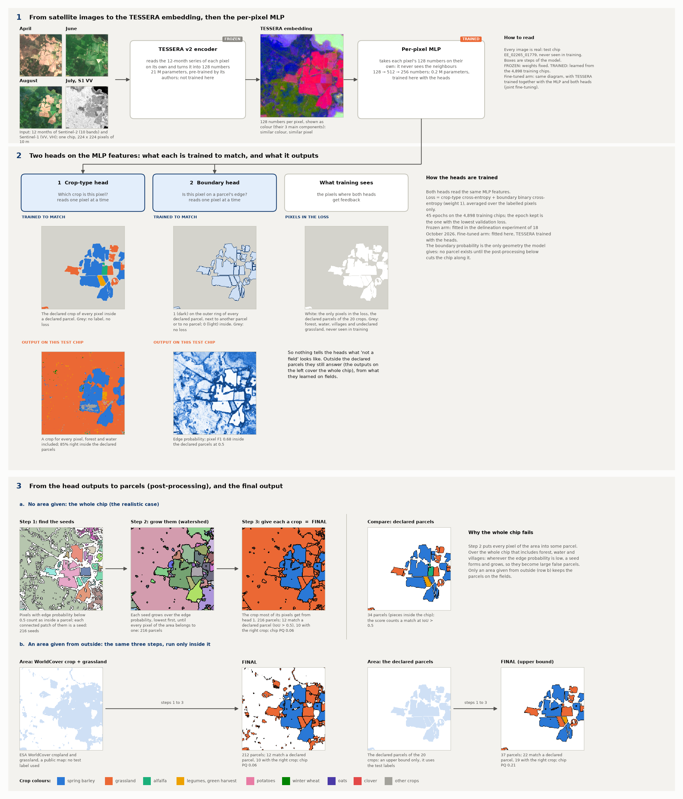
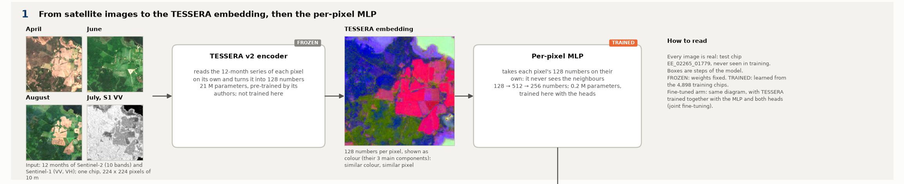
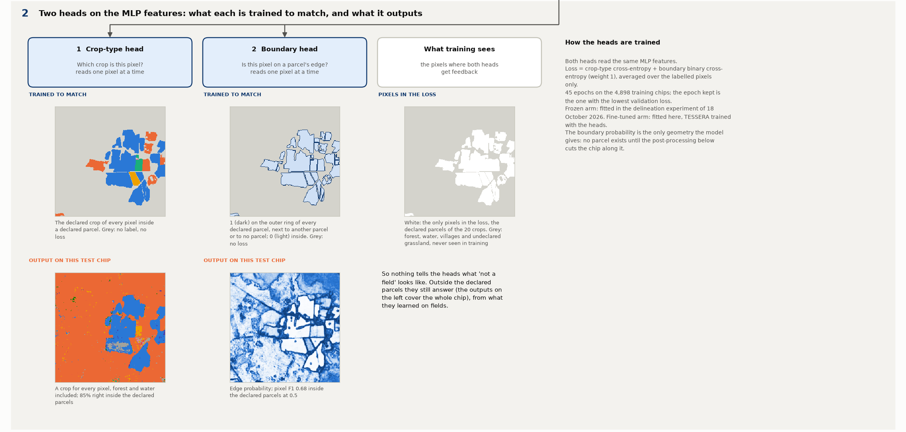
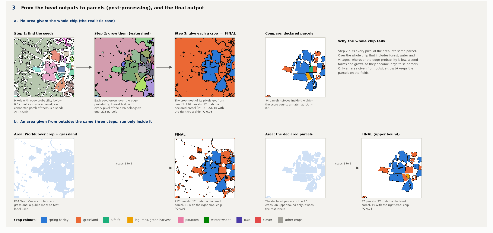
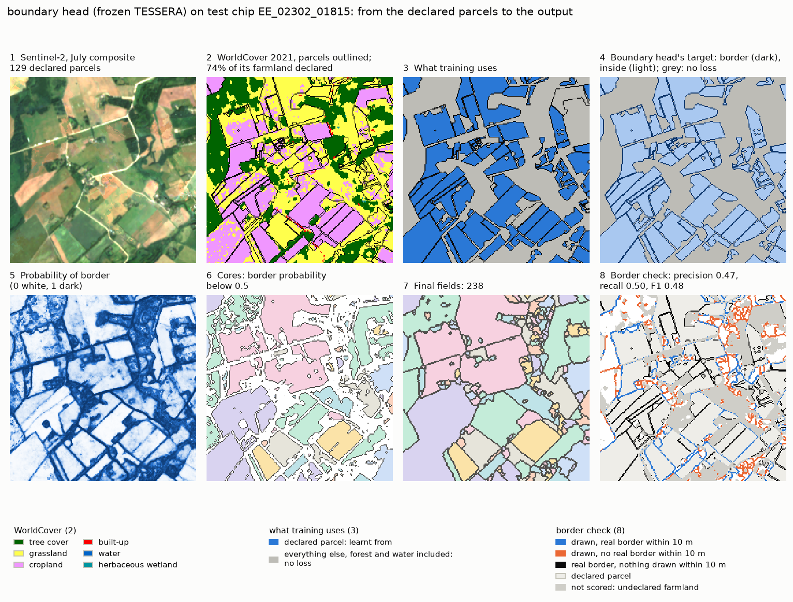

# The boundary head on TESSERA: the architecture, step by step

**In one sentence.** The boundary head adds one output to the crop-type model: for every pixel, the probability that
it lies on a parcel's edge. Parcels are then cut out of the chip along those edges, and each takes the crop most of its
pixels were given.

**Every image in the diagram is real.** They all come from one test chip, `EE_02265_01779`, which holds 34 declared
parcels (counted as the pieces inside the chip) and was never seen in training. It is the same chip as in
[PaPs' architecture](../2026-11-05_paps_tessera/ARCHITECTURE.md), so the two diagrams can be compared panel by panel.
The heads' outputs are the stored test predictions of the frozen-TESSERA model, fitted in the delineation experiment
(`../2026-10-18_parcel_delineation`). The post-processing is run exactly as `score.py` runs it.

**The chain in one line:**

    Sentinel-2 + Sentinel-1, 12 months  →  TESSERA encoder (frozen)  →  128 numbers per pixel
      →  per-pixel MLP (trained)  →  two heads (crop, edge)  →  cut the area along the edges  →  parcels with a crop

The diagram has three parts, shown larger below.

---

## Part 1. From satellite images to features

1. **Input.** One chip of 224 x 224 pixels of 10 m (2.24 km a side). Each pixel has 12 monthly Sentinel-2 images
   (10 bands) and 12 monthly Sentinel-1 radar images (VV and VH).
2. **TESSERA encoder (frozen).** The same pre-trained model as for PaPs (21 M parameters). It reads the 12-month
   series of **one pixel at a time** and turns it into **128 numbers**.
3. **The embedding.** The same image as in PaPs' diagram: the 3 main directions of variation of the 128 numbers,
   shown as colour.
4. **Per-pixel MLP (trained).** This is the crop-type decoder of the main workflow's TESSERA arm: 128 → 512 → 256
   numbers, 0.2 M parameters. Like TESSERA, it looks at **one pixel at a time** and never sees the neighbours. So
   nothing in this model looks at a neighbourhood.

---

## Part 2. The two heads: what each learns, and what it outputs

Each column is one head. The **upper** image is what the head is **trained to match** (drawn for this chip, for
comparison), and the **lower** image is what it **outputs** on this test chip.

| Head | Question it answers | Reads | Trained to match | Loss |
|---|---|---|---|---|
| 1 Crop type | Which crop is this pixel? | one pixel's MLP features | the declared crop of every pixel inside a declared parcel | cross-entropy |
| 2 Boundary | Is this pixel on a parcel's edge? | the same features | 1 on the outer ring of every declared parcel (a pixel next to another parcel or to no parcel), 0 inside | binary cross-entropy |

**The third column is the key to this model: what training sees.** Both losses are averaged over the pixels inside the
declared parcels of the 20 crops (white), and nowhere else. Forest, water, villages and undeclared grassland (grey)
never enter training. The heads still give an answer there, because they answer for every pixel, but nothing ever
taught them what "not a field" looks like.

**What to notice in the outputs:**

* **Head 1** paints a crop on every pixel of the chip, forest included (here mostly as grassland, orange). Inside the
  declared parcels it is right on 85 % of the pixels.
* **Head 2** draws the field edges well where they are sharp: inside the declared parcels its pixel F1 at 0.5 is
  0.68. Over the forest its probability is patchy, low in most places.

**Training.** 45 epochs on the 4,898 training chips, batches of 4 chips, AdamW at a learning rate of 0.001, random
flips and rotations. The loss is the crop-type loss plus the boundary loss (weight 1), and the epoch kept is the one
with the lowest validation loss.

---

## Part 3. From head outputs to parcels

No head outputs a parcel. The edge probability is the only geometry the model gives. Parcels exist only after these
steps (`panoptic_x.from_boundary`), which run inside an **area**:

**Row a. No area given: the whole chip.** This is the realistic case, since at prediction time nobody hands us the
declared parcels.

1. **Find the seeds.** Pixels with an edge probability below 0.5 count as "inside a parcel". Each connected patch of
   them is a seed. This chip has 216 seeds.
2. **Grow them (watershed).** Each seed grows outwards over the edge probability, lowest values first, like water
   filling neighbouring basins, until **every pixel of the area belongs to one seed**. Pixels no seed can reach become
   parcels of their own. Here: 216 parcels.
3. **Give each a crop.** Each parcel takes the crop that most of its pixels got from head 1. **This is the final
   output.**

On this chip the whole-chip output has 216 parcels against 34 declared ones. 12 match a declared parcel (overlap IoU
above 0.5), 10 of them with the right crop; chip PQ 0.06. The forest, the water and the villages have become large
false parcels. Step 2 has to put every pixel somewhere, and wherever the edge probability is low a seed forms and
grows.

**Row b. An area given from outside: the same three steps, run only inside it.**

* **ESA WorldCover cropland + grassland** (a public map, no test label used). 212 parcels, 12 found, 10 with the
  right crop, chip PQ 0.06. WorldCover removes the forest, but it keeps all the open grassland, declared or not, and
  it does not separate neighbouring fields.
* **The declared parcels** (an *upper bound only*: it uses the test labels, so it is not a real prediction). 37
  parcels, 22 found, 19 with the right crop, chip PQ 0.21. Most of this "success" comes from the area itself: the gaps
  between declared parcels already separate them.

**Over all 1,475 test chips** (55,575 declared parcels):

| Area the parcels are built in | Frozen TESSERA: PQ (crop ignored) | Fine-tuned TESSERA: PQ (crop ignored) |
|---|---|---|
| Whole chip, no area given | 0.145 (0.048) | 0.197 (0.036) |
| WorldCover cropland + grassland | 0.158 (0.063) | 0.204 (0.083) |
| Declared parcels (upper bound, uses the test labels) | 0.307 (0.476) | 0.355 (0.514) |

The class-aware PQ stays above the crop-ignored one because it averages over the crops: most of the false parcels
are called grassland, so they weigh on one crop out of twenty. For comparison, PaPs reaches 0.303 (0.336) frozen and
0.357 (0.366) fine-tuned over the whole chip, with no area given.

## A real example: from the declared parcels to the output

The chip is the median of the border report: half the test chips with at least 20 declared parcels score better for
PRUE, half worse. Row 1 is what the model is told, row 2 what it outputs:

1. **Sentinel-2**, the July composite, for orientation.
2. **WorldCover 2021** with the declared parcels outlined. Yellow is grassland and pink cropland, together the
   farmland; 74 % of it is declared here.
3. **What training uses** on a chip like this one.
4. **The training target** drawn for this chip.
5. and 6. **Two intermediate outputs**.
7. **The final fields**, in random colours.
8. **The border check** against the declared parcels: blue, a drawn border with a declared one within 10 m; orange,
   a drawn border with none; black, a declared border with nothing drawn within 10 m; grey, undeclared farmland, not
   scored.

For the boundary head, panel 3 shows the difference from PRUE and PaPs: **WorldCover does not enter its training**.
It learns from the pixels of the declared parcels alone (blue); forest, water, villages and undeclared land (grey)
never enter the loss. Panel 4 is its border target, panels 5 and 6 the border probability and the cores where it is
below 0.5.

**On this chip** the boundary head draws 238 fields over the whole chip for 129 declared parcels, and 18 of them
match a declared parcel. Half of the borders it draws are false (precision 0.47).

### The main weakness: it does not know what is not a parcel

Nothing in training ever showed the head a forest, a road or a village. Its border probability there is patchy
(panel 5), so cores form everywhere (panel 6), and the watershed must give every pixel of the chip to some field
(panel 7). The result is borders drawn across land that holds no field: the orange in panel 8. Over all test chips:

* its fields cover 100 % of the chip, forest and water included;
* 73 % (frozen) and 87 % (fine-tuned) of the borders it draws lie on non-farm land, so its border precision is 0.27
  and 0.13, and its F1 0.36 and 0.21;
* cutting its fields to WorldCover's farmland afterwards helps little (PQ, crop ignored, 0.048 to 0.063 frozen, 0.036
  to 0.083 fine-tuned): WorldCover keeps all the grassland, declared or not, and separates no fields.

Inside the declared parcels its borders are as good as PRUE's: given the declared extent, its PQ (crop ignored) is
0.476 frozen and 0.514 fine-tuned, against 0.487 and 0.511 for PRUE. What it lacks is the background class that
PRUE learns from WorldCover.

### The three methods on the same chip

| On test chip EE_02302_01815 (129 declared parcels) | PRUE ([note](../2026-11-06_prue_tessera/ARCHITECTURE.md)), fine-tuned | PaPs ([note](../2026-11-05_paps_tessera/ARCHITECTURE.md)), frozen | Boundary head ([note](../2026-11-05_parcel_extent/ARCHITECTURE.md)), frozen |
|---|---|---|---|
| Fields drawn | 97 | 84 | 238 |
| Fields matching a declared parcel (IoU above 0.5) | 56 | 44 | 18 |
| Border precision / recall / F1, this chip | 0.98 / 0.86 / 0.92 | 0.89 / 0.54 / 0.67 | 0.47 / 0.50 / 0.48 |
| Border F1, all 1,475 test chips, frozen / fine-tuned | **0.86 / 0.87** | 0.64 / 0.68 | 0.36 / 0.21 |
| Main weakness | borders between parcels of the same crop: two parcels become one field | no centre, no parcel: half the real borders are never drawn | no notion of "not a field": borders everywhere |

The border scores count a drawn border as right when a declared border lies within one pixel (10 m); land WorldCover
calls farmland but nobody declared is not scored ([the border report](../2026-11-07_border_accuracy/REPORT.md)).

---

## The fine-tuned arm

The diagram is the same, but TESSERA is no longer frozen. It is trained together with the MLP and both heads
(joint fine-tuning, 21 M more parameters trained), on the labelled pixels of the training chips. It trained for 45
epochs on the cluster (job 678194). Inside the declared parcels its parcels are better (PQ 0.355 against 0.307). Over the whole chip it makes even more parcels (535,011 against 351,664, for 55,575 declared ones), and the
crop-ignored PQ falls to 0.036.

## How the boundary head differs from PaPs

| | Boundary head | PaPs ([its architecture](../2026-11-05_paps_tessera/ARCHITECTURE.md)) |
|---|---|---|
| After TESSERA | per-pixel MLP: one pixel at a time | U-Net: sees neighbours |
| Heads | 2: crop, edge | 5: centre, saliency, size, shape, crop |
| Learns from | declared parcels only | declared parcels, plus WorldCover's non-farm land as background |
| A parcel is | a region between predicted edges | one detected centre with a mask drawn around it |
| Land with no parcel | impossible: every pixel of the area ends in some parcel | stays empty |

## Reproduce

    poetry run python experiments/2026-11-05_parcel_extent/architecture.py --chip EE_02265_01779

It needs the delineation experiment's stored frozen cell and the pilot TESSERA cache on the hub (for the embedding
image only). The chip must be one of the nine pilot test chips. The script writes `figures/architecture.png` and its
three parts (`architecture_1.png` to `architecture_3.png`).

The example (`figures/example_walkthrough.png`) comes from the stored test predictions:

    poetry run python experiments/2026-11-07_border_accuracy/walkthrough.py --chips EE_2021_rev
