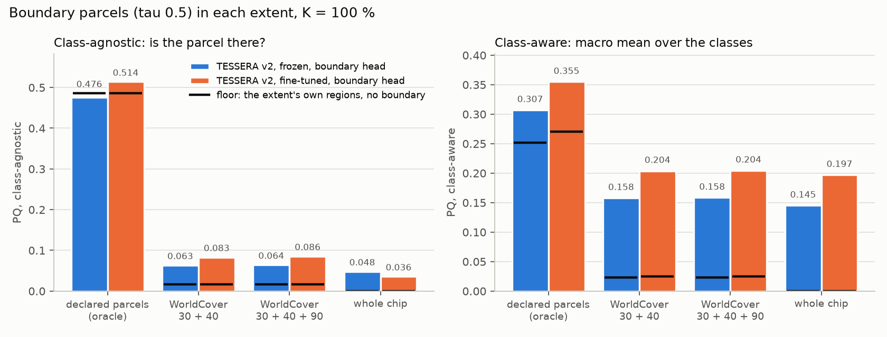
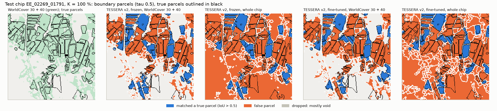
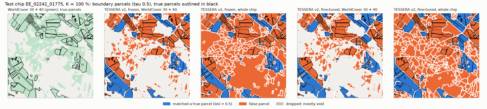
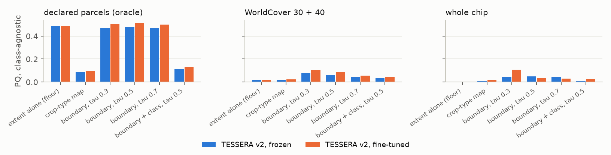
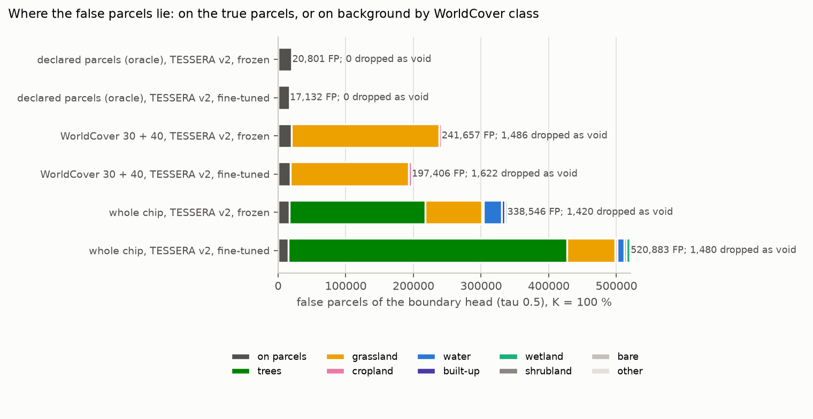

# Boundary-head parcels without the oracle extent, TESSERA frozen and fine-tuned: report, 6 November 2026

How the boundary head works, step by step on one test chip: [ARCHITECTURE.md](ARCHITECTURE.md). The comparison with
PaPs on the same encoders and extents: [`../2026-11-05_paps_tessera/REPORT.md`](../2026-11-05_paps_tessera/REPORT.md).

**Answer.** No: without the declared parcels the boundary head does not delineate. Given the declared parcels, as in
the delineation experiment, its parcels reach a class-agnostic PQ of 0.476 frozen and 0.514 fine-tuned. Built inside
ESA WorldCover's grassland and cropland they fall to 0.063 and 0.083, and over the whole chip to 0.048 and 0.036, for
55,575 true parcels against 255,000 to 535,000 predicted ones. Fine-tuning the encoder sharpens the edges inside the
fields but does not repair the missing background; over the whole chip it makes the result worse. PaPs on the same
encoders reaches 0.336 and 0.366 over the whole chip, so the boundary route as built here is not the one to extend.

* **The oracle extent did the work.** The extent alone, the declared parcels cut into their 4-connected regions with no
  boundary at all, scores 0.486 class-agnostic. The frozen boundary head stays below it (0.476), as in the delineation
  experiment. The fine-tuned one is the first TESSERA boundary head above it (0.514), the only gain over the floor in
  either experiment, and it needs the test labels.
* **WorldCover is no substitute.** WorldCover 30 + 40 holds 95.8 % of the true parcel pixels, but it covers 39 % of
  the chip against the parcels' 26 %: 57 % of its grassland lies on no declared parcel. The boundary head fills that
  land with parcels (218,000 false parcels on WorldCover grassland, frozen) and cannot separate neighbouring fields
  that WorldCover merges into one block.
* **Over the whole chip the forest becomes parcels.** The heads were trained only on the declared parcels' pixels, so
  nothing taught them what is not a field, and the watershed puts every pixel of the chip into some parcel. 59 %
  (frozen) and 79 % (fine-tuned) of the false parcels lie on WorldCover trees.
* **Class-aware PQ hides this.** It is a mean over the twenty classes, and 96 % (frozen) and 97 % (fine-tuned) of the
  false parcels are classed grassland, so they weigh on one class: class-aware PQ rises with fine-tuning (0.145 →
  0.197) while class-agnostic PQ falls (0.048 → 0.036).

One draw and one seed per arm, K = 100 % only (no budget sweep at this stage, user, 5 November 2026).

## Setup

| | |
|---|---|
| Question | How well do the boundary-head parcels of TESSERA delineate without the declared parcels, inside WorldCover or over the whole chip; how much does fine-tuning the encoder help; what does the boundary add over each extent's own floor (README.md) |
| Arms | `tessera_v2_medium`: frozen, the delineation experiment's stored cell, rescored (best epoch 31 of 0 to 44). `tessera_v2_medium_ft_bnd`: TESSERA v2 Medium trained jointly with the MLP and both heads on the labelled pixels at 1e-5 (the route of `2026-10-15_kshot_finetune`), 45 epochs, checkpoint of lowest validation loss (epoch 14) |
| Model | The main workflow's per-pixel MLP (128 → 512 → 256) with a crop-type head and one boundary logit, 0.2 M trainable parameters (plus 21.0 M in the fine-tuned student); loss cross-entropy plus boundary binary cross-entropy, weight 1, on the labelled pixels only |
| Parcels | Seeds where the boundary probability is below tau = 0.5 inside the extent, grown by watershed until the extent is filled, each classed by the majority of its crop-type pixels (`panoptic_x.from_boundary`); tau 0.3 and 0.7 as a sensitivity |
| Extents | declared in-scheme parcels (oracle, upper bound); WorldCover 2021 v200 grassland + cropland (30 + 40), with herbaceous wetland (90) as a check; the whole chip |
| Scoring | Void-rule PQ (README.md), class-agnostic and class-aware, counts summed over the 1,475 test chips; the boundary pixel F1 inside the declared parcels |
| Runs | Fine-tuned: cluster job 678194, commit `c1d196d`, 5 to 6 November 2026, 26.3 h of fitting, peak 9.0 GB; scored on the hub on 6 November (`score.py`). Frozen: no refit |

## Results

### Headline

Bars: the boundary parcels at tau 0.5; black ticks: the extent's own regions with no boundary (its floor).

| Extent | Encoder | PQ agn. | SQ agn. | RQ agn. | PQ | TP | FP | parcels |
|---|---|---|---|---|---|---|---|---|
| declared parcels (upper bound) | frozen | 0.476 | 0.903 | 0.527 | 0.307 | 27,354 | 20,801 | 48,155 |
| declared parcels (upper bound) | fine-tuned | **0.514** | 0.908 | 0.566 | **0.355** | 28,689 | 17,132 | 45,821 |
| WorldCover 30 + 40 | frozen | 0.063 | 0.729 | 0.087 | 0.158 | 13,491 | 241,657 | 255,148 |
| WorldCover 30 + 40 | fine-tuned | 0.083 | 0.739 | 0.112 | 0.204 | 15,050 | 197,406 | 212,456 |
| whole chip | frozen | 0.048 | 0.743 | 0.064 | 0.145 | 13,118 | 338,546 | 351,664 |
| whole chip | fine-tuned | 0.036 | 0.744 | 0.048 | 0.197 | 14,128 | 520,883 | 535,011 |

The floors (class-agnostic): 0.486 for the declared parcels, 0.016 for WorldCover 30 + 40, 0.000 for the whole chip.
With wetland added to WorldCover every number moves by at most 0.003 (`figures/tables.md`).

The geometry of what is found barely depends on the extent (SQ 0.73 to 0.74 outside the oracle); what collapses is
recognition, RQ 0.53 to 0.57 with the declared parcels against 0.05 to 0.11 without, because the false parcels
outnumber the matched ones 13 to 37 times.

### Examples

Blue: a predicted parcel that matches a true one (IoU > 0.5); orange: a false parcel. Inside WorldCover the forest is
gone, but the undeclared grassland around the fields becomes parcels, and neighbouring fields that WorldCover joins
come out as one. Over the whole chip the frozen encoder turns the forest into a few large parcels, the fine-tuned one
into many small ones: its jointly trained encoder, never shown a forest pixel, draws edges all over it.

### The variants and the threshold

| Class-agnostic PQ | tau 0.3 | tau 0.5 | tau 0.7 |
|---|---|---|---|
| declared parcels, frozen / fine-tuned | 0.466 / 0.506 | 0.476 / 0.514 | 0.466 / 0.498 |
| WorldCover, frozen / fine-tuned | 0.078 / 0.104 | 0.063 / 0.083 | 0.047 / 0.054 |
| whole chip, frozen / fine-tuned | 0.045 / 0.108 | 0.048 / 0.036 | 0.041 / 0.028 |

Tau was fixed at 0.5 beforehand. A lower one helps outside the oracle (fewer pixels count as inside, so fewer seeds and
fewer false parcels), most for the fine-tuned encoder over the whole chip (0.108), but choosing it on the test chips
would use the test labels, and even the best value stays at a third of PaPs' 0.366. The crop-type map's own regions
(0.005 to 0.099) and the boundary combined with the class (`boundary + class`) are below the boundary alone everywhere.

### Where the false parcels lie

| False parcels | on true parcels | trees | grassland | water | other (cropland, built-up, wetland and so on) |
|---|---|---|---|---|---|
| WorldCover, frozen | 19,885 | 0 | 218,282 | 0 | 3,490 |
| WorldCover, fine-tuned | 18,295 | 0 | 174,730 | 0 | 4,381 |
| whole chip, frozen | 16,866 | 200,287 | 84,430 | 26,413 | 10,550 |
| whole chip, fine-tuned | 14,819 | 412,390 | 71,192 | 10,305 | 12,177 |

Inside the declared parcels every false parcel is a wrong split or a poor fit of a true parcel (20,801 frozen, 17,132
fine-tuned). Outside them, the false parcels are on land with no declared parcel, in WorldCover's grassland inside
WorldCover and in its forest over the whole chip.

### The two heads

| Arm | crop-type pixel Macro-F1 | parcel Macro-F1 (given parcels) | boundary F1 inside the declared parcels | precision | recall |
|---|---|---|---|---|---|
| frozen | 0.618 | 0.606 | 0.639 | 0.754 | 0.555 |
| fine-tuned | 0.671 | 0.650 | 0.665 | 0.772 | 0.584 |

Joint fine-tuning improves both heads where they were trained: the crop-type head scores 0.011 above the crop-type-only
fine-tuning of `2026-10-15_kshot_finetune` (0.660), and the boundary F1 rises by 0.026. The heads are not what fails;
the post-processing outside the fields is.

## Every system of the two experiments, ranked

Over the 1,475 test chips. "No test label" means nothing at prediction time comes from the declared parcels.

| System | Area | PQ (crop right) | PQ (crop ignored) |
|---|---|---|---|
| **PaPs, fine-tuned, crop from the crop map** | whole chip, no test label | **0.361** | **0.366** |
| PaPs, fine-tuned, its own crop | whole chip, no test label | 0.357 | 0.366 |
| PaPs, fine-tuned, crop from the crop map | WorldCover, no test label | 0.345 | 0.348 |
| PaPs, frozen, crop from the crop map | whole chip, no test label | 0.322 | 0.336 |
| PaPs, frozen, its own crop | whole chip, no test label | 0.303 | 0.336 |
| boundary head, fine-tuned | WorldCover, no test label | 0.204 | 0.083 |
| boundary head, fine-tuned | whole chip, no test label | 0.197 | 0.036 |
| boundary head, frozen | WorldCover, no test label | 0.158 | 0.063 |
| boundary head, frozen | whole chip, no test label | 0.145 | 0.048 |
| *PaPs, fine-tuned, crop from the crop map* | *declared parcels: upper bound* | *0.385* | *0.455* |
| *boundary head, fine-tuned* | *declared parcels: upper bound* | *0.355* | *0.514* |
| *boundary head, frozen* | *declared parcels: upper bound* | *0.307* | *0.476* |
| *the declared parcels' own regions* | *declared parcels: upper bound* | *0.251 to 0.271* | *0.486* |

## Analysis

**The boundary head draws edges, not fields.** Its two heads answer for every pixel, but they were only ever trained on
the pixels of declared parcels. Inside the fields the edges are good, and better fine-tuned (boundary F1 0.665).
Outside them nothing tells the model that a pixel is no field, and the watershed, which must put every pixel of the
extent into a parcel, turns forest, water and undeclared grassland into parcels. The extent was doing the job of the
missing background class; take it away and the method has no way to say "nothing here".

**WorldCover removes the forest, not the problem.** It is a land-cover map, not a field map: it keeps all open
grassland, declared or not, and it merges neighbouring fields into one block, so the gaps between declared parcels that
gave the isolated parcels away for free (98 % found with the declared extent) are gone.

**Fine-tuning helps where the model was trained and hurts where it was not.** The jointly trained encoder improves the
crop head, the boundary F1 and the oracle PQ (0.514, above the floor for the first time), and it also changes the
embedding of the land it never saw: over the whole chip the forest breaks into many small parcels (521,000 false
parcels against 339,000).

**What this means for the method choice.** A boundary model needs a background class learned in training, as PaPs and
PRUE have, not an extent supplied afterwards. PaPs, which learns WorldCover's non-agricultural land as background,
reaches 0.336 to 0.366 class-agnostic over the whole chip on the same encoders. PRUE (`../2026-11-06_prue_tessera/`)
keeps the boundary formulation and adds that background class; it is the test of whether the boundary route can
recover.

## Caveats

* One draw and one seed per arm, K = 100 % only; no intervals.
* The two arms differ in the encoder and in the route: the fine-tuned fit sees labelled pixels only, the frozen one
  whole chips of the cached raster, which changes the MLP's batch-norm statistics (under 0.005 in validation Macro-F1
  in `2026-10-15_kshot_finetune`).
* Tau is fixed at 0.5; the threshold table shows the sensitivity, not a tuned value.
* The void rule drops predicted parcels lying mostly on declared parcels outside the scheme (1,420 to 1,622 outside
  the oracle); every system is scored the same way.
* Some false parcels on undeclared grassland may be real fields outside the declared scheme; the test labels cannot
  say. Those on forest are not.

## Next steps

1. Stop here with the boundary head: no further budget or arm for it.
2. Compare PaPs with PRUE when its jobs end (`../2026-11-06_prue_tessera/`).
3. If a boundary model is kept, train its background from WorldCover's non-agricultural land, as PaPs and PRUE do,
   rather than cutting its output afterwards.

## Reproduce

    bash scripts/cluster/submit.sh experiments/2026-11-05_parcel_extent/experiment_k100.yaml EE_2021_rev       # cluster
    bash scripts/cluster/pull_results.sh 2026-11-05_parcel_extent EE_2021_rev
    poetry run python experiments/2026-11-05_parcel_extent/score.py --chips EE_2021_rev
    poetry run python experiments/2026-11-05_parcel_extent/report.py --chips EE_2021_rev
    poetry run python experiments/2026-11-05_parcel_extent/architecture.py --chip EE_02265_01779

Results: `results/2026-11-05_parcel_extent/EE_2021_rev/<arm>/P100_draw0_seed0/extent_scores.json` (both arms) and
the fine-tuned cell's `results.json`, `predictions_test.npz` and checkpoint.
