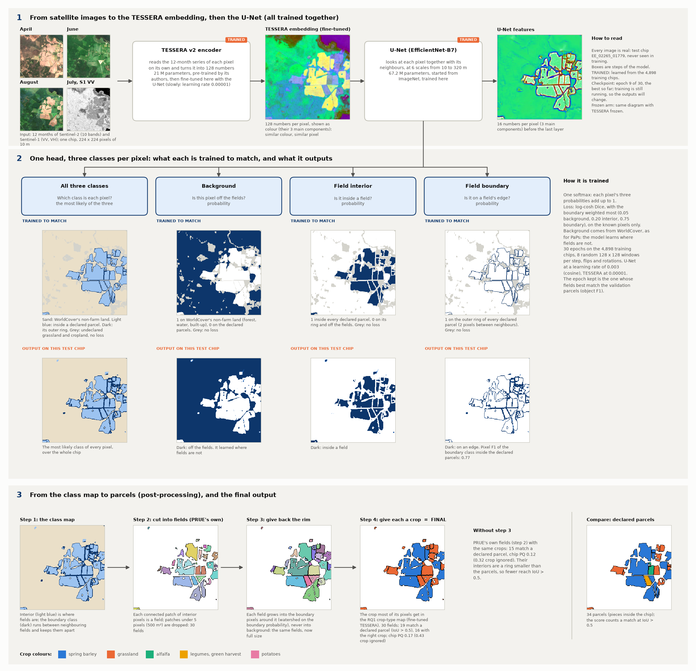
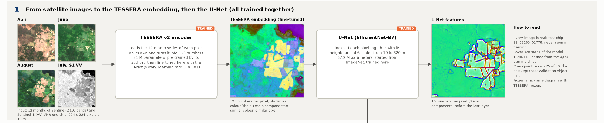
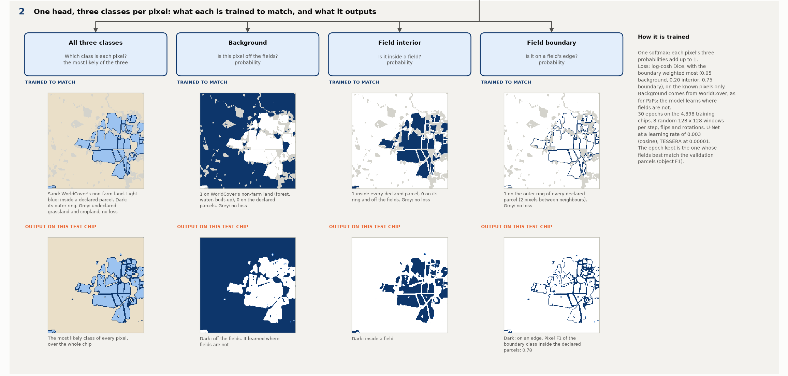
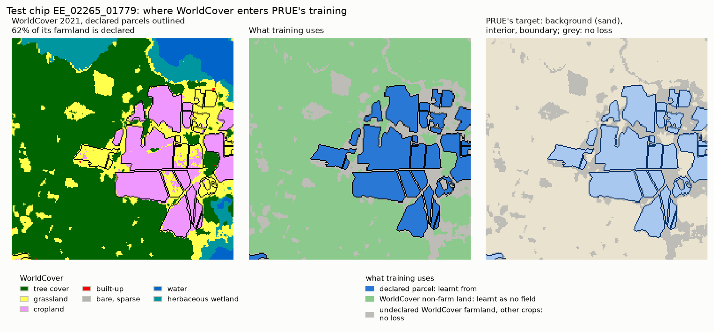
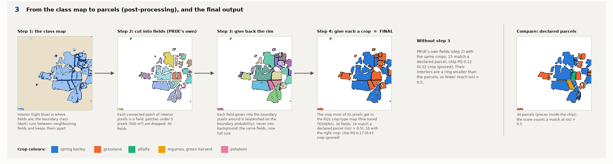
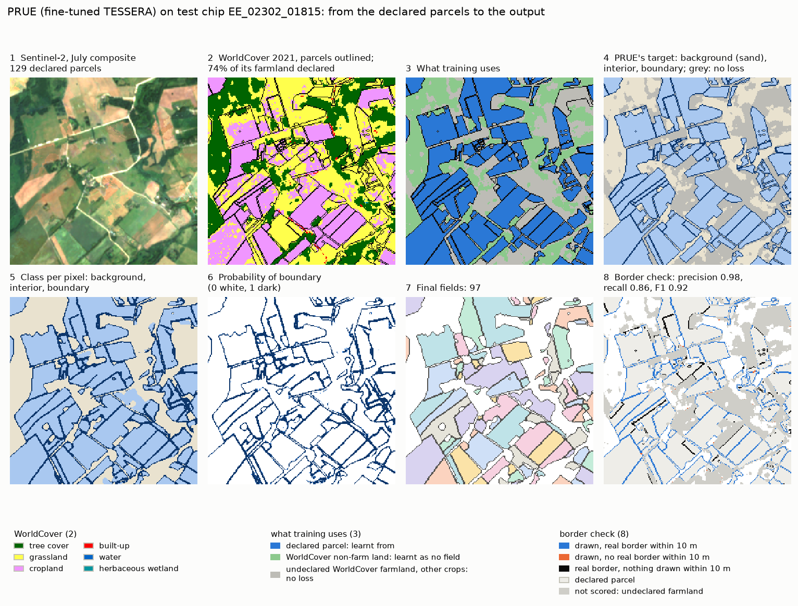

# PRUE on TESSERA: the architecture, step by step

**In one sentence.** PRUE (CVPR 2026, the best of 18 models on the Fields of The World benchmark) colours every pixel
as *background*, *field interior* or *field boundary*; its fields are the connected patches of interior, which the
boundary class keeps apart. Here it reads the TESSERA embedding, and TESSERA is trained together with it.

> **Final checkpoint.** The diagram uses the fine-tuned arm's kept checkpoint, **epoch 25 of 30**, the epoch of best
> validation object F1 (job 681338, finished 7 November 2026). The results over all test chips are in
> [REPORT.md](REPORT.md).

> **With a crop-type head.** The same network with a second head beside the border head, which gives each pixel a
> crop, so that one model draws the fields and their crops:
> [../2026-11-07_prue_crop_tessera/ARCHITECTURE.md](../2026-11-07_prue_crop_tessera/ARCHITECTURE.md).

**Every image in the diagram is real.** They come from the same test chip as the
[PaPs](../2026-11-05_paps_tessera/ARCHITECTURE.md) and [boundary head](../2026-11-05_parcel_extent/ARCHITECTURE.md)
diagrams, `EE_02265_01779`. It holds 34 declared parcels (counted as the pieces inside the chip) and was never seen in
training. The script runs the whole model on the chip, from the satellite composites through the fine-tuned TESSERA
and the U-Net to the parcels.

**The chain in one line:**

    Sentinel-2 + Sentinel-1, 12 months  →  TESSERA encoder (trained)  →  128 numbers per pixel
      →  U-Net (trained)  →  one head: 3 classes per pixel  →  post-processing  →  parcels, each with a crop

The diagram has three parts, shown larger below.

---

## Part 1. From satellite images to features

1. **Input.** One chip of 224 x 224 pixels of 10 m. Each pixel has 12 monthly Sentinel-2 images (10 bands) and 12
   monthly Sentinel-1 radar images (VV and VH).
2. **TESSERA encoder (trained here).** The same pre-trained model as for PaPs and the boundary head (21 M parameters),
   reading **one pixel at a time** and giving **128 numbers**. Unlike the other two diagrams, its weights are
   **fine-tuned end to end** with the U-Net, slowly (learning rate 0.00001, 300 times lower than the U-Net's).
3. **The embedding**, after fine-tuning, shown as colour (its 3 main directions of variation). The fields already
   stand out from the forest around them.
4. **U-Net (trained).** The model PRUE uses: an EfficientNet-B7 encoder, which looks at each pixel together with its
   neighbours at 6 scales from 10 to 320 m, and a decoder that brings the result back to 10 m. It has 67.2 M
   parameters and starts from ImageNet weights (its first layer adapted to TESSERA's 128 numbers). It is 55 times
   bigger than PaPs' U-Net.
5. **U-Net features.** 16 numbers per pixel before the last layer. Field edges are already drawn in them.

---

## Part 2. One head, three classes

PRUE has **one head**: a layer that gives each pixel three probabilities, which add up to 1. Each column shows one
class. The **upper** image is what it is **trained to match** (drawn for this chip, for comparison), and the
**lower** image is what it **outputs** on this test chip. The first column shows all three at once.

| Class | Question | Trained to match (1) | Weight in the loss |
|---|---|---|---|
| Background | Is this pixel off the fields? | WorldCover's non-farm land (forest, water, built-up and so on), outside the declared parcels | 0.05 |
| Field interior | Is it inside a field? | the pixels of a declared parcel, except its outer ring | 0.20 |
| Field boundary | Is it on a field's edge? | the outer ring of every declared parcel: one pixel on each side, so two pixels between neighbours | 0.75 |

**Where WorldCover comes in (our addition, not part of PRUE).** Published PRUE trains on the masks of Fields of The
World, which mark the background themselves. EuroCrops holds only the parcels farmers declared: on this chip 62 % of
the farmland WorldCover maps is declared, over all chips about two thirds. So the background comes from the public
ESA WorldCover 2021 map, exactly as in [PaPs' targets](../2026-11-05_paps_tessera/ARCHITECTURE.md):

* **Declared parcel** (blue): interior, with its outer ring as boundary.
* **WorldCover non-farm land** (green: forest, water, built-up, wetland): the background class. This is 60 % of the
  pixels of the chips, and where PRUE learns what is not a field.
* **Undeclared WorldCover grassland and cropland, and parcels of crops outside the 20 classes** (grey): no loss. They
  carry the ignore label, which the log-cosh Dice leaves out of both the prediction and the target, so the model is
  told neither "field" nor "no field" there. An undeclared field may still be a field.

Unlike PaPs, PRUE learns "not a field" pixel by pixel: the background class is a full output, so wherever it wins,
no field is drawn.

**Why the boundary weighs most.** Boundary pixels are few and thin, yet they decide whether two neighbouring fields
come out as one or two. PRUE's recipe gives them 0.75 of the loss (its "omega"). The loss is a log-cosh Dice: it
scores the overlap of each predicted class with its target, so a thin class is not swamped by the big ones.

**What to notice in the outputs:**

* **Background**: the forest and the water are confidently dark. Unlike the boundary head, this model was taught
  where fields are *not*.
* **Interior**: the declared fields fill in, with thin white gaps between neighbours.
* **Boundary**: a thin outline around and between the fields. Inside the declared parcels its pixel F1 on this chip
  is 0.77 (the boundary head's is 0.68 on the same chip, with a frozen encoder).

**Training.** 30 epochs on the 4,898 training chips. Each step takes 8 random windows of 128 x 128 pixels (whole chips
cost too much memory with TESSERA in the loop), with random flips and rotations. AdamW, U-Net at a learning rate of
0.003 on a cosine schedule, TESSERA at 0.00001 after a one-epoch warm-up. After every epoch the fields of the
validation chips are compared with their declared parcels, and the epoch kept is the one with the best object F1 (the
share of fields matched at IoU above 0.5), as PRUE's own code does.

---

## Part 3. From the class map to parcels

Again, the head gives no parcels, only a class per pixel. The parcels come from these steps (`prue.parcels`):

1. **The class map.** Each pixel takes its most likely class. The interior shows where the fields are; the boundary
   class runs between neighbouring fields.
2. **Cut into fields (PRUE's own fields).** Each connected patch of interior pixels becomes one field. Patches smaller
   than 5 pixels (500 m²) are dropped, as in PRUE's code. Background is never a field, so **land with no field stays
   empty**. Here: 30 fields.
3. **Give back the rim.** A field made of interior pixels only is one ring smaller than the real parcel. So each field
   grows into the boundary pixels around it (a watershed on the boundary probability), never into background. This
   step is our addition to PRUE.
4. **Give each a crop.** PRUE predicts no crop, so each field takes the crop that most of its pixels get in the RQ1
   crop-type map (the fine-tuned TESSERA + MLP of `../2026-10-15_kshot_finetune`). **This is the final output.**

**On this chip (epoch 25 checkpoint).** 31 fields; 21 match a declared parcel (IoU above 0.5) and 17 of those have the
right crop. Chip PQ is 0.19 with the crop, 0.49 with the crop ignored. Without step 3, PRUE's own fields match 16
parcels (PQ 0.12, or 0.36 with the crop ignored), because their shrunken interiors reach IoU 0.5 less often. Class-aware
PQ stays far below the crop-ignored one on a single chip, because it averages over the few crops present. The
boundary class has a pixel F1 of 0.78 inside the declared parcels.

For a rough idea only: on the same chip, PaPs (frozen TESSERA) finds 16 of the 34 parcels and the boundary head
(frozen, whole chip) 12. This is one chip, so it is no result. Over all 1,475 test chips the fine-tuned arm reaches a
PQ of 0.398 with the crop and 0.378 with the crop ignored with step 3, and 0.336 and 0.294 without it
([REPORT.md](REPORT.md)).

## A real example: from the declared parcels to the output

The chip is the median of the border report: half the test chips with at least 20 declared parcels score better for
PRUE, half worse. Row 1 is what the model is told, row 2 what it outputs:

1. **Sentinel-2**, the July composite, for orientation.
2. **WorldCover 2021** with the declared parcels outlined. Yellow is grassland and pink cropland, together the
   farmland; 74 % of it is declared here.
3. **What training uses** on a chip like this one.
4. **The training target** drawn for this chip.
5. and 6. **Two intermediate outputs**.
7. **The final fields**, in random colours.
8. **The border check** against the declared parcels: blue, a drawn border with a declared one within 10 m; orange,
   a drawn border with none; black, a declared border with nothing drawn within 10 m; grey, undeclared farmland, not
   scored.

For PRUE, panel 4 is the three-class target, with no loss on the grey land. Panels 5 and 6 are the class map and the
boundary probability.

**On this chip** (fine-tuned arm) PRUE draws 97 fields for 129 declared parcels, and 56 of them match a declared
parcel. 98 % of the borders it draws have a declared border within 10 m, and it draws 86 % of the declared borders.

### Why it fits, and where it still fails

PRUE asks the three questions the task needs, for every pixel at once: is this off the fields (background, learnt
from WorldCover), inside a field (interior), or on a field's edge (boundary)? No centre has to be found first, so
every field it sees is drawn, and the boundary class cuts the farmland where the image shows a line: tracks, ditches,
tree lines, changes of crop. Over all test chips its borders are the best of the three: precision 0.95 and 0.94,
recall 0.79 and 0.81, F1 0.86 and 0.87 (frozen, fine-tuned).

Its weakness is the border between two parcels of the same crop, often invisible at 10 m in every month: it draws
34 to 38 % of them, so the two parcels come out as one field (the short black segments in panel 8). That merge is
its main error at parcel level: 39 % of the declared parcels are merged with a neighbour ([REPORT.md](REPORT.md)). It
also draws fields on undeclared farmland, the grey land of panel 8; the border score leaves them out, but the parcel
score (PQ) counts them as false.

### The three methods on the same chip

| On test chip EE_02302_01815 (129 declared parcels) | PRUE ([note](../2026-11-06_prue_tessera/ARCHITECTURE.md)), fine-tuned | PaPs ([note](../2026-11-05_paps_tessera/ARCHITECTURE.md)), frozen | Boundary head ([note](../2026-11-05_parcel_extent/ARCHITECTURE.md)), frozen |
|---|---|---|---|
| Fields drawn | 97 | 84 | 238 |
| Fields matching a declared parcel (IoU above 0.5) | 56 | 44 | 18 |
| Border precision / recall / F1, this chip | 0.98 / 0.86 / 0.92 | 0.89 / 0.54 / 0.67 | 0.47 / 0.50 / 0.48 |
| Border F1, all 1,475 test chips, frozen / fine-tuned | **0.86 / 0.87** | 0.64 / 0.68 | 0.36 / 0.21 |
| Main weakness | borders between parcels of the same crop: two parcels become one field | no centre, no parcel: half the real borders are never drawn | no notion of "not a field": borders everywhere |

The border scores count a drawn border as right when a declared border lies within one pixel (10 m); land WorldCover
calls farmland but nobody declared is not scored ([the border report](../2026-11-07_border_accuracy/REPORT.md)).

---

## The frozen arm

The same diagram with TESSERA frozen: its embedding is read from the main workflow's cache and only the U-Net is
trained. It is the reference that shows what training the encoder adds (job 681339; its scores are in
[REPORT.md](REPORT.md)).

## How PRUE differs from PaPs and the boundary head

| | PRUE | PaPs | Boundary head |
|---|---|---|---|
| TESSERA | trained with the model | frozen (fine-tuned arm: fine-tuned on crop type first, then frozen) | frozen (fine-tuned arm: trained with the heads) |
| After TESSERA | U-Net, EfficientNet-B7, 67.2 M | small U-Net, 1.2 M | per-pixel MLP, 0.2 M, no neighbours |
| Output | 3 classes per pixel: background, interior, boundary | 5 heads: centre, saliency, size, shape, crop | 2 heads per pixel: crop, edge |
| Learns "not a field" from | WorldCover's non-farm land | WorldCover's non-farm land | nothing: declared parcels only |
| A parcel is | a connected patch of interior | a detected centre with a mask drawn around it | a region between predicted edges |
| Land with no parcel | stays empty | stays empty | impossible: every pixel ends in a parcel |
| Crop of a parcel | majority of the crop-type map | its own head, or the crop map | majority of its own crop head |

## Reproduce

    poetry run python experiments/2026-11-06_prue_tessera/architecture.py --chip EE_02265_01779 \
        --checkpoint results/2026-11-06_prue_tessera/EE_2021_rev/prue_tessera_v2_ft/P100_draw0_seed0/best.pt

It needs the fine-tuned arm's `best.pt`, with `embedding_stats.json` beside it. It runs on the CPU in about 1.5
minutes and works on any test chip, since it starts from the satellite composites. This version was drawn from the
final `best.pt` (epoch 25) on 7 November 2026. The script writes `figures/architecture.png` and
its three parts (`architecture_1.png` to `architecture_3.png`).

The WorldCover figure and the example (`figures/worldcover_training.png`, `figures/example_walkthrough.png`) come from
the stored test predictions:

    poetry run python experiments/2026-11-07_border_accuracy/walkthrough.py --chips EE_2021_rev
