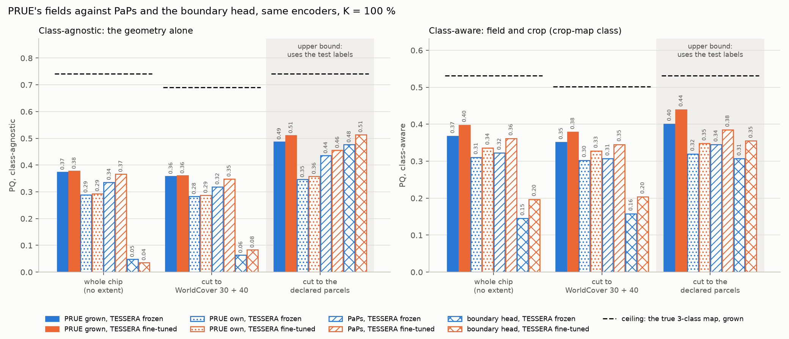
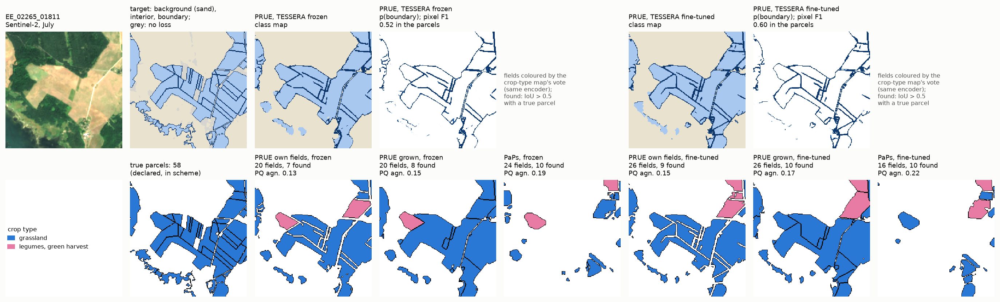
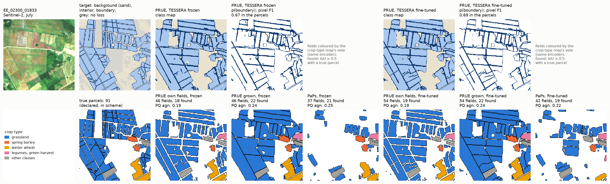
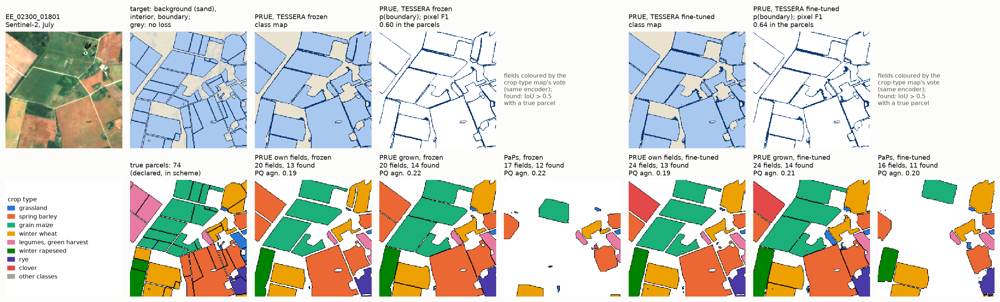
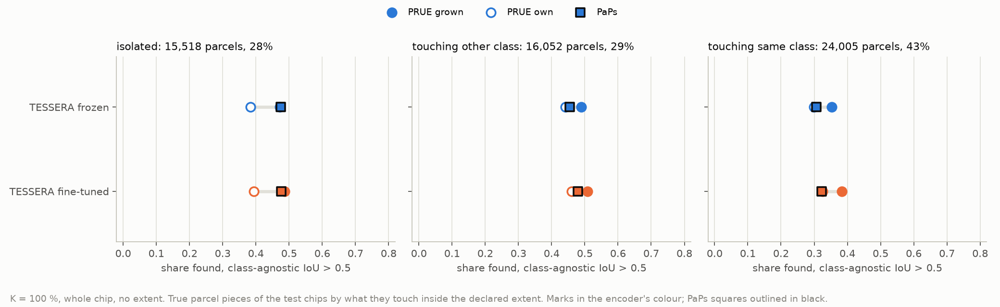
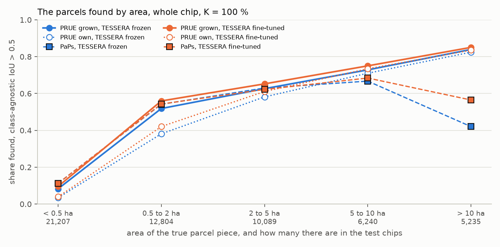
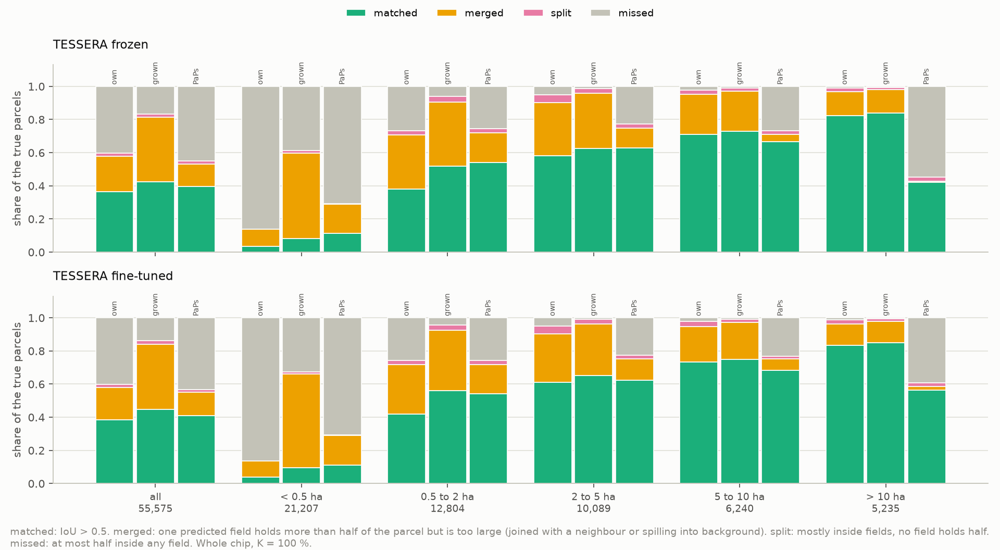
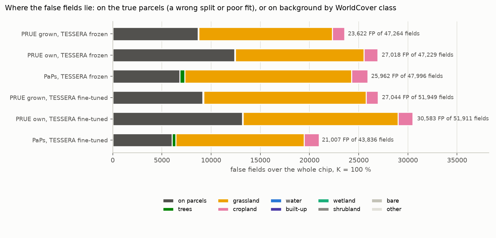
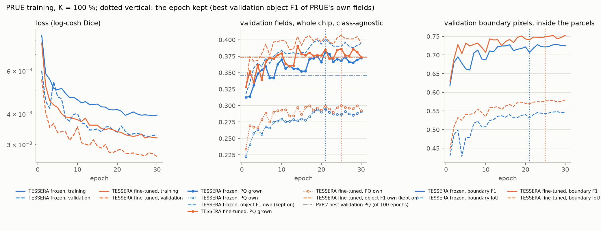

# PRUE field boundary segmentation on TESSERA, frozen and fine-tuned end to end: report, 7 November 2026

How the model works, step by step on one test chip: [ARCHITECTURE.md](ARCHITECTURE.md). Why PRUE was chosen among
the frontier boundary methods: [RESEARCH.md](RESEARCH.md).

**Answer.** PRUE is the best of the three parcel methods tried on TESSERA without test labels, but only with the step
we added, which gives each field back the rim that the boundary class takes from it. With the rim grown back, PRUE's
fields reach a **class-agnostic PQ of 0.374 on the frozen encoder and 0.378 fine-tuned** over the whole chip, against
0.336 and 0.366 for PaPs and 0.048 and 0.036 for the boundary head. With each field classed by the crop-type map,
**class-aware PQ is 0.367 frozen and 0.397 fine-tuned**, against PaPs' 0.322 and 0.361. PRUE's own fields, as the
paper builds them, score 0.289 and 0.294, below PaPs. **Training TESSERA end to end with PRUE adds almost nothing to
the geometry** (+0.004 class-agnostic PQ, +0.04 boundary pixel F1) at 50 times the training time (28.3 h against
0.56 h). The class-aware gain of the fine-tuned arm comes mostly from its better crop-type map.

* **The geometry (class-agnostic PQ, whole chip).** PRUE grown 0.374 / 0.378 (frozen / fine-tuned), PaPs 0.336 /
  0.366, PRUE's own fields 0.289 / 0.294, the predicted field left unsplit 0.100 / 0.096, the boundary head 0.048 /
  0.036. Over the fine-tuned PaPs, PRUE grown matches about as many parcels (RQ 0.463 against 0.459) and fits them
  better (SQ 0.815 against 0.796).
* **What it finds.** 42.5 % (frozen) and 44.8 % (fine-tuned) of the 55,575 true parcels, against PaPs' 39.6 and
  41.1 %. PRUE finds the large parcels PaPs misses (above 10 ha: 84 and 85 % against 42 and 56 %) and more of the
  parcels that touch another parcel of the same crop (35 and 38 % against 31 and 32 %). PaPs finds a few more of the
  smallest pieces, under 0.5 ha (11 % against 8 and 10 %).
* **How it fails: it merges.** Of the true parcels PRUE's grown fields do not match, most are merged: one field covers
  most of the parcel but also its neighbour, because no boundary was predicted between them. That happens to 39 % of
  all true parcels and 52 to 56 % of those under 0.5 ha. PaPs instead misses: 43 to 45 % of the true parcels lie mostly
  outside any of its parcels.
* **The false fields** (23,600 frozen, 27,000 fine-tuned) lie as PaPs' do: 57 to 61 % on grassland that WorldCover
  maps and no parcel declares, a third on the true parcels (a wrong split or a poor fit), almost none on forest or
  water.
* **The ceiling.** The test chips' own three-class map, put through the same post-processing, scores 0.741
  class-agnostic with the rim grown back (0.494 without it). PRUE on TESSERA reaches half of that.

One draw and one seed per arm, K = 100 % only (user, 5 November 2026), so differences under about 0.04 are not
resolved: PRUE grown against fine-tuned PaPs (+0.012 class-agnostic, +0.036 class-aware) and frozen against
fine-tuned PRUE (+0.004) are within that, PRUE grown against frozen PaPs (+0.038, +0.045) at its edge. The gap to the
boundary head, 0.33 class-agnostic, is far larger.

## Setup

| | |
|---|---|
| Question | PRUE (CVPR 2026, ftw-prue), the best of 18 models on the Fields of The World benchmark, fed TESSERA v2 Medium's 10 m embedding and trained end to end with it: how well does it delineate the parcels of Estonia over the whole chip, with no extent given; what does training the encoder add; how does it compare with PaPs and the boundary head on the same encoder (README.md) |
| Arms | `prue_tessera_v2_ft`: the pretrained v2 Medium student runs on the composites of every pixel of each training window and is trained with the U-Net at 1e-5 after a one-epoch warm-up; its output standardised with fixed statistics from 128 training chips. `prue_tessera_v2_frozen`: the main workflow's frozen TESSERA raster, every other setting the same (added as the reference; the user asked for the fine-tuned arm) |
| Model | smp U-Net with an EfficientNet-B7 encoder (ImageNet weights, first convolution on 128 channels), 67.2 M parameters, one softmax over three classes per pixel (`prue.py`). The fine-tuned arm adds the 21.0 M parameters of the student |
| Training | PRUE's recipe: log-cosh Dice with class weights 0.05 / 0.20 / 0.75 (background / interior / boundary), AdamW with amsgrad at 3e-3, cosine to 1e-6, weight decay 0.01, 30 epochs, bf16. Batches of 8 random 128 x 128 windows with D4 (whole chips cost 2 h per epoch on the fine-tuned arm); validation and test on whole chips. The checkpoint is the epoch of best validation object F1 (class-agnostic RQ) of PRUE's own fields, as ftw-prue monitors `val/object_f1` |
| Targets | A drawn in-scheme parcel pixel with a 4-neighbour of another parcel or of none is boundary (a ring of one pixel per parcel, two between neighbours), every other one interior. Background is WorldCover's non-agricultural land outside the drawn parcels, as in the PaPs targets; WorldCover grassland and cropland outside them is ignored. Shares on the training chips: background 0.50, interior 0.28, boundary 0.05, ignored 0.17 (on `EE_2021_rev_mini`) |
| Fields, no truth | `cc`, PRUE's own: the 4-connected patches of the interior class, under 5 pixels (500 m2) dropped. `grow`, our addition: each `cc` field grown by watershed on the boundary probability into the predicted field pixels around it, never into background. `field`: the predicted field (interior or boundary) left unsplit, the floor. All three fixed before the runs |
| Chip set | `EE_2021_rev`, split `blocks4_buf1600_seed0__6b0eb4cb`: 4,898 training, 769 validation, 1,475 test chips; 86,909 training parcels at K = 100 % |
| Runs | Cluster, commit `647f4b6`, hpc-node29. Pilots 681336 and 681337 on `EE_2021_rev_mini`, 3 epochs, 6 November 2026. Job 681338 (fine-tuned): 612 steps per epoch at 5.0 s, 35 GB, 28.3 h of fitting, ended 7 November 09:21. Job 681339 (frozen): the raster encoded on the node, then 0.56 h of fitting, 2.1 GB, ended 6 November 14:56 |

## How the outputs are scored

Exactly as the PaPs report (`score_prue.py` with `panoptic_x.py` copied from the extent experiment): the fields are
matched to the 55,575 true parcel pieces of the test chips at IoU > 0.5, PQ = SQ x RQ, counts summed over all test
chips; class-agnostic, and class-aware (mean over the classes) with each field's class voted by the crop-type map of
the same encoder (`results/kshot` frozen, `2026-10-15_kshot_finetune` fine-tuned), the maps PaPs' crop-map class
uses. The void rule removes the pixels of declared parcels outside the scheme from every field before its IoU, and
drops an unmatched field lying mostly on them (1,323 and 1,415 grown fields). Every other unmatched field is a false
positive, wherever it lies. Three extents: the whole chip, the headline; each field cut to WorldCover 30 + 40 (and
30 + 40 + 90); each field cut to the declared parcels, an upper bound that uses the test labels.

The ceiling (`analyse.py`, `results/2026-11-06_prue_tessera/EE_2021_rev/ceiling.json`) is the test chips' own target
taken as the prediction, unknown pixels called background, put through the same post-processing and scorer.

## Results

### The final output: fields with a class

PQ over the whole chip, with each field cut to WorldCover and, shaded, to the declared parcels. Colour: encoder;
hatch: method; dashed line: the ceiling of the grown fields.

| Encoder | Fields from | PQ | SQ | RQ | PQ agn. | SQ agn. | RQ agn. | TP | FP | FN | fields |
|---|---|---|---|---|---|---|---|---|---|---|---|
| frozen | **PRUE, grown** | **0.367** | 0.772 | 0.429 | **0.374** | 0.813 | 0.460 | 23,642 | 23,622 | 31,933 | 47,264 |
| frozen | PRUE, its own fields | 0.310 | 0.686 | 0.405 | 0.289 | 0.734 | 0.393 | 20,211 | 27,018 | 35,364 | 47,229 |
| frozen | PRUE, field unsplit | 0.082 | 0.667 | 0.105 | 0.100 | 0.760 | 0.131 | 4,647 | 10,502 | 50,928 | 15,149 |
| frozen | PaPs, crop-map class | 0.322 | 0.734 | 0.393 | 0.336 | 0.790 | 0.425 | 22,034 | 25,962 | 33,541 | 47,996 |
| frozen | boundary head | 0.145 | 0.702 | 0.186 | 0.048 | 0.743 | 0.064 | 13,118 | 338,546 | 42,457 | 351,664 |
| fine-tuned | **PRUE, grown** | **0.397** | 0.725 | 0.463 | **0.378** | 0.815 | 0.463 | 24,905 | 27,044 | 30,670 | 51,949 |
| fine-tuned | PRUE, its own fields | 0.336 | 0.653 | 0.435 | 0.294 | 0.740 | 0.397 | 21,328 | 30,583 | 34,247 | 51,911 |
| fine-tuned | PRUE, field unsplit | 0.086 | 0.670 | 0.109 | 0.096 | 0.766 | 0.126 | 4,481 | 11,197 | 51,094 | 15,678 |
| fine-tuned | PaPs, crop-map class | 0.361 | 0.698 | 0.438 | 0.366 | 0.796 | 0.459 | 22,829 | 21,007 | 32,746 | 43,836 |
| fine-tuned | boundary head | 0.197 | 0.705 | 0.250 | 0.036 | 0.744 | 0.048 | 14,128 | 520,883 | 41,447 | 535,011 |
| ceiling | perfect 3-class map, grown | 0.532 | 0.881 | 0.542 | 0.741 | 0.962 | 0.771 | 38,102 | 5,178 | 17,473 | 43,280 |
| ceiling | perfect 3-class map, own fields | 0.408 | 0.720 | 0.508 | 0.494 | 0.762 | 0.647 | 32,001 | 11,279 | 23,574 | 43,280 |

Whole chip, no extent. The boundary head: watershed seeds below 0.5, its class from its own crop head (PaPs report).
The ceiling's class-aware PQ uses the frozen crop-type map. All extents, both PaPs classes and the WorldCover
30 + 40 + 90 sensitivity: [figures/tables.md](figures/tables.md).

* **The rim step is what makes PRUE competitive.** PRUE's own fields are the interior class alone, one pixel smaller
  on every side than the parcel. At 10 m that costs a parcel of 0.5 ha (about 7 x 7 pixels) half its area, so its IoU
  falls to 0.5: even the perfect map loses one match in six that way (32,001 against 38,102). Growing each field
  back into its rim lifts PQ by 0.085 frozen and 0.084 fine-tuned, from below PaPs to above it. The loss comes from
  a one-pixel ring at 10 m; how the Fields of The World target draws its boundary class was not checked here.
* **The boundary class carries the delineation.** The predicted field left unsplit scores 0.100: almost every match
  comes from the boundary class cutting fields apart.
* **Cutting to WorldCover costs a little**, as for PaPs (0.374 to 0.359): the false fields lie on WorldCover grassland
  and cropland, which the cut keeps.
* **Given the declared parcels**, PRUE grown (0.487 / 0.511) equals the boundary head (0.476 / 0.514) and beats PaPs
  (0.435 / 0.455). Within the true extent, PRUE's boundaries are as good as the boundary head's; over the whole chip,
  PRUE keeps 74 to 77 % of that score and the boundary head 7 to 10 %, because PRUE has learnt where fields are not.

### Examples

PaPs' three example test chips (the ones with the most contacts between parcels of the same crop): the July image, the
three-class target, and per encoder the class map, the boundary probability and the fields. Fields coloured by the
crop-type map's vote; "found": IoU > 0.5 with a true parcel.

The boundaries PRUE draws follow the visible ones: tracks, ditches, tree lines, changes of crop. Between adjacent
grassland parcels, which make up most of these chips, it often draws none, and the grown field covers several declared
parcels (example 1: 58 true parcels, 26 fine-tuned fields). PaPs proposes fewer, smaller parcels and leaves large
parts of the declared extent empty. Both encoders give nearly the same fields; the fine-tuned boundary probability is
a little sharper.

### What PRUE finds, and what it misses

| Encoder | Fields from | all | isolated | touching other class | touching same class | < 0.5 ha | 0.5 to 2 ha | 2 to 5 ha | 5 to 10 ha | > 10 ha |
|---|---|---|---|---|---|---|---|---|---|---|
| frozen | PRUE grown | **0.425** | 0.471 | 0.489 | 0.353 | 0.083 | 0.518 | 0.626 | 0.728 | 0.839 |
| frozen | PRUE own | 0.364 | 0.383 | 0.442 | 0.299 | 0.034 | 0.381 | 0.582 | 0.710 | 0.824 |
| frozen | PaPs | 0.396 | 0.475 | 0.455 | 0.307 | 0.112 | 0.542 | 0.630 | 0.667 | 0.420 |
| fine-tuned | PRUE grown | **0.448** | 0.487 | 0.509 | 0.383 | 0.096 | 0.560 | 0.652 | 0.750 | 0.850 |
| fine-tuned | PRUE own | 0.384 | 0.394 | 0.460 | 0.326 | 0.039 | 0.420 | 0.611 | 0.734 | 0.835 |
| fine-tuned | PaPs | 0.411 | 0.477 | 0.479 | 0.323 | 0.112 | 0.543 | 0.622 | 0.684 | 0.565 |

True parcels: 15,518 isolated, 16,052 touching another class, 24,005 touching their own class; 21,207 under 0.5 ha,
12,804 from 0.5 to 2 ha, 10,089 from 2 to 5 ha, 6,240 from 5 to 10 ha, 5,235 above 10 ha.

The two methods find the same isolated parcels; PRUE finds more of those that touch others and many more of the
large ones, where PaPs' 16 x 16 shape head and box sizes fall short. Neither finds the pieces under 0.5 ha, which are
38 % of the true parcels and largely chip-edge slivers and fragments of multipart parcels.

### How the fields fail

Every true parcel is matched (IoU > 0.5), merged (one field holds more than half of it but is too large), split
(mostly inside fields, none holding half) or missed (at most half inside any field).

| Encoder | Fields from | matched | merged | split | missed | merged, < 0.5 ha | merged, 0.5 to 2 ha | merged, 2 to 5 ha | merged, 5 to 10 ha | merged, > 10 ha |
|---|---|---|---|---|---|---|---|---|---|---|
| frozen | PRUE grown | 23,642 | 21,540 | 1,149 | 9,244 | 0.516 | 0.388 | 0.334 | 0.244 | 0.143 |
| frozen | PRUE own | 20,211 | 11,905 | 1,054 | 22,405 | 0.104 | 0.327 | 0.322 | 0.241 | 0.145 |
| frozen | PaPs | 22,034 | 7,539 | 923 | 25,079 | 0.176 | 0.179 | 0.117 | 0.044 | 0.008 |
| fine-tuned | PRUE grown | 24,905 | 21,839 | 1,177 | 7,654 | 0.564 | 0.366 | 0.309 | 0.223 | 0.129 |
| fine-tuned | PRUE own | 21,328 | 10,804 | 1,156 | 22,287 | 0.097 | 0.298 | 0.292 | 0.212 | 0.128 |
| fine-tuned | PaPs | 22,829 | 7,865 | 791 | 24,090 | 0.177 | 0.176 | 0.132 | 0.068 | 0.021 |

The two methods fail in opposite ways. PRUE covers the farmland and under-segments it: a missing boundary joins two
parcels, and a small parcel next to a large one disappears into it. PaPs places a parcel only where it finds a centre
and leaves the rest empty. Splitting is rare for both. PRUE's own fields turn many of the merged parcels of the grown
ones into misses: once a field loses its rim, a small parcel at its edge is no longer mostly inside it.

### Where the false fields lie

Of the grown fields' false positives, 8,664 (frozen) and 9,154 (fine-tuned) lie on the true parcels, 13,581 and
16,487 on WorldCover grassland outside every declared parcel, about 1,250 on WorldCover cropland, and under 200 on
forest, wetland or water. PaPs has the same pattern (6,028 to 6,830 on parcels, 13,071 to 16,940 on grassland). The
undeclared grassland was ignored in training for both methods, so neither learnt whether it is a field, and some of
it may well be farmed land outside the subsidy scheme.

### Per pixel

| Encoder | IoU background | IoU interior | IoU boundary | field IoU | boundary F1 in the parcels | precision | recall |
|---|---|---|---|---|---|---|---|
| frozen | 0.984 | 0.901 | 0.524 | 0.963 | 0.700 | 0.733 | 0.670 |
| fine-tuned | 0.986 | 0.910 | 0.567 | 0.968 | 0.740 | 0.771 | 0.712 |

Three-class IoU on the test pixels the target knows; boundary pixels scored inside the declared parcels. Where fields
are is nearly solved (field IoU 0.96 to 0.97); the boundary class is not (IoU 0.52 to 0.57), and fine-tuning helps
it most (+0.04 IoU and F1). Missed boundary pixels mostly become interior (the merges above).

### The class

On the true parcels each method found, the crop-type map's vote is right for 81.6 % (frozen) and 84.6 % (fine-tuned)
of PRUE's grown fields, the same as for PaPs' (81.4 and 84.6 %), macro F1 0.647 and 0.684 against 0.642 and 0.686.
The class-aware PQ therefore follows the geometry and the crop map, and the fine-tuned arm's class-aware gain
(+0.030) comes mainly from its crop map (pixel Macro-F1 0.660 against 0.618).

### Training dynamics

| Encoder | best epoch | val object F1 (own) | val PQ agn., own | val PQ agn., grown | best val PQ agn., grown (epoch) | test PQ agn., grown | fit h | peak GB | trainable M | PaPs best val PQ agn. |
|---|---|---|---|---|---|---|---|---|---|---|
| frozen | 21 | 0.401 | 0.294 | 0.382 | 0.382 (21) | 0.374 | 0.56 | 2.1 | 67.2 | 0.345 |
| fine-tuned | 25 | 0.407 | 0.300 | 0.386 | 0.390 (14) | 0.378 | 28.27 | 35.1 | 88.2 | 0.373 |

The grown fields pass PaPs' best validation PQ at epoch 4 (frozen) and 9 (fine-tuned) and gain little after epoch
15; validation PQ moves
by about 0.02 from epoch to epoch while the learning rate is high. The object F1 of PRUE's own fields, on which the
checkpoint is chosen, rises with the grown fields' PQ, so the criterion does not cost the headline: the fine-tuned
arm's grown PQ peaks at epoch 14 (0.390), 0.004 above the epoch kept. The test scores sit 0.008 below the validation
ones. The fine-tuned arm's validation loss stays below the frozen arm's and its boundary IoU above it from the first
epochs, but its fields barely differ.

## Analysis

**A learnt background is what the boundary route needed.** The boundary head scored 0.476 given the declared parcels
and 0.048 without them, because it had no notion of land that is not a field. PRUE learns that from WorldCover's
non-agricultural land, and its predicted field covers the declared farmland almost exactly (field IoU 0.96 to 0.97).
Its whole-chip score is then 74 to 77 % of its score inside the declared parcels, against 7 to 10 % for the boundary
head. Inside the declared parcels PRUE's boundaries are as good as the boundary head's; the gain is all in the
background.

**PRUE and PaPs fail in opposite ways, and PRUE's way costs a little less.** PRUE covers the farmland and merges
parcels whose boundary it does not see; PaPs places a parcel per centre and leaves the rest empty. PRUE's grown fields
find more parcels, the large ones above all. They win by matching more parcels and fitting them better on the frozen
encoder (RQ +0.035, SQ +0.023), and by fitting them better on the fine-tuned one (RQ +0.004, SQ +0.019). The merges are
the main headroom: 39 % of the true parcels are merged, and the perfect map reaches 0.741. The parcels that touch
their own crop are found least (35 to 38 %, against 49 to 51 % of those touching another crop). Their boundary
likely shows no change in any month at 10 m, and some declared boundaries are administrative; no encoder recovers a
boundary that the imagery does not show.

**Fine-tuning TESSERA end to end is not worth it here.** It sharpens the boundary pixels (+0.04 F1) and lowers the
validation loss, but the fields barely move (+0.004 PQ, +0.003 RQ), and it costs 50 times the training time and 17
times the memory. For PaPs the fine-tuned student (fine-tuned on crop type, then frozen) gave +0.03; here the student
trained for delineation itself gives almost nothing. The U-Net's 67 M parameters and its six scales of context do
the spatial work, which TESSERA's per-pixel encoder cannot do, so training the encoder likely only refines each pixel's
evidence. The frozen arm, at half an hour, is the one to iterate on.

**The class should still come from the crop-type map.** PRUE predicts no crop, so the two-stage design of the PaPs
report is the only one here: geometry from the delineation model, class from the RQ1 crop-type model. It is right for
82 to 85 % of the parcels found, the same as for PaPs, so the choice between PRUE and PaPs is a choice of geometry.

## Caveats

* One draw and one seed per arm, K = 100 % only. The epoch is chosen on the validation chips and the test chips are
  untouched, but no interval exists; differences under about 0.04 are not resolved.
* The rim step (`grow`) is our addition to PRUE. It was defined, with the other two variants, before the runs, and
  needs no parameter, but the checkpoint was chosen on PRUE's own fields, not on the grown ones.
* PRUE's U-Net has 67.2 M parameters, PaPs' 1.23 M: the comparison is between methods as published, and capacity is
  part of the difference. PaPs trains for 100 epochs with a tuned confidence threshold, PRUE for 30.
* "Fine-tuned" means a different thing for each method: PRUE's student was trained end to end with it; PaPs read
  chips re-encoded by the student fine-tuned on crop type, then frozen; the boundary head's student was trained with
  its two heads. All start from the same pretrained student.
* Training on 128 x 128 windows (for the fine-tuned arm's cost) differs from ftw-prue's whole 256 x 256 chips; the
  frozen arm, which could afford whole chips, used the same windows to keep the arms comparable.
* The targets use WorldCover's non-agricultural land as the only background; undeclared grassland is unknown in
  training and background in scoring, which makes most of the false fields of both PRUE and PaPs.
* The ceiling's class-aware PQ uses the frozen crop-type map; with the fine-tuned map it would be a little higher.
* The FTW numbers quoted (object F1 0.47) come from another benchmark, other countries and another target; they are
  context, not a comparison.

## Next steps

1. **Fewer merges, at no training cost.** Cut fields where the boundary probability exceeds a threshold below the
   argmax (PRUE's own post-processing uses the argmax), with the threshold chosen on the validation chips from the
   frozen arm's `best.pt`. The merges are the largest error and the boundary probability is there to use.
2. **PaPs centres as seeds.** Grow PaPs' detected centres, instead of PRUE's interior patches, by watershed inside
   PRUE's predicted field: one parcel per centre, PRUE's extent and boundaries. The two methods' errors are
   complementary (PaPs misses where PRUE merges).
3. **Repeat the decisive comparison** (PRUE grown against PaPs, frozen) over three seeds to resolve differences of
   0.01 to 0.04; the frozen PRUE arm costs half an hour.
4. **Undeclared grassland.** Score with it as void as well, as a sensitivity, to see how much of the remaining gap to
   the ceiling is the label rather than the model.
5. If the user agrees: PRUE on AlphaEarth, the other 10 m raster; the token-grid models would need their features
   upsampled to 10 m first.

## Reproduce

    poetry run python experiments/2026-11-06_prue_tessera/check.py --chips EE_2021_rev_mini
    bash scripts/cluster/submit.sh experiments/2026-11-06_prue_tessera/experiment_pilot.yaml EE_2021_rev_mini   # cluster
    TIME=3-00:00:00 bash scripts/cluster/submit.sh experiments/2026-11-06_prue_tessera/experiment.yaml EE_2021_rev
    bash scripts/cluster/pull_results.sh 2026-11-06_prue_tessera EE_2021_rev
    poetry run python experiments/2026-11-06_prue_tessera/analyse.py --chips EE_2021_rev
    poetry run python experiments/2026-11-06_prue_tessera/report.py --chips EE_2021_rev
    poetry run python experiments/2026-11-06_prue_tessera/architecture.py

`analyse.py` needs the PaPs cells of `../2026-11-05_paps_tessera` and the crop-type maps on the hub. Results:
`results/2026-11-06_prue_tessera/EE_2021_rev/<arm>/P100_draw0_seed0/` (`results.json` with `panoptic_metrics` and the
training history, `analysis.json`, `metrics.csv`, `predictions_test.npz` with the class probabilities x 255,
`best.pt`, and for the fine-tuned arm `embedding_stats.json`), and `ceiling.json` beside the arms.
