# Drawing parcels from TESSERA: PRUE, PaPs and the boundary head compared, 7 November 2026

This report puts the three parcel delineation methods tried on TESSERA side by side. It explains each method in
plain words, compares them on the same test chips, and states what each fails at and what the comparison cannot
tell. It gathers what three experiments found:

| Method | Experiment report | How it works, step by step |
|---|---|---|
| PRUE | [2026-11-06_prue_tessera/REPORT.md](../2026-11-06_prue_tessera/REPORT.md) | [ARCHITECTURE.md](../2026-11-06_prue_tessera/ARCHITECTURE.md) |
| PaPs | [2026-11-05_paps_tessera/REPORT.md](../2026-11-05_paps_tessera/REPORT.md) | [ARCHITECTURE.md](../2026-11-05_paps_tessera/ARCHITECTURE.md) |
| Boundary head | [2026-11-05_parcel_extent/REPORT.md](../2026-11-05_parcel_extent/REPORT.md) | [ARCHITECTURE.md](../2026-11-05_parcel_extent/ARCHITECTURE.md) |

## In short

| | PRUE | PaPs | Boundary head |
|---|---|---|---|
| How it finds parcels | colours every pixel: off the fields, inside a field, or on a field's edge | finds each parcel's centre, then draws a shape around it | marks the edges, then cuts the whole chip along them |
| **Border F1** (frozen / fine-tuned) | **0.86 / 0.87** | 0.64 / 0.68 | 0.36 / 0.21 |
| Drawn borders that are real | 95 % / 94 % | 85 % / 86 % | 27 % / 13 % |
| Real borders that are drawn | 79 % / 81 % | 52 % / 56 % | 56 % / 57 % |
| Declared parcels found (IoU above 0.5) | 43 % / 45 % | 40 % / 41 % | 24 % / 25 % |
| Main weakness | borders between two parcels of the same crop: they merge | no centre, no parcel: half the parcels are never drawn | does not know what is not a field: borders everywhere |

* **PRUE fits the task best.** It draws few false borders and most of the real ones, and beats PaPs on 99 % of
  the test chips with at least 20 declared parcels.
* **PaPs** draws good borders where it places a parcel, but it misses parcels whose centre it does not find.
* **The boundary head** draws good borders inside farmland, but it was never shown land that is not a field, so it
  cuts forest, water and villages into fields too.
* **What none of them solves** is the border between two neighbouring parcels of the same crop: PRUE draws one in
  three.
* **Fine-tuning TESSERA** adds almost nothing to PRUE (+0.006 F1) at 50 times the training time.
* **The lead is large on borders, small on whole parcels.** Much of PRUE's border score comes from knowing where
  farmland ends; on the borders that separate one parcel from its neighbour it draws 60 %, against 49 % for PaPs, and
  its parcel score is close to fine-tuned PaPs' ([Limitations](#6-limitations)).

All numbers: Estonia 2021, the 1,475 test chips of 2.24 x 2.24 km, all training labels (K = 100 %), one fit per
method.

---

## 1. The task, and what the models are told

**The task.** Given one chip, 224 x 224 pixels of 10 m, draw its parcels. Every method reads the same input: for
each pixel, TESSERA's 128 numbers summarising a year of Sentinel-2 and Sentinel-1. Nothing about the parcels is
given at prediction time.

**The labels.** The parcels come from EuroCrops: those farmers declared for subsidies. That is not every field.
WorldCover, a public land cover map, shows how much farmland the declaration leaves out:

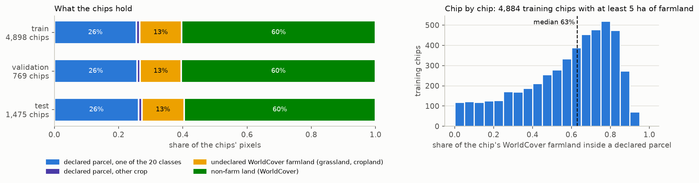

| Land | Share of the pixels (train / validation / test) |
|---|---|
| declared parcel, one of the 20 crop classes | 25.5 / 25.8 / 26.2 % |
| declared parcel, another crop | 1.0 / 0.9 / 1.1 % |
| undeclared WorldCover grassland and cropland | 13.1 / 12.8 / 13.1 % |
| non-farm land (forest, water, built-up, wetland) | 60.4 / 60.5 / 59.6 % |

**A third of the farmland in the chips is undeclared**, nearly all of it grassland: meadows outside the scheme,
margins, strips between parcels. A model told that every undeclared pixel is "no field" would learn that real fields
are not fields. So none of the three is told that:

| Land | PRUE | PaPs | Boundary head |
|---|---|---|---|
| declared parcel | inside a field, with its outer ring as edge | a centre, a box, a shape and a crop | a crop, and an edge on its outer ring |
| non-farm land, from WorldCover | **"not a field"** (its background class) | **"no centre here"** | not used |
| undeclared farmland | not used | not used | not used |

Using WorldCover this way is **our addition** to PRUE and PaPs, not part of either published method: PRUE was
published with labels that mark the background themselves, and PaPs with a dataset where every pixel is labelled.
The boundary head learns from the declared parcels alone. This was checked in the training code of each method.

---

## 2. The three methods in plain words

### PRUE: colour every pixel, then cut along the edges

PRUE (CVPR 2026, the best of 18 models on the Fields of The World benchmark) gives every pixel one of three classes:
**off the fields**, **inside a field**, or **on a field's edge**. The fields are the patches of "inside" that the
edge class keeps apart; each is then grown back over its edge ring (our addition, since the edge ring would
otherwise be missing from every field). A U-Net with an EfficientNet-B7 encoder (67 M parameters) does the
colouring; TESSERA is either frozen or trained with it.

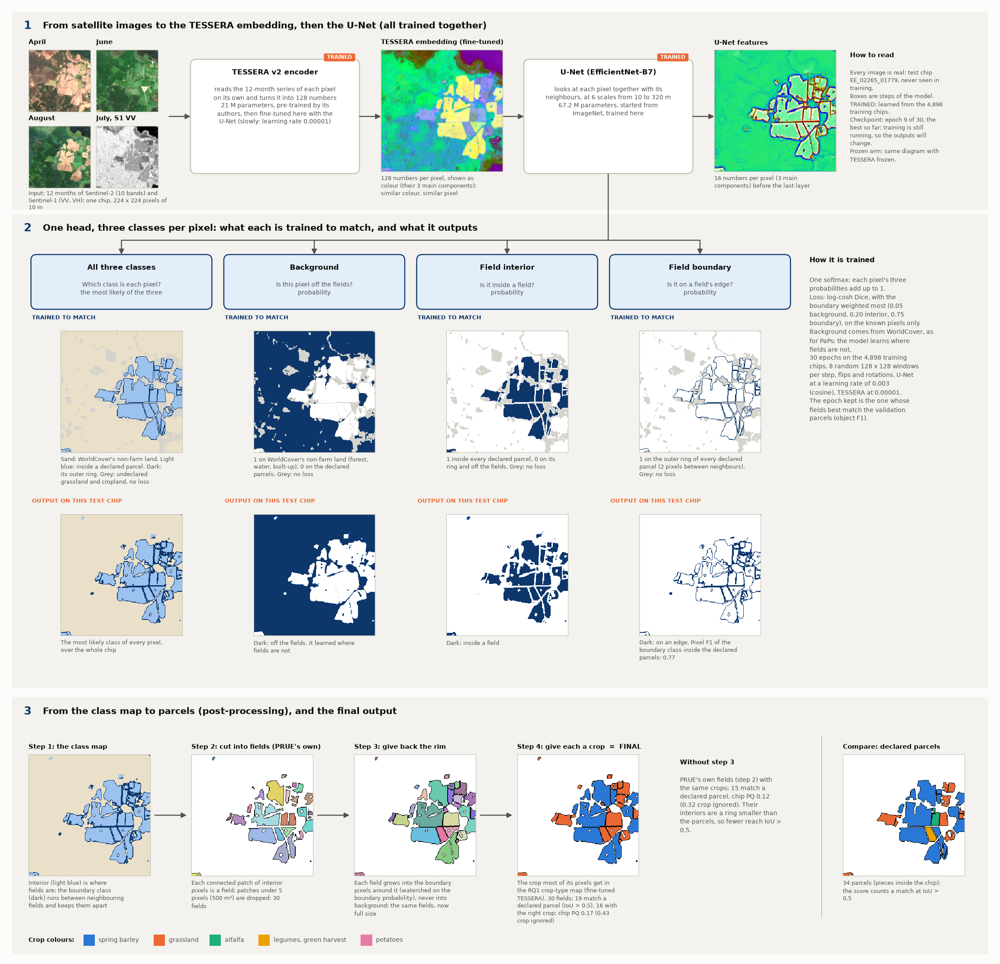

What PRUE is told on that chip: the declared parcels (blue) as fields with their edges, WorldCover's non-farm land
(green) as "off the fields", and nothing on the undeclared farmland (grey).

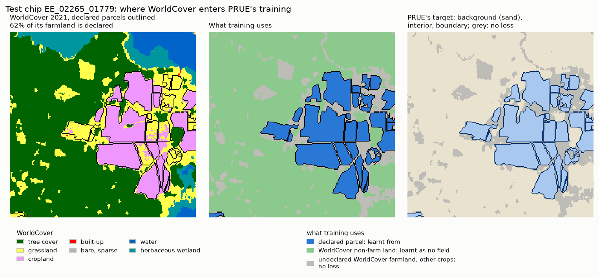

### PaPs: find each parcel's centre, then draw a shape around it

PaPs (Parcels-as-Points, ICCV 2021) finds each parcel as a **point**, its centre, from a heatmap. From the features
at that centre it predicts the parcel's box, a rough 16 x 16 shape and its crop; a saliency map sharpens the shape.
A small U-Net (1.2 M parameters) reads TESSERA. **No centre, no parcel**: what PaPs does not detect, it does not
draw.

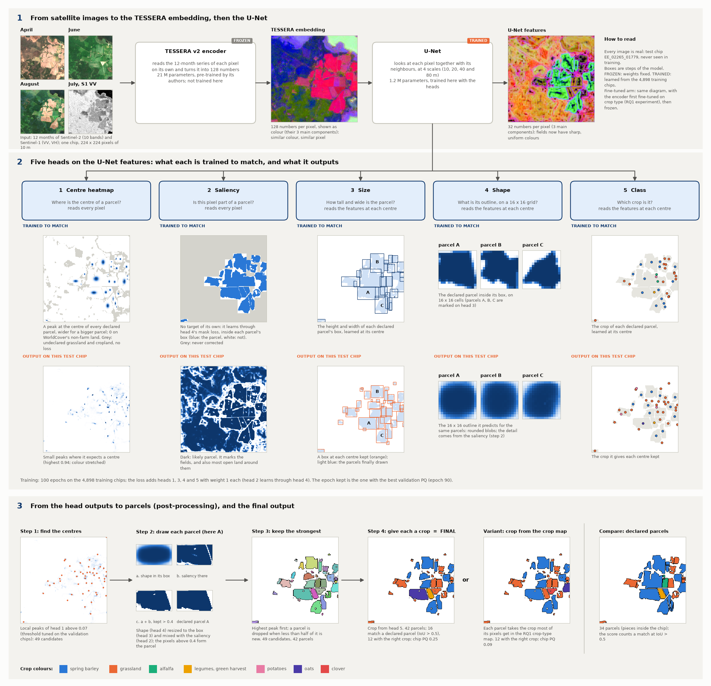

What PaPs is told: a peak at the centre of each declared parcel, "no centre here" on WorldCover's non-farm land, and
nothing on the undeclared farmland (grey).

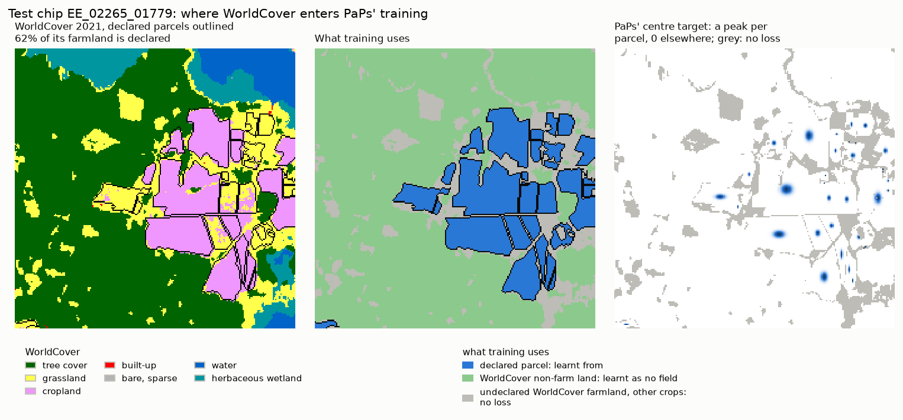

### The boundary head: mark the edges, then cut the chip along them

The boundary head is our baseline: the crop-type model of RQ1 (a per-pixel MLP on TESSERA, 0.2 M parameters) with
one more output, the probability that a pixel lies on a parcel's edge. Pixels with a low edge probability form
cores, and the cores grow until they meet, so **every pixel of the chip ends up in some field**. It is trained on the
pixels of the declared parcels only: nothing ever shows it a forest or a village.

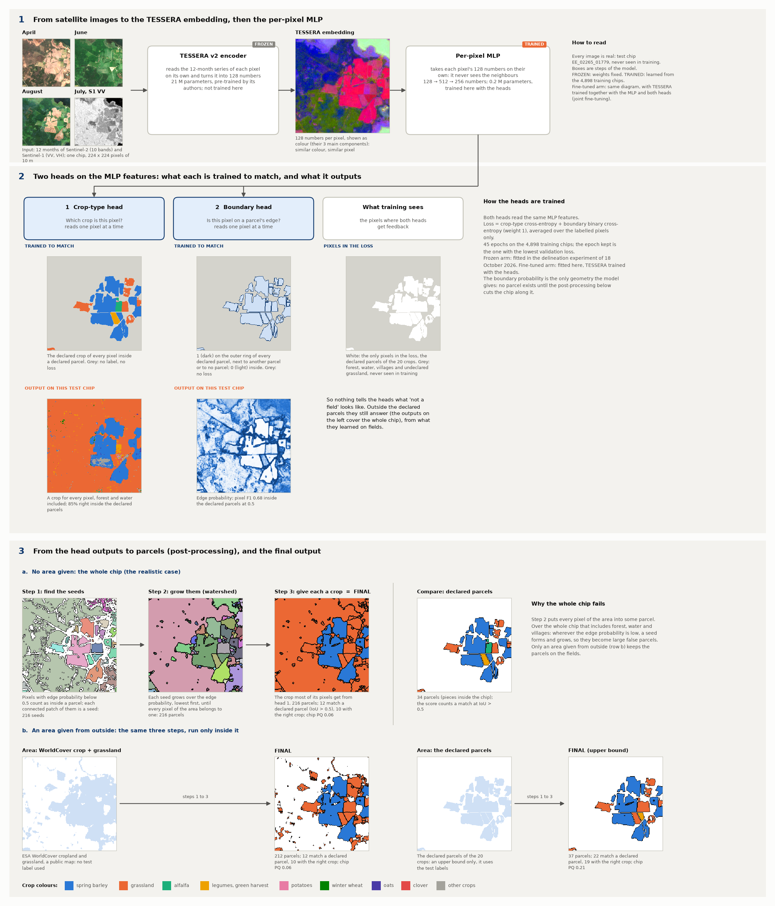

### Side by side

| | PRUE | PaPs | Boundary head |
|---|---|---|---|
| After TESSERA | U-Net, 67 M parameters | small U-Net, 1.2 M | per-pixel MLP, 0.2 M: no neighbours |
| Output | 3 classes per pixel | centre heatmap, saliency, and per centre a box, shape and crop | crop and edge probability per pixel |
| Learns "not a field" from | WorldCover's non-farm land, pixel by pixel | WorldCover's non-farm land, as "no centre" | nothing |
| A parcel is | a patch between edges | a shape drawn around a detected centre | a region between edges |
| Land with no field | stays empty | stays empty | impossible: every pixel is in a field |
| Crop of a field | majority of the RQ1 crop map | its own head, or the crop map | majority of its own crop head |

---

## 3. One chip, three methods

The same test chip through each method: `EE_02302_01815`, 129 declared parcels, the median chip for PRUE (half the
test chips with at least 20 parcels score better, half worse). Row 1 is what the model is told, row 2 what it
outputs. The panels:

1. Sentinel-2, July.
2. WorldCover with the declared parcels outlined: yellow grassland and pink cropland are the farmland, 74 % of it
   declared.
3. What training uses on a chip like this.
4. The training target.
5. and 6. Two intermediate outputs.
7. The final fields.
8. **The border check**: blue, a drawn border with a declared one within 10 m; orange, a drawn border with none;
   black, a declared border with nothing drawn within 10 m; grey, undeclared farmland, not scored.

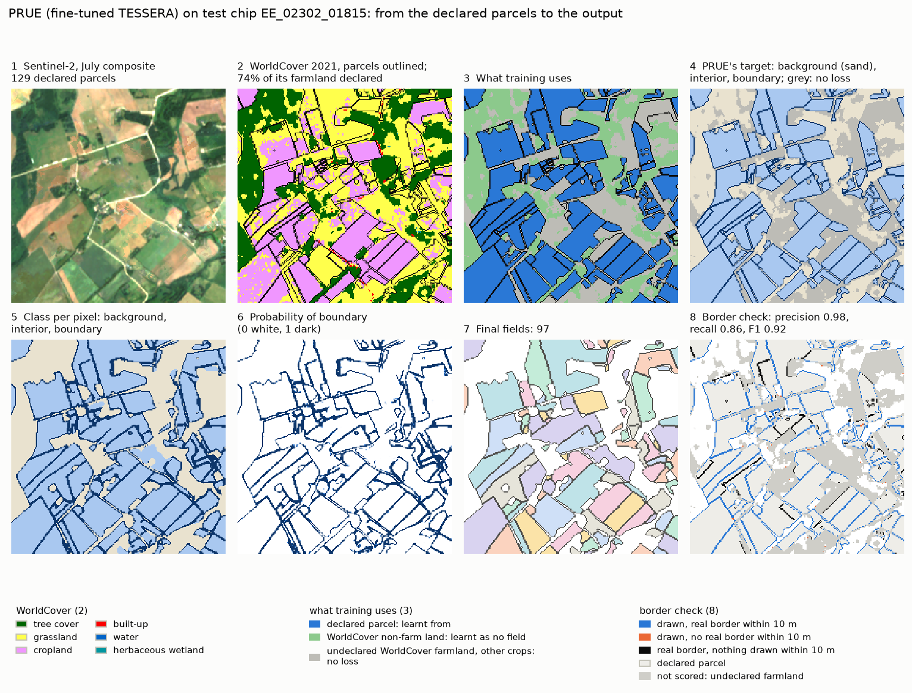

**PRUE** (fine-tuned) draws 97 fields; 56 match a declared parcel. Almost every line it draws is real (precision
0.98) and it draws 86 % of the declared borders. The few black segments lie mostly between parcels of the same crop.

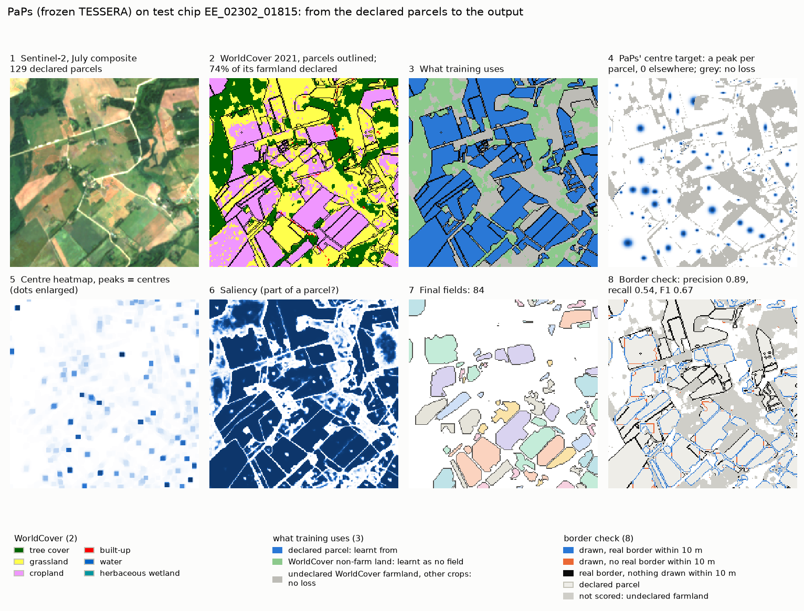

**PaPs** (frozen) draws 84 rounded parcels; 44 match. What it draws is real (0.89), but whole parcels are missing,
their borders black, even where the saliency (panel 6) covers them: no centre was found for them.

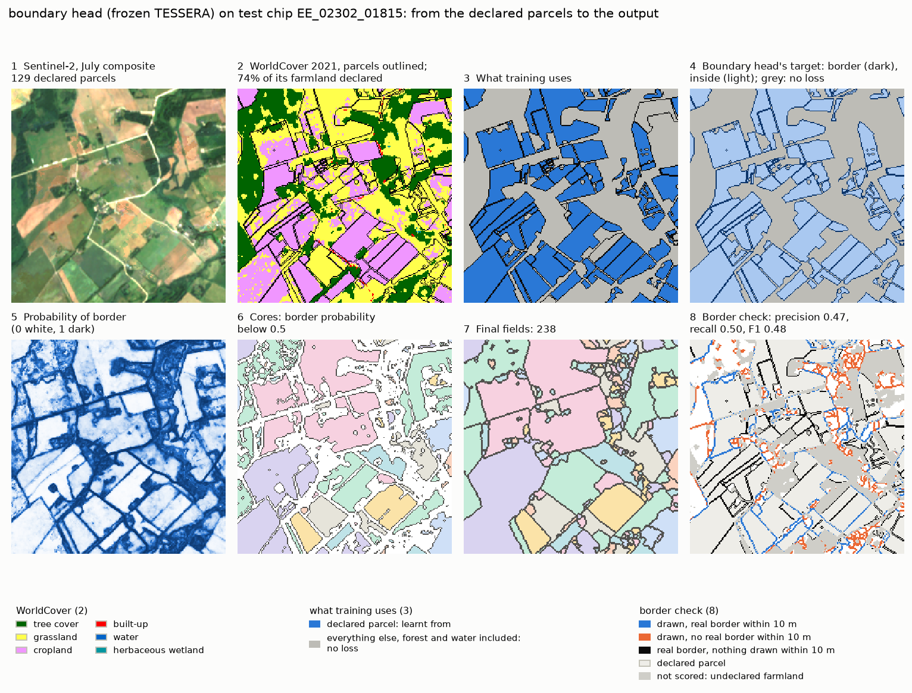

**The boundary head** (frozen) cuts the whole chip into 238 fields; 18 match. Half of the borders it draws are
false: the orange runs over the woods and the other non-farm land.

| On this chip | PRUE, fine-tuned | PaPs, frozen | Boundary head, frozen |
|---|---|---|---|
| Fields drawn (129 declared) | 97 | 84 | 238 |
| Fields matching a declared parcel | 56 | 44 | 18 |
| Border precision / recall / F1 | 0.98 / 0.86 / 0.92 | 0.89 / 0.54 / 0.67 | 0.47 / 0.50 / 0.48 |

---

## 4. How the delineation is scored

The question is the delineation alone, crop left out: does the predicted delineation match the declared one? It is
scored on the borders, as segmentation work does (the boundary F-score, Csurka et al., 2013):

1. **The real borders.** A pixel of a declared parcel is a border pixel when one of its four neighbours belongs to
   another parcel or to none: two pixels wide between neighbours, one at an outer edge.
2. **The drawn borders.** Each method's final fields, marked the same way.
3. **Precision**: the share of drawn border pixels with a real border within one pixel (10 m). **Recall**: the share
   of real border pixels with a drawn border within one pixel. **F1** combines the two.
4. **Where.** On the declared parcels and on WorldCover's non-farm land. Undeclared farmland is not scored: nobody
   says whether a field lies there.

The tolerance of one pixel accepts a border drawn one pixel beside the real one; without it, that border would count
once as false and once as missed. As a check, the declared parcels themselves score exactly 1, and every method is
scored on the same chips against the same borders.

**Whole parcels** are scored separately in the experiment reports, by panoptic quality (PQ): a predicted field and a
declared parcel match when they overlap with IoU above 0.5. That answers "is each parcel right", which one gap in a
long border can spoil.

---

## 5. Results

### 5.1 Borders

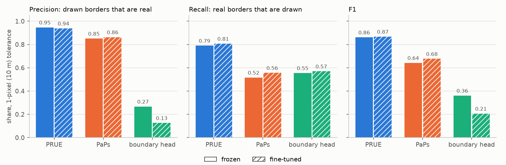

| Method | Encoder | Precision | Recall | F1 | F1, exact pixel | F1, 2 pixels |
|---|---|---|---|---|---|---|
| **PRUE** | frozen | **0.947** | **0.790** | **0.862** | 0.572 | 0.902 |
| **PRUE** | fine-tuned | 0.938 | **0.807** | **0.868** | 0.592 | 0.908 |
| PaPs | frozen | 0.851 | 0.516 | 0.642 | 0.367 | 0.727 |
| PaPs | fine-tuned | 0.863 | 0.557 | 0.677 | 0.392 | 0.758 |
| Boundary head | frozen | 0.267 | 0.555 | 0.361 | 0.175 | 0.432 |
| Boundary head | fine-tuned | 0.126 | 0.570 | 0.207 | 0.098 | 0.258 |

The ranking is the same at every tolerance. Most border errors are a shift of one pixel: going from exact to one
pixel adds about 0.3 for PRUE and PaPs, going to two pixels only 0.04 to 0.09 more.

### 5.2 Which real borders are drawn

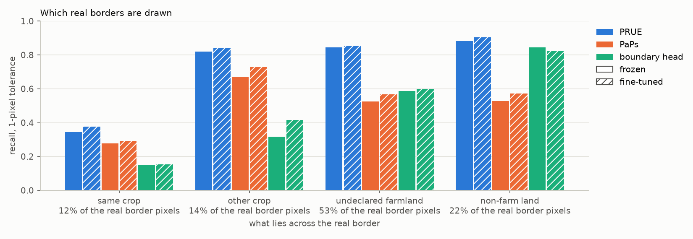

| Method | Encoder | same crop (12 %) | other crop (14 %) | undeclared farmland (53 %) | non-farm land (22 %) |
|---|---|---|---|---|---|
| PRUE | frozen | 0.344 | 0.820 | 0.845 | 0.883 |
| PRUE | fine-tuned | 0.377 | 0.841 | 0.856 | 0.905 |
| PaPs | frozen | 0.278 | 0.670 | 0.525 | 0.528 |
| PaPs | fine-tuned | 0.293 | 0.729 | 0.566 | 0.571 |
| Boundary head | frozen | 0.152 | 0.316 | 0.588 | 0.846 |
| Boundary head | fine-tuned | 0.153 | 0.415 | 0.600 | 0.823 |

Each real border pixel is typed by what lies across it; in brackets, its share of the 3.1 million real border
pixels.

* **Between two parcels of the same crop** every method fails most: PRUE draws one in three, PaPs a little fewer,
  the boundary head one in seven. Each one missed joins two parcels into one field.
* **Between different crops** PRUE draws more than four in five.
* **Outer edges** are three quarters of the real border. PRUE draws 84 to 91 % of them, PaPs about half (it leaves
  parcels out), the boundary head most of those against forest or water.

### 5.3 Where the false borders lie

| Method | Encoder | real | false, inside a declared parcel | false, on non-farm land |
|---|---|---|---|---|
| PRUE | frozen | 0.947 | 0.036 | 0.017 |
| PRUE | fine-tuned | 0.938 | 0.041 | 0.021 |
| PaPs | frozen | 0.851 | 0.114 | 0.035 |
| PaPs | fine-tuned | 0.863 | 0.108 | 0.028 |
| Boundary head | frozen | 0.267 | 0.005 | 0.728 |
| Boundary head | fine-tuned | 0.126 | 0.003 | 0.871 |

Shares of the drawn border. PRUE rarely cuts a parcel (4 %). PaPs' false borders lie inside parcels (11 %), likely
where its rounded shapes miss the corners. The boundary head's lie on forest, water and villages.

### 5.4 Chip by chip

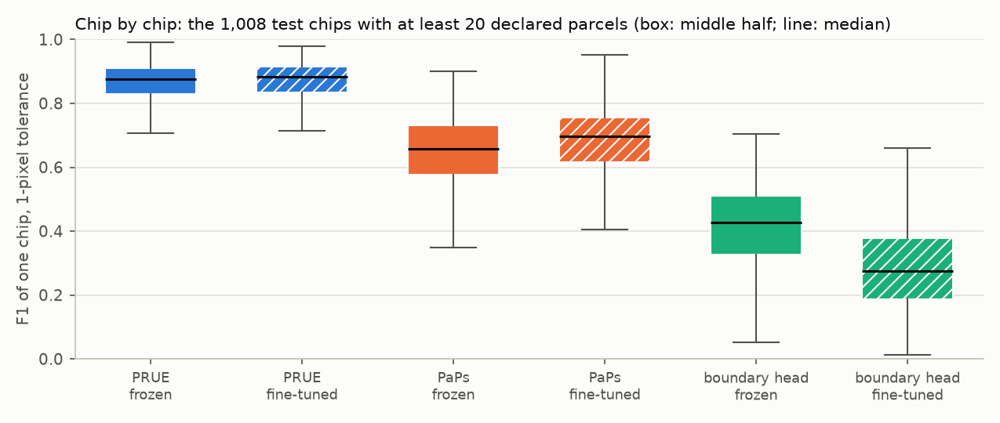

| Method | Encoder | median F1 | middle half |
|---|---|---|---|
| PRUE | frozen | 0.875 | 0.828 to 0.910 |
| PRUE | fine-tuned | 0.882 | 0.834 to 0.915 |
| PaPs | frozen | 0.659 | 0.578 to 0.731 |
| PaPs | fine-tuned | 0.696 | 0.616 to 0.757 |
| Boundary head | frozen | 0.428 | 0.326 to 0.510 |
| Boundary head | fine-tuned | 0.275 | 0.188 to 0.379 |

On the 1,008 test chips with at least 20 declared parcels, PRUE is above PaPs on 99.4 % (frozen) and 99.2 %
(fine-tuned), with the narrowest spread.

### 5.5 Whole parcels, from the experiment reports

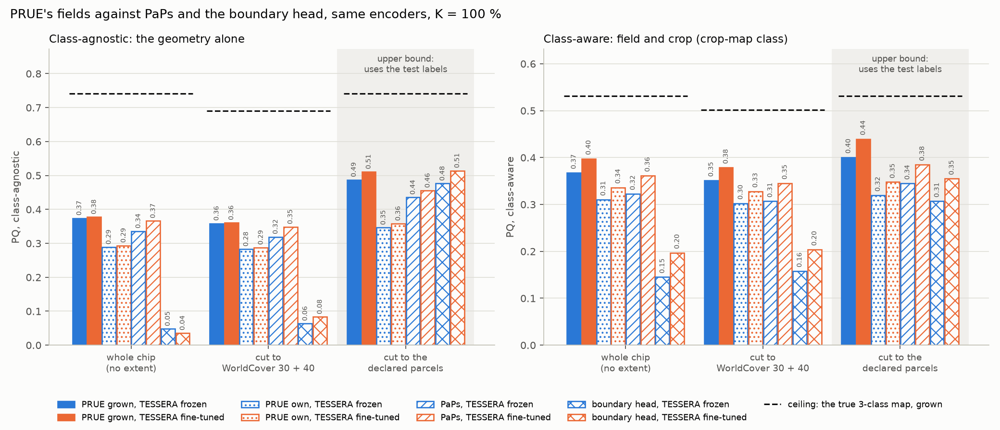

Here colour is the encoder (blue frozen, orange fine-tuned) and hatching the method; the dashed line is the most PRUE's
post-processing can reach, given the true three-class map.

| Method | PQ, crop ignored (frozen / fine-tuned) | PQ with the crop | PQ, given the declared parcels (upper bound) | Fields drawn |
|---|---|---|---|---|
| PRUE, grown | **0.374 / 0.378** | **0.367 / 0.397** | 0.487 / 0.511 | 47,264 / 51,949 |
| PRUE, its own fields | 0.289 / 0.294 | 0.310 / 0.336 | 0.346 / 0.358 | 47,229 / 51,911 |
| PaPs | 0.336 / 0.366 | 0.322 / 0.361 | 0.435 / 0.455 | 47,996 / 43,836 |
| Boundary head | 0.048 / 0.036 | 0.145 / 0.197 | 0.476 / 0.514 | 351,664 / 535,011 |

Over the whole chip, against 55,575 declared parcels. "With the crop": PRUE and PaPs fields take the crop of the RQ1
crop map, the boundary head its own crop head.

* **PRUE leads on whole parcels too, but by less**, and only with the step that grows its fields back over their
  edge ring (its own fields score 0.29).
* **Given the declared parcels**, the boundary head is as good as PRUE: its edges inside farmland are fine; what it
  lacks is knowing where farmland ends.
* **Cutting the fields to WorldCover's farmland afterwards** lowers PRUE and PaPs slightly and helps the boundary
  head only a little (0.048 to 0.063, 0.036 to 0.083): PRUE and PaPs already learnt WorldCover's non-farm land in
  training, and WorldCover separates no fields.

### 5.6 More examples

Four test chips picked by a fixed rule among those with at least 20 declared parcels: PRUE's (frozen) border F1 at
its 90th, 50th and 10th percentile, and the chip where PaPs beats PRUE most. Frozen encoders; the fine-tuned
versions are `figures/example_<n>_ft.png`. Row 1: Sentinel-2, WorldCover with the declared parcels outlined, the
declared parcels by crop, the declared borders; rows 2 to 4: one method each, its two intermediate outputs, its
fields and its border check (colours as in section 3).

**1. PRUE at its 90th percentile: large fields.** EE_02327_01812, 68 parcels. PRUE draws almost every border (0.98,
0.89, F1 0.94). PaPs (F1 0.63) leaves the largest parcels out: the saliency covers them, but no centre is found. The
boundary head (0.55) draws borders in and around the forest.

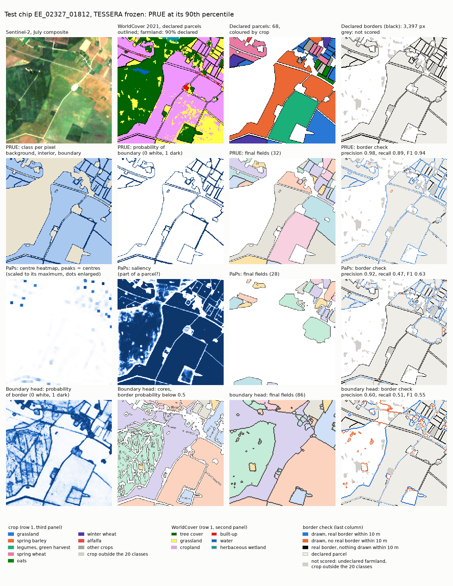

**2. PRUE at its median: a dense mosaic.** EE_02302_01815, 129 parcels, the chip of section 3 (frozen PRUE here,
F1 0.88). What PRUE misses lies inside blocks of grassland parcels. 74 % of the farmland is declared; the undeclared
rest lies in strips between the parcels.

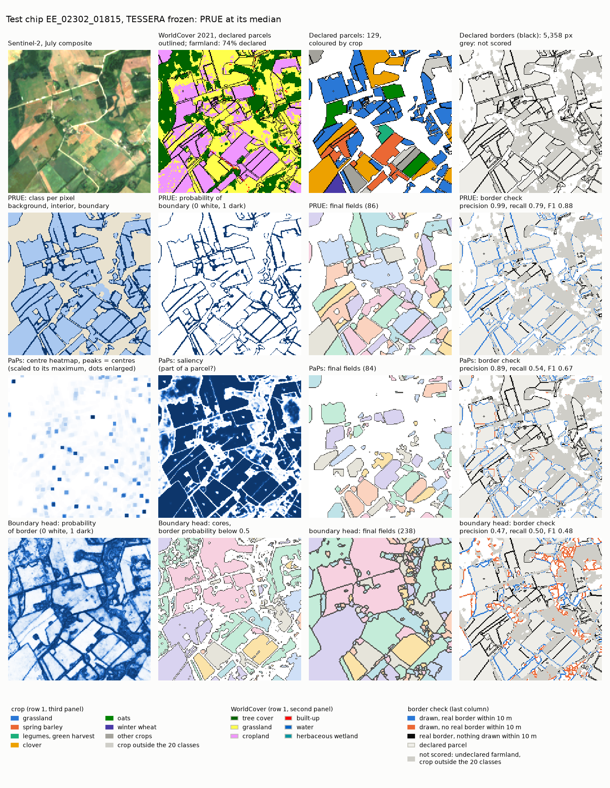

**3. PRUE at its 10th percentile: grassland blocks.** EE_02263_01778, 46 parcels. On the right, a block of adjacent
grassland parcels: all three draw its outline but few borders inside it (PRUE F1 0.75, PaPs 0.67). The boundary head
fills the woodland with borders (0.19). Only 57 % of the farmland is declared.

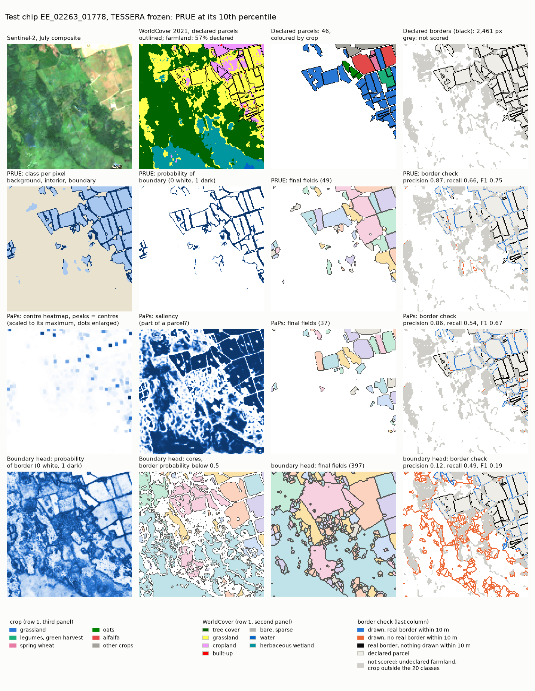

**4. Where PaPs beats PRUE most: little farmland.** EE_02270_01785, 20 parcels; WorldCover calls most of the chip
water. PRUE draws fields on an undeclared grassland strip; their insides are not scored, but their edges run onto
the wetland beside it and count as false (F1 0.49, PaPs 0.62). If the strip is a field, those borders are real. Such
chips are rare.

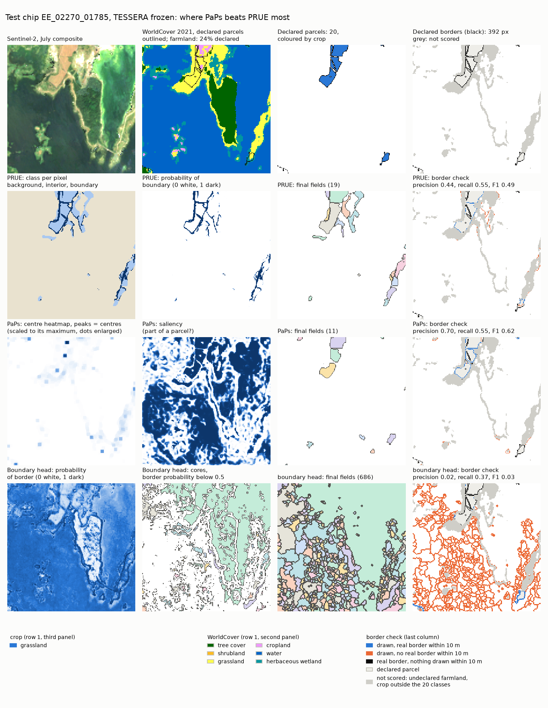

---

## 6. Limitations

### 6.1 Of each method

* **PaPs: no centre, no parcel.** A parcel exists only if a centre is detected. It finds 40 to 41 % of the declared
  parcels and leaves 43 to 45 % mostly uncovered, large ones included (above 10 ha it finds 42 to 57 %, PRUE 84 to
  85 %). Its rough 16 x 16 shapes round the corners off.
* **Boundary head: no notion of "not a field".** Trained on declared parcels only, it cuts every pixel of the chip
  into fields; 73 to 87 % of its drawn border lies on non-farm land. It is also the only method without spatial
  context (one pixel at a time), so it is a baseline rather than a rival on geometry.
* **PRUE: same-crop borders.** It draws 34 to 38 % of the borders between two parcels of the same crop, so those
  parcels merge: 39 % of the declared parcels end up merged with a neighbour. It also draws fields on undeclared
  farmland (57 to 61 % of its false parcels lie there), which may be real fields. And its parcels need the step we
  added; PRUE's own fields score below PaPs on whole parcels.

### 6.2 Of the comparison

**How much of the border score is real separation.** Three checks on the same chips (`robustness.py`):

| Fields | F1 | F1, strict | Recall on borders between parcels |
|---|---|---|---|
| PRUE, frozen | 0.862 | 0.797 | 0.598 |
| PRUE, fine-tuned | 0.868 | 0.791 | 0.624 |
| PaPs, frozen | 0.642 | 0.596 | 0.487 |
| PaPs, fine-tuned | 0.677 | 0.638 | 0.525 |
| Boundary head, frozen | 0.361 | 0.370 | 0.240 |
| Boundary head, fine-tuned | 0.207 | 0.245 | 0.292 |
| PRUE's field area, nothing split (frozen) | 0.700 | 0.642 | 0.167 |
| WorldCover farmland, nothing split | 0.550 | 0.343 | 0.115 |

* **Knowing where farmland ends earns most of the score.** Three quarters of the real border pixels are outer edges.
  PRUE's field area with no field split already scores 0.70; separating the parcels adds 0.16.
* **On the borders that separate two parcels**, the actual delineation job, PRUE draws 60 to 62 %, PaPs 49 to 53 %.
* **Strict scoring.** If every border drawn on undeclared farmland counts as false, PRUE's precision falls from
  0.95 to 0.78 to 0.80 and its F1 to 0.79 to 0.80; PaPs' F1 to 0.60 to 0.64. The truth lies in between, since some of
  that land is farmed. The ranking holds.

**The labels.**

* **The declared parcels are the truth.** Some declared borders are invisible at 10 m in every month (two parcels of
  the same crop farmed alike, an administrative split), and some visible borders are not declared.
* **Every declared edge is taught as a border.** Half the real border (53 %) is a declared parcel's edge against
  undeclared farmland. If a farmer declared only part of a field, that edge is not visible. It seems rare: PRUE draws
  85 % of these edges, nearly as many as of the edges against forest or water (88 %).
* **WorldCover decides what "not a field" is** for PRUE and PaPs. Its errors are not measured; 3.5 to 4.7 % of the
  declared parcel pixels lie on land it calls non-farm.
* **The parcel score treats the chip as complete.** PQ, and the validation scores that chose the checkpoints of PRUE
  and PaPs, count a field on undeclared farmland as false. That penalises PRUE most. The border score leaves that land
  out, apart from the edges of such fields that run onto non-farm land (example 4).

**The runs.**

* **One fit per method**: one draw, one seed, K = 100 %, one country. No interval. On borders PRUE's lead (0.2 F1,
  99 % of the chips) is far beyond what a seed is likely to move; on whole parcels its lead over fine-tuned PaPs
  (+0.012 PQ) is not.
* **The fine-tuning differs**: PRUE's encoder was trained end to end with it (28 h, against 0.6 h frozen); PaPs'
  was fine-tuned on crop type and then frozen; the boundary head's was trained with both heads.
* **The methods were not tuned alike**: each kept its own recipe (epochs, loss, checkpoint rule), as published or,
  for the boundary head, as in the main workflow.

---

## 7. Next steps

1. **Three seeds of frozen PRUE**, and of frozen PaPs: an interval for the comparison, at about half an hour per PRUE
   fit.
2. **The same-crop borders**: cut PRUE's fields at a boundary threshold below the argmax, tuned on the validation
   chips; `borders.py` measures the effect on these borders directly.
3. **How many missed same-crop borders are visible**: a look at a sample on the monthly composites tells how much of
   the gap is the imagery.
4. **PQ with undeclared farmland as void**, so that a field nobody declared is neither right nor wrong.
5. **A second country** once Latvia's chips are exported.

## Reproduce

    poetry run python experiments/2026-11-07_border_accuracy/borders.py --chips EE_2021_rev --workers 12
    poetry run python experiments/2026-11-07_border_accuracy/landcover.py --chips EE_2021_rev --workers 12
    poetry run python experiments/2026-11-07_border_accuracy/robustness.py --chips EE_2021_rev --workers 12
    poetry run python experiments/2026-11-07_border_accuracy/report.py --chips EE_2021_rev
    poetry run python experiments/2026-11-07_border_accuracy/walkthrough.py --chips EE_2021_rev

They write `borders.json`, `per_chip.npz`, `landcover.npz` and `robustness.json` in
`results/2026-11-07_border_accuracy/EE_2021_rev/`, the figures and `figures/tables.md` here, and the WorldCover and
one-chip figures into the three experiments' `figures/`. The architecture diagrams and `pq_bars.png` come from the
experiments' own scripts (see their reports).
