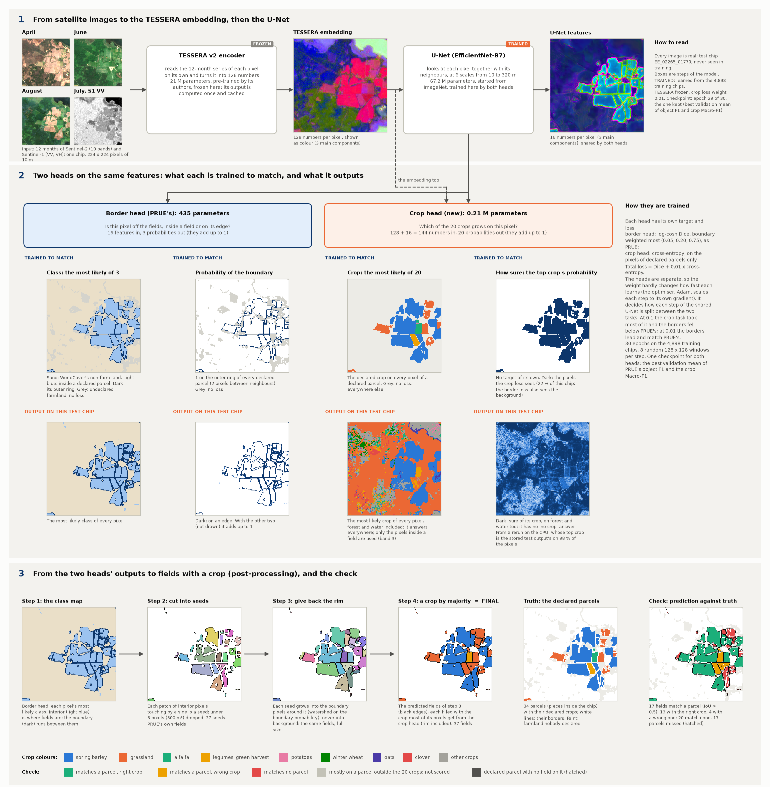
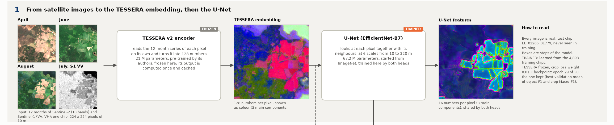
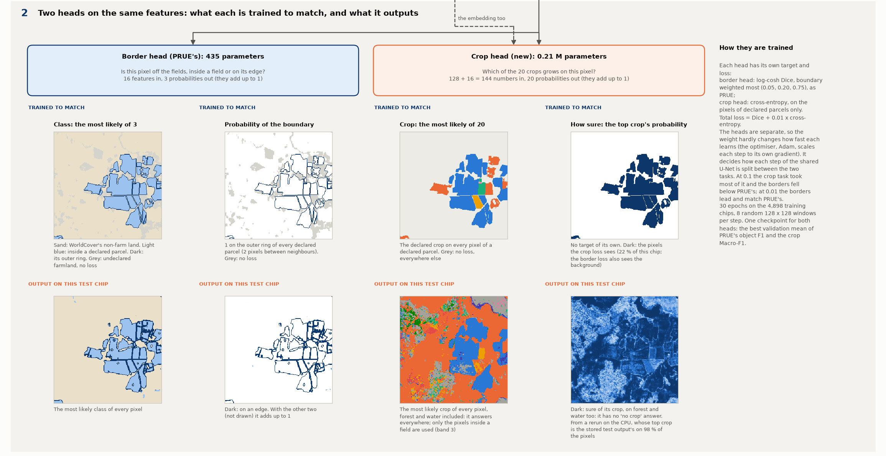
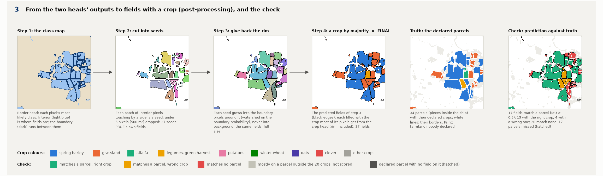
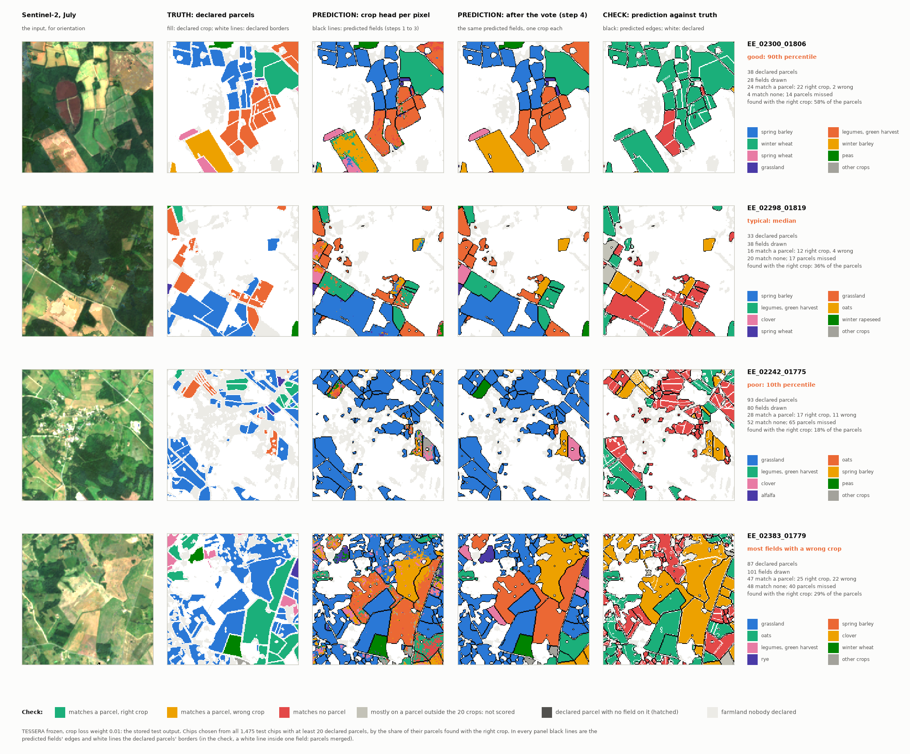

# One model for crop types and field borders: the architecture, step by step

**In one sentence.** One network reads the TESSERA embedding and answers two questions for every pixel: with
PRUE's border head, *is this pixel off the fields, inside a field or on its edge?*, and with a crop head beside it,
*which of the 20 crops grows here?* The fields come from the first answer, exactly as in PRUE, and each field takes
the crop most of its pixels get from the second.

> **Checkpoint.** The diagram uses the frozen arm with the crop loss weighted 0.01 (`joint_tessera_v2_frozen_cw001`),
> its kept checkpoint, **epoch 29 of 30** (job 699157, finished 8 November 2026). This is the arm that matches both
> separate models; the scores are at the end of this note and in [README.md](README.md). The fine-tuned arm is still
> training; `architecture.py --arm joint_tessera_v2_ft_cw001` draws the same figures from it once it is done.

**Every image is real.** They come from the test chip of the [PRUE](../2026-11-06_prue_tessera/ARCHITECTURE.md),
[PaPs](../2026-11-05_paps_tessera/ARCHITECTURE.md) and [boundary head](../2026-11-05_parcel_extent/ARCHITECTURE.md)
diagrams, `EE_02265_01779`: 34 declared parcels (counted as the pieces inside the chip), never seen in training.
Everything that was scored (both heads' maps, the fields, their crops and the check) is read from the arm's stored
test output, so the figures show exactly what the test scores were computed from. What the test output does not
store (the embedding, the U-Net's features and the crop head's probabilities) comes from a rerun of the checkpoint
on the hub's CPU; the rerun gives the same class as the stored output on 99.94 % of the pixels for the border head
and the same crop on 97.97 % (the cluster runs in bfloat16, the rerun in float32).

**The chain in one line:**

    Sentinel-2 + Sentinel-1, 12 months  →  TESSERA encoder (frozen)  →  128 numbers per pixel  →  U-Net (trained)
      →  16 features per pixel  ┬→  border head: 3 probabilities per pixel  ┐
         + the 128 numbers  ────┴→  crop head:  20 probabilities per pixel  ┴→  post-processing  →  fields, each with a crop

The diagram has three parts, shown larger below. First, what a head is.

---

## What a head is

A network has two parts. The **body** does almost all the work: it turns the input into features, numbers per pixel
that describe it. Here the body is PRUE's U-Net (67.2 M parameters) and its output is 16 numbers per pixel. A
**head** is the small last layer that turns those features into the answer to **one question**. It has its own
target (the right answer it is compared with) and its own loss (how far it is from that answer). Training lowers the
losses, and their gradients flow back through each head into the shared body.

One head can give several numbers. PRUE's question has three possible answers, of which a pixel is exactly one
(background, interior or boundary), so its head gives three numbers per pixel that a softmax turns into probabilities
adding up to 1. That is **one head with three outputs**, trained against one target map whose pixels carry one of
three labels, with one loss. PRUE's own note draws each of the three probabilities as its own image, and builds the
target from two sources (WorldCover for the background, the declared parcels for the rest), but there is one head.

A network gets a second head when it asks a **different kind of question**, one that is not another option of the
same answer. A pixel can be "inside a field" *and* "wheat": those are two answers, so the crop type needs its own
head.

| Model | Heads | Questions |
|---|---|---|
| PRUE | 1 | what part of a field is this pixel? (3 options) |
| **Joint model** | **2** | the same, and which crop grows here? (20 options) |
| PaPs | 5 | is this a parcel's centre, how big and what shape is the parcel, which crop is it, and how certain is the centre |

---

## Part 1. From satellite images to features

1. **Input.** One chip of 224 x 224 pixels of 10 m. Each pixel has 12 monthly Sentinel-2 images (10 bands) and 12
   monthly Sentinel-1 radar images (VV and VH).
2. **TESSERA encoder (frozen).** The pre-trained TESSERA v2 Medium (21 M parameters) reads **one pixel at a time**
   and gives **128 numbers**. In this arm it is not trained: its output is computed once for every chip and cached,
   as in the main workflow.
3. **The embedding**, shown as colour (its 3 main directions of variation). The fields already stand out from the
   forest around them.
4. **U-Net (trained).** PRUE's network: an EfficientNet-B7 encoder that looks at each pixel together with its
   neighbours at 6 scales from 10 to 320 m, and a decoder that brings the result back to 10 m. 67.2 M parameters,
   started from ImageNet weights. It is trained by **both** heads' losses.
5. **U-Net features.** 16 numbers per pixel before the heads. Field edges are already drawn in them. Both heads read
   them.

---

## Part 2. Two heads on the same features

The left half is PRUE's border head, the right half the crop head. In each column the **upper** image is what the
head is **trained to match** (drawn for this chip, for comparison) and the **lower** image what it **outputs** on
this test chip.

| | Border head (PRUE's) | Crop head (new) |
|---|---|---|
| Question | is this pixel off the fields, inside a field or on its edge? | which of the 20 crops grows on this pixel? |
| Reads | the U-Net's 16 features | the same 16 features **and** TESSERA's 128 numbers, 144 per pixel |
| Layers | one 3 x 3 convolution: **435 parameters** | the main workflow's per-pixel MLP: two layers of 512 and 256, each with ReLU, batch norm and dropout 0.2, then a layer to 20: **0.21 M parameters** |
| Gives | 3 probabilities per pixel, adding up to 1 | 20 probabilities per pixel, adding up to 1 |
| Trained to match | **background**: WorldCover's non-farm land; **interior**: the pixels of a declared parcel except its outer ring; **boundary**: that ring, so two pixels between neighbours | the declared crop on every pixel of a declared parcel |
| Pixels without a loss | undeclared WorldCover grassland and cropland, parcels of crops outside the 20 classes | everything off the declared parcels (78 % of this chip) |
| Loss | log-cosh Dice, boundary weighted most (0.05, 0.20, 0.75), as PRUE | cross-entropy, as the main workflow |

The crop head reads TESSERA's 128 numbers directly, so it keeps the per-pixel evidence of the main workflow's crop
map, and the U-Net's 16 features, which add the neighbourhood: what the field around the pixel looks like.

**What to notice in the outputs:**

* **Border head**: the same picture as PRUE's: forest and water confidently background, the declared fields filled
  with interior, a thin boundary between neighbours.
* **Crop head, top crop**: it answers on **every** pixel, forest and water included, where it calls most pixels
  grassland. It was only ever trained on declared parcels, so it has no "no crop" answer. This does no harm: the
  border head decides where the fields are, and only the pixels inside a field are used (Part 3).
* **Crop head, how sure**: dark almost everywhere, on the forest too. A high probability says the crop head is sure,
  not that it is right; off the fields it is sure about land it was never told anything about.

**Training.** The total loss is **log-cosh Dice + 0.01 x cross-entropy**. The weight needs explaining:

* The two **heads** are separate, so each learns from its own loss alone. The optimiser, AdamW, scales each
  parameter's step by the typical size of that parameter's own gradient, so multiplying the crop loss by 0.1 or 0.01
  hardly changes how fast the crop head learns.
* The **U-Net** is shared: each of its weights receives the sum of both losses' gradients, and AdamW rescales that
  sum to a step of roughly fixed size. The weight therefore decides **how each step of the U-Net is split** between
  "better borders" and "better crop types".
* The raw losses differ in scale: the cross-entropy over 20 classes gives large, persistent gradients, PRUE's
  Dice-type loss small ones. At **0.1** the crop loss pulled on the U-Net 1.4 to 9.8 times as hard as the border loss
  (median 3.6), the crop task took most of the U-Net, and the borders fell below PRUE's (F1 at 1 px 0.844 against
  0.862). At **0.01** its pull is 0.06 to 0.9 times the border loss's: the border task leads, and the borders match
  PRUE's (0.861).

Everything else is PRUE's recipe: 30 epochs on the 4,898 training chips, batches of 8 random 128 x 128 windows with
flips and rotations, the U-Net at a learning rate of 0.003 (AdamW with amsgrad, cosine schedule), the crop head at
the main workflow's 0.001 (weight decay 0.05). **One model, one checkpoint**: after every epoch the validation
chips are scored for both tasks, and the epoch kept is the one with the best mean of PRUE's object F1 (its fields
against the declared parcels) and the crop pixel Macro-F1.

---

## Part 3. From the two heads' outputs to fields with a crop

A plain crop map tells *what* is at each pixel. The output here also tells *which one*: every pixel either belongs
to exactly one numbered field, with that field's one crop, or to no field. Two neighbouring wheat parcels are two
fields that both say wheat, not one blob of wheat. Four steps make it (`prue.parcels`, variant `grow`, and
`panoptic_x.vote`). **Steps 1 to 3 use only the border head and decide where the fields are; step 4 is the only
place the crop head comes in, and it decides what grows in each.**

1. **The class map.** Each pixel takes the most likely of its three classes.
2. **Cut into seeds.** Each patch of interior pixels that touch **by a side** is one seed (pixels touching only by a
   corner do not join). Patches under 5 pixels (500 m²) are dropped as noise. These seeds are PRUE's own fields, as
   PRUE publishes them. On this chip: 37 seeds.
3. **Give back the rim.** A seed is one ring smaller than the real parcel, because the boundary class took that
   ring. So each seed grows into the boundary pixels around it: a watershed on the boundary probability. Think of
   the boundary probability as a landscape, interiors as valleys and boundaries as ridges; water poured into each
   seed rises and floods the boundary pixels around it, and where the water of two seeds meets, at the top of the
   ridge, is the line between their fields. Background pixels are a wall: a field never grows into them. A dropped
   patch is flooded by the seed it touches, or stays empty. This step is our addition to PRUE; it changes no
   field's existence, only its size.
4. **A crop by majority.** Each pixel of a field takes its top crop from the crop head, and the crop most of the
   field's pixels get wins (its rim included; a tie goes to the lower class index). **This is the final output**:
   37 fields on this chip.

**A made-up example**, to see the steps at work: a column of forest, then parcel A (wheat) and parcel B (barley),
each 6 x 6 pixels (60 x 60 m). `-` background, `i` interior, `b` boundary:

    Step 1, class map             Step 2, seeds                 Step 3, grown fields
    - b b b b b b b b b b b b     . . . . . . . . . . . . .     . 1 1 1 1 1 1 2 2 2 2 2 2
    - b i i i i b b i i i i b     . . 1 1 1 1 . . 2 2 2 2 .     . 1 1 1 1 1 1 2 2 2 2 2 2
    - b i i i i b b i i i i b     . . 1 1 1 1 . . 2 2 2 2 .     . 1 1 1 1 1 1 2 2 2 2 2 2
    - b i i i i b b i i i i b     . . 1 1 1 1 . . 2 2 2 2 .     . 1 1 1 1 1 1 2 2 2 2 2 2
    - b i i i i b b i i i i b     . . 1 1 1 1 . . 2 2 2 2 .     . 1 1 1 1 1 1 2 2 2 2 2 2
    - b b b b b b b b b b b b     . . . . . . . . . . . . .     . 1 1 1 1 1 1 2 2 2 2 2 2

Seed 1 has 16 pixels against parcel A's 36, an overlap (IoU) of 0.44: below the 0.5 the score needs, it would count
as a miss although it sits in the right place. After step 3 field 1 covers all 36 pixels. In step 4, field 1's
pixels say 31 wheat, 4 barley (rim pixels next to B, mixed) and 1 oats, so field 1 is wheat; field 2 is barley.

**What step 2 needs, and what it cannot do.** A seed does not need boundary pixels all around it: any pixel that is
not interior separates two seeds (boundary, background, or the chip's edge), so a field next to a forest needs no
boundary at all. But nothing closes a broken border. One interior pixel where the border should be joins the two
sides into one seed, and steps 3 and 4 cannot split it again:

    - b i i i i b b i i i i b
    - b i i i i i i i i i i b     ← a gap in the border: one seed, one field, one crop for both parcels

A merged field covers both parcels, so it overlaps each by about a half and matches neither. The crop vote cannot
help either. This merge is PRUE's main error, mostly between two parcels of the same crop whose border is invisible
at 10 m.

**How the result is checked** (`score_joint.py`, as for the separate models). Each field is compared with the
declared parcels, as pieces inside the chip. A field **matches** a parcel when they overlap at IoU above 0.5 (each
parcel and field can match once). A matched field has the **right crop** when its voted crop is the declared one. A
field that matches nothing is a **false field**, wherever it lies (including on farmland nobody declared), except a
field lying mostly on a parcel of a crop outside the 20 classes, which is not scored. The class-agnostic PQ counts
the matches; the class-aware PQ needs the right crop too, and averages over the crops.

**On this chip.** 37 fields for 34 declared parcels. 17 fields match a parcel: 13 with the right crop, 4 with a wrong
one (two alfalfa parcels voted green-harvest legumes or grassland, a green-harvest legume parcel and a spring barley
parcel voted grassland). 20 match none: 8 lie mostly on farmland nobody declared, 4 are merges of two or three
parcels of the same crop (a white line, a declared border, inside one red field), and the rest cover a parcel only
in part. 17 parcels are missed.

---

## Real examples to check the results

Four test chips, chosen from all 1,475 by one number, the share of their declared parcels found with the right crop,
among the chips with at least 20 parcels: the 90th percentile, the median, the 10th percentile, and the chip with
most fields matched with a wrong crop. **In every panel, black lines are the edges of the predicted fields and white
lines the borders of the declared parcels.** The columns of each row:

1. **Sentinel-2, July**: the input, for orientation.
2. **Truth: the declared parcels**, each filled with its declared crop, their borders in white. Faint: farmland
   nobody declared. Nothing the model drew is in this panel.
3. **Prediction: the crop head, pixel by pixel**, inside the predicted fields (black edges, from steps 1 to 3). This
   is what the vote counts: the scattered colours inside one field are pixels that disagree with the rest.
4. **Prediction after the vote (step 4)**: the same predicted fields, each now one colour, the crop most of its pixels
   got. This is the final output.
5. **Check: prediction against truth.** Each predicted field coloured by how it fares against the declared parcels
   (legend below the figure), with both sets of lines: a white line inside one black-edged field means two declared
   parcels came out as one field.

| Chip | Chosen as | Parcels | Fields | Match a parcel | Right crop | Wrong crop | Match none | Parcels missed |
|---|---|---|---|---|---|---|---|---|
| EE_02300_01806 | good: 90th percentile | 38 | 28 | 24 | 22 | 2 | 4 | 14 |
| EE_02298_01819 | typical: median | 33 | 38 | 16 | 12 | 4 | 20 | 17 |
| EE_02242_01775 | poor: 10th percentile | 93 | 80 | 28 | 17 | 11 | 52 | 65 |
| EE_02383_01779 | most fields with a wrong crop | 87 | 101 | 47 | 25 | 22 | 48 | 40 |

What they show:

1. **Good** (`EE_02300_01806`, 58 % of its parcels found with the right crop). Large arable parcels with visible
   borders. The vote does its job: the winter barley field at the bottom left has scattered pixels of other crops
   (third panel), and the field still comes out winter barley. Its two wrong crops are spring cereals (a spring wheat
   parcel voted spring barley, an oats parcel voted spring wheat). Of its 4 false fields, the large one (red) holds
   three green-harvest legume parcels with invisible borders between them; the other three are small.
2. **Typical** (`EE_02298_01819`, 36 %). The large spring barley block at the bottom comes out as one field over six
   declared parcels (white lines inside the red field): its crop is right, but it matches none of them. 13 of its 20
   false fields are the small red fields on the faint land: fields drawn on farmland nobody declared, which the score
   counts as false. Its 4 wrong crops: two grassland parcels voted green-harvest legumes, two spring barley parcels
   voted oats.
3. **Poor** (`EE_02242_01775`, 18 %). A grassland landscape around a village. Of its 52 false fields, 34 lie mostly
   on farmland nobody declared (the faint land around the village) and 12 are merges, one of them over ten declared
   parcels (red, with white lines inside): two grasslands side by side rarely show a border. All 17 of its right
   crops are grassland; its oats parcels (top left) all come out another crop (spring barley, peas or grassland),
   7 of its 11 wrong crops.
4. **Most wrong crops** (`EE_02383_01779`, 22 of 47 matched fields with a wrong crop). The field geometry is
   reasonable, but 9 of its oats parcels come out spring barley, 6 green-harvest legume parcels another crop, and two
   of its largest grassland parcels come out clover and spring barley. In the crop head's pixels (third panel) those
   fields are already mostly the wrong crop, so the vote picks it. **The vote removes scattered errors, not
   systematic ones**: when most of a field's pixels carry the same wrong crop, the vote confirms it.

---

## The results over all test chips

Frozen TESSERA, K = 100 %, 1,475 test chips, 55,575 declared parcels. Each head is scored as its separate model
was: the crop map per pixel and per declared parcel (each declared parcel takes the crop most of its pixels get),
the fields by their borders and PQ.

| | Crop map: pixel / parcel Macro-F1 | Borders: P / R / F1 at 1 px | PQ class-agnostic | PQ class-aware | Matched fields with the right crop |
|---|---|---|---|---|---|
| Two separate models: the main workflow's MLP and PRUE | 0.618 / 0.602 | 0.947 / 0.790 / 0.862 | 0.374 | 0.367 | 81.6 % |
| Joint model, crop loss weight 0.1 | 0.639 / 0.608 | 0.937 / 0.768 / 0.844 | 0.347 | 0.352 | 82.8 % |
| **Joint model, crop loss weight 0.01** | **0.624 / 0.604** | **0.940 / 0.795 / 0.861** | 0.366 | **0.370** | 82.3 % |

At 0.01 one model matches the two: the crop map slightly above the separate MLP, the borders level with PRUE's, the
class-agnostic PQ 0.008 lower (it draws a few more fields, 50,680 against 47,264) and the class-aware PQ 0.003
higher.

**Field by field** (`figures/architecture_tables.md`, recomputed from the stored test output and equal to
`results.json`): 50,680 fields are scored; 23,948 match a declared parcel, 19,711 of them with the right crop
(82.3 %) and 4,237 with a wrong one; 26,732 match none. So 35.5 % of all declared parcels are found with the right
crop. The geometry is the larger limit (57 % of the parcels are not matched by any field); the crop costs one matched
field in six.

**Which crops go wrong.** The crop of the matched fields, per declared crop:

| Declared crop | Matched fields | Right crop | Most frequent wrong crop |
|---|---|---|---|
| grassland | 9,630 | 96 % | legumes, green harvest (4 %) |
| winter wheat | 2,772 | 97 % | spring barley (1 %) |
| legumes, green harvest | 2,085 | 46 % | grassland (46 %) |
| spring barley | 2,023 | 87 % | oats (6 %) |
| winter rapeseed | 1,187 | 98 % | winter wheat (1 %) |
| oats | 1,167 | 64 % | spring barley (20 %) |
| spring wheat | 1,150 | 54 % | spring barley (27 %) |
| clover | 1,127 | 42 % | legumes, green harvest (26 %) |
| peas | 669 | 91 % | spring barley (3 %) |
| winter barley | 488 | 84 % | winter wheat (14 %) |
| beans | 338 | 86 % | peas (5 %) |
| alfalfa | 252 | 7 % | legumes, green harvest (54 %) |
| rye | 250 | 62 % | winter wheat (25 %) |
| spring rapeseed | 209 | 78 % | peas (9 %) |
| buckwheat | 201 | 87 % | oats (5 %) |
| grain maize | 166 | 97 % | beans (1 %) |
| potatoes | 133 | 77 % | grassland (9 %) |
| dried pulses | 82 | 0 % | grassland (39 %) |
| orchards | 10 | 0 % | grassland (90 %) |
| vegetables | 9 | 0 % | grassland (44 %) |

The errors fall in two families, the same as in the crop map pixel by pixel: the **grass-like crops** (green-harvest
legumes, clover and alfalfa against grassland and each other; green-harvest legumes voted grassland alone are 22 % of
all wrong crops) and the **spring cereals** among themselves (spring wheat and oats voted spring barley, 13 %). The
majority vote cannot separate them, because within such a field most pixels already carry the wrong crop.

---

## How the joint model differs from the two separate models

| | Two separate models | Joint model |
|---|---|---|
| Networks | the main workflow's per-pixel MLP for crop types, and PRUE's U-Net for borders | one U-Net with two heads |
| Parameters trained | 0.2 M (MLP) + 67.2 M (PRUE) | 67.2 M (U-Net) + 0.21 M (crop head) |
| Crop head reads | TESSERA's 128 numbers, pixel by pixel | TESSERA's 128 numbers and the U-Net's 16 features, which bring the neighbourhood |
| Training | two runs: the MLP on whole chips for 45 epochs, PRUE on 128 x 128 windows for 30 | one run on 128 x 128 windows for 30 epochs, loss Dice + 0.01 x cross-entropy |
| Checkpoint | each its own: lowest validation loss (MLP), best object F1 (PRUE) | one: the best mean of object F1 and crop Macro-F1 |
| At test | two forward passes, two outputs to combine | one forward pass gives both maps |
| Crop of a field | majority of the MLP's map | majority of the crop head's map |
| Post-processing | the four steps of Part 3 | the same four steps |

## Reproduce

    CUDA_VISIBLE_DEVICES= poetry run python experiments/2026-11-07_prue_crop_tessera/architecture.py \
        --arm joint_tessera_v2_frozen_cw001 --chip EE_02265_01779 --workers 12

It needs the arm's `best.pt`, `predictions_test.npz` and `results.json`, the chips of `EE_2021_rev` and their
WorldCover (`data/worldcover/EE_2021_rev/worldcover.npz`). The rerun of the model runs on the CPU (about 2 minutes,
most of it the TESSERA encoder); the check of all 1,475 test chips takes a few minutes on 12 workers. It writes
`figures/architecture.png` with its three parts (`architecture_1.png` to `architecture_3.png`),
`figures/examples.png` and `figures/architecture_tables.md`. Drawn on 9 November 2026.
