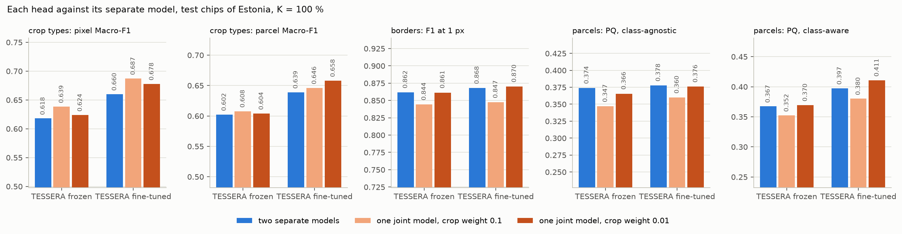
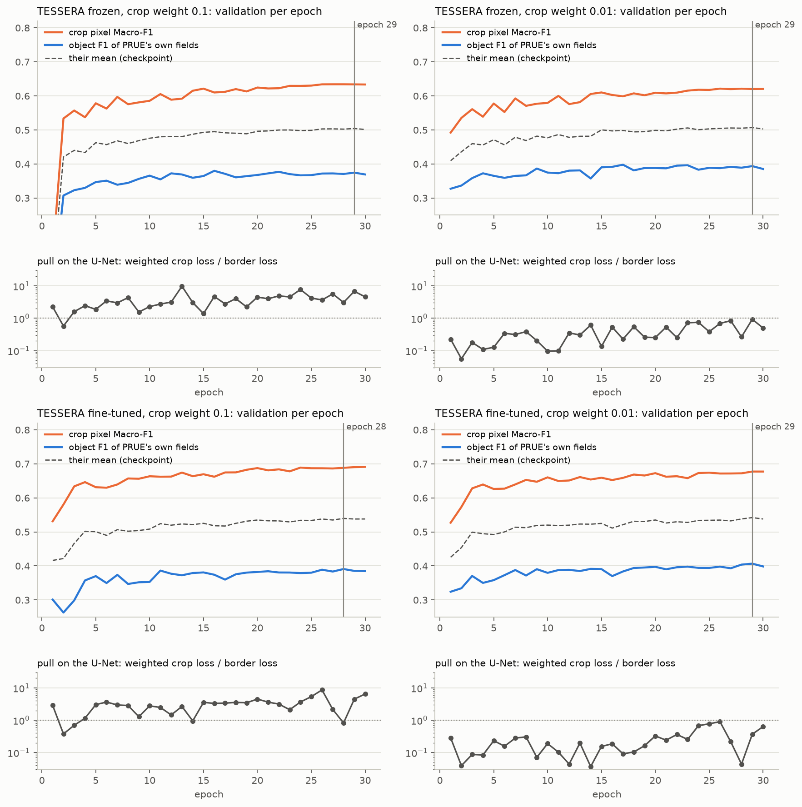
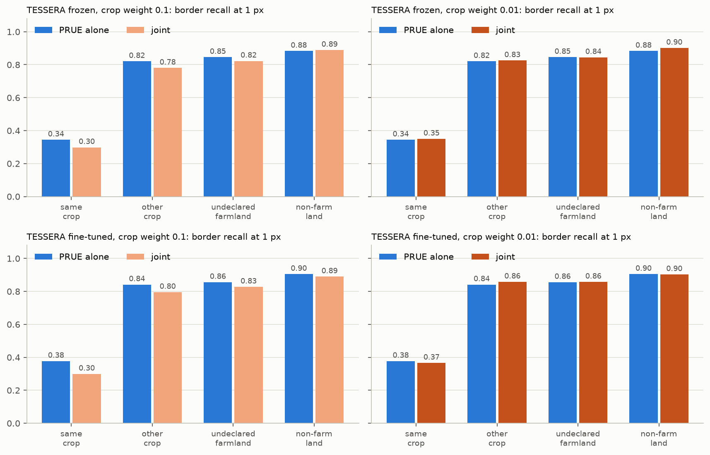
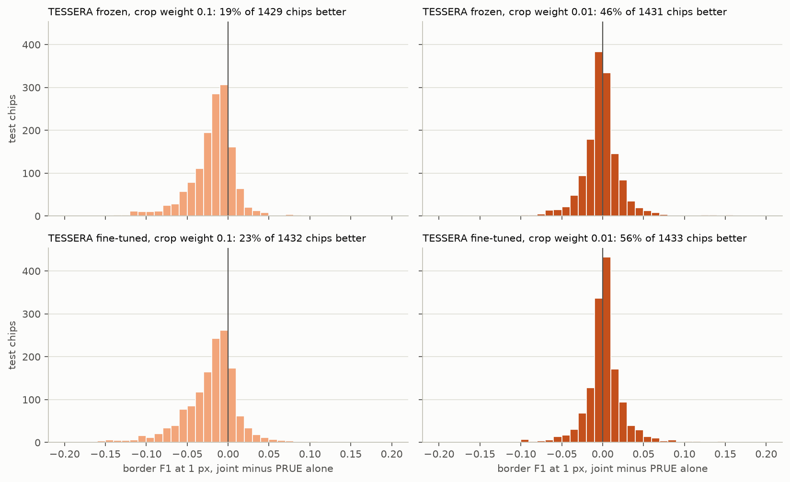
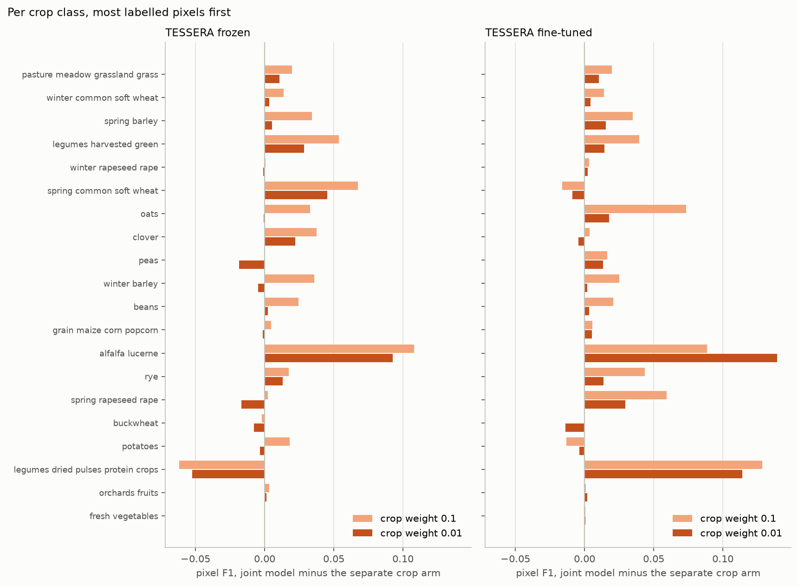

# One model for crop types and field borders, PRUE with a crop head on TESSERA: report, 11 November 2026

**Answer.** **Yes, with the crop loss weighted 0.01: one network draws PRUE's borders and a better crop map than the
MLP, frozen and fine-tuned.**

- **Fine-tuned**, against the two separate fine-tuned models:
  - crop pixel / parcel Macro-F1 0.678 / 0.658, against the MLP's 0.660 / 0.639 (+0.018 / +0.019);
  - border F1 at 1 px 0.870, against PRUE's 0.868;
  - class-agnostic PQ 0.376, against 0.378;
  - class-aware PQ 0.411, against 0.397.
- **Frozen**: crop 0.624 / 0.604 against 0.618 / 0.602, border F1 0.861 against 0.862, PQ 0.366 against 0.374,
  class-aware 0.370 against 0.367.
- **At a weight of 0.1** the crop map gains more (+0.021 frozen, +0.027 fine-tuned per pixel), but the crop loss takes
  over the shared U-Net. The borders fall by 0.017 to 0.020 F1, and four test chips in five lose border F1.

One draw and one seed per arm, so differences under about 0.01 to 0.02 are ties. "Same or better" holds within that.

## Setup

| | |
|---|---|
| Question | Can one network, PRUE's U-Net on TESSERA v2 Medium with a crop head beside its border head, trained once on both tasks, match or beat the two separate models on each one's own metrics (README) |
| Arms | Four: TESSERA frozen or fine-tuned (end to end at 1e-5), with the crop loss weighted 0.1 or 0.01. One network: smp's U-Net with an EfficientNet-B7 encoder from ImageNet on the 128-d embedding, with PRUE's 3-class border head; beside it the main workflow's crop MLP (512, 256), which reads the embedding and the U-Net's last 16 decoder channels (67.2 M + 0.21 M trainable, plus the student when fine-tuned) |
| Separate models | Crop types: the main workflow's MLP on frozen TESSERA (`results/kshot`, 45 epochs) and its fine-tuned arm (`../2026-10-15_kshot_finetune`). Borders: PRUE on TESSERA, frozen and fine-tuned (`../2026-11-06_prue_tessera`), its borders scored as in `../2026-11-07_border_accuracy` |
| Loss | PRUE's log-cosh Dice (0.05, 0.20, 0.75) plus a fixed weight times the crop cross-entropy. 0.1 came from `check.py --balance` on the mini set. 0.01 was added on 8 November, after the frozen 0.1 arm's logged crop pull on the U-Net ran at 1.4 to 9.8 times the border loss's and its borders fell below PRUE's |
| Chip set | `EE_2021_rev`, split `blocks4_buf1600_seed0__6b0eb4cb`: 4,898 training, 769 validation and 1,475 test chips |
| Protocol | K = 100 % only (a method check), draw 0, seed 0. PRUE's recipe: 30 epochs, batches of 8 random 128 x 128 windows, D4, bf16. The U-Net uses AdamW with amsgrad at 3e-3, the crop head AdamW at 1e-3, both on one cosine schedule. Checkpoint: best validation (object F1 of PRUE's own fields + crop pixel Macro-F1) / 2 |
| Scoring | Each head as its separate model: the crop map per pixel and per parcel; the fields by PRUE's post-processing with the rim grown back, class-agnostic and class-aware PQ (each field's class by majority vote of the model's own crop head); the borders by precision, recall and F1 within 1 px. `check.py --scorer` reproduced the separate frozen models' published numbers exactly |
| Runs | UT HPC `main-gpu`, one job per arm, 8 to 11 November 2026: 698900 frozen 0.1 (L40, hpc-node03, commit `e869efb`, fit 1.2 h); 699157 frozen 0.01 (L40, hpc-node03, `ee177bf`, 1.2 h); 698901 fine-tuned 0.1 (L40S, hpc-node16, `e869efb`, 55.0 h); 699431 fine-tuned 0.01 (L40, hpc-node03, `30c3dd0`, 60.0 h). The first submissions to `itc-gpu` (693226, 693227) queued behind other users' 14-day jobs and were moved to `main-gpu`. No failure |

## Results

### Headline

| Model | crop pixel Macro-F1 | crop parcel Macro-F1 | border P / R / F1 at 1 px | PQ agn. | PQ class-aware | fields | fit h |
|---|---|---|---|---|---|---|---|
| TESSERA frozen: two separate models | 0.618 | 0.602 | 0.947 / 0.790 / 0.862 | 0.374 | 0.367 | 47,264 | 1.51 |
| one joint model, crop weight 0.1 | 0.639 | 0.608 | 0.937 / 0.768 / 0.844 | 0.347 | 0.352 | 47,860 | 1.21 |
| difference | +0.021 | +0.005 | F1 -0.017 | -0.027 | -0.015 | | |
| **one joint model, crop weight 0.01** | 0.624 | 0.604 | 0.940 / 0.795 / 0.861 | 0.366 | 0.370 | 50,680 | 1.20 |
| difference | +0.006 | +0.002 | F1 -0.000 | -0.008 | +0.002 | | |
| TESSERA fine-tuned: two separate models | 0.660 | 0.639 | 0.938 / 0.807 / 0.868 | 0.378 | 0.397 | 51,949 | 54.12 |
| one joint model, crop weight 0.1 | 0.687 | 0.646 | 0.937 / 0.773 / 0.847 | 0.360 | 0.380 | 45,781 | 54.99 |
| difference | +0.027 | +0.007 | F1 -0.020 | -0.018 | -0.017 | | |
| **one joint model, crop weight 0.01** | **0.678** | **0.658** | 0.942 / 0.808 / **0.870** | 0.376 | **0.411** | 52,563 | 59.95 |
| difference | +0.018 | +0.019 | F1 +0.002 | -0.002 | +0.013 | | |

At both weights the joint model's crop map is above the MLP's. The weight decides the borders: at 0.1 every border
and field score falls below PRUE's, while at 0.01 each stays within 0.008 of it, and class-aware PQ rises.

### Training: the checkpoint and the pull of the crop loss

| Arm | epoch kept | val object F1 | val crop Macro-F1 | epoch by object F1 alone | by crop loss alone | by crop Macro-F1 alone |
|---|---|---|---|---|---|---|
| frozen, 0.1 | 29 | 0.3745 | 0.6338 | 16 | 30 | 28 |
| frozen, 0.01 | 29 | 0.3936 | 0.6202 | 17 | 30 | 26 |
| fine-tuned, 0.1 | 28 | 0.3908 | 0.6882 | 28 | 20 | 30 |
| fine-tuned, 0.01 | 29 | 0.4066 | 0.6772 | 29 | 25 | 29 |

The pull of the weighted crop loss on the U-Net, as a multiple of the border loss's, per epoch:

| Arm | median | range | lowest validation border loss | PRUE alone | epochs above PRUE's |
|---|---|---|---|---|---|
| frozen, 0.1 | 3.3 | 0.57 to 9.8 | 0.0039 | 0.0032 | 27 of 30 |
| frozen, 0.01 | 0.31 | 0.06 to 0.93 | 0.0032 | 0.0032 | 6 of 30 |
| fine-tuned, 0.1 | 3.0 | 0.38 to 8.6 | 0.0036 | 0.0027 | 30 of 30 |
| fine-tuned, 0.01 | 0.19 | 0.04 to 0.90 | 0.0028 | 0.0027 | 24 of 30 |

At 0.1 the crop loss pulls on the U-Net about three times as hard as the border loss over the whole run. The balance
check on the mini set predicted 0.4 times after the first 40 steps; it did not hold on the full set. At 0.01 the
crop pull stays below the border pull at every epoch. The validation border loss then equals PRUE's frozen and is
about 0.0002 above it fine-tuned. Every arm keeps epoch 28 or 29, where the crop Macro-F1 is still climbing slowly. With the
frozen encoder, object F1 alone would have stopped at epoch 16 or 17.

### Which borders are drawn

| Model | same crop | other crop | undeclared farmland | non-farm land |
|---|---|---|---|---|
| TESSERA frozen: PRUE alone | 0.344 | 0.820 | 0.845 | 0.883 |
| joint, 0.1 | 0.298 | 0.780 | 0.823 | 0.889 |
| joint, 0.01 | 0.350 | 0.825 | 0.844 | 0.901 |
| TESSERA fine-tuned: PRUE alone | 0.377 | 0.841 | 0.856 | 0.905 |
| joint, 0.1 | 0.299 | 0.795 | 0.827 | 0.890 |
| joint, 0.01 | 0.366 | 0.858 | 0.857 | 0.903 |

At 0.1 the joint model loses most where the image changes least across the border: between two parcels of the same
crop (0.34 to 0.30 frozen, 0.38 to 0.30 fine-tuned), then between two crops (-0.04). At 0.01 every type is within
0.02 of PRUE's.

### Per test chip

| Arm | chips (>= 100 true border pixels) | joint better | median difference |
|---|---|---|---|
| frozen, 0.1 | 1,429 | 19.2 % | -0.014 |
| frozen, 0.01 | 1,431 | 45.6 % | -0.001 |
| fine-tuned, 0.1 | 1,432 | 22.6 % | -0.015 |
| fine-tuned, 0.01 | 1,433 | 56.5 % | +0.002 |

The loss at 0.1 is a shift of the whole distribution, not a few failed chips. At 0.01 the distribution centres on
zero.

### Per crop class

The gains are largest where the MLP was weakest:

- alfalfa: +0.09 to +0.11 frozen and +0.09 to +0.14 fine-tuned, from 0.13 and 0.21;
- legumes harvested green: +0.02 to +0.05;
- spring common soft wheat: +0.05 to +0.07, frozen only;
- oats: +0.07 fine-tuned at 0.1;
- dried pulses: +0.11 to +0.13 fine-tuned, from 0.00.

These are the grass-like and spring-cereal classes that [ARCHITECTURE.md](ARCHITECTURE.md) found most confused. The
losses are few and small. The largest are dried pulses frozen (-0.05 to -0.06, a class of 58,763 test pixels), peas
and spring rapeseed frozen at 0.01 (-0.02), and spring common soft wheat fine-tuned (-0.01 to -0.02). The full table
is in `figures/tables.md`.

## Analysis

**The weight of the crop loss decides whether the borders survive.** The two losses meet in the U-Net. Adam's step
does not depend on the scale of a gradient, so the weight only changes their ratio on the shared part.

- **At 0.1** the crop loss pulled three times as hard as the border loss for the whole run:
  - the U-Net's features served the crop map;
  - the validation border loss stayed above PRUE's at 27 and 30 of the 30 epochs;
  - the borders lost recall (0.790 to 0.768 frozen, 0.807 to 0.773 fine-tuned);
  - fine-tuned, the model drew 6,200 fewer fields than PRUE.
- **At 0.01** the border loss leads (pull median 0.31 and 0.19). The validation border loss matches PRUE's frozen and
  is slightly above it fine-tuned, and the borders tie at every border type and on the median chip.

**The crop head gains from the U-Net's features even when the border loss leads.** At 0.01 the crop map is still above
the MLP's: +0.006 / +0.002 frozen and +0.018 / +0.019 fine-tuned, per pixel / per parcel. This is with 30 epochs on
128 x 128 windows, against the MLP's 45 epochs on whole chips. The MLP sees one pixel's embedding. The joint head also
reads 16 channels that the U-Net computed over the field and its neighbours, so a pixel inside a field can borrow the
evidence of the rest of the field.

At 0.1 the pixel gain is larger (+0.021, +0.027) but the parcel gain smaller (+0.005, +0.007). A parcel's class changes
only when its majority vote flips, so most of the extra pixels are likely in parcels whose majority was already right.

**Fine-tuning helps inside the joint model as it helps the separate ones.** Fine-tuned against frozen, at 0.01:

| | crop per pixel | border F1 | class-aware PQ |
|---|---|---|---|
| Joint model | +0.054 | +0.009 | +0.041 |
| Separate models | +0.042 (MLP) | +0.006 (PRUE) | — |

The cost is 50 times the fit time (60 h against 1.2 h).

**Class-aware PQ improves most with one model.** Fine-tuned at 0.01 it reaches 0.411 against 0.397: each field's
class is voted by a crop map that is itself better (+0.019 per parcel), and the fields match PRUE's.

**One model is the more compact system at equal accuracy.** Prediction runs one forward pass, and when fine-tuned it
keeps one adapted copy of TESSERA instead of two. The training time does not compare cleanly: the joint fine-tuned
arm took 55 to 60 h on L40 and L40S GPUs, the two separate fine-tuned models 25.8 + 28.3 h on the RTX PRO 6000
Blackwell.

**A balanced weight does better than either fixed one.** `../2026-11-09_borders_all_arms` ran the same network on
frozen TESSERA under its own recipe:

- the weight was reset every 25 steps so that the crop pull stays at 0.3 times the border pull;
- whole chips, 45 epochs, batches of 4.

At K = 100 % it reached:

| | crop pixel / parcel | border F1 | PQ agn. | PQ class-aware |
|---|---|---|---|---|
| Balanced, frozen | 0.645 / 0.621 | 0.868 | 0.369 | 0.388 |
| Frozen, 0.01 (here) | 0.624 / 0.604 | 0.861 | 0.366 | 0.370 |
| Separate models | 0.618 / 0.602 | 0.862 | 0.374 | 0.367 |

That beats the two separate models on the crop map by 0.027 / 0.019 and ties them on the borders, which is better
than either frozen arm here. Three things changed at once (the balance, whole chips, the epochs), so this does not
say which carries the gain. It does make the balanced recipe the better default for a joint model.

## Caveats

* One draw and one seed per arm, at K = 100 % only; no interval.
* Only two weights were tried. The second (0.01) was chosen after the first arm's training logs and test scores were
  known, so the weight is not tuned on validation data.
* The separate models ran on the RTX PRO 6000 Blackwell (`itc-gpu`), the joint ones on L40 and L40S (`main-gpu`). The
  fit times compare loosely.
* The checkpoint criterion mixes the two tasks. For the frozen arms, object F1 alone would have kept epoch 16 or 17
  instead of 29.
* The separate model's class-aware PQ votes each of PRUE's fields with the MLP's map. The joint model votes with its
  own head, so this metric compares two systems, not two networks.

## Next steps

* **Your decision, for the parcel-level outputs.** Whether the joint model becomes the model that makes the crop map
  and the fields. If so, train it with the fine-tuned encoder and the balanced weight of the border experiment rather
  than a fixed one. Adding it to the main workflow is a separate decision.
* **Under the label budget.** The border experiment already ran the frozen, balanced joint model at K = 20 and 5 %
  (TESSERA: crop 0.614 and 0.569, border F1 0.811 and 0.761). A fine-tuned joint model under a budget has not been
  run.
* **The architecture note.** [ARCHITECTURE.md](ARCHITECTURE.md) draws its figures from the frozen 0.01 arm. It can be
  redrawn from the fine-tuned one with `architecture.py --arm joint_tessera_v2_ft_cw001`.

## Reproduce

    poetry run python experiments/2026-11-07_prue_crop_tessera/check.py --chips EE_2021_rev --scorer
    TIME=4-00:00:00 bash scripts/cluster/submit.sh experiments/2026-11-07_prue_crop_tessera/experiment.yaml EE_2021_rev
    bash scripts/cluster/pull_results.sh 2026-11-07_prue_crop_tessera EE_2021_rev
    poetry run python experiments/2026-11-07_prue_crop_tessera/run.py -e experiments/2026-11-07_prue_crop_tessera/experiment.yaml --chips data/eurocrops_chips/EE_2021_rev --summarise
    poetry run python experiments/2026-11-07_prue_crop_tessera/report.py --chips EE_2021_rev

The jobs were submitted with `sbatch` by hand, with `-p main-gpu --gres=gpu:lovelace:1 -t 4-00:00:00` and otherwise
the command `submit.sh` builds.
