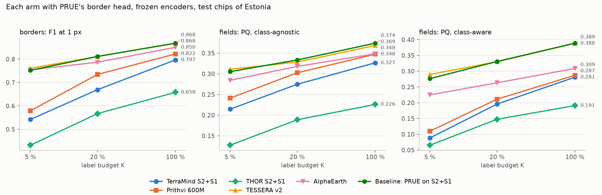
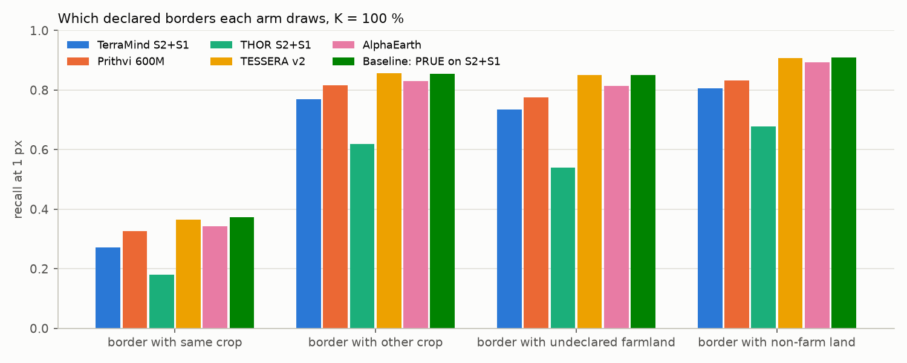
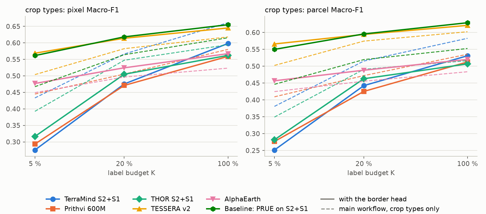
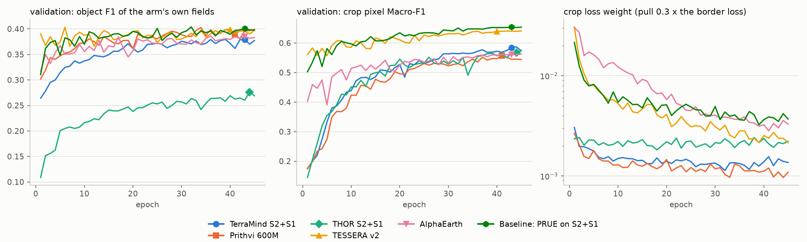

# Field borders from every arm, PRUE's border head on each frozen GFM and the baseline: report, 10 November 2026

**Answer.** **TESSERA draws the field borders best of the five GFMs, and ties the baseline, PRUE itself on the raw
S2 + S1 composites**, at every label budget: border F1 at 1 px 0.868, 0.811 and 0.761 at K = 100, 20 and 5 %, against
0.868, 0.812 and 0.752 for the baseline. AlphaEarth follows within 0.025 (0.850, 0.787, 0.754). The three token-grid
GFMs draw weaker borders, and lose more of them as labels get scarce: Prithvi 0.822, 0.735 and 0.579, TerraMind
0.797, 0.669 and 0.542, THOR 0.658, 0.567 and 0.432. The order holds for the fields built from the borders
(class-agnostic PQ 0.369 TESSERA, 0.374 baseline, 0.348 AlphaEarth and Prithvi, 0.327 TerraMind, 0.226 THOR at K =
100 %). Every arm misses the same borders first, those between two parcels of the same crop (recall 0.18 to 0.37).

The second head changes the crop maps in opposite directions by group. **For the 10 m arms it helps**: TESSERA
+0.027, +0.032 and +0.065 pixel Macro-F1 over the main workflow's MLP at K = 100, 20 and 5 %, AlphaEarth +0.03 to
+0.04. **For the token-grid arms it hurts**, by 0.02 to 0.16 (TerraMind 0.598, 0.475 and 0.275 against 0.661, 0.566
and 0.433), because their crop head reads only the decoder that the border loss mostly trains; that is a property of
this design, not of their tokens. **The baseline becomes as strong as the best GFM**: PRUE's U-Net on S2 + S1 reaches
0.655, 0.618 and 0.561 pixel Macro-F1 (0.629, 0.596 and 0.550 per parcel), 0.04 to 0.10 above the main workflow's
ResNet-18 from scratch, and within 0.016 of TESSERA at every budget, either way.

One draw and one seed per cell, so differences under about 0.02 (borders) and 0.03 (crop maps) are not resolved.
The gaps between the 10 m arms and the token-grid arms are larger than that, 0.05 to 0.33 border F1, all but one:
AlphaEarth leads Prithvi by only 0.028 at K = 100 %.

## Setup

| | |
|---|---|
| Question | Which GFM draws the field borders best, at each label budget, against a baseline that is PRUE itself; and what the border head does to each arm's crop map (README) |
| Arms | The six arms of the main workflow, encoders frozen. **10 m arms** (TESSERA v2 Medium, 128 dims; AlphaEarth v1, 64 dims): PRUE's U-Net (EfficientNet-B7 from ImageNet) on the embedding, its 3-class border head, and the main workflow's crop MLP on the embedding plus the U-Net's 16 features (67.1 to 67.2 M + 0.18 to 0.21 M trainable). **Baseline**: the same U-Net on the 12 monthly S2 + S1 composites, 168 channels, everything trained (67.2 M + 0.23 M); it replaces the main workflow's ResNet-18 from scratch. **Token-grid arms** (TerraMind v1 large and THOR v1 large on S2 + S1, 160 m tokens; Prithvi-EO-2.0 600M TL on S2, 140 m): the main workflow's token decoder, then a fifth block to 10 m (bilinear, two 3 x 3 convolutions of 64 channels) carrying both heads (53.4 M; Prithvi 62.8 M) |
| Loss | PRUE's log-cosh Dice on background, interior and boundary (weights 0.05, 0.20, 0.75) plus a weight times the crop cross-entropy, the weight reset every 25 steps so that the crop loss pulls 0.3 times as hard as the border loss on the shared part. Achieved pull per epoch: median 0.30, range 0.22 to 0.44 over all cells |
| Chip set | `EE_2021_rev`, split `blocks4_buf1600_seed0__6b0eb4cb`: 4,898 training chips (4,213 at K = 20 %, 2,706 at 5 %), 769 validation, 1,475 test; 55,575 declared parcel pieces on the test chips |
| Protocol | K-shot: K = 100, 20 and 5 % of each class's trainable parcels (the core's `draw_support`), draw 0, seed 0, 45 epochs, whole 224 x 224 chips in batches of 4, D4 augmentation, bf16. Under a budget, parcels not drawn are ignored in both targets. Checkpoint: best validation (object F1 of the arm's own fields + crop pixel Macro-F1) / 2 |
| Scoring | Crop map per pixel and per parcel, as the main workflow. Fields: PRUE's post-processing with the rim grown back (`grow`), class-agnostic and class-aware PQ (each field's crop by majority vote of the arm's crop head). Borders: the edges of the final fields against the declared borders, precision, recall and F1 within 1 px |
| References | The main workflow's crop-only fits of the same arms (`results/kshot/EE_2021_rev/`, 45 epochs, 16 October 2026); PRUE on frozen TESSERA at K = 100 % (`../2026-11-06_prue_tessera`: border F1 0.862, class-agnostic PQ 0.374) |
| Runs | UT HPC, one job per arm, commit `eb74944`, 9 and 10 November 2026: on L40, L40S and A40 GPUs (hpc-node04, 05, 06, 12, ctit094). Fit time per cell 0.9 to 5.9 h; the token-grid arms first encode their feature cache on the node (0.85 to 1.35 TB), TESSERA its 10 m raster (2.4 h). Prithvi's first job (709461) stopped on its disk check before encoding (1,219 GB free, 1,350 needed); it ran again as 712940 on a node with room. No other failure |

## Results

### Borders and fields against the label budget

| Arm | K | border P / R / F1 at 1 px | PQ agn. | PQ class-aware | fields / declared parcels |
|---|---|---|---|---|---|
| TESSERA v2 | 100 % | 0.941 / 0.805 / **0.868** | 0.369 | 0.388 | 53,747 / 55,575 |
| | 20 % | 0.903 / 0.737 / **0.811** | 0.328 | 0.330 | 52,001 |
| | 5 % | 0.847 / 0.691 / **0.761** | 0.311 | 0.290 | 49,078 |
| Baseline: PRUE on S2 + S1 | 100 % | 0.940 / 0.807 / **0.868** | 0.374 | 0.389 | 51,798 |
| | 20 % | 0.901 / 0.738 / **0.812** | 0.334 | 0.331 | 49,888 |
| | 5 % | 0.847 / 0.677 / 0.752 | 0.305 | 0.276 | 47,082 |
| AlphaEarth | 100 % | 0.939 / 0.777 / 0.850 | 0.348 | 0.309 | 50,575 |
| | 20 % | 0.886 / 0.708 / 0.787 | 0.318 | 0.263 | 46,990 |
| | 5 % | 0.858 / 0.672 / 0.754 | 0.284 | 0.225 | 48,907 |
| Prithvi 600M | 100 % | 0.926 / 0.739 / 0.822 | 0.348 | 0.287 | 44,200 |
| | 20 % | 0.863 / 0.640 / 0.735 | 0.303 | 0.211 | 38,302 |
| | 5 % | 0.691 / 0.498 / 0.579 | 0.241 | 0.110 | 33,109 |
| TerraMind S2 + S1 | 100 % | 0.926 / 0.699 / 0.797 | 0.327 | 0.281 | 38,246 |
| | 20 % | 0.787 / 0.583 / 0.669 | 0.275 | 0.196 | 36,226 |
| | 5 % | 0.645 / 0.468 / 0.542 | 0.215 | 0.088 | 32,989 |
| THOR S2 + S1 | 100 % | 0.847 / 0.538 / 0.658 | 0.226 | 0.191 | 28,483 |
| | 20 % | 0.723 / 0.467 / 0.567 | 0.189 | 0.148 | 29,615 |
| | 5 % | 0.564 / 0.350 / 0.432 | 0.127 | 0.066 | 24,675 |

The three U-Net arms on 10 m input lie together at every budget and lose about 0.11 border F1 from K = 100 to 5 %.
The token-grid arms start lower and fall faster: TerraMind loses 0.25, Prithvi 0.24, THOR 0.23. Precision stays at 0.93 to 0.94 for
every arm but THOR (0.85) at K = 100 %; the gap is recall, and it shows as fewer fields: at K = 100 % the token-grid arms
draw 28,500 to 44,200 fields for 55,575 declared parcels, the 10 m arms 50,600 to 53,700, so their fields merge more
neighbours.

### Which borders are drawn

| Arm | K | same crop | other crop | undeclared farmland | non-farm land |
|---|---|---|---|---|---|
| TESSERA v2 | 100 % | 0.366 | 0.856 | 0.850 | 0.908 |
| | 5 % | 0.364 | 0.795 | 0.810 | 0.517 |
| Baseline | 100 % | 0.373 | 0.856 | 0.850 | 0.909 |
| | 5 % | 0.352 | 0.774 | 0.795 | 0.506 |
| AlphaEarth | 100 % | 0.344 | 0.830 | 0.814 | 0.894 |
| | 5 % | 0.326 | 0.737 | 0.786 | 0.547 |
| Prithvi 600M | 100 % | 0.326 | 0.816 | 0.775 | 0.832 |
| | 5 % | 0.322 | 0.689 | 0.581 | 0.274 |
| TerraMind | 100 % | 0.272 | 0.770 | 0.734 | 0.806 |
| | 5 % | 0.320 | 0.632 | 0.546 | 0.255 |
| THOR | 100 % | 0.181 | 0.619 | 0.541 | 0.677 |
| | 5 % | 0.261 | 0.459 | 0.387 | 0.239 |

A border between two parcels of the same crop is found a third of the time at best, by every arm: nothing in the
image need change across it. Borders with another crop, with undeclared farmland and with non-farm land are found 0.8
to 0.9 of the time by the 10 m arms at K = 100 %. With fewer labels the border with non-farm land is lost first, for
every arm: from 0.91 to 0.51 for TESSERA and the baseline at K = 5 %, while their borders with another crop drop by
0.06 to 0.08 (AlphaEarth 0.09, the token-grid arms 0.13 to 0.16). A likely cause, not measured here: under a budget the parcels not drawn are ignored but WorldCover's
non-farm land stays labelled background on every chip, so at K = 5 % background dominates the target near field edges.

### Crop maps against the main workflow

| Arm | K | pixel Macro-F1 | main workflow | difference | parcel Macro-F1 | main workflow | difference |
|---|---|---|---|---|---|---|---|
| Baseline: PRUE on S2 + S1 | 100 % | 0.655 | 0.616 | +0.039 | 0.629 | 0.553 | +0.076 |
| | 20 % | 0.618 | 0.564 | +0.054 | 0.596 | 0.520 | +0.076 |
| | 5 % | 0.561 | 0.467 | +0.094 | 0.550 | 0.446 | +0.104 |
| TESSERA v2 | 100 % | 0.645 | 0.618 | +0.027 | 0.621 | 0.602 | +0.019 |
| | 20 % | 0.614 | 0.582 | +0.032 | 0.594 | 0.574 | +0.020 |
| | 5 % | 0.569 | 0.504 | +0.065 | 0.566 | 0.502 | +0.064 |
| AlphaEarth | 100 % | 0.567 | 0.523 | +0.044 | 0.520 | 0.484 | +0.036 |
| | 20 % | 0.524 | 0.497 | +0.028 | 0.488 | 0.455 | +0.033 |
| | 5 % | 0.477 | 0.449 | +0.028 | 0.457 | 0.425 | +0.032 |
| Prithvi 600M | 100 % | 0.559 | 0.580 | -0.021 | 0.513 | 0.535 | -0.023 |
| | 20 % | 0.471 | 0.505 | -0.034 | 0.425 | 0.472 | -0.047 |
| | 5 % | 0.293 | 0.445 | -0.151 | 0.277 | 0.409 | -0.132 |
| TerraMind S2 + S1 | 100 % | 0.598 | 0.661 | -0.063 | 0.531 | 0.583 | -0.052 |
| | 20 % | 0.475 | 0.566 | -0.091 | 0.442 | 0.515 | -0.073 |
| | 5 % | 0.275 | 0.433 | -0.158 | 0.251 | 0.381 | -0.129 |
| THOR S2 + S1 | 100 % | 0.562 | 0.594 | -0.032 | 0.507 | 0.516 | -0.010 |
| | 20 % | 0.505 | 0.547 | -0.042 | 0.463 | 0.491 | -0.028 |
| | 5 % | 0.317 | 0.393 | -0.076 | 0.282 | 0.349 | -0.067 |

The "main workflow" column of the baseline is a different model, the ResNet-18 U-Net from scratch; for every other arm
it is the same frozen encoder with a crop-only decoder.

### Training

| Arm | K | epoch kept | by object F1 alone | by crop loss alone | final crop weight | fit h |
|---|---|---|---|---|---|---|
| TESSERA v2 | 100 / 20 / 5 % | 40 / 30 / 37 | 6 / 36 / 37 | 43 / 29 / 9 | 0.0018 / 0.0070 / 0.0130 | 3.5 / 2.9 / 1.9 |
| Baseline | 100 / 20 / 5 % | 43 / 43 / 36 | 32 / 34 / 36 | 42 / 37 / 24 | 0.0064 / 0.0139 / 0.0082 | 5.9 / 5.1 / 1.9 |
| AlphaEarth | 100 / 20 / 5 % | 43 / 43 / 34 | 36 / 43 / 31 | 45 / 23 / 14 | 0.0030 / 0.0146 / 0.0163 | 4.3 / 3.7 / 1.7 |
| Prithvi 600M | 100 / 20 / 5 % | 41 / 43 / 39 | 34 / 43 / 32 | 37 / 22 / 27 | 0.0014 / 0.0024 / 0.0025 | 2.5 / 2.1 / 1.4 |
| TerraMind | 100 / 20 / 5 % | 43 / 42 / 44 | 39 / 40 / 39 | 29 / 27 / 35 | 0.0012 / 0.0060 / 0.0024 | 1.5 / 1.3 / 0.9 |
| THOR | 100 / 20 / 5 % | 44 / 45 / 43 | 44 / 45 / 43 | 20 / 30 / 25 | 0.0021 / 0.0028 / 0.0043 | 1.6 / 1.3 / 1.0 |

The checkpoint falls late, at epoch 30 to 45, for every cell. The balance holds the crop pull at 0.3 (median 0.30 per
epoch); the weight that does it is 0.001 to 0.016, lowest for the token-grid decoders at K = 100 % (0.0012 to 0.0021,
against 0.0018 to 0.0064 for the U-Nets), and higher at K = 20 and 5 % than at 100 % for every arm. At K = 5 % the
token-grid arms' validation crop Macro-F1 still climbs in the last third of training: from epoch 30 to its best,
TerraMind goes from 0.22 to 0.27 (epoch 44), Prithvi from 0.25 to 0.30 and THOR from 0.27 to 0.33 (both epoch 37).

## Analysis

**Borders need 10 m features in the decoder.** The three arms whose border head sits on a U-Net over a 10 m input
(TESSERA, AlphaEarth, the raw composites) draw the borders equally well, within 0.02, whatever the input; the three
whose border head sits on decoded tokens draw them worse, by 0.03 to 0.21 at K = 100 % and 0.17 to 0.33 at K = 5 %,
even with a learned block at 10 m. A token of 140 or 160 m holds a field border only as a mixture, and the decoder must recover where it runs from
the token's neighbours; a 10 m embedding marks it pixel by pixel. Prithvi, the finest token grid (140 m), is the best
of the three at every budget (0.822, 0.735, 0.579), THOR the worst (0.658, 0.567, 0.432); why THOR falls so far below TerraMind on the same 160 m grid and the
same inputs is not tested here. The
same split appears in what each arm finds: the token-grid arms draw a fifth to a half fewer fields than there are
parcels, because their missing borders merge neighbours.

**The gap widens under label scarcity.** From K = 100 to 5 % the 10 m arms lose 0.10 to 0.12 border F1, the
token-grid arms 0.23 to 0.25. The U-Net learns where borders run from the 10 m input with few examples; the token
decoders, which must learn to place them within a token, need more.

**Among the GFMs, TESSERA is the answer, but not against the baseline.** TESSERA beats AlphaEarth by 0.007 to 0.024
border F1 and 0.01 to 0.03 class-agnostic PQ, and every token-grid GFM by more. It does not beat PRUE on the raw
composites: border F1 equal at K = 100 and 20 %, +0.009 at 5 %; class-agnostic PQ -0.005, -0.006 and +0.006; all
within one draw's noise. A frozen GFM therefore buys no border accuracy over PRUE trained on the bands, at any budget
tried here.

**The border head improves the crop maps of the 10 m arms.** TESSERA gains 0.027 to 0.065 pixel Macro-F1 over the
MLP alone, most at K = 5 %; AlphaEarth 0.028 to 0.044. The earlier joint TESSERA model with a fixed weight of 0.01
gained only 0.006 at K = 100 % (`../2026-11-07_prue_crop_tessera`); here the crop head trains on whole chips for 45
epochs, where there it saw a third of each chip for 30, and the weight adapts. The crop MLP reads the U-Net's 16
features beside the embedding, so it gets the spatial context of the field the per-pixel MLP lacks. The
`2026-10-15_tessera_decoder` experiment found a U-Net alone no better than the MLP under scarcity; here the MLP keeps
its direct view of the embedding and adds the U-Net's features, and the border loss shapes those features.

**For the token-grid arms the same design costs crop accuracy.** Their crop head is one 1 x 1 convolution on the 64
features of the fifth block, which the border loss trains three times as hard as the crop loss; nothing else reaches
it. In the main workflow the whole decoder serves the crop map. The loss grows as labels get scarce (TerraMind -0.06,
-0.09, -0.16; Prithvi -0.02, -0.03, -0.15) and at K = 5 % the validation curves still climb in the last third of
training, so the decoder is undertrained for
the crop map rather than limited by the tokens: the main workflow's decoder on the same tokens reaches 0.433. A token-grid arm that should keep its crop map needs its own crop path: the crop
head on the decoder's 20 m output before the fifth block, a higher pull for these arms, or two decoders.

**The baseline is the strongest arm on both tasks.** PRUE on S2 + S1 ties TESSERA on borders and on the crop map
(pixel -0.010, -0.004 and +0.008 for TESSERA at K = 100, 20 and 5 %; parcel -0.008, -0.002 and +0.016), and is 0.04
to 0.10 above the main workflow's baseline on the crop map, most at K = 5 %. Three things changed at once: the
encoder (EfficientNet-B7 from ImageNet for a ResNet-18 from scratch), the recipe (PRUE's AdamW with amsgrad at 3e-3,
cosine), and the border head beside the crop head. This experiment cannot say which carries the gain. For RQ1 it
matters: no GFM's crop map, with the border head here or crop-only in the main workflow, is above this baseline by
more than one draw's noise at any budget. The closest are TESSERA here (within 0.016 either way) and TerraMind's
crop-only fit at K = 100 % (0.661 against 0.655 per pixel, 0.583 against 0.629 per parcel); at K = 20 and 5 % the
baseline is ahead of every main-workflow fit by 0.036 or more per pixel.

## Caveats

* One draw and one seed per cell; no interval. Differences under about 0.02 border F1 and 0.03 Macro-F1 are not
  resolved, among them every comparison between TESSERA, the baseline and AlphaEarth on borders.
* The token-grid arms' network is ours: the fifth block, its width (64) and the crop head on it were not tuned, and
  the balance target (0.3) was set on TESSERA. Their crop maps are handicapped by the design (above); their borders
  may be too, by an untuned block.
* The baseline differs from the main workflow's in encoder, pretraining, recipe and the auxiliary task together.
* The border target ignores the parcels not drawn, so at K = 5 % the border labels are as scarce as the crop labels;
  a border-only study with every border labelled would measure something else.
* The checkpoint criterion mixes the two tasks; the epoch each alone would pick differs by up to 37 epochs (TESSERA
  at K = 100 %: object F1 alone epoch 6, crop loss alone 43).
* GPUs differed between jobs (L40, L40S, A40), and the fit times include reading chips over the shared file system,
  so they compare loosely.

## Next steps

* **The baseline, for RQ1** (the user's decision). Whether the main workflow's baseline should become PRUE's U-Net
  from ImageNet: it is 0.04 to 0.10 stronger on the crop map. One run would separate the encoder from the border head:
  the same U-Net with the crop loss only, under the K-shot protocol.
* **The token-grid crop maps.** If their crop maps matter beside borders, one variant with the crop head on the
  decoder's own 20 m output.
* **Intervals.** More draws at K = 5 and 20 %, where the order of TESSERA, the baseline and AlphaEarth is still within
  the noise.
* **Non-farm borders under scarcity.** Checking the cause above: which class the arms predict at the missed borders
  with non-farm land at K = 5 %.

## Reproduce

    poetry run python experiments/2026-11-09_borders_all_arms/check.py --chips EE_2021_rev_mini
    ssh -n utwente-hpc 'cd ~/ExplainedGMF4Agri && TIME=4-00:00:00 bash scripts/cluster/submit.sh experiments/2026-11-09_borders_all_arms/experiment.yaml EE_2021_rev'
    bash scripts/cluster/pull_results.sh 2026-11-09_borders_all_arms EE_2021_rev
    poetry run python experiments/2026-11-09_borders_all_arms/run.py -e experiments/2026-11-09_borders_all_arms/experiment.yaml --chips data/eurocrops_chips/EE_2021_rev --summarise
    poetry run python experiments/2026-11-09_borders_all_arms/report.py --chips EE_2021_rev

The jobs were submitted with `sbatch` by hand rather than `submit.sh`, to reach the `main-gpu` partition and to keep
the token-grid arms off nodes without room for their cache (`--exclude`); a token-grid arm checks the free space under
`/local` before it encodes and stops if it is short.
