# Sparse autoencoders on the precomputed TESSERA embeddings of Estonia 2021: report, 20 November 2026

**Answer.** Partly yes, for the crops with a season of their own. A sparse autoencoder (SAE) on the 128-dimensional
TESSERA store embedding finds single features that mark one crop: winter rapeseed (one feature catches 90 % of
rapeseed pixels, and 98 % of the pixels it fires on are rapeseed), grassland, maize, winter barley, winter wheat and
buckwheat. The trained crop head depends on these features. Removing the 7 to 22 features of one of these crops
from the embedding takes 60 to 96 percentage points off that crop's recall, while as many random features take 0
to 8 points off. The features that matter come back when the SAE is trained again with another seed. Two results
limit this. First, an SAE with a frozen random dictionary scores almost the same on the "one feature, one crop"
tests (mean best-feature F1 0.36 against 0.38), so those tests mostly reward sparsity and do not show that the SAE
learned the crops. Second, for the spring cereals, the legumes, clover and oats no feature and no group of features
isolates the crop. In the crop head these classes rest on features they share with other classes. So the SAE is
useful as an explanation tool for a crop map: which features fire, what each one looks like through the season, and
which of them the head cannot do without. It is not evidence that the embedding is organised crop by crop.

## What an SAE does here, in short

Each pixel's embedding is 128 numbers, and each number mixes many crops (a "raw dimension"). The SAE rewrites each
pixel as a sum of a few directions chosen from a dictionary of 1,024 learned directions, the **features**. Exactly
16 features are active per pixel on average. If training works, each feature stands for one thing on the ground,
for example "rapeseed in flower", and the pixel is described by which 16 of the 1,024 are on. The method and code
follow geosae (arXiv 2611.11398), and the test of whether the crop head uses a feature follows Young and Keshav
(arXiv 2610.32617).

## Setup

| | |
|---|---|
| Question | Does an SAE on the TESSERA store embedding of all of Estonia 2021 find features that each mark one crop, more cleanly than the raw dimensions, PCA or a frozen random dictionary? Does the trained crop head rely on them? |
| Embedding | TESSERA v1.0 store, `<chip>_tessera.tif`, 128 dimensions at 10 m, chip set `EE_2021_rev`, split `blocks4_buf1600_seed0__6b0eb4cb`. Chips with a store embedding: 4,876 of 4,898 training, 762 of 769 validation, 1,463 of 1,475 test |
| Pixels | Training: 1,000 per training chip, 4.87 M in all. Validation and test: 256 uniform per chip, plus up to 400 per class on field interiors and 200 outside fields, each pixel weighted by how many it stands for (1.73 M and 3.13 M). Scores use up to 5,000 field-interior pixels per class, weighted back to the real class shares |
| Input | The embedding as the crop head sees it (z-scored with the training-chip statistics), scaled to a mean norm of 1 |
| SAE | BatchTopK, 1,024 features, k = 16, three seeds; k = 8 and 32 for the reconstruction curve; 8,000 steps of 8,192 pixels, Adam, dead-feature revival (AuxK). `sae.py` is adapted from geosae (MIT, header lists the changes) |
| Control | The same SAE with its dictionary frozen at random directions: only the encoder learns. If the control does as well on a test, that test measures sparsity, not learning |
| Other baselines | The 128 raw dimensions, and the 128 PCA components of the training pixels |
| Crop head | The per-pixel MLP of `results/2026-10-14_unet_baseline/EE_2021_rev/tessera_v1/P100_draw0_seed0` (store embedding, K = 100 %, test Macro-F1 0.623). Exported unchanged: it reproduces its stored test predictions on 99.98 % of labelled pixels |
| Rules | Every choice (best feature per class, thresholds, feature families) is made on the validation chips. Every score is on the test chips. Crop scores use field interiors, fields shrunk by one pixel, because the store rasters sit about 0.7 px off the chip grid |
| Classes | The 20 Estonian classes of the crop head, not the 21-species scheme of the XAI work |
| Runs | JupyterHub, on CPU because the shared GPU was full. Extraction 35 min; 8 SAE trainings of 17 to 21 min each at 16 threads, two waves of four; evaluation 27 min, of which 17 min for the crop head on all 1,475 test chips. Code as in this commit |

## Results

The figures are in `figures/`, written by `report.py`. All numbers are in `figures/tables.md`.

### 1. Reconstruction

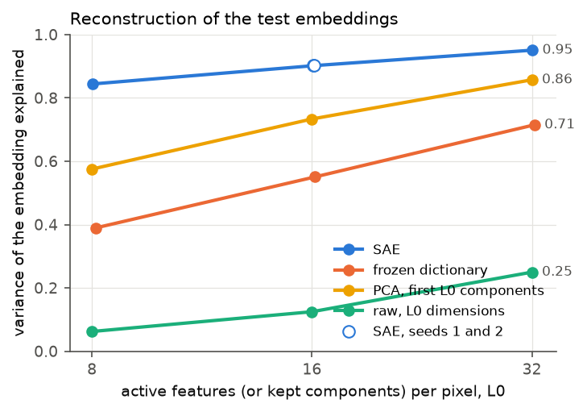

**What it shows.** How much of the embedding's variation (FVE, fraction of variance explained) is kept when each
pixel is rebuilt from a few numbers: L0 active SAE features, the first L0 PCA components, or L0 raw dimensions.
The hollow marker is the two other seeds at k = 16.

**What it tells us.** The SAE learns real structure. With 16 active features it keeps 90 % of the variation, against
73 % for 16 PCA components and 55 % for the frozen random dictionary. The three seeds land on the same value
(0.902, 0.902, 0.903). The embedding is not low-dimensional: 16 raw dimensions keep 12 %.

| | L0 = 8 | 16 | 32 |
|---|---|---|---|
| SAE | 0.84 | 0.90 | 0.95 |
| PCA | 0.58 | 0.73 | 0.86 |
| frozen dictionary | 0.39 | 0.55 | 0.72 |
| raw dimensions | 0.06 | 0.13 | 0.25 |

### 2. The crop head on the reconstruction

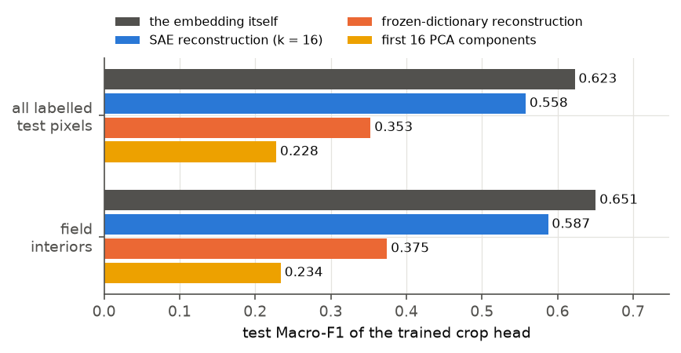

**What it shows.** The trained crop head run on all labelled test pixels of the 1,475 test chips, once on the
embedding and once on each rebuilt version of it.

**What it tells us.** The 16 active SAE features carry most of what the head uses. Its Macro-F1 falls from 0.623 to
0.558, and to 0.353 with the frozen dictionary and 0.228 with 16 PCA components. PCA keeps more variance than the
frozen dictionary yet does worse here: the head relies on small directions that the first components drop. On the
SAE reconstruction the clear crops lose almost nothing (winter rapeseed, grassland, maize, winter wheat: 0.01 to
0.03 F1). Rye, oats, potatoes and spring rapeseed lose most (0.13 to 0.16).

### 3. One feature, one crop?

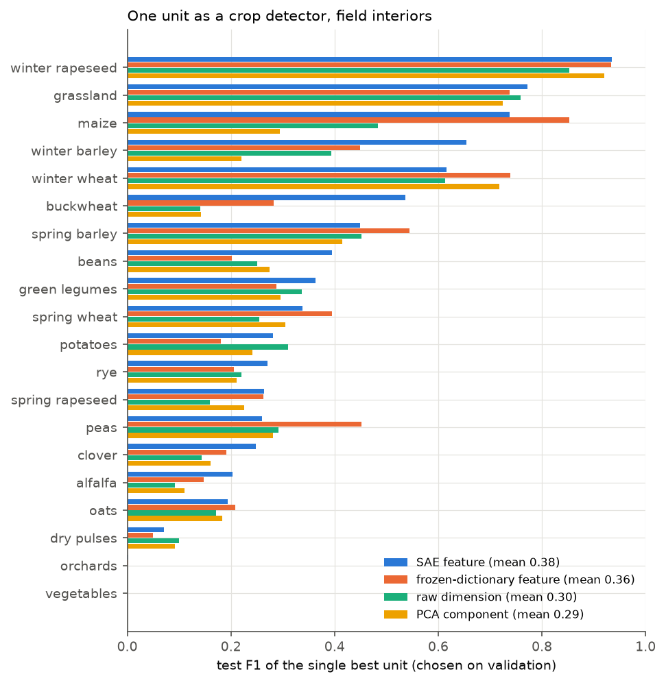

**What it shows.** For each class, the one unit that best marks it, chosen on validation and scored on the test
field interiors. An SAE or frozen-dictionary feature counts as "this class" when it is on. A raw dimension or PCA
component gets more freedom, a sign and a threshold. The legend gives the mean over the 20 classes.

**What it tells us.** Six crops have a feature that marks them well: winter rapeseed (F1 0.93), grassland (0.77),
maize (0.74), winter barley (0.65), winter wheat (0.62) and buckwheat (0.54). The SAE beats the raw dimensions and
PCA on average (0.38 against 0.30 and 0.29) and by much on maize, winter barley and buckwheat. **The frozen random
dictionary does as well (0.36)**: it wins on maize, winter wheat, spring barley and peas and loses on winter barley,
buckwheat and beans. The two other SAE seeds score 0.37 and 0.40, so the gap to the control lies within the
difference between seeds. Spring cereals, legumes, clover and oats have no good single feature (F1 0.19 to 0.45).
Orchards, vegetables and dry pulses have none at all, and the crop head does not find them either (F1 0.00 to 0.01).

### 4. How many crops one unit marks

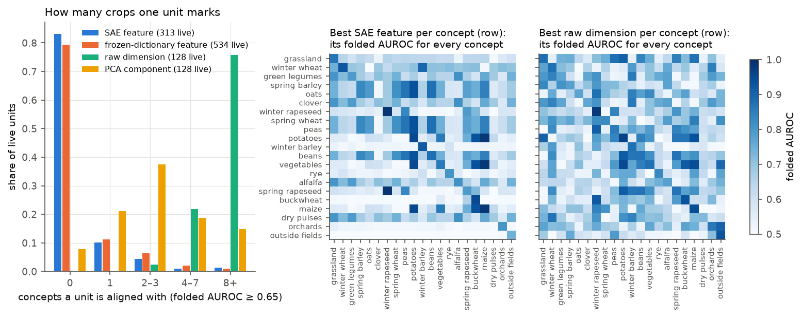

**What it shows.** Left: for each kind of unit, how many of the 21 concepts (20 crops plus "outside fields") it is
aligned with, meaning it separates that concept from the rest with a folded AUROC of at least 0.65. Only "live"
units count, those that separate at least one concept slightly (AUROC above 0.51). Middle and right: for the best
SAE feature and the best raw dimension of each concept (rows), how well it separates every concept (columns). A
clean unit gives one dark cell in its row.

**What it tells us.** Sparse units mark one thing or nothing: 93 % of live SAE features are aligned with at most one
concept, against none of the raw dimensions, which are aligned with 9 concepts each (median). But 91 % of the frozen
dictionary's features also mark at most one concept, so this too comes from sparsity. Most live SAE features (83 %)
are aligned with no crop at all at this threshold, because they fire on part of a class only. The heatmaps show the
difference in practice. The best SAE features for winter rapeseed, winter barley, buckwheat, rye and orchards give
one dark cell. The best raw dimension for every concept is dark in many columns. The best SAE features for potatoes,
beans and vegetables are dark in several columns, maize and potatoes among them: those crops share features.

### 5. Where each feature fires

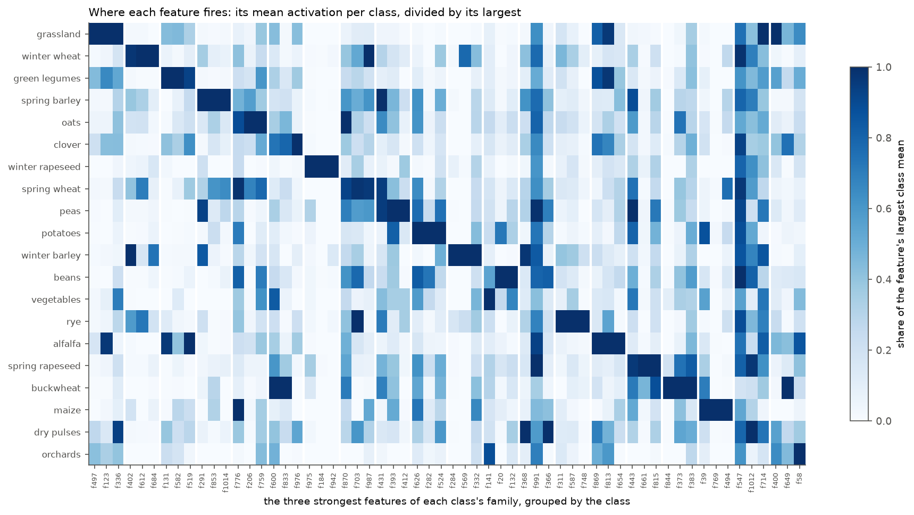

**What it shows.** Each class's **family** is the set of features whose mean activation on that class is at least
twice their mean on all field pixels (chosen on validation). The columns are the three strongest features of each
family; each column is divided by its largest class mean, so 1 is the class it fires on most.

**What it tells us.** Most families have features that belong to their class: dark blocks on the diagonal for
grassland, winter wheat, green legumes, spring barley, oats, winter rapeseed, potatoes, winter barley, rye,
alfalfa, spring rapeseed, buckwheat and maize. Some features are broad and fire on many spring crops (f991, f547,
f1012). Alfalfa's features fire almost as much on grassland and green legumes, which is why alfalfa has no good
single feature although it has "its own" features. Not every feature is about crops. On the uniform test pixels,
358 of the 1,024 features fire on at least 1 in 1,000 field-interior pixels and 226 fire mainly outside fields.
More than half (553) fire on fewer than 1 in 1,000 pixels of any kind. These groups overlap (last table of
`tables.md`).

### 6. Three features on the map

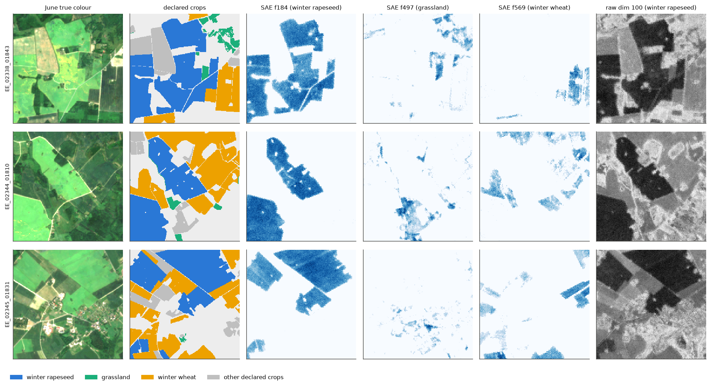

**What it shows.** Three test chips rich in winter rapeseed, winter wheat and grassland: the June image, the
declared crops, the activation of the best SAE feature of each of the three crops, and the raw dimension that best
marks rapeseed.

**What it tells us.** The rapeseed feature f184 fills the rapeseed fields and is zero everywhere else, edges and
farmyards included. The raw dimension 100 also picks out the rapeseed fields (dark), but it varies over forest,
villages and other fields too, so a threshold on it makes errors. The grassland and winter wheat features fire on
parts of their fields only: they cover one kind of grassland or wheat, and other features cover the rest.

### 7. What the features look like through the season

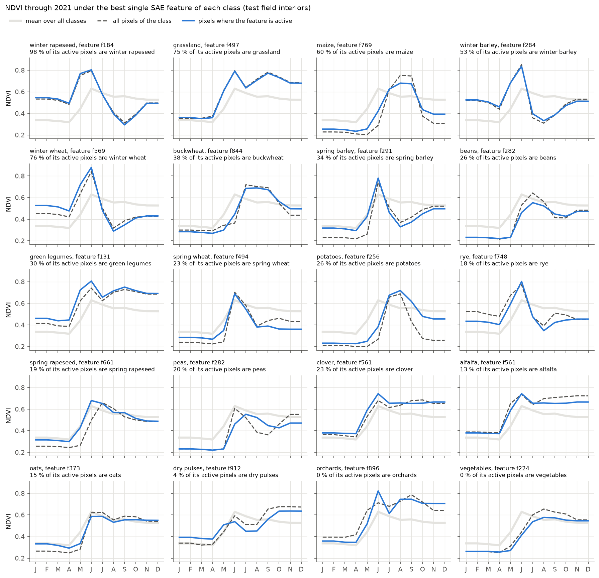

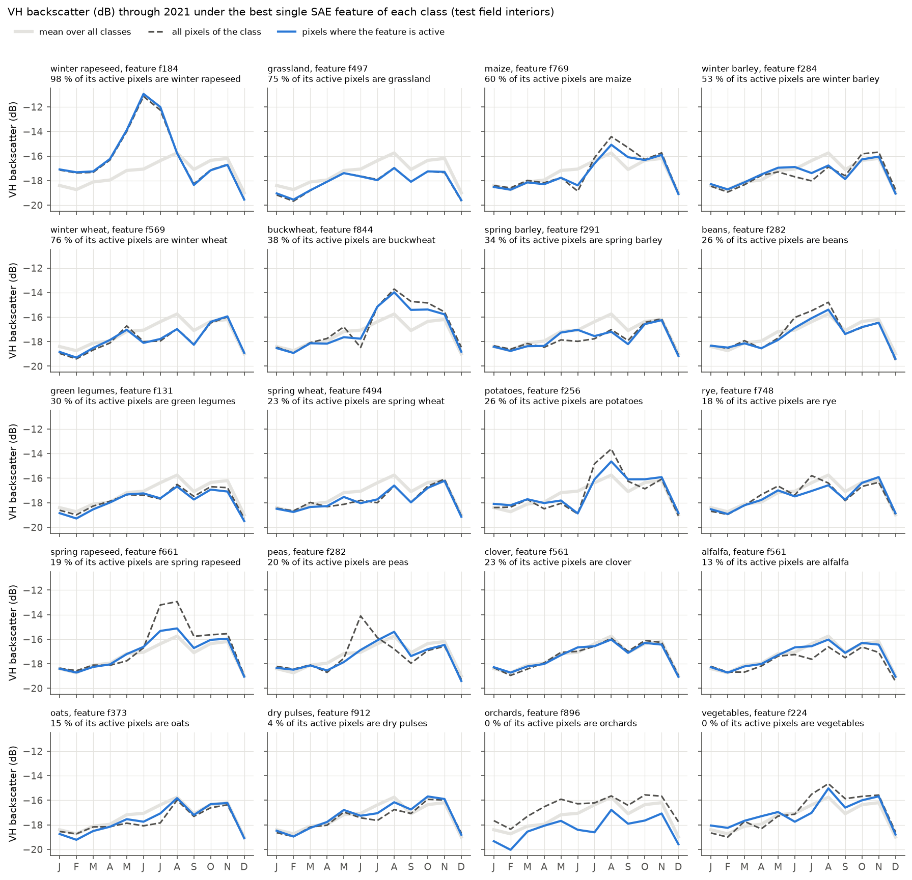

**What it shows.** For each class's best SAE feature: the monthly Sentinel-2 NDVI and Sentinel-1 VH of the test
field-interior pixels where the feature is on (blue), of all pixels of the class (dashed), and the mean over all
classes (grey). The panel title gives the share of the feature's pixels that belong to the class. January to March
and November to December are mostly filled from the nearest clear month in our composites (pipeline.md section 5),
so read the curves from April to October.

**What it tells us.** The clean features follow the crop calendars:

- **Winter rapeseed (f184)** is green early and peaks in May and June. NDVI falls to 0.3 by September, after the
  harvest. Its VH backscatter climbs to about -11 dB in June, 5 dB above the other crops: the dense flowering and
  podding canopy, a known radar signature of rapeseed.
- **Winter wheat (f569) and winter barley (f284)** are already green in April, peak in June and drop in July, barley
  earlier than wheat.
- **Maize (f769)** stays bare until June, then peaks in August and September, with a VH maximum in August.
- **Buckwheat (f844)**, sown late, is green from July to September.
- **Grassland (f497)** shows a June peak, a dip in July and a second peak in August: the first cut and the regrowth.

Where a feature is impure, the curve shows it. The potato feature's pixels stay green into October while potato
fields are bare by then, so the feature also fires on other late crops.

### 8. Does the crop head use these features?

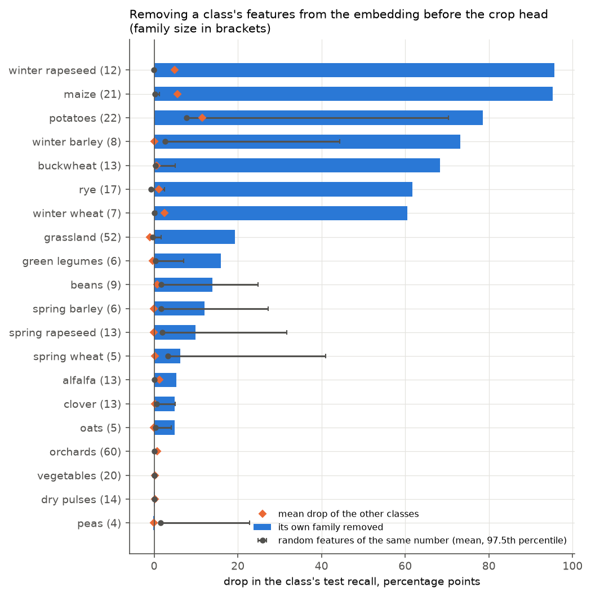

**What it shows.** Each class's family (from validation) is subtracted from the test embedding: each family feature's
contribution, activation times direction, is removed and everything else, the reconstruction error included, is
kept. The trained head then predicts again. Blue: the drop in that class's recall. Grey: the same for 100 random
sets of live features of the same size (mean and 97.5th percentile). Orange: the mean drop of the other classes.

**What it tells us.** This is the clearest result. The head relies on these features, and on them specifically:

| class | features removed | recall before → after | random sets of the same size, mean | other classes' mean drop |
|---|---|---|---|---|
| winter rapeseed | 12 | 0.98 → 0.02 | 0.0 pp | 4.9 pp |
| maize | 21 | 0.95 → 0.00 | 0.2 pp | 5.6 pp |
| potatoes | 22 | 0.80 → 0.01 | 7.8 pp | 11.5 pp |
| winter barley | 8 | 0.91 → 0.18 | 2.6 pp | 0.1 pp |
| buckwheat | 13 | 0.85 → 0.16 | 0.4 pp | 0.6 pp |
| rye | 17 | 0.65 → 0.04 | -0.7 pp | 1.1 pp |
| winter wheat | 7 | 0.95 → 0.35 | 0.0 pp | 2.5 pp |

For winter rapeseed, winter barley, buckwheat and winter wheat, the one strongest feature alone takes off almost
all of it (96, 75, 66 and 57 pp). The pixels go where an agronomist would expect: without its features, winter
barley is read as winter wheat (79 %), rye as winter wheat (71 %), and maize as spring cereals. For grassland (52
features, 19 pp), green legumes, beans, the spring cereals, spring rapeseed, clover and oats the drop is small, and
for several of them it lies within the random sets' range. Their evidence is spread over features that other
classes share. Peas do not move at all: their 4 family features are not what the head uses.

### 9. A crop map from feature families alone

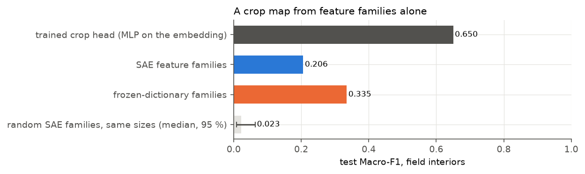

**What it shows.** Each test pixel gets the class whose family has the highest mean activation, with no trained
head.

**What it tells us.** The families alone make a poor crop map: Macro-F1 0.21, against 0.65 for the head on the same
pixels. That is far above random families of the same sizes (0.02), but below the frozen dictionary's families
(0.34), so this test does not favour the trained SAE either. Part of it is the rule: a large family has a low mean
(grassland, 52 features, F1 0.08), and the SAE's families differ more in size. Winter rapeseed (0.93), maize (0.77)
and winter wheat (0.63) are read correctly from their families alone.

### 10. Do the features come back with another seed?

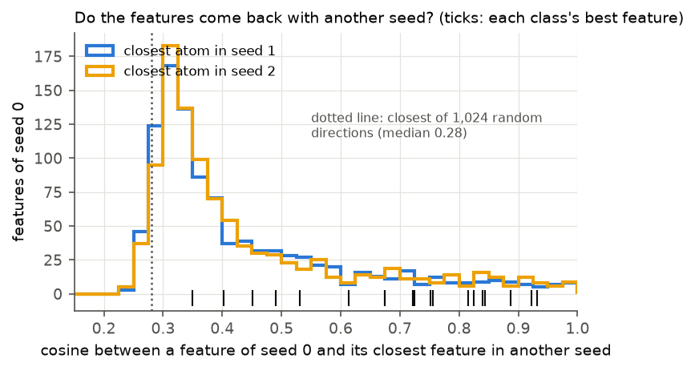

**What it shows.** For each feature of the seed-0 SAE, the cosine to the closest feature of the SAE trained with seed
1 (blue) or 2 (orange). 1 means the same direction. The dotted line is what random directions give. The ticks mark
each class's best feature.

**What it tells us.** Most of the dictionary is not reproducible: only 3 % of the features return at a cosine of 0.9
or more, and 10 to 12 % at 0.7. The median match (0.36) lies just above random directions (0.28). The unstable
ones are mainly the rare features. The 553 features that fire on fewer than 1 in 1,000 pixels have a median match
of 0.32, while 31 and 34 % of the 257 features that fire on at least 1 in 100 pixels return at 0.7 or more. The features
that carry the crops do return. The best features for winter rapeseed (cosine 0.84 and 0.87), maize (0.92, 0.89),
winter barley (0.93, 0.83), winter wheat (0.83, 0.84) and buckwheat (0.75, 0.84) are found again by both other
seeds, with about the same test F1.

### Training

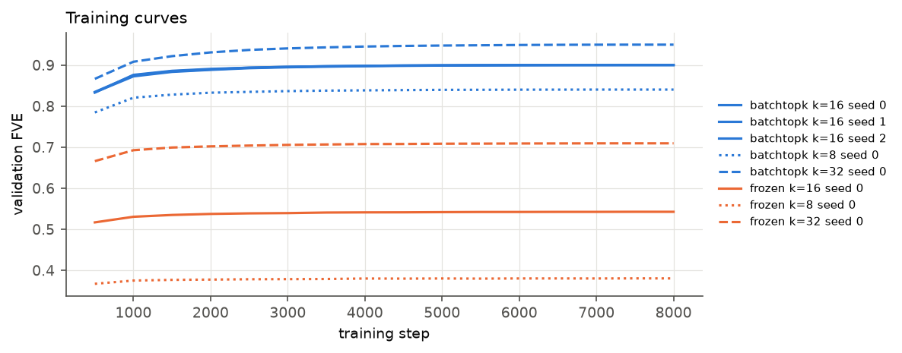

All eight SAEs flatten out by step 4,000 of 8,000. No feature was dead at the end. The three seeds at k = 16 overlap.

## Analysis

**What is solid.** Four results are solid. The SAE is a good compression of the TESSERA store embedding: 90 % of
the variance from 16 of 1,024 features, the same for every seed. Its reconstruction keeps the crop map at 0.558
against 0.623. For the crops with a season unlike the others (winter rapeseed, maize, the winter cereals,
buckwheat), it finds one or a few features that mark the crop, that look like the crop's calendar in NDVI and
radar, that reappear with other seeds, and that the trained head cannot do without. Removing them takes the crop
off the map, while the other crops lose 0 to 6 points of recall on average (potatoes: 12). Random sets of the same
size do almost nothing. This is the
causal test Young and Keshav ask for, and it passes for 7 of 20 classes.

**What does not hold.** The trained SAE is not better than a frozen random dictionary at the label-based tests: the
best single feature per class, alignment and the families. This is the warning of the geosae paper: sparse codes
over many directions look monosemantic whether or not the directions are learned. These tests therefore cannot
show that the SAE learned crops. Only the reconstruction, the head on the reconstruction and the stability of the
crop features separate the trained SAE from the control, and there the trained SAE wins clearly.

**What the pattern says about the embedding.** The crops that are clean in the SAE differ most in timing: sown in
autumn, flowering yellow, or green only late in the summer. The head maps them best (F1 0.85 to 0.96 for winter
rapeseed, maize, winter wheat, winter barley and buckwheat). The spring cereals, legumes, clover and grass mixtures
share one season, and in the SAE they share features. The head still maps some of them well (peas 0.85, beans 0.83,
spring barley 0.79), but from many small differences spread over shared features, not from one feature of their
own. For these classes the SAE shows no hidden crop code. Whether a larger dictionary would split them further was
not tested.

**For the thesis (Phase 2).** The useful part for explaining a crop map is the combination of ablation and profiles:

- for a map pixel, the 16 active features;
- for each feature, its seasonal curve and the crops it fires on;
- for each crop, the features whose removal changes the head's decision.

For the distinct crops this gives a short, checkable explanation in agronomic terms ("read as rapeseed because of
the May and June flowering feature"). For the spring crops it shows honestly that the decision rests on many shared
features. It connects to the agronomic ground truth of the explainability set-up: the feature profiles can be
compared with the crop calendars per zone.

## Caveats

- **The retired store embedding.** This is TESSERA v1.0 from the store, 0.7 px off the chip grid, not the frozen v2
  Medium of the main workflow. Field interiors absorb the offset for the scores, but the result belongs to the store
  embedding.
- **One crop head.** The ablation reads one head fit (K = 100 %, draw 0, seed 0). Another head may use other
  features.
- **No ablation control with the frozen dictionary,** and no ablation of raw dimensions. The random-set null shows
  that the chosen SAE features matter more than other SAE features, not that the SAE beats other ways of finding
  directions. The rapeseed raw dimension (d100) might also remove rapeseed when projected out.
- **20 Estonian classes,** not the 21-species and 9-group scheme of the XAI work. Vegetables, orchards and dry pulses
  are in the scores, but the head does not map them (F1 at most 0.01), so nothing can be said about them.
- **Filled winter months.** NDVI and backscatter for January to March and November to December are mostly filled in
  the composites (January equals February in 99 % of pixels). The profiles mean something from April to October only.
- **CPU training with a two-stage top-k** (each pixel's 128 largest, then the batch-wide top k times the batch
  size). The per-pixel cap was reached by at most about one pixel in a batch of 8,192. One training length (8,000
  steps); the curves had flattened.
- **The family rule** (mean activation over the family) penalises large families. Another rule, a sum or a small
  classifier, would score the families differently. It was fixed before the test data were read.

## Next steps

1. **The same study on the frozen v2 Medium embedding** of the main workflow, the arm the thesis uses (about 7 h to
   encode on the hub), then on the fine-tuned TESSERA at K = 100 %. The question: are the crop features cleaner when
   the encoder has seen the labels?
2. **Close the ablation gap:** ablate the frozen dictionary's families and the best raw and PCA directions the same
   way, to see whether the SAE's directions are needed or any rapeseed direction would do.
3. **Name the features with phenometrics** (start, peak, end of season, peak VH) instead of crop labels, and check
   them against the crop calendars per zone of the explainability set-up, on the 21-species scheme.
4. AlphaEarth (64 dimensions) as a second embedding, if the v2 result holds.

Nothing here is proposed for the main workflow.

## Reproduce

From the repository root on the hub (CPU), after the extraction and head export:

    poetry run python experiments/2026-11-20_sae_tessera_store/run.py extract
    poetry run python experiments/2026-11-20_sae_tessera_store/run.py head
    poetry run python experiments/2026-11-20_sae_tessera_store/run.py train --run batchtopk_k16_s0   # one process per run in sae.yaml
    poetry run python experiments/2026-11-20_sae_tessera_store/run.py evaluate
    poetry run python experiments/2026-11-20_sae_tessera_store/report.py

Results, models and logs: `results/2026-11-20_sae_tessera_store/EE_2021_rev/` (`samples/`, `head/`, `runs/`,
`eval/summary.json`, `eval/arrays.npz`, `logs/`). The two-wave training script is `logs/train_all.sh`.
