# Field cases: what drives a confident prediction, by each method, against the AUC map

**Superseded** by the focused run's field cases, on windows, band groups and indices, with the AUC of each method's
main blocks: [../2026-11-26_xai_tessera_blocks/FIELD_CASES.md](../2026-11-26_xai_tessera_blocks/FIELD_CASES.md). This page stays as the
record of the first run.

Generated by `field_cases.py` from the explanations of this experiment ([REPORT.md](REPORT.md)). One field per
species, 10 in all: among the fields the model predicts correctly with p ≥ 0.95, the one with the most interior
pixels (a species with none takes its most confident correct field).

**How to read the numbers.** Scores are the field's mean log p over its interior; p = e^score. SHAP and IG values,
and the falls of occlusion, are differences of log p, so e^value is a factor: 0.7 doubles, 2.3 multiplies by ten,
a negative value works against the species. SHAP and IG start from the species-balanced training mean (the grey
dotted curve of each input figure) and share out the difference between the field's score and that reference's;
occlusion gives the fall of the score when one block alone is hidden.

**Each field has two figures.** *The input*: the monthly composites as TESSERA gets them, per band (median over the
interior pixels, the middle half shaded), against the species' training mean and the methods' reference. *The
drivers*: IG and occlusion per month × band group cell beside the species' AUC map (squares: its five best cells;
dot: the method's top cell), then each method's months and band groups, scaled to their largest value so the
rankings can be compared (grey: the species' best AUC months and groups).

## The fields at a glance

**Bold**: the main driver is one of the species' main AUC cues (top 3 months, top 2 band groups, top 5 cells).

| species | field | class | p | interior pixels | SHAP month | SHAP band group | IG cell | occlusion cell | AUC best cue | main drivers that are main AUC cues |
|---|---|---|---|---|---|---|---|---|---|---|
| grassland | 20522164 | pasture meadow grassland grass | 0.987 | 1700 | Jun | **NIR** | May NIR | Jul SWIR | Oct VV (0.89) | 3 of 9 |
| forage legumes | 21490882 | legumes harvested green | 0.981 | 2471 | Jun | **Red-edge** | Jun Red-edge | Jul Red-edge | May VV (0.74) | 3 of 9 |
| wheat | 22212206 | spring common soft wheat | 0.965 | 4579 | **Jun** | **Red-edge** | Jun NIR | **Jun Red-edge** | Jun Red-edge (0.83) | 7 of 9 |
| barley | 20399721 | winter barley | 0.990 | 3983 | Jul | Visible | Jun NIR | Jun Visible | Aug SWIR (0.74) | 0 of 9 |
| rye | 20655866 | rye | 0.951 | 617 | Jul | **Red-edge** | May Red-edge | Jul NIR | Jun SWIR (0.82) | 3 of 9 |
| oats | 20445995 | oats | 0.898 | 329 | **Jun** | NIR | Jun Visible | Jul NIR | Jul VV (0.81) | 4 of 9 |
| rapeseed | 20389874 | winter rapeseed rape | 0.996 | 2010 | **Jun** | Red-edge | May NIR | Jun SWIR | Jun VV (0.95) | 4 of 9 |
| dry pulses | 22229614 | beans | 0.980 | 12731 | Jul | Red-edge | Jun Red-edge | Jul Red-edge | Jun VH (0.82) | 2 of 9 |
| buckwheat | 21439328 | buckwheat | 0.965 | 599 | **Jul** | **Red-edge** | Jun NIR | **Jul Red-edge** | Sep VH (0.90) | 3 of 9 |
| maize | 20399830 | grain maize corn popcorn | 0.980 | 2500 | Jul | **Red-edge** | Jun Red-edge | May SWIR | Sep Red-edge (0.92) | 3 of 9 |

**What the cases show.** The methods agree with one another on when: SHAP and IG name the same month
in 6 of the 10 fields and neighbouring months in the other 4, all between May and July. The model's evidence
is optical in every case, mostly red-edge and NIR. Against the AUC map, the band group agrees most often (SHAP: 6 of 10 fields), the
month less (SHAP: 4 of 10) and single cells rarely (occlusion: wheat and buckwheat; IG: none, though its top cells
are good cues, AUC 0.56 to 0.87). Where the data's strongest cue is radar (grassland, forage legumes, oats,
rapeseed, dry pulses, buckwheat), the cue is visible in the field's own curves, yet the model's main drivers are
optical; for barley the AUC map is flat, so its misses are near ties.

## Grassland: field 20522164, chip `EE_02334_01781`

pasture meadow grassland grass, 1700 interior pixels, **p = 0.987**; rival forage legumes, 4.69 in log p, so grassland is 109 times more likely.

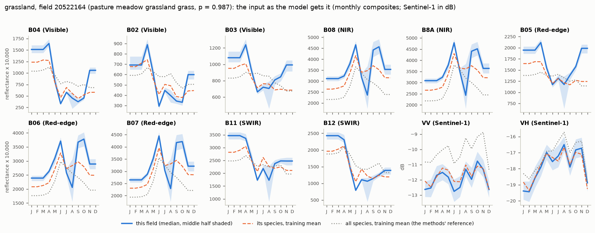

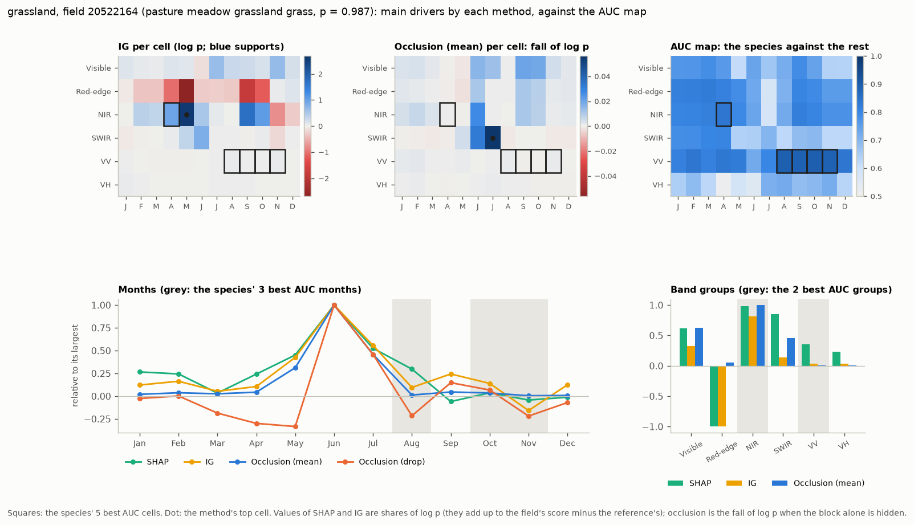

Main driver of each method, with its value and its AUC; **bold** = one of the species' main AUC cues.

| level | AUC main cues | SHAP | IG | Occlusion (mean) | Occlusion (drop) |
|---|---|---|---|---|---|
| cells (AUC top 5 of 72) | Oct VV 0.89, Aug VV 0.89, Nov VV 0.89, Sep VV 0.88, Apr NIR 0.84 | – | May NIR (2.62; AUC 0.80) | Jul SWIR (0.06; AUC 0.70) | – |
| months (AUC top 3 of 12) | Oct 0.89, Aug 0.89, Nov 0.89 | Jun (0.92; AUC 0.74) | Jun (0.95; AUC 0.74) | Jun (0.33; AUC 0.74) | Jun (0.01; AUC 0.74) |
| band groups (AUC top 2 of 6) | VV 0.89, NIR 0.84 | **NIR** (1.33; AUC 0.84) | **NIR** (6.65; AUC 0.84) | **NIR** (0.41; AUC 0.84) | – |

**What it tells us.** All methods agree that the model recognises this grassland by its green canopy in late spring: NIR, May and June. NIR is one of the data's two main groups (AUC 0.84), so the band group agrees; the month does not. The data's best grassland cues are August to November VV (lower backscatter, AUC 0.88 to 0.89), and the field shows that cue (October VV −10.8 dB against −9.2 dB for the reference), but no method finds the model using it.

## Forage legumes: field 21490882, chip `EE_02360_01832`

legumes harvested green, 2471 interior pixels, **p = 0.981**; rival grassland, 4.43 in log p, so forage legumes is 84 times more likely.

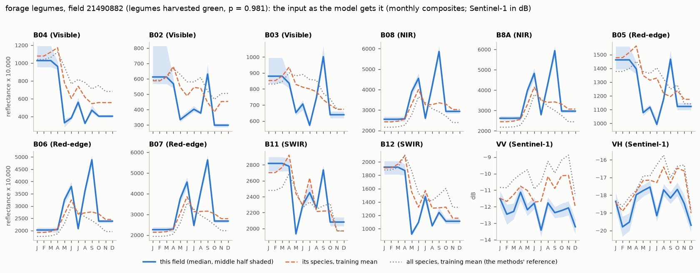

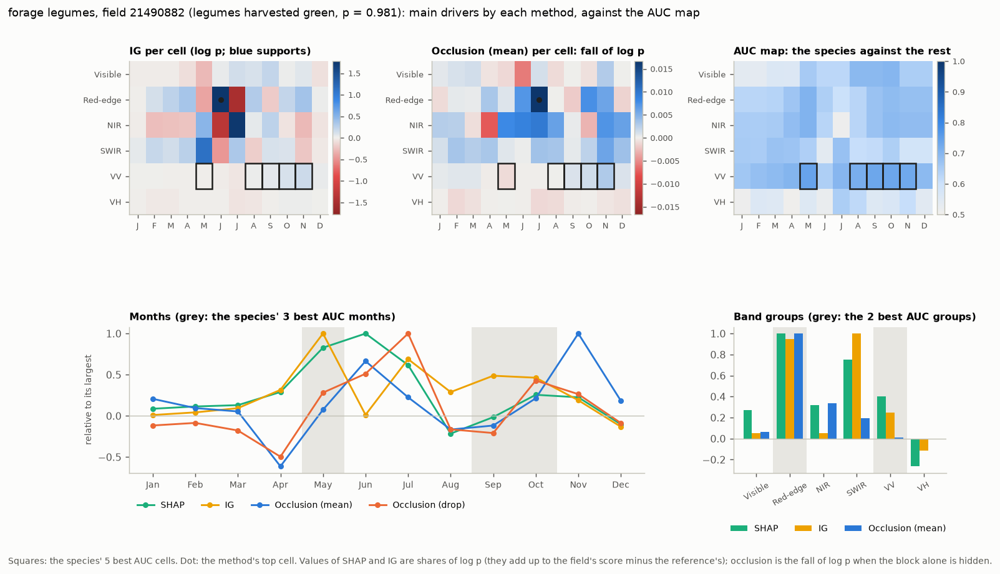

Main driver of each method, with its value and its AUC; **bold** = one of the species' main AUC cues.

| level | AUC main cues | SHAP | IG | Occlusion (mean) | Occlusion (drop) |
|---|---|---|---|---|---|
| cells (AUC top 5 of 72) | May VV 0.74, Oct VV 0.73, Sep VV 0.73, Nov VV 0.73, Aug VV 0.72 | – | Jun Red-edge (1.78; AUC 0.64) | Jul Red-edge (0.02; AUC 0.60) | – |
| months (AUC top 3 of 12) | May 0.74, Oct 0.73, Sep 0.73 | Jun (0.97; AUC 0.64) | **May** (0.90; AUC 0.74) | Nov (0.01; AUC 0.73) | Jul (0.01; AUC 0.70) |
| band groups (AUC top 2 of 6) | VV 0.74, Red-edge 0.71 | **Red-edge** (1.26; AUC 0.71) | SWIR (1.42; AUC 0.68) | **Red-edge** (0.92; AUC 0.71) | – |

**What it tells us.** The model's evidence is June red-edge (SHAP and occlusion; red-edge is the data's second group, 0.71); IG puts it in May, one of the data's months. The data itself has no sharp cue for forage legumes: its best cells are VV in May and in autumn, all 0.72 to 0.74. Occlusion's months rest on falls of 0.01 and say nothing.

## Wheat: field 22212206, chip `EE_02373_01780`

spring common soft wheat, 4579 interior pixels, **p = 0.965**; rival oats, 5.13 in log p, so wheat is 169 times more likely.

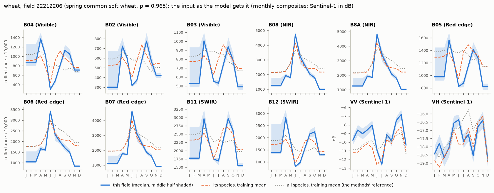

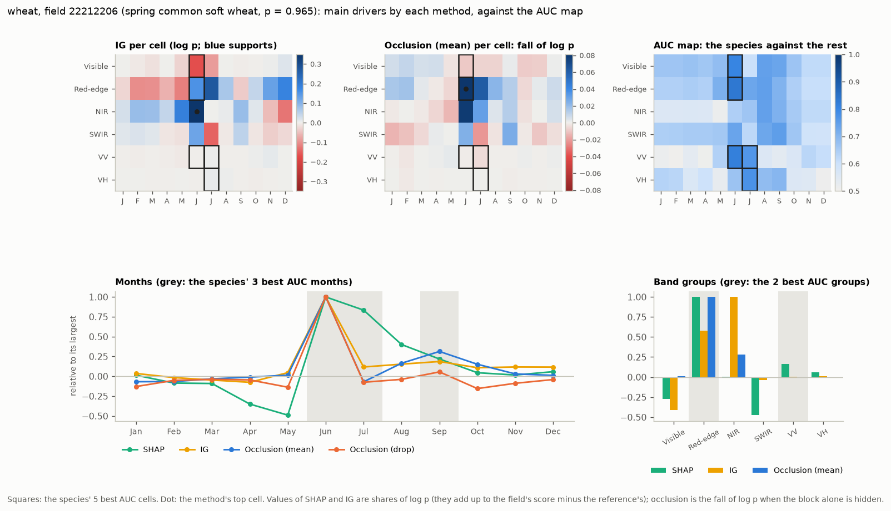

Main driver of each method, with its value and its AUC; **bold** = one of the species' main AUC cues.

| level | AUC main cues | SHAP | IG | Occlusion (mean) | Occlusion (drop) |
|---|---|---|---|---|---|
| cells (AUC top 5 of 72) | Jun Red-edge 0.83, Jun VV 0.82, Jun Visible 0.80, Jul VH 0.78, Jul VV 0.77 | – | Jun NIR (0.35; AUC 0.64) | **Jun Red-edge** (0.08; AUC 0.83) | – |
| months (AUC top 3 of 12) | Jun 0.83, Jul 0.78, Sep 0.75 | **Jun** (0.50; AUC 0.83) | **Jun** (0.46; AUC 0.83) | **Jun** (0.19; AUC 0.83) | **Jun** (0.09; AUC 0.83) |
| band groups (AUC top 2 of 6) | Red-edge 0.83, VV 0.82 | **Red-edge** (1.63; AUC 0.83) | NIR (0.69; AUC 0.74) | **Red-edge** (2.90; AUC 0.83) | – |

**What it tells us.** The clearest agreement. Every method puts the evidence in June, SHAP and occlusion on red-edge, and occlusion's top cell is June red-edge, the species' best cue (AUC 0.83). The field shows it plainly: June B05 is 824 against 1,363 for the reference (a dense, chlorophyll-rich canopy absorbs more). IG names June NIR, the same canopy seen through the correlated NIR band.

## Barley: field 20399721, chip `EE_02338_01826`

winter barley, 3983 interior pixels, **p = 0.990**; rival wheat, 6.50 in log p, so barley is 665 times more likely.

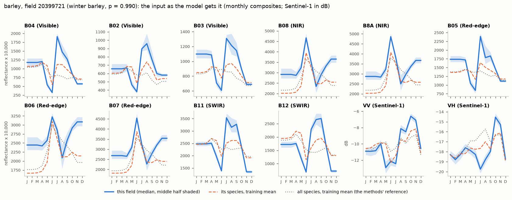

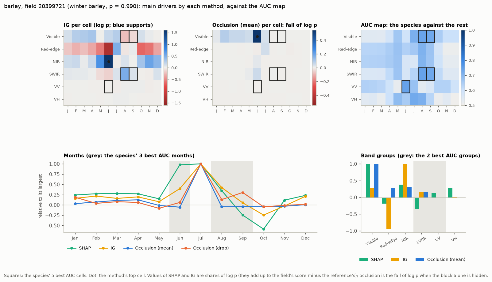

Main driver of each method, with its value and its AUC; **bold** = one of the species' main AUC cues.

| level | AUC main cues | SHAP | IG | Occlusion (mean) | Occlusion (drop) |
|---|---|---|---|---|---|
| cells (AUC top 5 of 72) | Aug SWIR 0.74, Jun VV 0.74, Aug Visible 0.74, Sep SWIR 0.73, Sep Visible 0.73 | – | Jun NIR (1.61; AUC 0.57) | Jun Visible (0.55; AUC 0.59) | – |
| months (AUC top 3 of 12) | Aug 0.74, Jun 0.74, Sep 0.73 | Jul (0.72; AUC 0.73) | Jul (0.84; AUC 0.73) | Jul (0.11; AUC 0.73) | Jul (0.05; AUC 0.73) |
| band groups (AUC top 2 of 6) | SWIR 0.74, VV 0.74 | Visible (1.74; AUC 0.74) | NIR (4.29; AUC 0.70) | Visible (4.29; AUC 0.74) | – |

**What it tells us.** No main driver is one of the AUC main cues, but the misses are near ties: barley has no strong single cue (best 0.74), and the model's July (0.73) and visible (0.74) are as good in the data as the top ones. The data's August SWIR cue (ripe or harvested crop) is strongly present in the field (B12 2,654 against 1,421) and unused.

## Rye: field 20655866, chip `EE_02337_01791`

rye, 617 interior pixels, **p = 0.951**; rival wheat, 6.02 in log p, so rye is 411 times more likely.

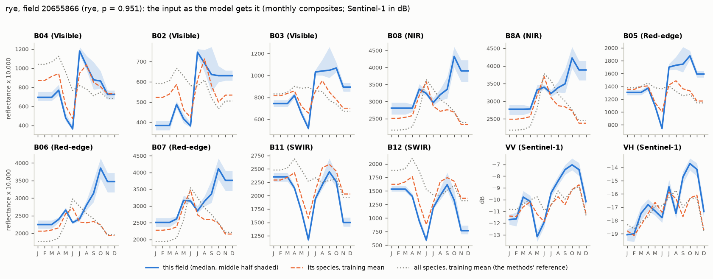

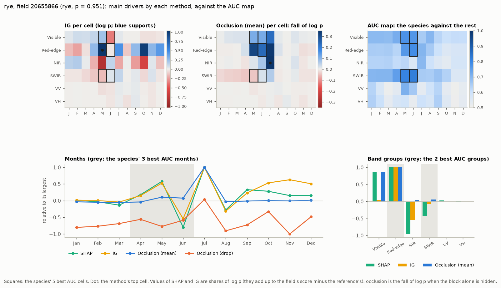

Main driver of each method, with its value and its AUC; **bold** = one of the species' main AUC cues.

| level | AUC main cues | SHAP | IG | Occlusion (mean) | Occlusion (drop) |
|---|---|---|---|---|---|
| cells (AUC top 5 of 72) | Jun SWIR 0.82, May SWIR 0.81, Jun Red-edge 0.79, May Visible 0.77, Jun Visible 0.77 | – | May Red-edge (1.04; AUC 0.76) | Jul NIR (0.35; AUC 0.69) | – |
| months (AUC top 3 of 12) | Jun 0.82, May 0.81, Apr 0.75 | Jul (0.86; AUC 0.70) | Jul (0.46; AUC 0.70) | Jul (0.66; AUC 0.70) | Jul (0.00; AUC 0.70) |
| band groups (AUC top 2 of 6) | SWIR 0.82, Red-edge 0.79 | **Red-edge** (2.34; AUC 0.79) | **Red-edge** (3.13; AUC 0.79) | **Red-edge** (5.52; AUC 0.79) | – |

**What it tells us.** The three methods agree on red-edge, one of the data's two main groups (0.79); IG's top cell, May red-edge, is the rye canopy's chlorophyll, close to the data's best cells (June SWIR 0.82, June red-edge 0.79). The month disagrees: the model looks at July, the data at May and June.

## Oats: field 20445995, chip `EE_02334_01782`

oats, 329 interior pixels, **p = 0.898** (no correct field of this species reaches p = 0.95; its most confident one); rival barley, 3.54 in log p, so oats is 34 times more likely.

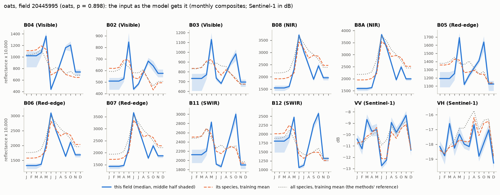

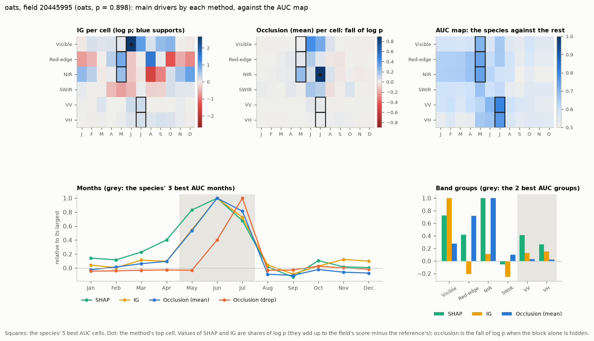

Main driver of each method, with its value and its AUC; **bold** = one of the species' main AUC cues.

| level | AUC main cues | SHAP | IG | Occlusion (mean) | Occlusion (drop) |
|---|---|---|---|---|---|
| cells (AUC top 5 of 72) | Jul VV 0.81, Jul VH 0.76, May NIR 0.74, May Red-edge 0.74, May Visible 0.70 | – | Jun Visible (2.68; AUC 0.56) | Jul NIR (0.90; AUC 0.59) | – |
| months (AUC top 3 of 12) | Jul 0.81, May 0.74, Jun 0.70 | **Jun** (1.58; AUC 0.70) | **Jun** (1.97; AUC 0.70) | **Jun** (0.30; AUC 0.70) | **Jul** (0.75; AUC 0.81) |
| band groups (AUC top 2 of 6) | VV 0.81, VH 0.76 | NIR (1.95; AUC 0.74) | Visible (5.80; AUC 0.70) | NIR (3.94; AUC 0.74) | – |

**What it tells us.** The least confident case (p = 0.90). The methods find June and July, the data's months, but read them through NIR and visible, while the data's main cue is July VV (lower backscatter, 0.81), which the field shows (−12.2 dB against −10.5 dB).

## Rapeseed: field 20389874, chip `EE_02357_01797`

winter rapeseed rape, 2010 interior pixels, **p = 0.996**; rival wheat, 5.90 in log p, so rapeseed is 363 times more likely.

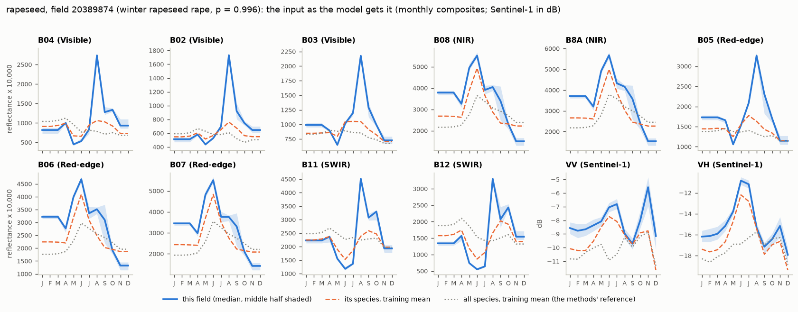

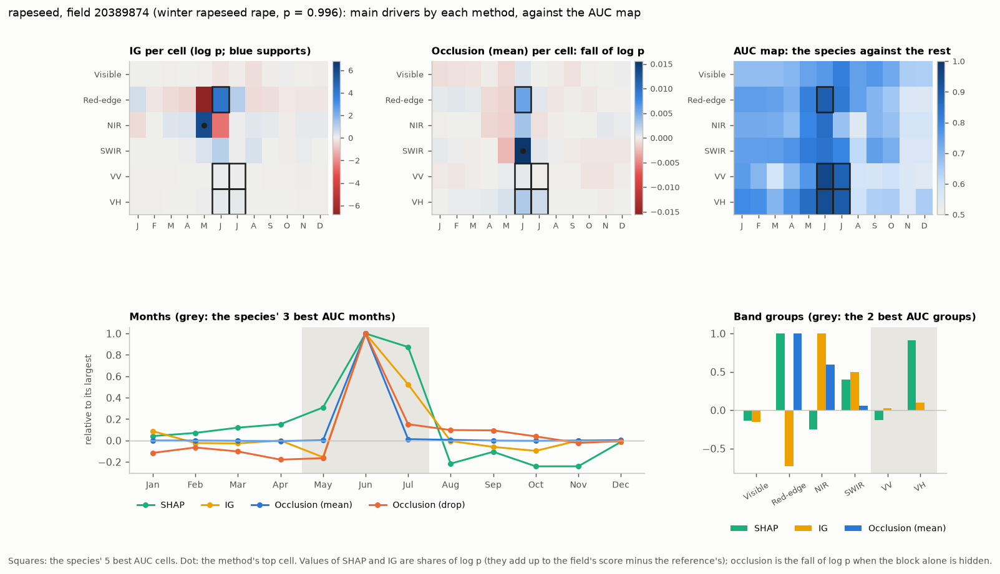

Main driver of each method, with its value and its AUC; **bold** = one of the species' main AUC cues.

| level | AUC main cues | SHAP | IG | Occlusion (mean) | Occlusion (drop) |
|---|---|---|---|---|---|
| cells (AUC top 5 of 72) | Jun VV 0.95, Jun VH 0.94, Jul VH 0.90, Jun Red-edge 0.89, Jul VV 0.89 | – | May NIR (5.85; AUC 0.80) | Jun SWIR (0.02; AUC 0.84) | – |
| months (AUC top 3 of 12) | Jun 0.95, Jul 0.90, May 0.86 | **Jun** (1.87; AUC 0.95) | **Jun** (2.71; AUC 0.95) | **Jun** (0.14; AUC 0.95) | **Jun** (0.01; AUC 0.95) |
| band groups (AUC top 2 of 6) | VV 0.95, VH 0.94 | Red-edge (1.83; AUC 0.89) | NIR (4.58; AUC 0.86) | Red-edge (6.14; AUC 0.89) | – |

**What it tells us.** June, the data's best month, for every method. The data's best cues are June radar (VV 0.95, VH 0.94) and the field shows them (VV −7.1 dB against −10.9 dB), but the model leads with red-edge and NIR, the canopy of May and June; SHAP does rank VH second among the band groups. The jump of the visible and SWIR bands in August is the harvest.

## Dry pulses: field 22229614, chip `EE_02335_01824`

beans, 12731 interior pixels, **p = 0.980**; rival forage legumes, 7.53 in log p, so dry pulses is 1,865 times more likely.

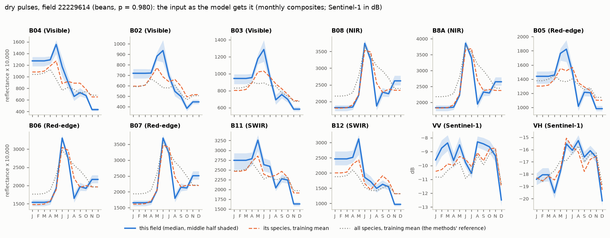

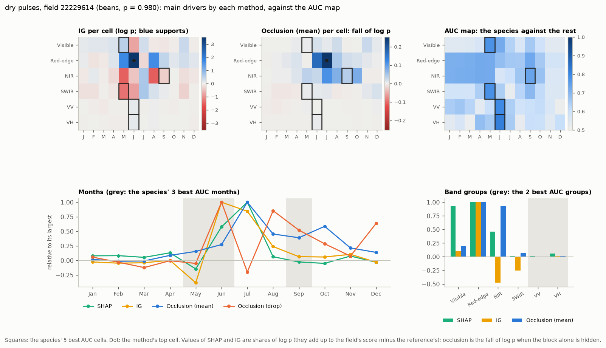

Main driver of each method, with its value and its AUC; **bold** = one of the species' main AUC cues.

| level | AUC main cues | SHAP | IG | Occlusion (mean) | Occlusion (drop) |
|---|---|---|---|---|---|
| cells (AUC top 5 of 72) | Jun VH 0.82, Jun VV 0.79, May SWIR 0.78, May Visible 0.78, Sep NIR 0.74 | – | Jun Red-edge (3.54; AUC 0.68) | Jul Red-edge (0.25; AUC 0.66) | – |
| months (AUC top 3 of 12) | Jun 0.82, May 0.78, Sep 0.74 | Jul (1.61; AUC 0.66) | **Jun** (1.62; AUC 0.82) | Jul (0.13; AUC 0.66) | **Jun** (0.04; AUC 0.82) |
| band groups (AUC top 2 of 6) | VH 0.82, VV 0.79 | Red-edge (1.18; AUC 0.73) | Red-edge (7.79; AUC 0.73) | Red-edge (0.62; AUC 0.73) | – |

**What it tells us.** The three methods agree on red-edge in June and July (AUC 0.73). The data's main cue is June radar (VH 0.82, VV 0.79), present in the field (VH −15.5 dB against −16.9 dB) but not what the model uses.

## Buckwheat: field 21439328, chip `EE_02388_01778`

buckwheat, 599 interior pixels, **p = 0.965**; rival rapeseed, 4.69 in log p, so buckwheat is 108 times more likely.

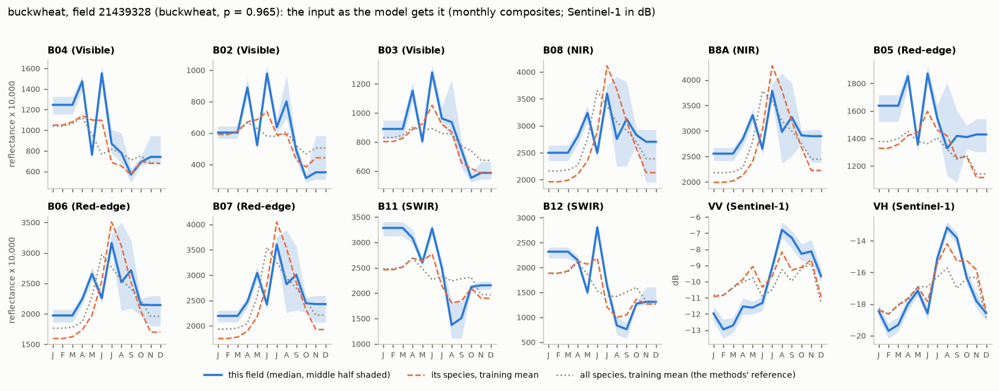

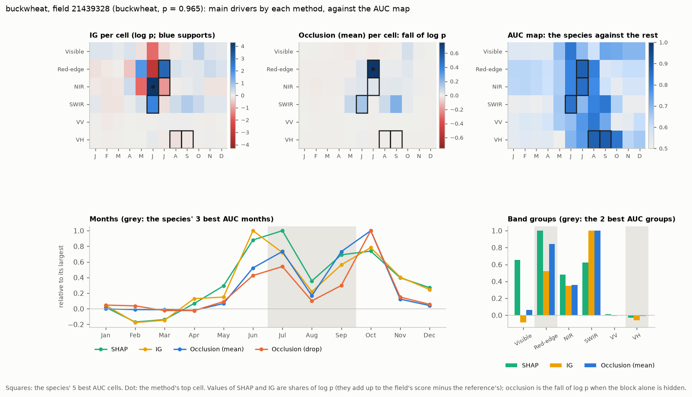

Main driver of each method, with its value and its AUC; **bold** = one of the species' main AUC cues.

| level | AUC main cues | SHAP | IG | Occlusion (mean) | Occlusion (drop) |
|---|---|---|---|---|---|
| cells (AUC top 5 of 72) | Sep VH 0.90, Aug VH 0.89, Jul Red-edge 0.89, Jul NIR 0.86, Jun SWIR 0.85 | – | Jun NIR (4.31; AUC 0.81) | **Jul Red-edge** (0.75; AUC 0.89) | – |
| months (AUC top 3 of 12) | Sep 0.90, Aug 0.89, Jul 0.89 | **Jul** (1.64; AUC 0.89) | Jun (1.83; AUC 0.85) | Oct (0.67; AUC 0.84) | Oct (0.16; AUC 0.84) |
| band groups (AUC top 2 of 6) | VH 0.90, Red-edge 0.89 | **Red-edge** (2.63; AUC 0.89) | SWIR (4.20; AUC 0.85) | SWIR (1.48; AUC 0.85) | – |

**What it tells us.** The methods split. SHAP gives July red-edge, both among the data's cues, and occlusion's top cell is July red-edge too (0.89, one of the five best). IG points to June NIR, low because buckwheat is sown late and has little canopy in June (2,651 against 3,784 for the reference), itself a good cue (0.81). The data's best cue, September VH, is present in the field and unused.

## Maize: field 20399830, chip `EE_02338_01826`

grain maize corn popcorn, 2500 interior pixels, **p = 0.980**; rival wheat, 7.34 in log p, so maize is 1,540 times more likely.

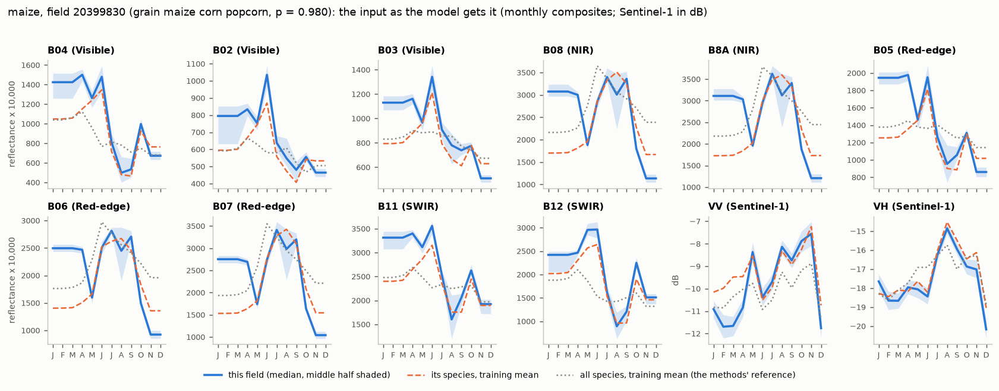

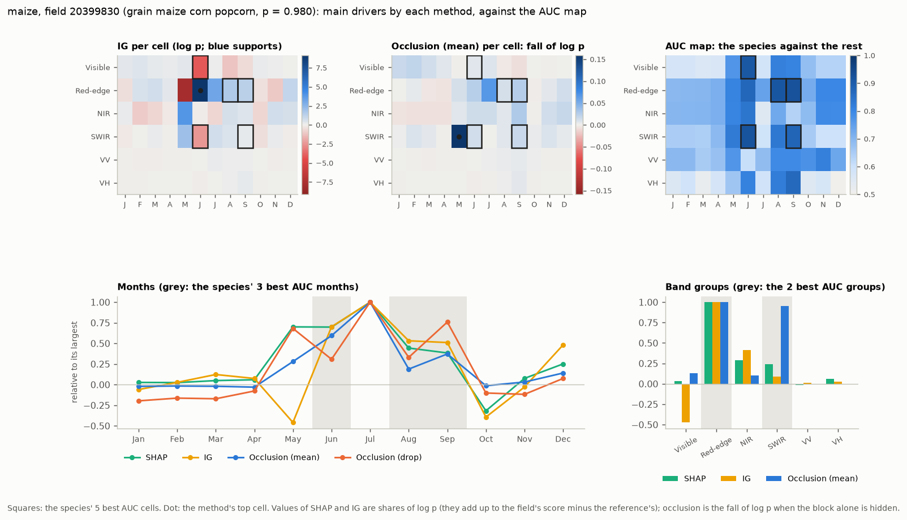

Main driver of each method, with its value and its AUC; **bold** = one of the species' main AUC cues.

| level | AUC main cues | SHAP | IG | Occlusion (mean) | Occlusion (drop) |
|---|---|---|---|---|---|
| cells (AUC top 5 of 72) | Sep Red-edge 0.92, Jun SWIR 0.92, Aug Red-edge 0.91, Jun Visible 0.91, Sep SWIR 0.88 | – | Jun Red-edge (9.12; AUC 0.87) | May SWIR (0.16; AUC 0.83) | – |
| months (AUC top 3 of 12) | Sep 0.92, Jun 0.92, Aug 0.91 | Jul (2.60; AUC 0.74) | Jul (3.52; AUC 0.74) | Jul (0.15; AUC 0.74) | Jul (0.05; AUC 0.74) |
| band groups (AUC top 2 of 6) | Red-edge 0.92, SWIR 0.92 | **Red-edge** (5.49; AUC 0.92) | **Red-edge** (8.24; AUC 0.92) | **Red-edge** (4.94; AUC 0.92) | – |

**What it tells us.** Red-edge, the data's main group, for all three methods. IG's top cell, June red-edge (0.87), is nearly as strong as the best (0.92): in June the maize field is still mostly bare (B05 1,952 against 1,363). The model's month, July, is the summer month where no single band tells maize apart well (0.74), so the model's July evidence comes from bands combined.
