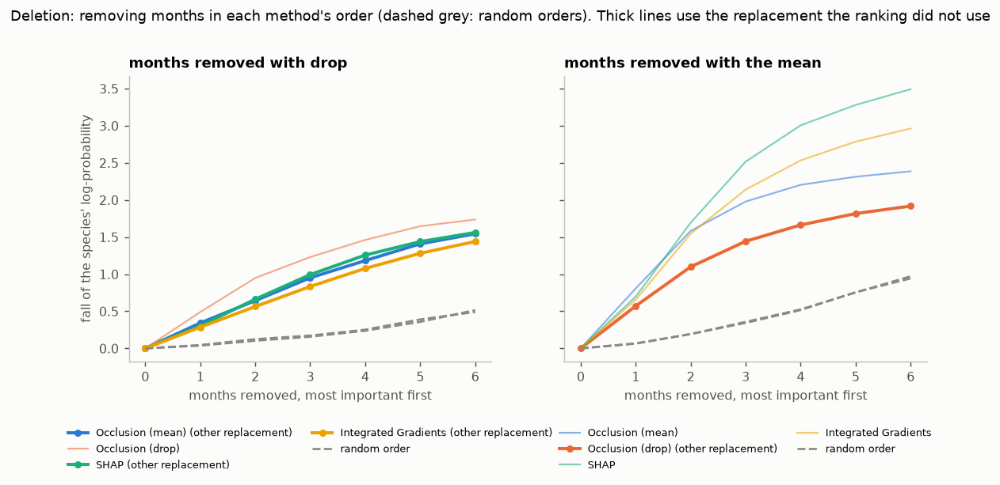
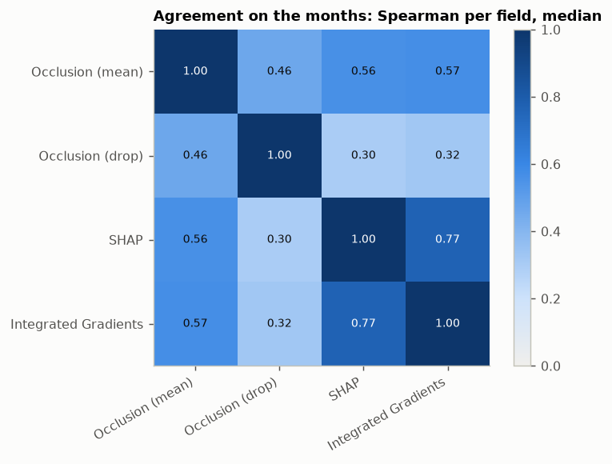
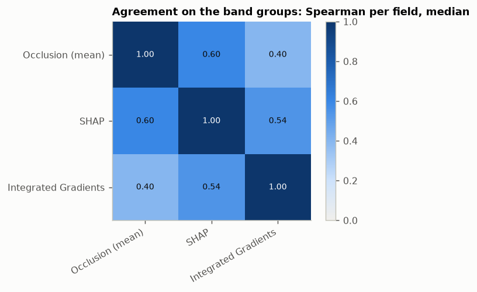
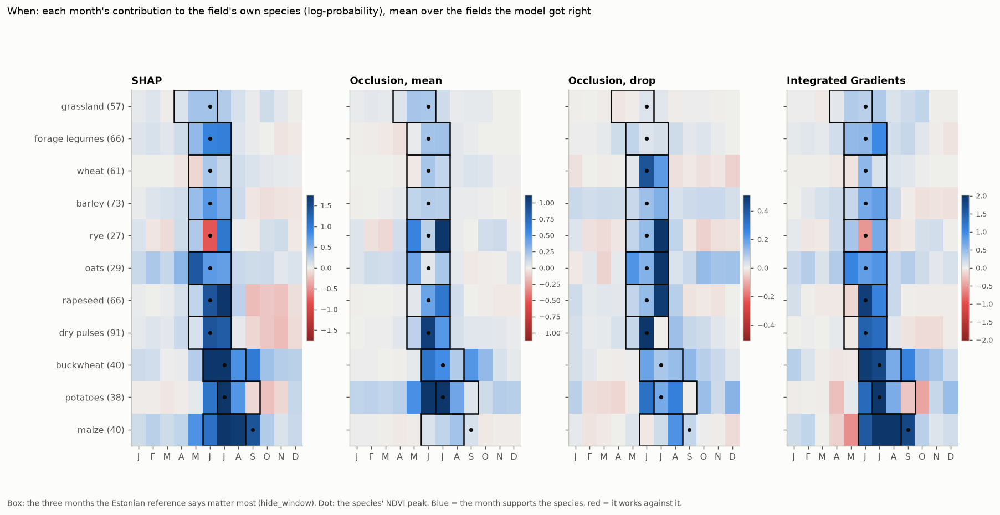
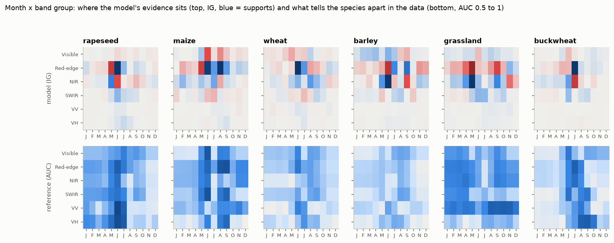

# XAI on TESSERA: occlusion, SHAP and Integrated Gradients against the Estonian crop signatures: report, 25 November 2026

**Answer.** The three methods pass every check, and so describe the model rather than the input: SHAP's and IG's
parts add up to the total change, removing months in their order lowers the score three to five times faster than
removing them at random, and on a randomised network the explanations lose all relation to the trained one
(Spearman −0.12 to 0.05). Against the crop signatures, **"when" agrees**: in 21 of 22 species × method cases the
model's costliest three months are the reference window or the window next to it, mostly one month later, and 34 to
78 % of the SHAP and IG attribution falls in the expected three months (25 % if spread evenly). **"Which property"
agrees only in part**: the model rests on red-edge and NIR for almost every species, matches the reference's band
group for 5 of 11 species (SHAP), and leaves the radar cues the data offers for oats, dry pulses, potatoes,
buckwheat and most crop pairs largely unused; rapeseed is the exception. **"Against which crop" does not agree**:
the model separates a pair with the same optical cells of May and June, and the pair's own cue ranks at a median
of 24.5 of 72 cells. The direction of the cue agrees for 9 of 11 species.

## Setup

| | |
|---|---|
| Question | which months, band groups and sensors the TESSERA model uses for each Estonian crop, whether occlusion, SHAP and Integrated Gradients agree with each other, and whether they agree with the crop-signature ground truth (Q1 to Q7 of `docs/research/xai/2026-11-16_crop_signatures`) |
| Model | the two-head TESSERA arm of `experiments/2026-11-09_borders_all_arms`, K = 100 %, draw 0, seed 0 (crop pixel Macro-F1 0.645): frozen TESSERA v2 Medium on the monthly S2 + S1 composites, PRUE's U-Net and the crop head. Not retrained |
| Explained score | per field, log p(species) averaged over the field's interior pixels; the 20 classes summed into 13 species; "A rather than B" = log p(A) − log p(B), B the strongest other species |
| Groups | 12 months, 10 windows of three months, 6 band groups (Visible, Red-edge, NIR, SWIR, VV, VH), 2 sensors, 24 month × sensor, 72 cells (month × band group); the crop-signature groups without the atmospheric bands, which TESSERA does not read |
| Replacements | **mean**: the species-balanced training mean (state test); **drop**: TESSERA's "no observation", identical to removing the frame (event test). Changed on the field's own pixels; on the whole chip as a check |
| Methods | occlusion (102 groups under mean, 48 under drop, 28 on the whole chip); SHAP, baseline Shapley from the mean field (months: 32 permutations, antithetic; band groups: exact); Integrated Gradients from the mean field, 32 steps (64 on 102 fields as a check) |
| Sample | 780 test fields in 50 test chips of `EE_2021_rev` (split `blocks4_buf1600_seed0__6b0eb4cb`), about 40 per class, interior of 20 pixels or more. The species profiles use the 588 fields the model gets right at species level; the misclassified ones enter Q3 |
| Reference | the crop-signature analysis rerun on the 56,122 Estonian fields (`reference_ee.py`, `reference/`); potatoes is not among them and takes zone 21's entry |
| Runs | the hub's RTX A4000, 24 and 25 November 2026, `run_hub.sh`, commits `e684529` to `4a37a48`: step 0 3.8 h, the 50 chips 17 h, the randomised check 1 h. The cluster had no GPU free before 1 December (two 14-day jobs), so its jobs were cancelled. The first pilot ran out of memory (the explanation encoded at the cluster's batch); fixed in `4a37a48`, memory only |

**Step 0, the chain.** The fit's normalisation statistics were lost with its cluster cache, so step 0 recomputed
them from the 4,898 training chips and checked the rebuilt chain against the stored test predictions on 300 test
chips. Pass criterion, set before the check: fp32 pixels ≥ 99.0 %, parcels ≥ 99.5 %. Result: **fp32 99.65 % of
2.68 M pixels and 99.91 % of 7,595 parcels**; bf16, the precision of the stored predictions, 99.91 % and 99.97 %.
The explanations are of the model that was evaluated.

**The fields.** Share the model gets right at species level: buckwheat, grassland and maize 1.00, potatoes 0.95,
barley 0.86, rapeseed 0.78, wheat 0.76, dry pulses and oats 0.72, rye 0.68, forage legumes 0.53; orchards (16
fields) and vegetables (7) 0, so these two have no profile.

## Results

### Can the explanations be trusted?

| Check | Result |
|---|---|
| SHAP: the months' parts add up to f(field) − f(mean field) | exact (largest gap 0.0000) |
| IG, 32 steps: relative completeness error, median / 90th percentile | 0.27 % / 1.3 % (64 steps: 0.13 %) |
| SHAP months: two halves of the permutations, Spearman per field, median | 0.92 |
| IG months: 32 against 64 steps, Spearman, median | 1.00 |
| Randomised crop head: Spearman with the trained explanation (windows mean / windows drop / IG months) | −0.07 / 0.02 / 0.05 |
| Randomised crop head and decoder | −0.12 / −0.02 / 0.01 |

**What it shows.** Each method ranks the months; the months are then removed in that order, the most important
first, and the fall of the species' log-probability is followed. Thick lines remove with the replacement the
ranking did not use, so a method is not scored on its own test. Grey dashed lines are random orders.

**What it tells us.** Every ranking finds the months that matter. Removed with drop, the first month alone costs
0.29 to 0.49 against 0.04 for a random month; the mean fall over six months (AOPC) is 0.91 to 1.04 for the rankings
made under the mean, against 0.24 at random. Removed with the mean, the order found under drop gives 1.42 against
0.47. Under the mean, SHAP's order removes the most (2.45), as expected of a method computed with that replacement.

**What it shows.** Spearman correlation of the methods' rankings, per field, median over the 588 fields.

**What it tells us.** SHAP and IG agree well on the months (0.77) and moderately on the band groups (0.54);
occlusion under the mean agrees with both at about 0.56 on the months. Occlusion under drop agrees least (0.30 to
0.46): it asks whether the model *needs* the month, and TESSERA can often fill a dropped month from its neighbours
(the largest window fall is 1.62 under drop against 2.65 under the mean). On the 72 cells, occlusion and IG agree
at only 0.28, so explanations at the level of one month of one band group are not robust; months, windows and band
groups are.

### Q1 When

**What it shows.** Each month's contribution to the field's own species, mean over the fields the model gets right
(blue supports the species, red works against it). Boxes: the three months the Estonian reference says matter most
(`hide_window`). Dots: the species' NDVI peak.

**What it tells us.** The model looks where the crop signatures say. The costliest window is the reference window
(8 of 22 species × method cases) or its neighbour (13); the exception is rye under occlusion with the mean, two
months late. Where it is the neighbour, it is mostly one month later (11 of 13): the model's evidence sits on June
and July, around the NDVI peak and the month after, while the reference's window (from a random forest on the same
composites) often starts in May. The share of SHAP and IG attribution in the expected window is 0.41 to 0.71
(SHAP) and 0.34 to 0.78 (IG); rapeseed (0.71, 0.78) and dry pulses (0.68, 0.67) are the sharpest, grassland (0.41,
0.34), whose reference window is the broad Apr to Jun, the least.

| species | fields | reference window | occlusion (mean) | occlusion (drop) | SHAP in window | IG in window |
|---|---|---|---|---|---|---|
| grassland | 57 | Apr-Jun | May-Jul (neighbour) | May-Jul (neighbour) | 0.41 | 0.34 |
| forage legumes | 66 | May-Jul | May-Jul | May-Jul | 0.67 | 0.59 |
| wheat | 61 | May-Jul | Jun-Aug (neighbour) | Jun-Aug (neighbour) | 0.54 | 0.63 |
| barley | 73 | May-Jul | May-Jul | Jun-Aug (neighbour) | 0.62 | 0.55 |
| rye | 27 | May-Jul | Jul-Sep (+2 months) | May-Jul | 0.66 | 0.56 |
| oats | 29 | May-Jul | Apr-Jun (neighbour) | Jun-Aug (neighbour) | 0.59 | 0.48 |
| rapeseed | 66 | May-Jul | May-Jul | May-Jul | 0.71 | 0.78 |
| dry pulses | 91 | May-Jul | Jun-Aug (neighbour) | Jun-Aug (neighbour) | 0.68 | 0.67 |
| buckwheat | 40 | Jun-Aug | Jun-Aug | Jul-Sep (neighbour) | 0.56 | 0.55 |
| potatoes (zone 21) | 38 | Jul-Sep | Jun-Aug (neighbour) | Jul-Sep | 0.55 | 0.47 |
| maize | 40 | Jun-Aug | Jul-Sep (neighbour) | Jul-Sep (neighbour) | 0.54 | 0.57 |

### Q2 Which property

**What it shows.** Each band group's contribution over the twelve months. Square: the band group whose hiding costs
the reference's random forest most. Dot: the band group of the single best cue (AUC).

**What it tells us.** The model is mostly optical and leans on red-edge and NIR. SHAP's leading group is the
reference's for 5 of 11 species (grassland NIR, forage legumes SWIR, wheat red-edge, rapeseed VH, maize red-edge);
occlusion's for 4 and IG's for 2. Where they differ, the reference points to radar (VV for oats, dry pulses and
potatoes; VH for buckwheat) or to visible (barley) and SWIR (rye), and the model uses red-edge or NIR instead. Only
rapeseed leans on radar: 35 % of its SHAP is on VV and VH, against 3 to 24 % for the other species. Removing
Sentinel-1 costs more than removing Sentinel-2 only for grassland (0.52 against 0.32 log-probability); the
reference has Sentinel-2 above Sentinel-1 for every species but dry pulses.

**What it shows.** Top: IG per month × band group for six species (blue supports). Bottom: the reference AUC of
each cell (species against the rest).

**What it tells us.** The data offers cues in many cells, radar among them (rapeseed's June VV and VH, grassland's
summer VV); the model concentrates on a few optical cells around May to July. The rank correlation of IG's cells
with the AUC map is 0.04 (grassland) to 0.58 (rye), median 0.30; occlusion's, median 0.18. Cells where the species
has no cue (AUC under 0.55) never get more than their share of IG (oats 0.21 of the attribution on 0.33 of the
cells, barley 0.13 on 0.19).

### Q3 Against which crop

The 27 species and rival pairs with 8 fields or more, from `figures/tables.md` (abridged):

| A | rival B | fields | model wrong | IG (A − B) top cell | reference pair cue (AUC, verdict) | rank of the cue cell (of 72) |
|---|---|---|---|---|---|---|
| forage legumes | grassland | 99 | 46 | May Red-edge | Feb Red-edge (0.74, no single cue) | 12 |
| barley | wheat | 53 | 6 | Jun NIR | May Visible (0.75, partial) | 52 |
| dry pulses | forage legumes | 40 | 24 | Aug Red-edge | Jun VV (0.92, clear) | 20 |
| rye | wheat | 37 | 10 | May Red-edge | Jul VH (0.88, partial) | 18 |
| rapeseed | wheat | 35 | 0 | Jun Red-edge | Jun VV (0.99, clear) | 16 |
| wheat | barley | 31 | 10 | Jun Red-edge | May Visible (0.75, partial) | 11 |
| wheat | oats | 23 | 8 | Jun NIR | Jun Red-edge (0.84, partial) | 63 |
| maize | wheat | 17 | 0 | Aug Red-edge | Jun SWIR (0.98, clear) | 68 |

**What it tells us.** The model tells crops apart with the same optical cells of May and June whatever the rival:
the top cell of A − B is red-edge, NIR or visible in every pair, and between May and August, mostly May and June. The pair's own cue,
radar in 13 of the 26 pairs with a reference, ranks first in none, in the top ten in 2, median 24.5. The evidence is
equally spread for clear and for no-cue pairs (the top cell holds 0.09 to 0.22 of it). Forage legumes against
grassland, the pair the model confuses most (46 of 99 fields wrong), has no single cue in the data either (0.74).

### Q4 Direction

| species | cue cell | the species is | share of fields whose gradient agrees |
|---|---|---|---|
| grassland | Oct VV | lower | 0.96 |
| forage legumes | May VV | lower | **0.39** |
| wheat | Jun B05 | lower | 1.00 |
| barley | Aug B12 | higher | 0.96 |
| rye | Jun B11 | lower | 0.93 |
| oats | Jul VV | lower | 1.00 |
| rapeseed | Jun VV | higher | 1.00 |
| dry pulses | Jun VH | higher | 0.99 |
| buckwheat | Sep VH | higher | **0.35** |
| potatoes | Jul VV | higher | 1.00 |
| maize | Sep B05 | lower | 1.00 |

**What it tells us.** On the species' best cue, the model responds the way the data says for 9 of 11 species, in
93 % of the fields or more: more VV raises rapeseed and potatoes, less red-edge reflectance (more chlorophyll)
raises wheat and maize. It does so even where the cue is not among its main evidence (radar for oats, potatoes).
Forage legumes and buckwheat are the exceptions, both on radar cues of moderate strength.

### Q6 Sowing form

**What it tells us.** Rapeseed follows the expectation: spring fields peak in July, a month after winter fields,
and draw nothing from January to May (winter fields 0.20). Wheat's two forms differ little (June for winter, July
for spring; spring wheat's May works against "wheat"). Barley is the other way round: spring barley's evidence
peaks in May (0.52 of it January to May), winter barley's in June and July (0.21).

### Q7 Not the crop, and the field's surroundings

The mostly cloud-filled months (February, March, November) carry 9.4 % of the SHAP attribution, median over the
fields (25 % if spread evenly), so the composites' copied months are not where the model looks. Hiding a window on
the whole chip rather than on the field alone barely changes anything (largest fall 2.75 against 2.65 under the
mean; ranking Spearman 0.99): the evidence comes from the field itself, not from its neighbours.

## Analysis

**The explanations are usable.** All three methods pass completeness, convergence, deletion and randomisation, on
the model the stored predictions came from. 32 IG steps and 32 SHAP permutations are enough at the level of months
and band groups. The cells are not: methods agree on them at 0.28, so a single "June VH" is not a safe statement
about this model, while "June to July, red-edge and NIR" is.

**The methods answer different questions, and both tests are needed.** SHAP and IG, both computed from the mean
field, agree with each other; occlusion under drop differs because TESSERA fills a missing month from the others.
A month can be important as a state (mean) and dispensable as an observation (drop); winter cereals' April is the
example the design anticipated, and the windows show the same: falls under drop are about 60 % of those under the
mean.

**Agreement with agronomy is strong for timing and weak for the physical cue.** The model looks at each crop's own
season, centred on June and July, one month later than the random forest's window but always containing the NDVI
peak or the month after it. Its physical evidence is narrower than the data's: red-edge and NIR carry most of it,
and the radar cues that separate rapeseed, potatoes, oats, dry pulses and most pairs in the reference are little
used. This is not necessarily wrong, because the band groups carry overlapping information (the crop-signature
report found that hiding one band group rarely hurts the random forest); it says that this model reads crops
through canopy chlorophyll and density, and not through structure or soil. Rapeseed, whose radar cue is the
strongest in the data (June VV 0.95), is the one species where it does use radar.

**"A rather than B" is where the model and the data part most.** The model separates every pair with the same May
to June optical cells, not with the pair's own cue. For an explanation offered to an agronomist ("this field is
barley rather than wheat because ..."), this matters most: the answer would name the general optical cue, not the
one a crop specialist would check.

**The direction is right where the model responds at all**, which is the property an agronomist can check most
easily on a single field.

## Caveats

- **One fit.** One draw and one seed; how stable the explanations are across seeds needs refits (out of this round).
- **The reference is empirical.** A random forest and single-band AUCs on the same composites, over all Estonian
  fields, not over our 780 test fields; it contains fallow and triticale, which the model does not have, and
  potatoes comes from zone 21. Its "costliest group" is the forest's choice among redundant groups, so Q2's
  disagreements are weaker evidence than Q1's agreements.
- **Units differ.** The model's falls are log-probabilities, the reference's recall lost and AUC; only rankings are
  compared.
- **Profiles are of the fields the model gets right.** Orchards and vegetables have none; forage legumes rests on
  53 % of its fields.
- **The replacements shape the answer.** SHAP and IG are relative to the species-balanced mean field; another
  baseline would give other values.
- **A bug found during the analysis.** `reference_ee.py` built the pair table with a lookup on a repeated index, so
  every pair showed August VH. Fixed and regenerated; only `ee_pairs.csv` changed (the other six reference files are
  byte-identical), and only Q3's reference column depended on it.
- Q5 (zones) is not tested: Estonia is one zone.

## Next steps

- The same frame on the other arms of the two-head workflow (PRUE from ImageNet, TerraMind), to see whether the
  optical bias is TESSERA's or the decoder's.
- Two more seeds of this cell, for the stability of the explanations.
- Three further tests on the stored results, not yet in `report.py`: whether a cloud-filled month gets more weight
  than its observed neighbour (Q7), whether spring fields lean more on radar (Q6), and the share of fields that
  flip from A to B when the pair's cue window is hidden (Q3).
- Q5 with the transfer models, once they exist.

## Reproduce

    bash experiments/2026-11-20_xai_tessera/run_hub.sh            # hub GPU: step 0, the pass criterion, pilot, 8 shards, sanity
    poetry run python experiments/2026-11-20_xai_tessera/reference_ee.py --threads 24   # the Estonian reference (hub)
    poetry run python experiments/2026-11-20_xai_tessera/report.py

The sample (`sample/`) and the reference (`reference/`) are committed; the explanations are in
`results/2026-11-20_xai_tessera/EE_2021_rev/{step0,explain,sanity}/`.
