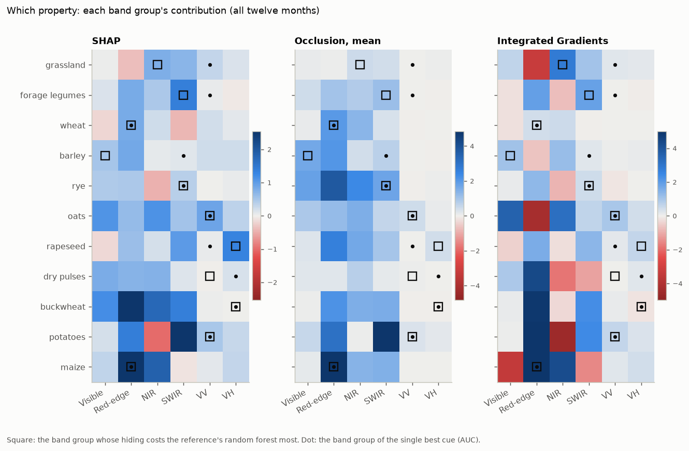
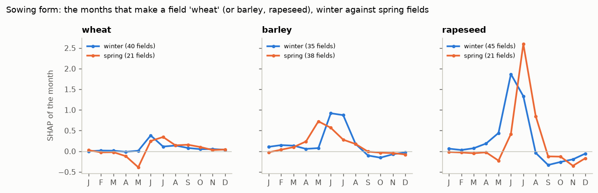

# XAI on TESSERA: occlusion, SHAP and Integrated Gradients against the Estonian crop signatures: report, 25 November 2026

**Answer.** The three methods pass every check, and so describe the model rather than the input: SHAP's and IG's
parts add up to the total change, removing months in their order lowers the score three to five times faster than
removing them at random, and on a randomised network the explanations lose all relation to the trained one
(Spearman −0.12 to 0.05). Against the crop signatures, **"when" agrees**: the model looks at the growing season,
and inside it at each crop's own part of it. Its evidence centre moves with the crop's NDVI peak (Spearman 0.57 for
SHAP, 0.78 for IG over 11 species), the costliest window is the reference window or its neighbour in 21 of 22
species × method cases, and 9 of 11 species put more attribution in their own reference window than in the other
species' windows (grassland and potatoes do not). **"Which property" agrees in part**: the model rests on red-edge
and NIR, its leading band group is the reference's for 5 of 11 species (SHAP; 1.8 by chance), and its main cell is
a strong cue in the data for 8 of 10 species; the field's radar values matter only for oats, potatoes and rapeseed.
**"Against which crop" agrees on the month and not on the band**: the pair's cue month ranks 3 of 12 in the model's
evidence (median; 6.5 by chance), its band group 4.5 of 6 (3.5 by chance), because the model separates every pair
with the same optical cells, cues of median pair AUC 0.78 where the data's best is 0.92. The direction of the cue
agrees for 9 of 11 species.

## Setup

| | |
|---|---|
| Question | which months, band groups and sensors the TESSERA model uses for each Estonian crop, whether occlusion, SHAP and Integrated Gradients agree with each other, and whether they agree with the crop-signature ground truth (Q1 to Q7 of `docs/research/xai/2026-11-16_crop_signatures`) |
| Model | the two-head TESSERA arm of `experiments/2026-11-09_borders_all_arms`, K = 100 %, draw 0, seed 0 (crop pixel Macro-F1 0.645): frozen TESSERA v2 Medium on the monthly S2 + S1 composites, PRUE's U-Net and the crop head. Not retrained |
| Explained score | per field, log p(species) averaged over the field's interior pixels; the 20 classes summed into 13 species; "A rather than B" = log p(A) − log p(B), B the strongest other species |
| Groups | 12 months, 10 windows of three months, 6 band groups (Visible, Red-edge, NIR, SWIR, VV, VH), 2 sensors, 24 month × sensor, 72 cells (month × band group); the crop-signature groups without the atmospheric bands, which TESSERA does not read |
| Replacements | **mean**: the species-balanced training mean (state test); **drop**: TESSERA's "no observation", identical to removing the frame (event test). Changed on the field's own pixels; on the whole chip as a check |
| Methods | occlusion (102 groups under mean, 48 under drop, 28 on the whole chip); SHAP, baseline Shapley from the mean field (months: 32 permutations, antithetic; band groups: exact); Integrated Gradients from the mean field, 32 steps (64 on 102 fields as a check) |
| Sample | 780 test fields in 50 test chips of `EE_2021_rev` (split `blocks4_buf1600_seed0__6b0eb4cb`), about 40 per class, interior of 20 pixels or more. The species profiles use the 588 fields the model gets right at species level; the misclassified ones enter Q3 |
| Reference | the crop-signature analysis rerun on the 56,122 Estonian fields (`reference_ee.py`, `reference/`); potatoes is not among them and takes zone 21's entry |
| Runs | the hub's RTX A4000, 24 and 25 November 2026, `run_hub.sh`, commits `e684529` to `4a37a48`: step 0 3.8 h, the 50 chips 17 h, the randomised check 1 h. The cluster had no GPU free before 1 December (two 14-day jobs), so its jobs were cancelled. The first pilot ran out of memory (the explanation encoded at the cluster's batch); fixed in `4a37a48`, memory only |

**Step 0, the chain.** The fit's normalisation statistics were lost with its cluster cache, so step 0 recomputed
them from the 4,898 training chips and checked the rebuilt chain against the stored test predictions on 300 test
chips. Pass criterion, set before the check: fp32 pixels ≥ 99.0 %, parcels ≥ 99.5 %. Result: **fp32 99.65 % of
2.68 M pixels and 99.91 % of 7,595 parcels**; bf16, the precision of the stored predictions, 99.91 % and 99.97 %.
The explanations are of the model that was evaluated.

**The fields.** Share the model gets right at species level: buckwheat, grassland and maize 1.00, potatoes 0.95,
barley 0.86, rapeseed 0.78, wheat 0.76, dry pulses and oats 0.72, rye 0.68, forage legumes 0.53; orchards (16
fields) and vegetables (7) 0, so these two have no profile.

## Results

### Can the explanations be trusted?

| Check | Result |
|---|---|
| SHAP: the months' parts add up to f(field) − f(mean field) | exact (largest gap 0.0000) |
| IG, 32 steps: relative completeness error, median / 90th percentile | 0.27 % / 1.3 % (64 steps: 0.13 %) |
| SHAP months: two halves of the permutations, Spearman per field, median | 0.92 |
| IG months: 32 against 64 steps, Spearman, median | 1.00 |
| Randomised crop head: Spearman with the trained explanation (windows mean / windows drop / IG months) | −0.07 / 0.02 / 0.05 |
| Randomised crop head and decoder | −0.12 / −0.02 / 0.01 |

**What it shows.** Each method ranks the months; the months are then removed in that order, the most important
first, and the fall of the species' log-probability is followed. Thick lines remove with the replacement the
ranking did not use, so a method is not scored on its own test. Grey dashed lines are random orders.

**What it tells us.** Every ranking finds the months that matter. Removed with drop, the first month alone costs
0.29 to 0.49 against 0.04 for a random month; the mean fall over six months (AOPC) is 0.91 to 1.04 for the rankings
made under the mean, against 0.24 at random. Removed with the mean, the order found under drop gives 1.42 against
0.47. Under the mean, SHAP's order removes the most (2.45), as expected of a method computed with that replacement.

**What it shows.** Spearman correlation of the methods' rankings, per field, median over the 588 fields.

**What it tells us.** SHAP and IG agree well on the months (0.77) and moderately on the band groups (0.54);
occlusion under the mean agrees with both at about 0.56 on the months. Occlusion under drop agrees least (0.30 to
0.46): it asks whether the model *needs* the month, and TESSERA can often fill a dropped month from its neighbours
(the largest window fall is 1.62 under drop against 2.65 under the mean). On the 72 cells, occlusion and IG agree
at only 0.28, so explanations at the level of one month of one band group are not robust; months, windows and band
groups are.

### Q1 When

**What it shows.** Each month's contribution to the field's own species, mean over the fields the model gets right
(blue supports the species, red works against it). Boxes: the three months the Estonian reference says matter most
(`hide_window`). Dots: the species' NDVI peak.

**What it tells us.** The model looks at the growing season, and inside it at each crop's own part. Three
readings, from the coarsest:

- **The season.** Every species' evidence sits between May and September; the cloud-filled winter months carry
  little (Q7). This alone would make "share in the expected window" high, because 7 of the 11 reference windows are
  May to July and every crop here is a summer crop, so the share is compared with the share in the *other*
  species' reference windows, not with 0.25.
- **The crop's own part of it.** 9 of 11 species put more SHAP in their own reference window than in the other
  species' windows (by 0.08 for buckwheat to 0.26 for rapeseed and dry pulses). Grassland (0.41 against 0.43) and
  potatoes (0.55 against 0.66) do not: grassland's evidence lies later than its Apr to Jun reference, potatoes'
  earlier than its Jul to Sep one (a zone 21 reference). The centre of the supporting evidence moves with the crop:
  oats, barley, forage legumes, rapeseed and dry pulses at 5.6 to 6.2 (early to mid June, SHAP), buckwheat, maize
  and potatoes at 7.1 to 7.3 (July); its Spearman with the NDVI peak is 0.57 (SHAP) and 0.78 (IG). Wheat is the
  exception, at 7.3 for a June peak.
- **The costliest window.** It is the reference window (8 of 22 species × method cases) or its neighbour (13), rye
  under occlusion with the mean the exception (two months late). The neighbour is mostly the later one (11 of 13):
  the model's evidence runs about a month behind the random forest's window, on the NDVI peak and the month after.

| species | reference window | occlusion (mean) | occlusion (drop) | SHAP in window | SHAP in the other species' windows | IG in window | evidence centre, SHAP / IG | NDVI peak |
|---|---|---|---|---|---|---|---|---|
| grassland | Apr-Jun | May-Jul (neighbour) | May-Jul (neighbour) | 0.41 | 0.43 | 0.34 | 6.4 / 7.3 | Jun |
| forage legumes | May-Jul | May-Jul | May-Jul | 0.67 | 0.47 | 0.59 | 5.9 / 6.4 | Jun |
| wheat | May-Jul | Jun-Aug (neighbour) | Jun-Aug (neighbour) | 0.54 | 0.43 | 0.63 | 7.3 / 6.9 | Jun |
| barley | May-Jul | May-Jul | Jun-Aug (neighbour) | 0.62 | 0.49 | 0.55 | 5.8 / 6.1 | Jun |
| rye | May-Jul | Jul-Sep (+2 months) | May-Jul | 0.66 | 0.41 | 0.56 | 6.7 / 6.8 | Jun |
| oats | May-Jul | Apr-Jun (neighbour) | Jun-Aug (neighbour) | 0.59 | 0.36 | 0.48 | 5.6 / 6.1 | Jun |
| rapeseed | May-Jul | May-Jul | May-Jul | 0.71 | 0.45 | 0.78 | 6.1 / 6.2 | Jun |
| dry pulses | May-Jul | Jun-Aug (neighbour) | Jun-Aug (neighbour) | 0.68 | 0.42 | 0.67 | 6.2 / 6.4 | Jun |
| buckwheat | Jun-Aug | Jun-Aug | Jul-Sep (neighbour) | 0.56 | 0.48 | 0.55 | 7.3 / 7.4 | Jul |
| potatoes (zone 21) | Jul-Sep | Jun-Aug (neighbour) | Jul-Sep | 0.55 | 0.66 | 0.47 | 7.1 / 7.3 | Jul |
| maize | Jun-Aug | Jul-Sep (neighbour) | Jul-Sep (neighbour) | 0.54 | 0.43 | 0.57 | 7.2 / 7.5 | Sep |

Evidence centre: the month at the centre of the supporting (positive) attribution, 1 = January, median over the
fields.

### Q2 Which property

**What it shows.** Each band group's contribution over the twelve months. Square: the band group whose hiding costs
the reference's random forest most. Dot: the band group of the single best cue (AUC).

**What it tells us.** The model is mostly optical and leans on red-edge and NIR. SHAP's leading group is the
reference's for 5 of 11 species (grassland NIR, forage legumes SWIR, wheat red-edge, rapeseed VH, maize red-edge),
against 1.8 expected by chance; occlusion's for 4, IG's for 2. Where they differ, the reference points to radar (VV
for oats, dry pulses and potatoes, VH for buckwheat), visible (barley) or SWIR (rye), and the model leads with
red-edge or NIR. The two tests of the sensors say different things about radar:

- **Its values (state test).** Replacing the field's Sentinel-1 with the mean costs 0.79 log-probability for oats,
  0.51 for potatoes and 0.37 for rapeseed, and 0.07 or less for the other eight species; rapeseed has the largest
  radar share of SHAP (35 %, against 3 to 24 %). So the field's radar is read for the three species whose radar cue
  is strongest in the reference, and hardly for the rest.
- **Its presence (event test).** Dropping Sentinel-1 altogether costs more: 1.74 for rye, 1.36 for potatoes, 1.07
  for rapeseed, 1.00 for maize. For rye and maize this is not their radar values (0.02, 0.03 under the mean), so it
  measures the model's reaction to a missing sensor rather than a radar cue.

Sentinel-2 costs more than Sentinel-1 under both tests for every species but grassland under drop (0.32 against
0.52), as in the reference (all species but dry pulses).

**What it shows.** Top: IG per month × band group for six species (blue supports). Bottom: the reference AUC of
each cell (species against the rest).

**What it tells us.** The data offers cues in many cells, radar among them (rapeseed's June VV and VH, grassland's
summer VV); the model concentrates on a few optical cells around May to July. Those cells are good cues: the
model's top IG cell has an AUC within 0.1 of the species' best cell for 8 of 10 species (wheat's is the best cell,
maize's and buckwheat's within 0.01), and above the median cell for 8. Barley (June NIR, 0.57 against a best of 0.74)
and dry pulses (June red-edge, 0.68 against 0.82) are the exceptions. Over all 72 cells, the rank correlation of
IG's map with the AUC map is 0.04 (grassland) to 0.58 (rye), median 0.30, occlusion's 0.18: the model uses few
cells, the data offers many, so this correlation is a weak test. Cells where the species has no cue (AUC under 0.55)
never get more than their share of IG (oats 0.21 of the attribution on 0.33 of the cells, barley 0.13 on 0.19).

### Q3 Against which crop

The 27 species and rival pairs with 8 fields or more are in `figures/tables.md`; the largest:

| A | rival B | fields | model wrong | IG (A − B) top cell (pair AUC) | reference pair cue (AUC, verdict) | cue's rank: cell of 72 / month of 12 / band group of 6 |
|---|---|---|---|---|---|---|
| forage legumes | grassland | 99 | 46 | May Red-edge (0.63) | Feb Red-edge (0.74, no single cue) | 12 / 7 / 1 |
| barley | wheat | 53 | 6 | Jun NIR (0.58) | May Visible (0.75, partial) | 52 / 3 / 1 |
| dry pulses | forage legumes | 40 | 24 | Aug Red-edge (0.77) | Jun VV (0.92, clear) | 20 / 12 / 1 |
| dry pulses | rapeseed | 38 | 0 | May NIR (0.88) | May SWIR (0.91, clear) | 27 / 2 / 6 |
| rye | wheat | 37 | 10 | May Red-edge (0.67) | Jul VH (0.88, partial) | 18 / 1 / 5 |
| buckwheat | rapeseed | 35 | 0 | Jul Red-edge (0.80) | Jun VH (0.96, clear) | 22 / 1 / 6 |
| rapeseed | wheat | 35 | 0 | Jun Red-edge (0.95) | Jun VV (0.99, clear) | 16 / 1 / 2 |
| wheat | barley | 31 | 10 | Jun Red-edge (0.74) | May Visible (0.75, partial) | 11 / 12 / 3 |
| barley | oats | 27 | 3 | May Red-edge (0.57) | Jul Red-edge (0.78, partial) | 13 / 1 / 1 |
| maize | wheat | 17 | 0 | Aug Red-edge (0.94) | Jun SWIR (0.98, clear) | 68 / 4 / 2 |

The cell rank is IG's map of A − B; the month and band-group ranks are occlusion of A − B under the mean.

**What it tells us.** The model separates a pair at the right time but with its own bands. Over the 26 pairs with
a reference cue:

- **Month.** The cue's month is the model's top month for A − B in 8 pairs and among its top three in 14; median
  rank 3 of 12, against 6.5 by chance.
- **Band group.** The cue's band group ranks 4.5 of 6 (median), against 3.5 by chance; first in 6 pairs. The
  model's top cell is red-edge, NIR or visible in every pair, between May and August, mostly May and June, whatever
  the rival; the pair cue is radar in 13 of the 26.
- **Cell.** The cue cell ranks 24.5 of 72 (median; 36.5 by chance) and first in none.
- **How good the model's cells are for the pair.** Its top cell has a median pair AUC of 0.78, against 0.92 for the
  pair's best cell; within 0.1 of the best in 9 of 26 pairs (rapeseed against wheat: June red-edge 0.95 against June
  VV 0.99). So the model uses a fair but weaker cue, the same for most rivals.

The evidence is equally spread for clear and for no-cue pairs (the top cell holds 0.09 to 0.22 of it). Forage
legumes against grassland, the pair the model confuses most (46 of 99 fields wrong), has no single cue in the data
either (0.74), and the model's best cell for it is weak (0.63).

### Q4 Direction

| species | cue cell | the species is | share of fields whose gradient agrees |
|---|---|---|---|
| grassland | Oct VV | lower | 0.96 |
| forage legumes | May VV | lower | **0.39** |
| wheat | Jun B05 | lower | 1.00 |
| barley | Aug B12 | higher | 0.96 |
| rye | Jun B11 | lower | 0.93 |
| oats | Jul VV | lower | 1.00 |
| rapeseed | Jun VV | higher | 1.00 |
| dry pulses | Jun VH | higher | 0.99 |
| buckwheat | Sep VH | higher | **0.35** |
| potatoes | Jul VV | higher | 1.00 |
| maize | Sep B05 | lower | 1.00 |

**What it tells us.** On the species' best cue, the model responds the way the data says for 9 of 11 species, in
93 % of the fields or more: more VV raises rapeseed and potatoes, less red-edge reflectance (more chlorophyll)
raises wheat and maize. It does so even where the cue is a minor part of its evidence (radar for oats and potatoes).
Forage legumes and buckwheat are the exceptions, both on radar cues of moderate strength.

### Q6 Sowing form

**What it tells us.** Rapeseed follows the expectation: spring fields peak in July, a month after winter fields,
and draw nothing from January to May (winter fields 0.20). Wheat's two forms differ little (June for winter, July
for spring; spring wheat's May works against "wheat"). Barley is the other way round: spring barley's evidence
peaks in May (0.52 of it January to May), winter barley's in June and July (0.21).

### Q7 Not the crop, and the field's surroundings

The mostly cloud-filled months (February, March, November) carry 9.4 % of the SHAP attribution, median over the
fields (25 % if spread evenly), so the composites' copied months are not where the model looks. Hiding a window on
the whole chip rather than on the field alone barely changes anything (largest fall 2.75 against 2.65 under the
mean; ranking Spearman 0.99): the evidence comes from the field itself, not from its neighbours.

## Analysis

**The explanations are usable.** All three methods pass completeness, convergence, deletion and randomisation, on
the model the stored predictions came from. 32 IG steps and 32 SHAP permutations are enough at the level of months
and band groups. The cells are not: methods agree on them at 0.28, so a single "June VH" is not a safe statement
about this model, while "June to July, red-edge and NIR" is.

**The methods answer different questions, and both tests are needed.** SHAP and IG, both computed from the mean
field, agree with each other; occlusion under drop differs because TESSERA fills a missing month from the others.
A month can be important as a state (mean) and dispensable as an observation (drop); winter cereals' April is the
example the design anticipated, and the windows show the same: falls under drop are about 60 % of those under the
mean.

**Agreement with agronomy is strong for timing and partial for the physical cue.** The model looks at the
growing season and, inside it, at each crop's own part: later crops (maize, buckwheat, potatoes) about a month after
the cereals, oilseeds and legumes, and its window about a month behind the random forest's, on the NDVI peak and the
month after. The test that makes this claim is the comparison with the other species' windows, not with an even
spread, because the reference windows overlap and all crops here grow in summer. Its physical evidence is narrower
than the data's: red-edge and NIR carry most of it, and the cells it picks are strong cues for 8 of 10 species, so
the model chose good optical cues among several. The field's radar values matter for oats, potatoes and rapeseed,
the species whose radar cue the reference rates highest, and little for the others. This is not necessarily wrong,
because the band groups carry overlapping information (the crop-signature report found that hiding one band group
rarely hurts the random forest); it says that this model reads crops mainly through canopy chlorophyll and density.
Dropping Sentinel-1 altogether hurts rye and maize although their radar values do not matter, a reaction to a
missing sensor that the explanation of a field should not be read as a radar cue.

**"A rather than B" is where the model and the data part most, and only on the band.** The model separates a pair
in the right month (median rank 3 of 12) but with the same optical cells for most rivals, so the pair's own band is
no more likely than chance to lead (4.5 of 6). Its cells are fair cues for the pair (pair AUC 0.78) but weaker than
the best one (0.92). For an explanation offered to an agronomist ("this field is barley rather than wheat because
..."), the month would be right and the band would be the general optical cue, not the one a crop specialist would
check.

**The direction is right where the model responds at all**, which is the property an agronomist can check most
easily on a single field.

## Caveats

- **One fit.** One draw and one seed; how stable the explanations are across seeds needs refits (out of this round).
- **The reference is empirical.** A random forest and single-band AUCs on the same composites, over all Estonian
  fields, not over our 780 test fields; it contains fallow and triticale, which the model does not have, and
  potatoes comes from zone 21. Its "costliest group" is the forest's choice among redundant groups, so Q2's
  disagreements are weaker evidence than Q1's agreements.
- **Units differ.** The model's falls are log-probabilities, the reference's recall lost and AUC; only rankings are
  compared.
- **Profiles are of the fields the model gets right.** Orchards and vegetables have none; forage legumes rests on
  53 % of its fields.
- **The replacements shape the answer.** SHAP and IG are relative to the species-balanced mean field; another
  baseline would give other values.
- **A bug found during the analysis.** `reference_ee.py` built the pair table with a lookup on a repeated index, so
  every pair showed August VH. Fixed and regenerated; only `ee_pairs.csv` changed (the other six reference files are
  byte-identical), and only Q3's reference column depended on it. A second rerun added every pair's full map
  (`ee_pair_auc_map.csv`) for Q3's comparison, again leaving the other files byte-identical.
- Q5 (zones) is not tested: Estonia is one zone.

## Next steps

- The same frame on the other arms of the two-head workflow (PRUE from ImageNet, TerraMind), to see whether the
  optical bias is TESSERA's or the decoder's.
- Two more seeds of this cell, for the stability of the explanations.
- Three further tests on the stored results, not yet in `report.py`: whether a cloud-filled month gets more weight
  than its observed neighbour (Q7), whether spring fields lean more on radar (Q6), and the share of fields that
  flip from A to B when the pair's cue window is hidden (Q3).
- Q5 with the transfer models, once they exist.

## Reproduce

    bash experiments/2026-11-20_xai_tessera/run_hub.sh            # hub GPU: step 0, the pass criterion, pilot, 8 shards, sanity
    poetry run python experiments/2026-11-20_xai_tessera/reference_ee.py --threads 24   # the Estonian reference (hub)
    poetry run python experiments/2026-11-20_xai_tessera/report.py

The sample (`sample/`) and the reference (`reference/`) are committed; the explanations are in
`results/2026-11-20_xai_tessera/EE_2021_rev/{step0,explain,sanity}/`.
