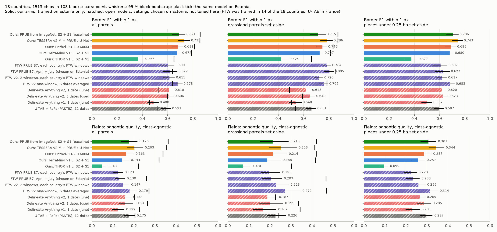
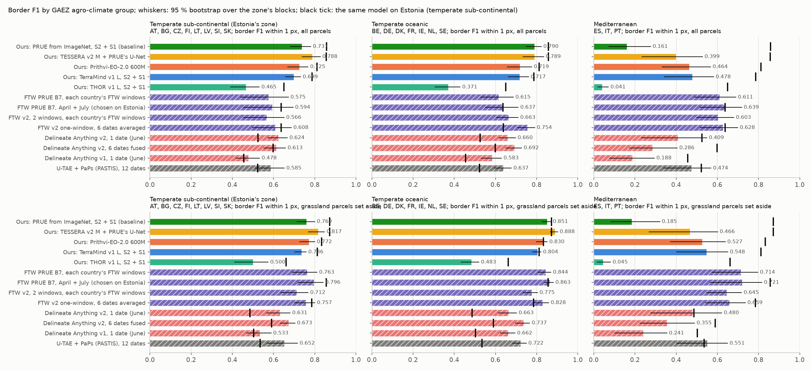
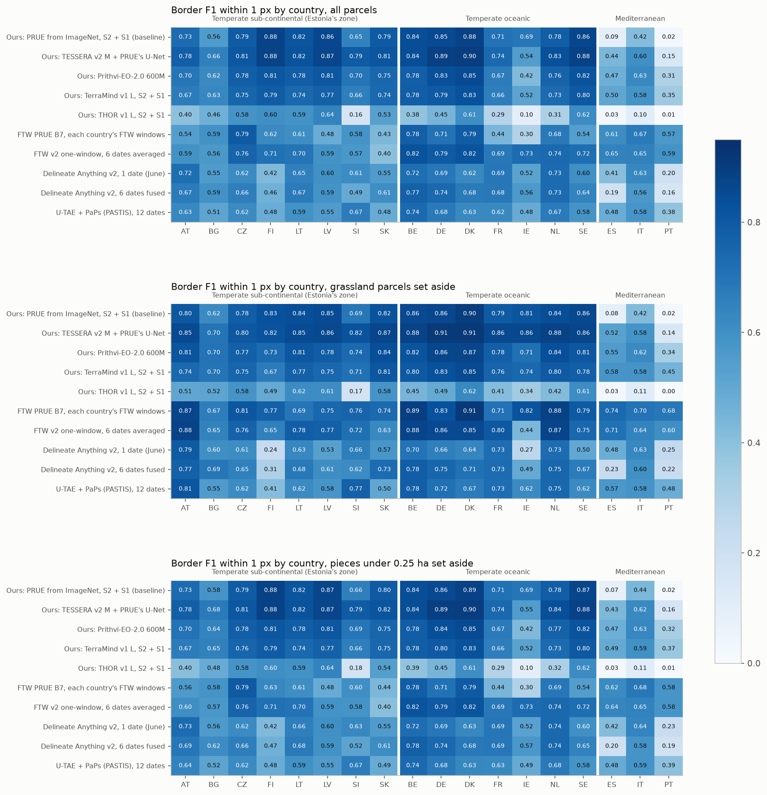
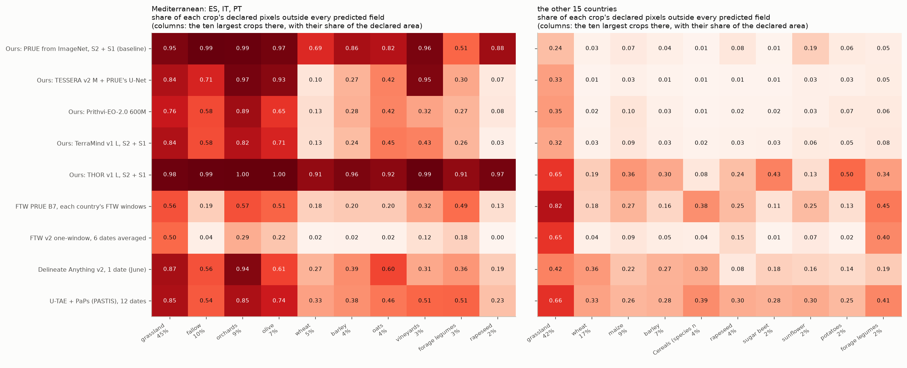
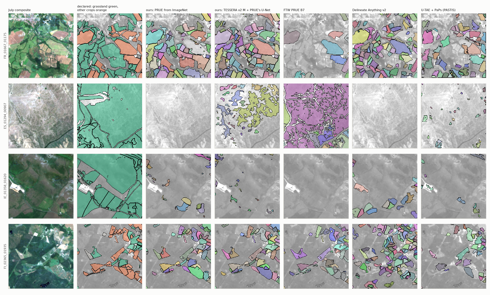
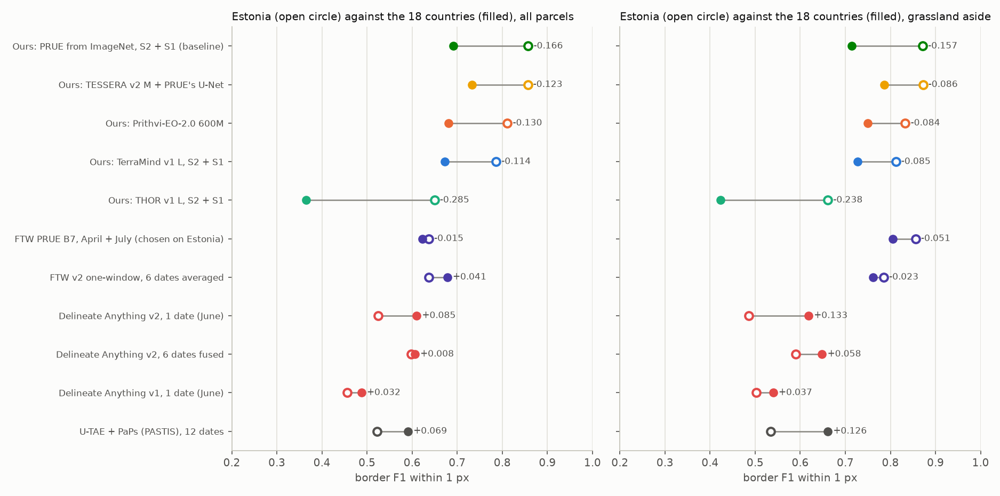
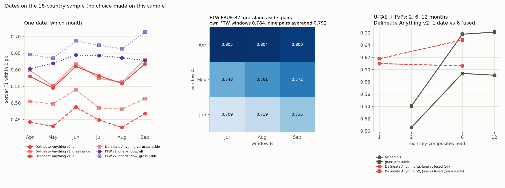

# Field delineation outside Estonia: all models on a distributed sample of 18 countries

26 November 2026. The comparison of [the Estonian experiment](../2026-11-26_open_delineation/REPORT.md), repeated on
six test blocks in each of 18 other European countries: our two-head arms with their Estonian checkpoints, and the
open models with the settings chosen on Estonia. Nothing is trained or tuned on this sample. The figures and
[figures/tables.md](figures/tables.md) are made by [report.py](report.py); how to run everything is in the
[README](README.md).

## In short

- **On a sample none of the models was tuned on, six test blocks in each of 18 countries (1,513 chips), our
  two-head workflow with TESSERA v2, trained on Estonia alone, draws field borders best:** border F1 within one
  pixel 0.733 [0.686, 0.775], against 0.691 for our baseline, PRUE from ImageNet (paired difference +0.042
  [+0.016, +0.069]), and 0.678 for the best open model, FTW v2 with six monthly predictions averaged. Equal weights
  per country give the same order.
- **Across both temperate groups our arms transfer:** in Estonia's agro-climate group (eight countries) TESSERA
  0.788, the baseline 0.737, the best open model 0.624; in the temperate oceanic group, outside Estonia's zone, the
  baseline and TESSERA hold just as well, at 0.79, ahead of FTW v2 (0.754). The break comes only in the
  Mediterranean.
- **In the Mediterranean (Spain, Italy, Portugal) our arms fail:** baseline 0.16, the GFM arms 0.40 to 0.48, against
  0.64 for FTW PRUE B7, which was trained in Spain and Portugal. Three quarters of the declared land there is grassland,
  fallow, orchards, olive groves and vineyards, which the Estonian decoders leave outside every field. The frozen
  encoders lose much less there than the baseline trained end to end, and somewhat less within Estonia's group.
- **With grassland set aside, FTW's own definition of a field, FTW PRUE B7 leads** (0.805 against TESSERA's 0.786,
  intervals overlapping).
- **Per country, the best of our arms beats the best open model in 14 of 18 countries** (11 of 18 with grassland
  aside); it loses in Spain, Italy, Portugal and, on all parcels, Ireland. In the four countries FTW has never seen
  (Bulgaria, Czechia, Ireland, Italy) FTW keeps its standing, so its advantage elsewhere is not only familiarity.
- **THOR aside, our arms lose 0.11 to 0.17 border F1 when they leave Estonia, the open models little or
  nothing**: the lead of 0.22 over FTW on Estonia shrinks to 0.06 here.
- **THOR collapses (0.365)**; its inference path reproduces its Estonian predictions, as every arm's does, so
  the drop is its own.
- PQ is low for every model (0.05 to 0.20) because the sample holds many parcels too small for 10 m pixels; the
  order is the same as by border F1. Averaging monthly predictions helps FTW v2 (+0.03 to +0.05); fusing six months
  helps Delineate Anything less than on Estonia, and hurts it in the Mediterranean.

## 1. The question

The user asked on 26 November 2026, after the Estonian comparison, to check the delineation metrics on a sample of
other countries, not Estonia, spread over them, and to compare all the models.

## 2. What was done

### 2.1 The sample

Six test blocks of 4 x 4 chips (2,240 m each, 10 m pixels) per country, in 18 countries, drawn by farthest-point
sampling from the test blocks of the transfer plan's country samples (`docs/research/transferability/samples.csv`),
so that they spread over each country ([sample.py](sample.py)). That makes **108 blocks and 1,513 chips**, 64 (Finland)
to 96 (France) per country; some blocks have fewer than 16 chips with labels. The chips are those of the transfer
export (`<CC>_2021_transfer`): twelve monthly Sentinel-2 L2A composites of 2021 under the `revised` screening,
Sentinel-1 RTC beside them, and the EuroCrops declarations as masks and parcel ids, on the same grid as Estonia. The
background of the border target is ESA WorldCover 2021, as for Estonia ([worldcover.py](worldcover.py)).

The countries fall into three GAEZ v5 agro-climate groups (`docs/research/transferability/gaez_domains.csv`):

| Group | Countries |
|---|---|
| Temperate sub-continental, **Estonia's own** | AT, BG, CZ, FI, LT, LV, SI, SK |
| Temperate oceanic | BE, DE, DK, FR, IE, NL, SE |
| Mediterranean (subtropics, winter rainfall) | ES, IT, PT |

RQ1.2 asks how accuracy holds across countries of the same agro-ecological zone, so the first group is the reading
for transfer; the other two show what happens outside it. The country-level group is used because the blocks' own
AEZ codes mix climatic and special (soil, terrain) classes.

### 2.2 The models

| | Model | Setting | Has it seen these countries? |
|---|---|---|---|
| **Ours** | PRUE from ImageNet, S2 + S1 (the baseline), TESSERA v2 Medium + PRUE's U-Net, TerraMind v1 L, THOR v1 L, Prithvi-EO-2.0 600M | the Estonian checkpoints at K = 100 % of the two-head workflow, fields grown from the interior | **No.** Trained on Estonia only |
| **Open, 2 dates** | FTW PRUE B7 v3.1 | each country's own FTW windows (its published setting), and April + July (chosen on Estonia) | FTW trained in 14 of the 18 countries; not in BG, CZ, IE, IT |
| | FTW v2, two windows | each country's own FTW windows | as above |
| | FTW v2, one window | six monthly predictions averaged (chosen on Estonia) | as above |
| **Open, 1 date** | Delineate Anything v2, and v1 | June, and the six months fused (chosen on Estonia) | trained on FBIS, a merge of public field datasets; which of these countries it holds was not checked |
| **Open, series** | U-TAE + PaPs | PASTIS fold 1, twelve months (chosen on Estonia) | trained in France only |

AlphaEarth is left out: its embeddings were never fetched for these countries. The token-grid arms and TESSERA
encode the sample with their frozen encoders, normalised with the Estonian statistics their decoders were trained
on ([predict_arms.py](predict_arms.py)). The FTW windows come from FTW's own per-country configuration: the
mid-month of each window, April + July for the four countries FTW does not cover ([predict_ftw_own.py](predict_ftw_own.py)).

**So this is a cross-country transfer only for our arms.** For FTW, 14 countries are known countries with unseen
chips; only Bulgaria, Czechia, Ireland and Italy are new to it. Fields of The World also touches 29 of the 1,513
chips (Austria 11, Latvia 10, Slovakia 8; [ftw_overlap.py](ftw_overlap.py)); the `test_clean` subset leaves them
out and changes no border F1 by more than 0.01 and no PQ by more than 0.004.

### 2.3 Scoring

One scorer for every model, the Estonian experiment's ([score.py](score.py)), with the two-head workflow's
functions read-only. Fields are scored class-agnostically by panoptic quality (PQ) at IoU > 0.5, borders by
precision, recall and F1 within one pixel, on the declared parcels and WorldCover's non-farm land. Three truths:

- **all parcels**, as declared;
- **grassland set aside** (species 14 and group 26 made void): FTW's labels call grassland background, so this is
  the reading on which FTW is judged on its own terms;
- **pieces under 0.25 ha set aside** (parcel pieces under 25 pixels made void). New here: Austria, Slovenia and the
  Mediterranean countries declare many very small parcels (in Austria a median piece of 18 pixels, in Spain, Italy
  and Portugal 55 to 68 % of the pieces under 25 pixels; in Estonia a median of 190 pixels), which no 10 m model can
  draw and which hold PQ down for every model.

Intervals are 95 % block-bootstrap intervals over the 108 blocks (1,000 resamples, the same for every model), over
the zone's blocks for a zone, and over a country's six blocks for a country (wide). The pooled score weights the
countries by their border pixels (Austria 777,000, Finland 67,000); the **country mean** beside it weights them
equally.

## 3. Results

Border F1 within one pixel is the main reading, as in the Estonian experiment; PQ is given beside it. Every number
below is in [figures/tables.md](figures/tables.md), with precision, recall, SQ, RQ and field counts.

### 3.1 The headline

| Model | Border F1, all parcels | Border F1, grassland aside | PQ, all | PQ, grassland aside | Border F1, country mean |
|---|---|---|---|---|---|
| **Ours: TESSERA v2 + PRUE's U-Net** | **0.733** [0.686, 0.775] | 0.786 [0.733, 0.828] | **0.203** | 0.253 | **0.734** |
| Ours: PRUE from ImageNet (baseline) | 0.691 [0.638, 0.738] | 0.715 [0.650, 0.773] | 0.176 | 0.213 | 0.679 |
| Ours: Prithvi-EO-2.0 600M | 0.681 [0.637, 0.721] | 0.749 | 0.163 | 0.214 | 0.693 |
| Ours: TerraMind v1 L | 0.672 [0.634, 0.705] | 0.727 | 0.144 | 0.188 | 0.684 |
| Ours: THOR v1 L | 0.365 [0.317, 0.413] | 0.424 | 0.048 | 0.070 | 0.381 |
| FTW v2 one-window, six months averaged | 0.678 [0.634, 0.716] | 0.762 | 0.179 | **0.272** | 0.671 |
| FTW PRUE B7, April + July | 0.622 [0.562, 0.676] | **0.805** [0.766, 0.837] | 0.130 | 0.203 | 0.604 |
| FTW PRUE B7, each country's FTW windows | 0.600 | 0.784 | 0.123 | 0.195 | 0.596 |
| FTW v2, two windows, each country's | 0.615 | 0.720 | 0.147 | 0.228 | 0.614 |
| Delineate Anything v2, June | 0.610 | 0.618 | 0.158 | 0.187 | 0.585 |
| Delineate Anything v2, six months fused | 0.606 | 0.648 | 0.158 | 0.199 | 0.581 |
| Delineate Anything v1, June | 0.488 | 0.540 | 0.122 | 0.167 | 0.458 |
| U-TAE + PaPs, twelve months | 0.591 | 0.661 | 0.175 | 0.226 | 0.577 |

On all parcels **TESSERA draws the borders best**, 0.042 above our baseline in paired resamples
([+0.016, +0.069]) and 0.055 above the best open model, FTW v2 with its six monthly predictions averaged. The
baseline, Prithvi, TerraMind and FTW v2 one-window form a second group within 0.02 of each other; FTW PRUE B7,
Delineate Anything v2 and U-TAE follow at 0.59 to 0.62. Weighting every country equally gives the same order.

With grassland set aside, the reading on which FTW is judged on its own terms, **FTW PRUE B7 leads** (0.805 against
TESSERA's 0.786, intervals overlapping), and every FTW variant gains 0.08 to 0.18, because FTW's labels call
grassland background and it leaves most grassland parcels undrawn. TESSERA's lead over the baseline widens to
+0.071 [+0.042, +0.108]. Prithvi passes the baseline on this truth (+0.034 [+0.001, +0.075]), which it does not on all parcels;
TerraMind is level with it.

PQ is low for every model, 0.05 to 0.20 on all parcels, against 0.32 to 0.36 for our four transferable arms on Estonia. The sample
holds many parcels too small for 10 m pixels (section 2.3); with pieces under 0.25 ha set aside, PQ rises to 0.26 to
0.34 for our four transferable arms and to 0.22 to 0.31 for the open models, in the same order. TESSERA leads PQ on all
three truths but grassland aside, where FTW v2 one-window leads (0.272 against 0.253).

### 3.2 By agro-climate group

| Border F1, all parcels / grassland aside | Estonia's group (8 countries) | Temperate oceanic (7) | Mediterranean (3) |
|---|---|---|---|
| Ours: PRUE from ImageNet (baseline) | 0.737 / 0.760 | **0.790** / 0.851 | 0.161 / 0.185 |
| Ours: TESSERA v2 + PRUE's U-Net | **0.788** / **0.817** | 0.789 / **0.888** | 0.399 / 0.466 |
| Ours: Prithvi-EO-2.0 600M | 0.725 / 0.772 | 0.719 / 0.830 | 0.464 / 0.527 |
| Ours: TerraMind v1 L | 0.699 / 0.736 | 0.717 / 0.804 | 0.478 / 0.548 |
| Ours: THOR v1 L | 0.465 / 0.500 | 0.371 / 0.483 | 0.041 / 0.045 |
| FTW PRUE B7, April + July | 0.594 / 0.796 | 0.637 / 0.863 | **0.639** / **0.721** |
| FTW v2 one-window, six months averaged | 0.608 / 0.757 | 0.754 / 0.828 | 0.628 / 0.659 |
| Delineate Anything v2, June | 0.624 / 0.631 | 0.660 / 0.663 | 0.409 / 0.480 |
| U-TAE + PaPs, twelve months | 0.585 / 0.652 | 0.637 / 0.722 | 0.474 / 0.551 |

**Within Estonia's own group, the reading for RQ1.2, our arms transfer.** TESSERA reaches 0.788 [0.739, 0.827] on
all parcels, the baseline 0.737, and the best open model 0.624 (Delineate Anything v2); with grassland aside TESSERA
(0.817) and FTW B7 (0.796) are level within their intervals. The GFM arms lose less in the move than the baseline: from
Estonia to its group, TESSERA loses 0.068, Prithvi 0.086, TerraMind 0.087 and the baseline 0.120.

**In the oceanic group**, outside Estonia's zone, the baseline and TESSERA hold at 0.79, as high as in Estonia's
group and ahead of FTW v2 one-window (0.754); with grassland
aside TESSERA leads (0.888), FTW B7 next (0.863).

**In the Mediterranean our arms fail.** The baseline falls to 0.161 (Portugal 0.02, Spain 0.09), and the three GFM
arms keep 0.40 to 0.48, against 0.64 for FTW B7, which was trained in Spain and Portugal. Here the frozen encoders
hold far better: the baseline, trained end to end on Estonia, loses 0.70 from its Estonian score;
TerraMind, Prithvi and TESSERA lose 0.31 to 0.46.

### 3.3 By country

**The best of our arms beats the best open model in 14 of the 18 countries on all parcels, 11 of 18 with grassland
aside and 14 of 18 with small pieces aside** (tables.md, "Who leads in each country"). TESSERA is the best of ours in
12 countries on all parcels, the baseline in Finland, Belgium and Ireland, TerraMind in Spain and Portugal, Prithvi
in Italy. The margins are widest in the Baltic and northern countries (Latvia +0.27, Slovakia +0.21, Finland +0.17,
Sweden +0.16).

Our arms lose in Spain (−0.14), Italy (−0.05), Portugal (−0.26) and, on all parcels, in Ireland (−0.04 against FTW
v2 one-window). Ireland is mostly grassland; TESSERA falls there to 0.54 while the baseline keeps 0.69 (TESSERA draws fewer
borders: recall 0.46 against 0.64, precision 0.66 against 0.75), and with grassland aside TESSERA recovers to 0.86. With grassland aside FTW B7 also edges our best in Austria and Slovenia
(by 0.03), Belgium (0.01) and Czechia (by less than 0.005).

Each country has six blocks, so its interval is wide (figure; the bars' whiskers): per-country differences under
about 0.1 are not resolved.

### 3.4 Why the Mediterranean fails

The share of each crop's declared pixels that lies outside every predicted field shows what our arms do not draw:

| Share outside every field | grassland (45 % of declared area) | fallow (10 %) | orchards (9 %) | olive (7 %) | wheat (5 %) | barley (4 %) | vineyards (3 %) | all declared |
|---|---|---|---|---|---|---|---|---|
| Ours: baseline | 0.95 | 0.99 | 0.99 | 0.97 | 0.69 | 0.86 | 0.96 | 0.90 |
| Ours: TESSERA | 0.84 | 0.71 | 0.97 | 0.93 | 0.10 | 0.27 | 0.95 | 0.70 |
| Ours: Prithvi | 0.76 | 0.58 | 0.89 | 0.65 | 0.13 | 0.28 | 0.32 | 0.60 |
| Ours: TerraMind | 0.84 | 0.58 | 0.82 | 0.71 | 0.13 | 0.24 | 0.43 | 0.63 |
| FTW PRUE B7, own windows | 0.56 | 0.19 | 0.57 | 0.51 | 0.18 | 0.20 | 0.32 | 0.43 |
| FTW v2 one-window | 0.50 | 0.04 | 0.29 | 0.22 | 0.02 | 0.02 | 0.12 | 0.29 |

Three quarters of the declared Mediterranean land are classes Estonia has little or none of: grassland (dehesa and
montado pasture under scattered trees), fallow, orchards, olive groves and vineyards. Our arms leave most of these
outside any field. The baseline also misses most of the wheat and barley, crops it draws well at home; the GFM arms
keep most of them. In the other 15 countries the same arms leave only 11 to
21 % of the declared pixels outside every field, most of it grassland.

The inputs were checked before this reading was accepted: the band layout and value ranges of the Mediterranean
chips match Estonia's, and FTW reads the same composites and scores 0.64 on them. The failure is a transfer failure
of our decoders, not a fault in the data.

The examples show the pattern. In the French chip every model draws fields, FTW B7 leaving the grassland out. The
Spanish chip is one large dehesa parcel: the baseline and Delineate Anything draw nothing, TESSERA scattered
patches, FTW B7 one large field cut by its own clutter. The Irish chip is grassland that almost no model draws. In
the Finnish chip, close to Estonia, our two arms and FTW B7 follow the declared parcels.

Where borders are found, recall depends on what lies across them (tables.md, last table): borders between two
parcels of the same crop are found least (0.13 to 0.44), borders against non-farm land are found by our arms
(0.48 to 0.57 for the four transferable arms) far more often than by FTW (0.29 to 0.43).

### 3.5 Estonia against the 18 countries

| Border F1, all parcels | Estonia | 18 countries | change | Estonia, grass aside | 18 countries, grass aside | change |
|---|---|---|---|---|---|---|
| Ours: baseline | 0.857 | 0.691 | −0.166 | 0.872 | 0.715 | −0.157 |
| Ours: TESSERA | 0.856 | 0.733 | −0.123 | 0.872 | 0.786 | −0.086 |
| Ours: Prithvi | 0.811 | 0.681 | −0.130 | 0.833 | 0.749 | −0.084 |
| Ours: TerraMind | 0.786 | 0.672 | −0.114 | 0.812 | 0.727 | −0.085 |
| Ours: THOR | 0.650 | 0.365 | −0.285 | 0.661 | 0.424 | −0.238 |
| FTW PRUE B7, April + July | 0.637 | 0.622 | −0.015 | 0.856 | 0.805 | −0.051 |
| FTW v2 one-window | 0.637 | 0.678 | +0.041 | 0.785 | 0.762 | −0.023 |
| Delineate Anything v2, June | 0.525 | 0.610 | +0.085 | 0.486 | 0.618 | +0.133 |
| U-TAE + PaPs | 0.522 | 0.591 | +0.069 | 0.535 | 0.661 | +0.126 |

Estonia's score is on its test chips that no FTW chip touches. Our arms, trained there, lose 0.11 to 0.17 when they
leave (THOR 0.29); in Estonia's group and the oceanic group the loss is 0.07 to 0.12 (section 3.2). The open models hold or gain: Estonia is
not their home ground, and FTW has most of these countries in its training set. **The lead our arms had on Estonia
(0.857 against FTW's 0.637) shrinks to 0.733 against 0.678 on the sample**, and turns into a deficit in the
Mediterranean.

### 3.6 The four countries FTW has not seen

Bulgaria, Czechia, Ireland and Italy are new to every model, so here the open models face the same transfer as ours.

| Border F1 (P / R) | All parcels | Grassland aside |
|---|---|---|
| Ours: baseline | 0.624 (0.75 / 0.53) | 0.622 |
| Ours: TESSERA | 0.623 (0.75 / 0.53) | **0.702** |
| Ours: Prithvi | 0.571 | 0.696 |
| Ours: TerraMind | 0.596 | 0.678 |
| FTW PRUE B7 (April + July: its fallback for these countries) | 0.547 (0.81 / 0.41) | **0.722** |
| FTW v2 one-window | **0.677** (0.71 / 0.65) | 0.654 |
| Delineate Anything v2, six months fused | 0.585 | 0.640 |
| U-TAE + PaPs | 0.532 | 0.579 |

The four countries are two of Estonia's group (Bulgaria, Czechia), one oceanic (Ireland) and one Mediterranean
(Italy), so this is a hard subset for our arms. FTW keeps its standing on them: v2 one-window leads on all parcels,
B7 with grassland aside. FTW's advantage is therefore not only that it has seen the other 14 countries.

### 3.7 THOR

THOR v1 L halves outside Estonia, from 0.650 to 0.365, and keeps only 0.465 even in Estonia's group, where the
other arms lose 0.07 to 0.12. That looked like a fault of the inference path, so it was checked before being
reported ([check_arms_ee.py](check_arms_ee.py), [reference/arms_ee_check.json](reference/arms_ee_check.json)): the
same path, with THOR's token cache computed afresh, applied to the nine Estonian test chips of the pilot
`EE_2021_rev_mini`, reproduces the border probabilities THOR's Estonian fit stored, with the most likely class
agreeing on 99.98 % of the pixels and a mean difference of 0.04 on the 0 to 255 scale.
The same check passes for the other four arms (TerraMind, Prithvi, TESSERA with its raster cache
computed afresh, and the baseline): the most likely class agrees on 99.96 to 99.98 % of the pixels, the mean
difference is at most 0.07, so every arm's numbers on the sample come from its Estonian fit as it was.

The drop is therefore THOR's own. It draws few fields outside Estonia: 34,059 against 252,009 declared, 14 %, where
on Estonia it drew 52 % (20,722 of 39,978) and the baseline draws 31 % of the sample's. Its border precision holds
better (0.85 on Estonia, 0.71 here) than its recall (0.53, then 0.25). THOR was already the weakest arm on Estonia.
Why it transfers so much worse than TerraMind, its closest counterpart, was not tested; its averaged band groups
(pipeline.md section 10) are one candidate.

### 3.8 Dates

The temporal settings were chosen on Estonia; here they are only read, not chosen.

- **FTW PRUE B7, two windows** (grassland aside): pairs anchored in April are best (April + July 0.805, April +
  August 0.804), pairs anchored in June worst (0.709 to 0.735), as on Estonia. Each country's own FTW windows give
  0.784, and the nine pairs averaged 0.792.
- **FTW v2, two windows**: nearly flat across pairs (0.603 to 0.623 on all parcels); averaging the nine pairs adds
  0.024 with grassland aside.
- **FTW v2, one window**: single months give 0.603 to 0.644 on all parcels; averaging the six monthly predictions
  gives 0.678 and 0.762 with grassland aside, 0.034 and 0.048 above the best single month. Time pays here.
- **Delineate Anything v2**: June (0.610) and September (0.617) are the best single months. Fusing six months gives
  0.606 on all parcels and 0.648 with grassland aside, against 0.610 and 0.618 for June; in the Mediterranean fusion
  costs 0.12 (0.286 against 0.409). Delineate Anything v1: fused 0.439 against 0.488 for June.
- **U-TAE + PaPs**: 2 months 0.506, 6 months 0.594, 12 months 0.591; the growing season carries the information.

So time helps the models built to read it or averaged over it (FTW v2, U-TAE), as on Estonia. Delineate
Anything differs: on Estonia fusing six months raised it by 0.07, a gain the field-rule control there attributed to
time; here fusion is level on all parcels, gains 0.03 with grassland aside and costs 0.12 in the Mediterranean, so
that gain does not carry over everywhere.

## 4. Analysis

**The answer to the question.** On a sample spread over 18 countries that no model was tuned on, the
two-head workflow with TESSERA v2, trained on Estonia alone, delineates fields better than the open models on all
parcels, overall and in 14 of the 18 countries. The open models win in Spain and Portugal, where FTW was trained, but
also in two countries FTW never saw: Italy (FTW PRUE B7) and, on all parcels, Ireland (FTW v2 one-window). On FTW's
own definition of a field (grassland aside) FTW PRUE B7 and TESSERA are level.

**Transfer holds across the temperate groups and breaks in the Mediterranean.** In Estonia's agro-climate group
our four transferable arms keep 0.70 to 0.79 border F1, 0.07 to 0.12 below Estonia, and lead every open model. In
the oceanic group, a different GAEZ group, they do as well: TESSERA 0.789 against 0.788 in Estonia's group, the
baseline 0.790 against 0.737. In the Mediterranean they draw a fraction of the declared land, because most of it is
land use the Estonian decoders never saw. So the line that matters on this sample is not the one between Estonia's
group and its neighbours, but the one between temperate and Mediterranean agriculture. The rule of transferring
only within one GAEZ zone (decided on 2 October 2026) is stricter than this sample requires: it would forbid the
oceanic transfer, which works, and does forbid the Mediterranean one, which fails. Whether the zone boundary is
the right unit is a question for the transfer design; six blocks per country do not settle it.

**The frozen encoders transfer better than the network trained end to end.** In Estonia the baseline ties
TESSERA (0.857 against 0.856); out of it, the baseline loses more than every GFM arm except THOR, a little in
Estonia's group (−0.120 against −0.068 to −0.087), dramatically in the Mediterranean (0.16 against 0.40 to 0.48);
in the oceanic group the four lose about the same (0.07 to 0.09). In Estonia's group the baseline still scores
above Prithvi and TerraMind; it is its loss that is larger.
The encoders' pretraining on global data seems to give the decoder features that hold where the training region's
appearance does not. This bears on RQ1.2 directly: against PRUE from ImageNet, the GFM arms' value shows in
transfer, not on the training country.

**FTW's standing depends on what a field is.** Counted on all declared parcels, FTW loses 0.08 to 0.18 to its own
grassland-aside score, because its labels make grassland background. Where grassland is a large share of the land
(48 % of the declared area in the oceanic group, 45 % in the Mediterranean, 34 % in Estonia's group, and most of
Ireland), this decides the comparison. Both readings are reported, as on Estonia.

**PQ says little here beyond border F1.** Small declared pieces hold every model's PQ down, the order of the models
is the same as by border F1, and the small-pieces-aside truth shows that the order does not come from them.

## 5. Caveats

- **Only our arms face a true cross-country transfer.** FTW was trained in 14 of the 18 countries (on other chips,
  and 29 sample chips touch FTW chips; leaving them out changes no border F1 by more than 0.01), U-TAE + PaPs in
  France, and Delineate Anything on FBIS, whose country coverage was not checked. The open models, on the other hand,
  run with settings chosen on Estonia, and FTW and Delineate Anything on our monthly composites rather than the
  single scenes they were trained on.
- **Our arms read the sample with Estonian statistics.** Inputs are normalised as in Estonian training, by design;
  a per-country normalisation was not tried and might soften the Mediterranean shift.
- **Six blocks per country.** Country scores have wide intervals; zone and pooled scores are the reliable readings.
  The pooled score weights countries by border pixels (Austria about 11 times Finland), so the country mean is given
  beside it, and agrees.
- **One fit per arm.** The Estonian checkpoints are one draw and one seed at K = 100 %.
- **The country-level zone.** Each country takes its group in `gaez_domains.csv`; blocks at the edge of a zone
  (northern Italy, southern France) are counted with their country.

## 6. Next steps

- **Training data from the Mediterranean**, or from each zone, for the transfer experiments of RQ1.2: the transfer
  exports cover Spain, Italy and Portugal, and a zone-wise fit would test whether the failure here is one of data or
  of method.
- **THOR**: test its band groups concatenated rather than averaged, the open point of pipeline.md section 10,
  if THOR stays among the arms.
- **Ireland and grassland**: Ireland is the one country where TESSERA falls clearly below the baseline, mostly
  because it draws fewer borders between grassland parcels; a look at its border probabilities there would say
  whether a threshold or the training mix is at fault.
- **Proposed record** in `pipeline.md` section 11, once agreed.
