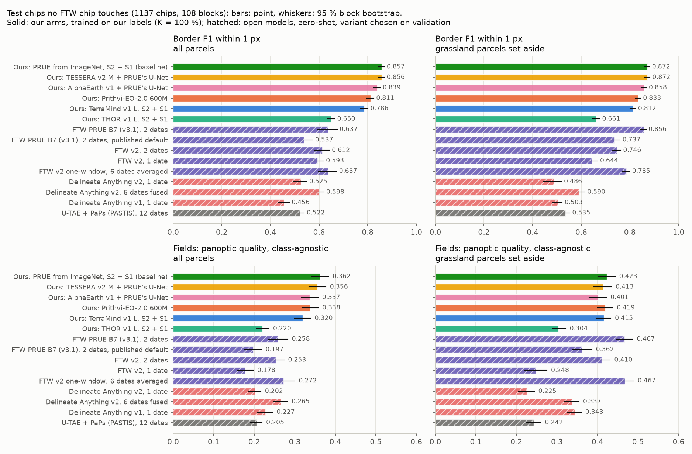
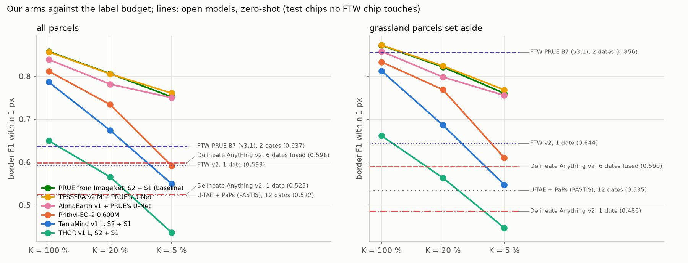
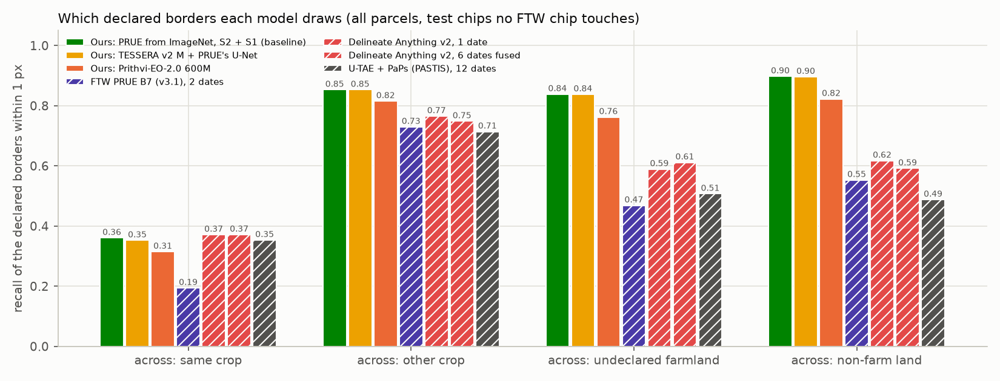
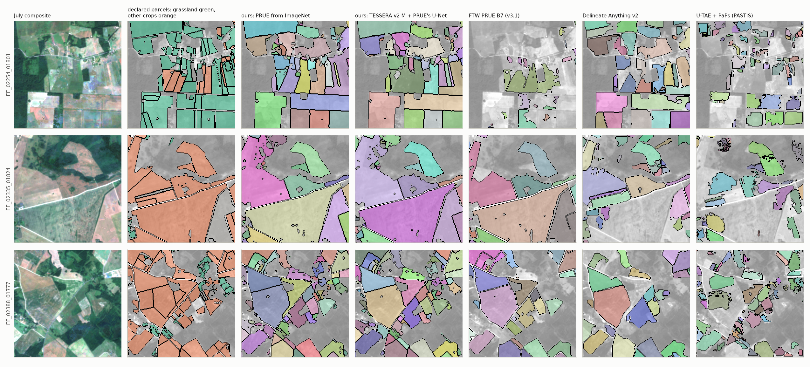
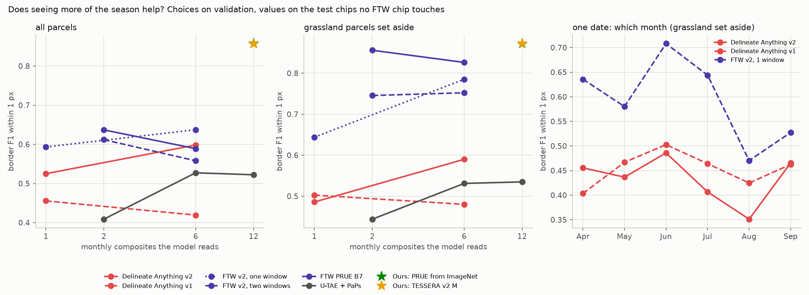
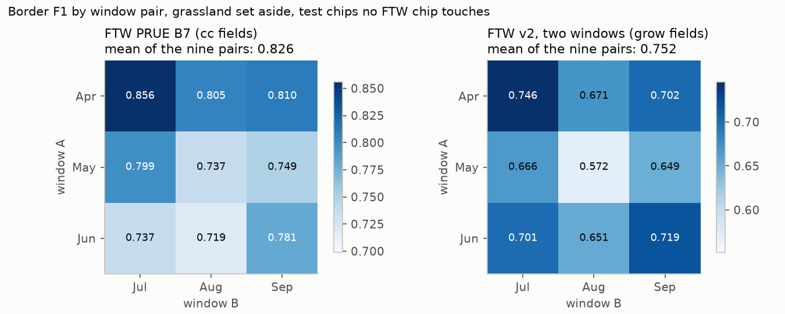

# Open field-delineation models against the two-head workflow, Estonia 2021

26 November 2026. Three released field-delineation models, run zero-shot on the main workflow's Estonian test chips
and scored exactly as our six two-head arms are. The figures and [figures/tables.md](figures/tables.md) are made
by [report.py](report.py); how to run everything is in the [README](README.md).

## In short

- **Our models delineate Estonian fields better than every open model.** On the test chips that no Fields of The
  World (FTW) chip touches, our PRUE baseline and TESSERA reach a border F1 of 0.857 and 0.856 within one pixel.
  The best open model, FTW's released PRUE B7, reaches 0.637. Delineate Anything v2 reaches 0.525, or 0.598 with
  six dates fused, and U-TAE + PaPs 0.522. The intervals do not overlap.
- **Most of FTW's gap is a different idea of what a field is.** FTW's Estonian labels call grassland background, so
  its model leaves most grassland parcels undrawn. With grassland parcels set aside, FTW PRUE B7 reaches a border
  F1 of 0.856 against our 0.872 (paired difference −0.016, interval −0.023 to −0.009). Its fields score higher than
  ours: panoptic quality 0.467 against 0.423 (+0.044, interval +0.025 to +0.066). It predicts fewer fields, and
  more of those it predicts are right.
- **Zero-shot, FTW PRUE B7 equals our models trained on 20 % of the labels.** With grassland set aside, its 0.856
  lies above every arm at K = 20 % (best 0.824) and below the best arms at K = 100 % (0.872). On all parcels the
  10 m arms and the baseline beat every open model even at K = 5 % (0.750 to 0.761 against at most 0.637).
- **Delineate Anything is far behind at 10 m**, yet it draws the border between two fields of the same crop as
  often as ours do (recall 0.37 against 0.36), from one image. Its fields are made for sharper images.
- **Do the common approaches use time?** Mostly not, or only a little. The instance and foundation-model approaches
  read one image. Fields of The World and PRUE stack two dates, and older pipelines average single-date predictions
  after the network. Only U-TAE + PaPs and PTAViT3D encode a whole series. Here, **time helps every open model, but
  which dates matters as much as how many**:
  - Delineate Anything v2 gains 0.07 border F1 when six monthly predictions are averaged.
  - FTW's one-window model gains 0.04 from six averaged months, and 0.14 with grassland aside.
  - U-TAE loses 0.11 when it gets two months instead of twelve.
  - FTW PRUE B7's nine window pairs span 0.51 to 0.64. Its published default (May and August) is one of the worst
    pairs, and April with July the best.

## 1. The question

The user asked on 26 November 2026 how the field delineation of our crop segmentation and field delineation
models compares with top open models, GFM-based or optical, Delineate Anything among them. A second question ran
across them: do the common approaches use temporal data for field delineation?

## 2. What was done

### 2.1 The models

| | Model | Reads | Gives | Trained on | Run here |
|---|---|---|---|---|---|
| **Ours** | the six arms of the two-head workflow ([its report](../../docs/phase1/results_estonia_borders/REPORT.md)) | twelve monthly S2 (+ S1) composites, or AlphaEarth's annual embedding | background, interior, border; fields grown from the interior | our Estonian training parcels, K = 100, 20, 5 % | their stored test predictions, rescored |
| **Open, 1 date** | Delineate Anything v2 (ECCV 2026), and v1 | one RGB image | field instances | FBIS-73M (v1: FBIS-22M), 0.25 to 10 m | each month from April to September |
| **Open, 2 dates** | FTW PRUE B7, v3.1 CC-BY (CVPR 2026) | R, G, B, NIR of two windows | background, field, boundary | Fields of The World, 24 countries, Estonia 2021 among them | the nine pairs of April to June with July to September |
| | FTW v2, two windows and one window | the same, or one window | the same | the same, all licences | the same pairs, or each month |
| **Open, series** | U-TAE + PaPs (ICCV 2021) | the whole series, 10 bands | panoptic parcels | PASTIS, France | 12, 6 or 2 monthly composites |

Every open model runs **zero-shot**: no weight is trained on our labels. Each reads our monthly Sentinel-2 L2A
composites, the same input our arms read; section 6 says what a composite in place of a single scene changes. No
released checkpoint of a geospatial foundation model fine-tuned for field boundaries was found: PRUE's paper
fine-tunes Clay but releases only its EfficientNet U-Nets, and AI4Boundaries and PTAViT3D release no weights. Our
arms are therefore the foundation-model side.

### 2.2 How each open model is run

- **FTW** follows ftw-tools' `inference run` line for line, in ftw-tools' own current package stack: R, G, B, NIR
  of window A then window B, divided by 3000, bilinear upsampling × 2, softmax, nearest downsampling. Fields of
  The World's Estonian windows are April to June and July to September; here one monthly composite stands for each
  window.
- **Delineate Anything** follows two published recipes.
  - The authors' own `delineate.py`: a 1 to 99 % percentile stretch to 8 bits, cubic upsampling × 2, confidence
    0.15, full-resolution masks and their mask smoothing. Their 256 px Sentinel-2 tiles become 512 px; our 224 px
    chips become 448 px, the same scale.
  - ftw-tools' wrapper: reflectance / 3000, bilinear × 2, confidence 0.05, at most 100 fields.
- **U-TAE + PaPs** follows the authors' test code with their five fold models. Each composite is dated on the 15th
  of its month and placed on PASTIS's calendar. The bands are standardised by PASTIS's statistics or by ours. The
  PaPs defaults are kept, and instances PASTIS would call background or void are dropped.

**Choices on validation only.** For each open model, the month or window pair, the recipe, the confidence, the fold,
the normalisation and the field rule are those of the best border F1 on the 769 validation chips. The test chips are
never used to choose. Where a model has a published default, the default is reported as well. For FTW that means
the middle of its Estonian windows, May and August, with its own fields. The choices made:

| Model | Chosen on validation |
|---|---|
| FTW PRUE B7 | April + July, FTW's own fields (interior regions) |
| FTW v2, two windows | April + July, our grown fields |
| FTW v2, one window | July |
| Delineate Anything v2 and v1 | the authors' recipe, June, confidence 0.15 |
| U-TAE + PaPs | fold 1, PASTIS's statistics (Estonian statistics scored 0.19 to 0.31 on validation, PASTIS's 0.37 to 0.54) |

### 2.3 One scorer

Every model's fields are scored by the two-head workflow's own functions (`gfm4agri.borders.scoring`, read-only):

- **Three-class maps** (FTW, our arms) become fields as our arms' do: each region of interior, grown into the
  predicted field. For FTW also as FTW builds them: the interior regions alone.
- **Instance models** keep their own fields, split into connected pieces as the true parcels are. Pieces under
  5 px are dropped, FTW's 500 m².
- **Borders**: precision, recall and F1 of each model's field borders against the declared borders, within 1 px,
  scored on the declared parcels and on non-farm land.
- **Fields**: class-agnostic panoptic quality (PQ). A field is found when it overlaps a declared parcel by more than
  half. RQ, the share of fields found, is FTW's object F1.

Rescoring our 18 arm cells this way reproduces the border F1 and PQ in their `results.json` exactly.

### 2.4 Two things that would make the comparison unfair

- **FTW has seen Estonia.** Fields of The World includes Estonia 2021, two areas of central and south-eastern
  Estonia, labelled from the 2021 declarations that are also the source of our labels. 338 of our 1,475 test chips
  touch an FTW chip, 337 of them a training or validation chip. **Every headline number therefore uses the 1,137
  test chips that touch no FTW chip**, for every model. On all 1,475 chips FTW PRUE B7 scores 0.026 higher and our
  baseline 0.011 higher, so the chips FTW trained near are mainly easier
  ([tables](figures/tables.md)).
- **FTW does not call grassland a field.** Its Estonian labels take two crop groups of the declarations, arable and
  permanent crops. Over 40 sampled chips, FTW labels 87 % of our grassland parcel pixels as background, against
  0.6 % of our other crop parcels (`reference/ftw_label_check.json`). Grassland is 58 % of the parcel pieces on the
  clean test chips (23,081 of 39,978). Every model is therefore scored twice: on all parcels, our definition, and
  with grassland parcels set aside, made void so that neither their fields nor their borders count.

Intervals are 95 % from a block bootstrap over the clean test chips' 108 spatial blocks, 1,000 resamples, the same
resamples for every model, so that differences are paired.

## 3. Results

### 3.1 Borders and fields

| Test chips no FTW chip touches | Border F1, all parcels | Border F1, grassland aside | PQ, all | PQ, grassland aside |
|---|---|---|---|---|
| Ours: PRUE from ImageNet, S2 + S1 (baseline) | **0.857** | **0.872** | **0.362** | 0.423 |
| Ours: TESSERA v2 M + PRUE's U-Net | 0.856 | **0.872** | 0.356 | 0.413 |
| Ours: AlphaEarth v1 | 0.839 | 0.858 | 0.337 | 0.401 |
| Ours: Prithvi-EO-2.0 600M | 0.811 | 0.833 | 0.338 | 0.419 |
| Ours: TerraMind v1 L | 0.786 | 0.812 | 0.320 | 0.415 |
| Ours: THOR v1 L | 0.650 | 0.661 | 0.220 | 0.304 |
| FTW PRUE B7, April + July | 0.637 | 0.856 | 0.258 | **0.467** |
| FTW PRUE B7, published default (May + August) | 0.537 | 0.737 | 0.197 | 0.362 |
| FTW v2, two windows | 0.612 | 0.746 | 0.253 | 0.410 |
| FTW v2, one window (July) | 0.593 | 0.644 | 0.178 | 0.248 |
| FTW v2, one window, six months averaged | 0.637 | 0.785 | 0.272 | **0.467** |
| Delineate Anything v2, one date (June) | 0.525 | 0.486 | 0.202 | 0.225 |
| Delineate Anything v2, six dates fused | 0.598 | 0.590 | 0.265 | 0.337 |
| Delineate Anything v1, one date (June) | 0.456 | 0.503 | 0.227 | 0.343 |
| U-TAE + PaPs, twelve months | 0.522 | 0.535 | 0.205 | 0.242 |

- **On all parcels, our five better arms lead clearly.** Every open model lies 0.22 to 0.40 border F1 below our
  baseline (0.45 for FTW v2's published default), and the block-bootstrap intervals of the differences exclude
  zero.
- **FTW draws few borders, but they are right.** Its border precision is 0.929 on all parcels, close to our
  baseline's 0.936, and 0.943 with grassland aside, the highest of all models (ours 0.900). Its recall on all
  parcels is 0.485, because grassland fields are left as background: FTW PRUE B7 predicts 10,950 fields for 39,978
  true pieces.
- **With grassland aside, FTW PRUE B7 nearly matches our best**, and its fields are better. Our models also draw
  fields on undeclared grassland, which counts against them; FTW draws none there.
- **Delineate Anything v2 over-segments at 10 m.** It predicts the most fields of all models (48,426 for 39,978
  pieces) and draws the least precise borders (0.473). It is the only model that scores lower with grassland aside
  (border precision 0.378): it splits arable parcels, with their rows and textures, more than meadows.
- **U-TAE + PaPs, trained in France, transfers poorly.** Its fields are small and fragmented (last column of the
  examples below). Its border F1 is 0.52 with PASTIS's standardisation, and 0.19 to 0.31 on validation with ours.

### 3.2 Against the label budget

The open models need no Estonian labels. With grassland aside, FTW PRUE B7 (0.856) beats every arm at K = 20 % (at
most 0.824) and is passed only by the 10 m arms and the baseline at K = 100 %. On all parcels, the 10 m arms and the
baseline stay above every open model at every budget, including K = 5 % (0.750 to 0.761 against at most 0.637).
Prithvi and TerraMind fall below FTW PRUE B7 at K = 5 % (0.592 and 0.550), and THOR at every budget.

### 3.3 Which borders each model draws

| Recall within 1 px, all parcels | same crop | other crop | undeclared farmland | non-farm land |
|---|---|---|---|---|
| Ours: PRUE from ImageNet | 0.361 | **0.853** | **0.838** | **0.898** |
| Ours: TESSERA v2 M | 0.353 | **0.853** | **0.838** | 0.896 |
| FTW PRUE B7, April + July | 0.194 | 0.730 | 0.469 | 0.553 |
| Delineate Anything v2, one date | **0.371** | 0.765 | 0.589 | 0.617 |
| U-TAE + PaPs | 0.354 | 0.714 | 0.507 | 0.488 |

The border between two parcels of the same crop stays the hardest for every model, as the two-head report found.
Delineate Anything, which reads one image, draws it as often as our models do (U-TAE as well): such a border is a
line in the image, a ditch or a track, more than a change over the season. FTW draws a fifth of them, because 58 %
of the same-crop border pixels lie between grassland parcels, which FTW does not draw.

### 3.4 Examples

- **First chip, mostly grassland.** FTW leaves nearly all of it empty; our models and Delineate Anything draw the
  meadows.
- **Second chip, one large arable field.** Delineate Anything and U-TAE leave most of it undrawn.
- **Third chip, arable land.** FTW draws it close to the declarations.

## 4. Do the common approaches use temporal data?

### 4.1 In the literature

Most published field-delineation methods read one image or two dates; a whole time series is the exception.

| Method | Dates read | How time enters | Source read |
|---|---|---|---|
| Delineate Anything v1, v2 | one image | not at all; RGB from any sensor at 0.25 to 10 m | project page, repository |
| Segment Anything, zero-shot or fine-tuned | one image | not at all | PRUE, Table 1 |
| ResUNet-a (Waldner and Diakogiannis 2020) | one monthly composite | single-date predictions averaged afterwards: averaging over at least four dates across the season helps, and one date "only marginally decreased accuracy" | arXiv 1910.12023 |
| Sentinel Hub field delineation (eo-learn) | every cloud-free date | trained on single-date patches; predictions "merged temporally" afterwards | github.com/sentinel-hub/field-delineation |
| Fields of The World baselines (AAAI 2025) | two windows | the two images stacked as eight channels; stacking beats either window alone and the mean of the two (Table 4: pixel IoU 0.58, 0.79, 0.80 against at most 0.55, 0.78, 0.79 in Slovenia, France, South Africa) | arXiv 2409.16252 |
| PRUE (CVPR 2026) | two windows, planting and harvest | stacked; its foundation-model variants concatenate the two windows' features | arXiv 2603.27101 |
| AI4Boundaries (dataset, 2023) | six monthly composites, March to August | offered as a series; how its baseline used it was not verified | ESSD 15, 317 |
| U-TAE + PaPs (ICCV 2021) | the whole series, 33 to 61 dates | temporal attention (L-TAE) inside the U-Net | arXiv 2107.07933 |
| PTAViT3D (RSE 2026) | Sentinel-1 or Sentinel-2 series | a 3D vision transformer over space and time | arXiv 2409.13568 |

DECODE (Waldner et al. 2021), Delineate Anything Flow and a 2026 seasonal Segment Anything study could not be
checked and are left out. A 2025 review of parcel delineation (arXiv 2508.14558) notes that large-scale studies
"often incorporat[e] multi-temporal datasets", without counting how many do.

Time therefore enters the common approaches in three ways, from the most common to the least:

1. **Not at all.** One image, as in the instance-segmentation and foundation-model approaches trained on very high
   resolution images.
2. **A few dates, before or after the network.** Two dates stacked as channels (Fields of The World, PRUE), or
   single-date predictions averaged after the network (ResUNet-a, eo-learn).
3. **The whole series, inside the network.** U-TAE + PaPs and PTAViT3D, the newest and the fewest.

Our models belong to the third group through their encoders. TESSERA, TerraMind, THOR and Prithvi read the twelve
monthly composites, the PRUE baseline reads them stacked as 168 channels, and AlphaEarth's precomputed embedding
summarises the year.

### 4.2 What this experiment shows

| Model | One date | Two dates | Six dates | Twelve |
|---|---|---|---|---|
| Delineate Anything v2 | 0.525 (June) | | 0.598 (fused) | |
| FTW v2, one window | 0.593 (July) | | 0.637 (averaged) | |
| FTW v2, two windows | | 0.612 (April + July) | 0.558 (nine pairs averaged) | |
| FTW PRUE B7 | | 0.637 (April + July) | 0.589 (nine pairs averaged) | |
| U-TAE + PaPs | | 0.409 (May + August) | 0.527 (April to September) | 0.522 |
| Ours: PRUE from ImageNet, trained | | | | 0.857 |

Border F1 on all parcels; with grassland aside the pattern is the same and larger ([tables](figures/tables.md)).

- **More dates help a model that reads one image.** Averaging six monthly maps adds 0.07 border F1 and 0.06 PQ to
  Delineate Anything v2, and 0.04 border F1 to FTW's one-window model (0.14 with grassland aside, where the averaged
  one-window model passes the two-window one). Delineate Anything v1 is the exception (0.456 to 0.419): it finds
  few fields per month (10 to 12 per chip against 40 to 65 for v2), probably too few for averaging to help.
- **A series model needs its series.** U-TAE + PaPs, trained on 33 to 61 dates, drops from 0.52 to 0.41 when it gets
  only May and August.
- **Which dates matters as much as how many.** For a single date, June is the best month for both Delineate
  Anything models, and for FTW's one-window model with grassland aside (July on all parcels); August or September
  is the worst. For a pair, FTW PRUE B7 ranges from 0.513 (June + August) to 0.637 (April + July). Its published
  default, May + August (0.537), is the third worst of the nine pairs, and averaging all nine (0.589) is worse than
  the best pair. A likely reason: in April most arable fields are bare or just emerging and in July near their peak,
  so that pair holds the largest contrast between neighbouring fields.

For our own trained models this experiment does not separate the effect of time: they all read the twelve months.
Section 7 proposes the run that would.

## 5. Checks

| Check | Result |
|---|---|
| Our arms rescored by this experiment's scorer | the 18 cells' stored border F1 and PQ reproduced exactly (`score.py` stops otherwise) |
| FTW: ftw-tools' own `inference run` on 5 exported chips against the stored maps | argmax agreement 99.85 to 100 %, mean 99.97 % (`reference/wiring.json`) |
| Delineate Anything, ftw-tools' wrapper against the stored `ftw` recipe | the same number of fields on every chip, mean best IoU 0.985 to 1.000 |
| U-TAE + PaPs on four PASTIS test patches (fold 5, the test fold of the fold-1 weights) | class-agnostic RQ 0.60; the authors report class-aware RQ 0.48 for that fold |
| PaPs with confidence pruning against without | identical panoptic output on 6 chips, 5.6 times faster |
| FTW's labels against ours | 87 % of grassland pixels background, 0.6 % of other crops (40 chips) |

One fault was found and fixed on the way. FTW's maps first came from the Poetry environment, whose
segmentation-models-pytorch 0.5.0 builds the same U-Net and loads the same weights, yet gave class maps that
differed from ftw-tools' on 0.5 to 4 % of the pixels. Kornia's resizing was ruled out (identical in both
environments). With ftw-tools' current stack (Python 3.12, segmentation-models-pytorch 0.6.0) the maps agree, so
every FTW prediction was redone there and rescored. The first run's log is kept as
`logs/predict_ftw_poetry_smp050.log`.

## 6. Caveats

- **Zero-shot against trained.** Our arms learnt Estonian fields from Estonian labels; the open models did not. The
  comparison says how far an off-the-shelf model is from our pipeline in Estonia, not which architecture is
  better. FTW PRUE B7 and our baseline share one architecture (U-Net, EfficientNet-B7): our baseline's advantage
  comes from our labels, our definition of a field and twelve months of S2 and S1.
- **FTW knows Estonia, only not these chips.** It trained on other Estonian parcels of the same year, so it is
  in-country, not truly out-of-domain.
- **Composites in place of scenes.** Every open model was trained on single acquisitions; it reads median monthly
  composites here. They are cloud-free and smoother, and per-pixel seams remain (pipeline.md section 5). FTW picks
  one scene within each window; a composite month stands in.
- **Chips of 2.24 km.** Fields are cut at the chip edges for every model and for the truth alike. Delineate
  Anything's own merging across tiles and its 2,500 m² minimum are not applied; every instance model keeps pieces
  of 5 px or more.
- **U-TAE's input is far from its training.** It saw 33 to 61 raw, partly cloudy dates in France; it reads 12
  cloud-free composites in Estonia. PASTIS's standardisation, which includes clouds, scored better than ours.
- **One draw and one seed per arm.** The intervals come from resampling test blocks; they do not include training
  variance.
- **The choices on validation use border F1 on all parcels.** A choice made with grassland aside could favour
  other FTW pairs, but the ranking of the pairs is nearly the same under both truths.

## 7. Next steps

1. **A temporal ablation of our own model.** Refit the PRUE baseline of the two-head workflow at K = 100 % on one,
   two (April and July), six and twelve monthly composites. That would show whether our models' lead comes from
   the series or from the labels, the one temporal question this experiment leaves open for trained models.
2. **FTW's weights as a starting point.** Fine-tune FTW PRUE B7 on our labels in place of ImageNet, on two windows
   or on the twelve months. Zero-shot it already equals our arms at K = 20 % on crops, so it may help most when
   labels are scarce (RQ1.2).
3. **Report FTW with grassland aside, and with April and July,** wherever it is cited as a reference for Estonia:
   its published default windows and its field definition understate it.
4. If agreed, an entry in pipeline.md section 11 among the experiments of the analysis.

## Files

| File | Holds |
|---|---|
| `predict_ftw.py`, `predict_delany.py`, `predict_utae.py` | the three models' inference |
| `fuse.py` | the six-month fusion of Delineate Anything |
| `score.py` | the one scorer: per-chip counts, `scores/summary.csv` |
| `report.py` | the figures, `figures/tables.md`, `figures/bootstrap.json` |
| `check_wiring.py` | the checks of section 5, `reference/wiring.json` |
| `ftw_overlap.py`, `ftw_labels.py` | FTW's coverage of our chips and its labels against ours (`reference/`) |
| `vendor/utae_paps/` | U-TAE + PaPs, MIT, with its README of changes |
| `env.sh`, `env_ftw312.sh`, `fetch_weights.sh`, `run_hub.sh` | the environments, the weights, the whole run |
