# Field cases: how good a cue is what each method says drives the prediction?

From the focused run ([REPORT.md](REPORT.md)); generated by `field_cases.py`. One confidently and correctly predicted
field per species (p ≥ 0.95; oats, with none, its surest field).

**How to read.** For each method, the *main* block is the one it ranks first: the window, the property (band group
or index) and the window × property cell. Beside it, in brackets, that block's **AUC**: how well it alone separates
the species from the other crops in the training fields (0.5 = not at all, 1 = perfectly). A window's AUC is that of
its best property, a property's that of its best window. The species' **main AUC cues** are listed below each table.
IG's property and cell choices are the least reliable (its split between correlated bands is unstable).

## All correctly predicted fields

Median over the 438 fields of the AUC of each method's main block, beside the AUC of the species' best block and of a typical one (the median block); and the share of fields whose main block is above the typical one.

| level | method | AUC of the main block | best block | typical block (median) | main block above the typical |
|---|---|---|---|---|---|
| window | Consensus | 0.78 | 0.85 | 0.77 | 0.67 |
| window | Occlusion | 0.79 | 0.85 | 0.77 | 0.69 |
| window | SHAP | 0.78 | 0.85 | 0.77 | 0.66 |
| window | IG | 0.78 | 0.85 | 0.77 | 0.69 |
| window | Drop | 0.83 | 0.85 | 0.77 | 0.80 |
| property | Occlusion | 0.80 | 0.85 | 0.80 | 0.61 |
| property | SHAP (groups) | 0.82 | 0.85 | 0.79 | 0.62 |
| property | IG | 0.80 | 0.85 | 0.80 | 0.44 |
| cell | Occlusion | 0.74 | 0.85 | 0.66 | 0.73 |
| cell | IG | 0.70 | 0.85 | 0.66 | 0.72 |

**What it says.** The model's main blocks are informative but rarely the best cue. Its main window has a
median AUC of 0.78 (the species' best window 0.85, a typical window 0.77), above a typical window for two thirds of
the fields; its main property 0.80 to 0.82 by occlusion and SHAP (best 0.85, typical 0.80); its main cell 0.74 by
occlusion (best 0.85, typical 0.66), above a typical cell for three quarters of the fields. The windows the model
cannot do without (drop) are better cues, 0.83. IG's main property is no better than a typical one.

## The fields at a glance

Main window: the consensus of occlusion, SHAP and IG. Main property and cell: occlusion.

| species | p | main window (AUC; best) | main property (AUC; best) | main cell, occlusion (AUC; best) |
|---|---|---|---|---|
| rye | 0.958 | Jul-Sep (0.69; 0.85) | Red-edge (0.80; 0.85) | May-Jul SWIR (0.85; 0.85) |
| buckwheat | 0.989 | May-Jul (0.71; 0.90) | Red-edge (0.86; 0.90) | Jun-Aug Red-edge (0.78; 0.90) |
| potatoes | 0.953 | Jun-Aug (0.90; 0.91) | SWIR (0.91; 0.91) | Jun-Aug Red-edge (0.65; 0.91) |
| rapeseed | 0.991 | May-Jul (0.95; 0.95) | Red-edge (0.89; 0.95) | May-Jul NDMI (0.88; 0.95) |
| oats | 0.952 | May-Jul (0.74; 0.75) | SWIR (0.61; 0.75) | Jun-Aug NDMI (0.56; 0.75) |
| maize | 0.986 | Jul-Sep (0.94; 0.94) | Red-edge (0.94; 0.94) | Jul-Sep Red-edge (0.94; 0.94) |
| barley | 0.972 | May-Jul (0.74; 0.78) | Visible (0.78; 0.78) | Apr-Jun Visible (0.55; 0.78) |
| forage legumes | 0.998 | May-Jul (0.75; 0.80) | Red-edge (0.76; 0.80) | Jun-Aug Visible (0.78; 0.80) |
| grassland | 0.993 | May-Jul (0.83; 0.91) | NIR (0.86; 0.91) | Jun-Aug SWIR (0.72; 0.91) |
| dry pulses | 0.955 | Mar-May (0.74; 0.76) | NDMI (0.74; 0.76) | Jun-Aug Red-edge (0.61; 0.76) |
| wheat | 0.965 | Jun-Aug (0.79; 0.82) | Red-edge (0.82; 0.82) | Jun-Aug Red-edge (0.75; 0.82) |

## Rye: field 21091946 (p = 0.958, 478 interior pixels)

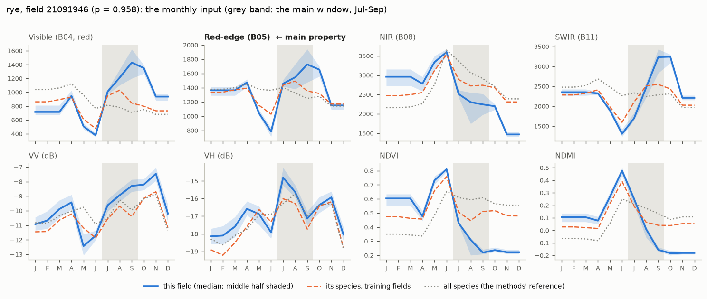

| method | main window (AUC) | main property (AUC) | main cell (AUC) |
|---|---|---|---|
| Occlusion | Jul-Sep (0.69) | Red-edge (0.80) | May-Jul SWIR (0.85) |
| SHAP | Jul-Sep (0.69) | Red-edge (0.80) | – |
| IG | May-Jul (0.85) | Red-edge (0.80) | May-Jul Red-edge (0.77) |
| Drop | May-Jul (0.85) | – | – |

**Main AUC cues of rye:** windows May-Jul 0.85, Apr-Jun 0.84; properties SWIR 0.85, Visible 0.83; best cell May-Jul SWIR 0.85.

Occlusion and SHAP pick Jul-Sep, a weak window (0.69); IG and drop pick May-Jul, the best (0.85). Red-edge (0.80) is close to the best property, and occlusion's main cell, May-Jul SWIR, is the best cell (0.85).

## Buckwheat: field 21388891 (p = 0.989, 3075 interior pixels)

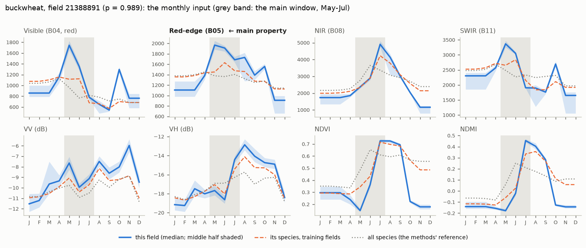

| method | main window (AUC) | main property (AUC) | main cell (AUC) |
|---|---|---|---|
| Occlusion | May-Jul (0.71) | Red-edge (0.86) | Jun-Aug Red-edge (0.78) |
| SHAP | Jun-Aug (0.78) | Red-edge (0.86) | – |
| IG | Jun-Aug (0.78) | Red-edge (0.86) | Jul-Sep Red-edge (0.86) |
| Drop | Jul-Sep (0.90) | – | – |

**Main AUC cues of buckwheat:** windows Jul-Sep 0.90, Aug-Oct 0.90; properties NDMI 0.90, VH 0.90; best cell Jul-Sep NDMI 0.90.

The model reads red-edge (0.86, near the best 0.90) from May to August (0.71 to 0.78); the best season in the data, July to October (0.90), is picked only by drop.

## Potatoes: field 21758550 (p = 0.953, 1250 interior pixels)

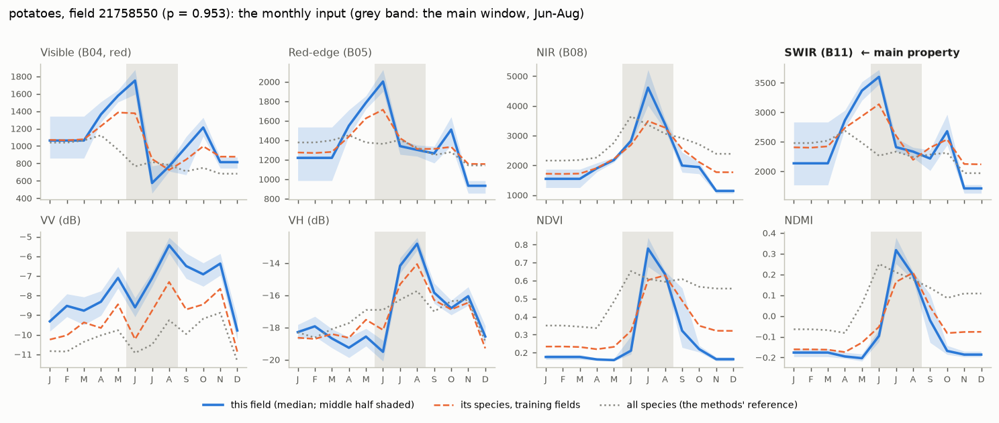

| method | main window (AUC) | main property (AUC) | main cell (AUC) |
|---|---|---|---|
| Occlusion | Jun-Aug (0.90) | SWIR (0.91) | Jun-Aug Red-edge (0.65) |
| SHAP | Jun-Aug (0.90) | SWIR (0.91) | – |
| IG | Jun-Aug (0.90) | Red-edge (0.78) | Jun-Aug Red-edge (0.65) |
| Drop | Jun-Aug (0.90) | – | – |

**Main AUC cues of potatoes:** windows May-Jul 0.91, Jun-Aug 0.90; properties SWIR 0.91, NDVI 0.90; best cell May-Jul SWIR 0.91.

Every method's main window (Jun-Aug, 0.90) and, by occlusion and SHAP, its main property (SWIR, 0.91) are at the top of the data's cues.

## Rapeseed: field 20822973 (p = 0.991, 3972 interior pixels)

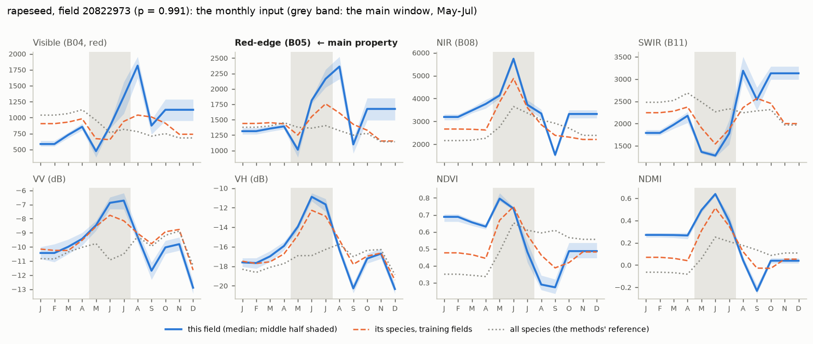

| method | main window (AUC) | main property (AUC) | main cell (AUC) |
|---|---|---|---|
| Occlusion | May-Jul (0.95) | Red-edge (0.89) | May-Jul NDMI (0.88) |
| SHAP | May-Jul (0.95) | Red-edge (0.89) | – |
| IG | Jun-Aug (0.95) | Red-edge (0.89) | Jun-Aug Red-edge (0.83) |
| Drop | May-Jul (0.95) | – | – |

**Main AUC cues of rapeseed:** windows May-Jul 0.95, Jun-Aug 0.95; properties VH 0.95, VV 0.91; best cell May-Jul VH 0.95.

The main window is the best (May-Jul, 0.95); red-edge (0.89) and May-Jul NDMI (0.88) are strong cues, though the data's best is radar (VH 0.95).

## Oats: field 21512048 (p = 0.952, 1628 interior pixels)

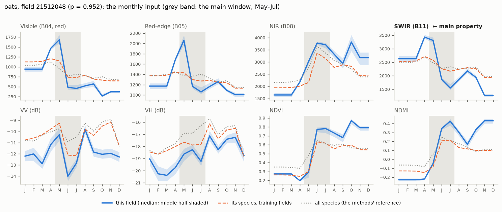

| method | main window (AUC) | main property (AUC) | main cell (AUC) |
|---|---|---|---|
| Occlusion | Jul-Sep (0.72) | SWIR (0.61) | Jun-Aug NDMI (0.56) |
| SHAP | May-Jul (0.74) | SWIR (0.61) | – |
| IG | May-Jul (0.74) | Visible (0.65) | May-Jul NDVI (0.59) |
| Drop | Jun-Aug (0.75) | – | – |

**Main AUC cues of oats:** windows Jun-Aug 0.75, May-Jul 0.74; properties VV 0.75, VH 0.74; best cell Jun-Aug VV 0.75.

Oats has only weak cues (best 0.75, VV). The model's window is close to the best (0.72 to 0.75), its main property, SWIR, weak (0.61).

## Maize: field 21646938 (p = 0.986, 3482 interior pixels)

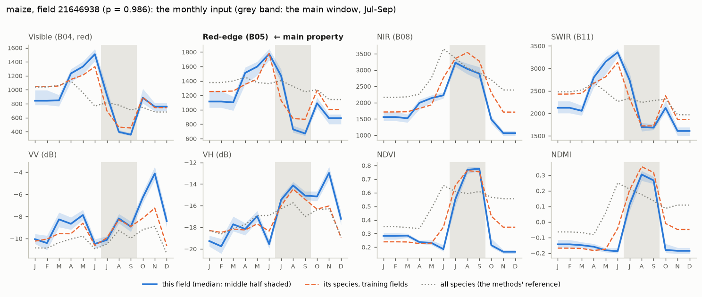

| method | main window (AUC) | main property (AUC) | main cell (AUC) |
|---|---|---|---|
| Occlusion | Jul-Sep (0.94) | Red-edge (0.94) | Jul-Sep Red-edge (0.94) |
| SHAP | Jul-Sep (0.94) | Red-edge (0.94) | – |
| IG | Jun-Aug (0.71) | NIR (0.85) | Jun-Aug Red-edge (0.67) |
| Drop | Jul-Sep (0.94) | – | – |

**Main AUC cues of maize:** windows Jul-Sep 0.94, Aug-Oct 0.91; properties Red-edge 0.94, NDMI 0.90; best cell Jul-Sep Red-edge 0.94.

The clearest case: occlusion and SHAP name the data's best window, property and cell (Jul-Sep red-edge, 0.94). IG differs (Jun-Aug, 0.71).

## Barley: field 21066199 (p = 0.972, 5009 interior pixels)

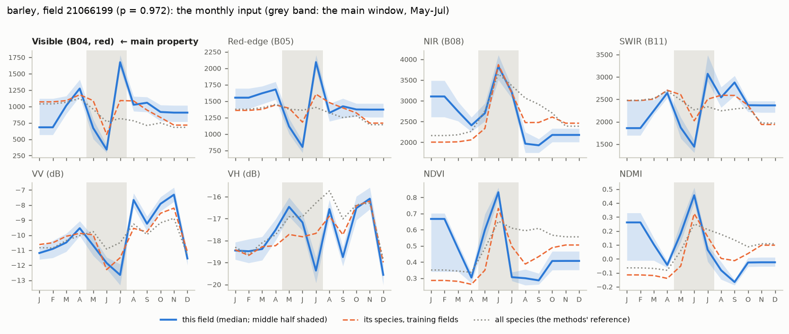

| method | main window (AUC) | main property (AUC) | main cell (AUC) |
|---|---|---|---|
| Occlusion | May-Jul (0.74) | Visible (0.78) | Apr-Jun Visible (0.55) |
| SHAP | May-Jul (0.74) | Red-edge (0.72) | – |
| IG | Jul-Sep (0.78) | NDMI (0.78) | May-Jul NDMI (0.52) |
| Drop | Jun-Aug (0.78) | – | – |

**Main AUC cues of barley:** windows Jun-Aug 0.78, Jul-Sep 0.78; properties VH 0.78, NDVI 0.78; best cell Jun-Aug VH 0.78.

Barley has no strong cue (all 0.78 or less). The model's window (0.74) and property (visible, 0.78) are near the top of that flat map; its cells are weak (0.52 to 0.55).

## Forage legumes: field 20225826 (p = 0.998, 1400 interior pixels)

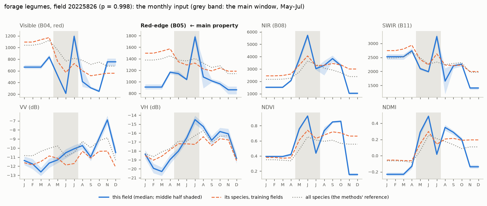

| method | main window (AUC) | main property (AUC) | main cell (AUC) |
|---|---|---|---|
| Occlusion | May-Jul (0.75) | Red-edge (0.76) | Jun-Aug Visible (0.78) |
| SHAP | May-Jul (0.75) | SWIR (0.72) | – |
| IG | May-Jul (0.75) | SWIR (0.72) | Apr-Jun Red-edge (0.74) |
| Drop | May-Jul (0.75) | – | – |

**Main AUC cues of forage legumes:** windows Sep-Nov 0.80, Aug-Oct 0.79; properties NDVI 0.80, Visible 0.78; best cell Sep-Nov NDVI 0.80.

Moderate cues in the wrong season: the model reads May-Jul (0.75) red-edge and SWIR (0.72 to 0.76); the data's best are autumn NDVI and visible (0.80).

## Grassland: field 21230835 (p = 0.993, 3570 interior pixels)

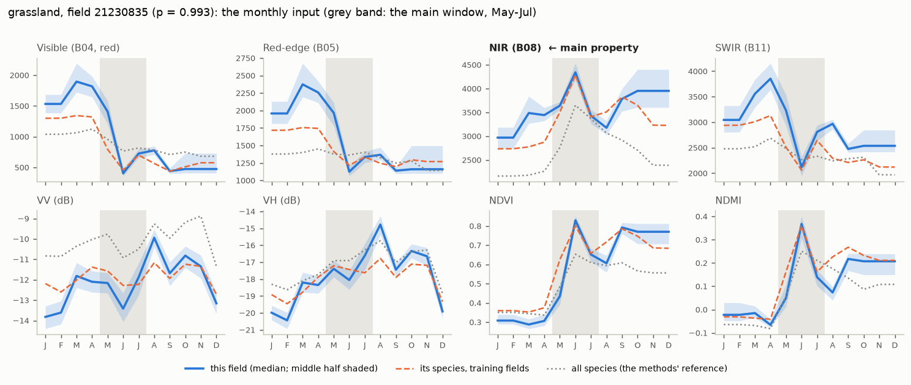

| method | main window (AUC) | main property (AUC) | main cell (AUC) |
|---|---|---|---|
| Occlusion | May-Jul (0.83) | NIR (0.86) | Jun-Aug SWIR (0.72) |
| SHAP | May-Jul (0.83) | NIR (0.86) | – |
| IG | May-Jul (0.83) | Visible (0.86) | Apr-Jun NIR (0.82) |
| Drop | Jun-Aug (0.89) | – | – |

**Main AUC cues of grassland:** windows Aug-Oct 0.91, Sep-Nov 0.91; properties VV 0.91, NDVI 0.89; best cell Aug-Oct VV 0.91.

Good cues, not the best: May-Jul (0.83) NIR (0.86). The data's best, autumn VV (0.91), is not what the model uses.

## Dry pulses: field 22176709 (p = 0.955, 1090 interior pixels)

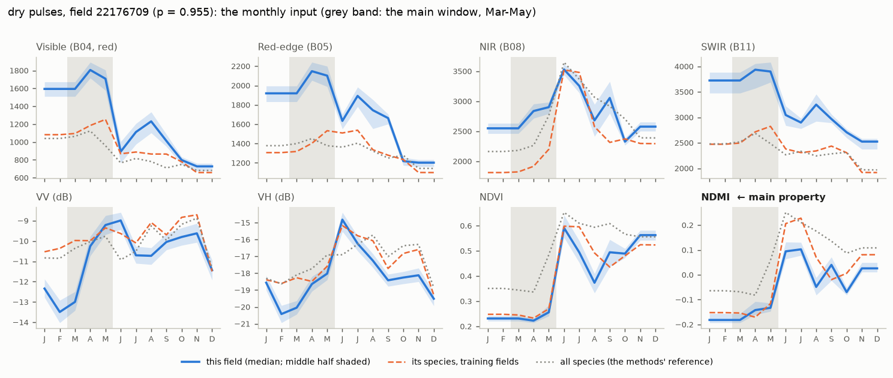

| method | main window (AUC) | main property (AUC) | main cell (AUC) |
|---|---|---|---|
| Occlusion | May-Jul (0.76) | NDMI (0.74) | Jun-Aug Red-edge (0.61) |
| SHAP | Mar-May (0.74) | Visible (0.71) | – |
| IG | Mar-May (0.74) | NDMI (0.74) | May-Jul NDMI (0.61) |
| Drop | Jun-Aug (0.74) | – | – |

**Main AUC cues of dry pulses:** windows May-Jul 0.76, Mar-May 0.74; properties VH 0.76, NDMI 0.74; best cell May-Jul VH 0.76.

A flat map (0.74 to 0.76): the methods differ on the window, all on cues of that level; occlusion's main property, NDMI (0.74), is one of the main AUC properties.

## Wheat: field 22212206 (p = 0.965, 4579 interior pixels)

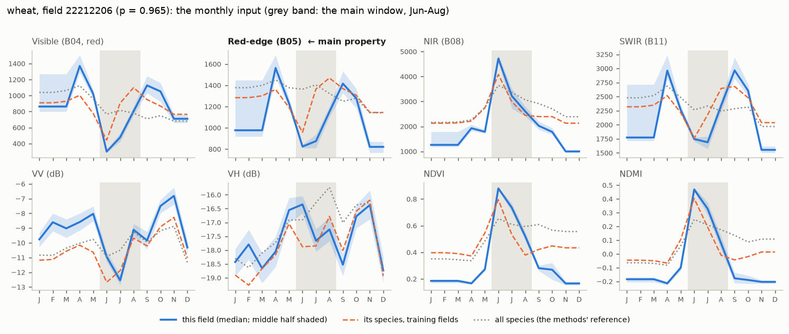

| method | main window (AUC) | main property (AUC) | main cell (AUC) |
|---|---|---|---|
| Occlusion | Jun-Aug (0.79) | Red-edge (0.82) | Jun-Aug Red-edge (0.75) |
| SHAP | Jun-Aug (0.79) | Red-edge (0.82) | – |
| IG | Jun-Aug (0.79) | NIR (0.78) | Apr-Jun NIR (0.59) |
| Drop | Jun-Aug (0.79) | – | – |

**Main AUC cues of wheat:** windows Apr-Jun 0.82, May-Jul 0.82; properties Red-edge 0.82, Visible 0.81; best cell Apr-Jun Red-edge 0.82.

Red-edge (0.82) is the data's best property; the model reads it in Jun-Aug (0.79), one window after the best (Apr-Jun, 0.82).
