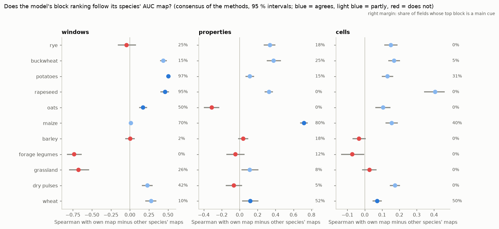
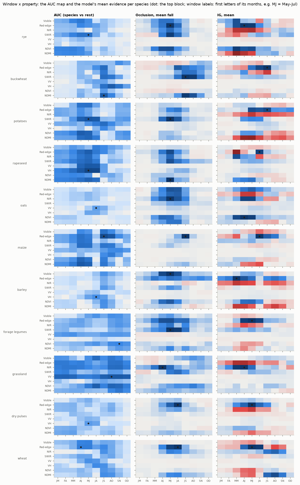
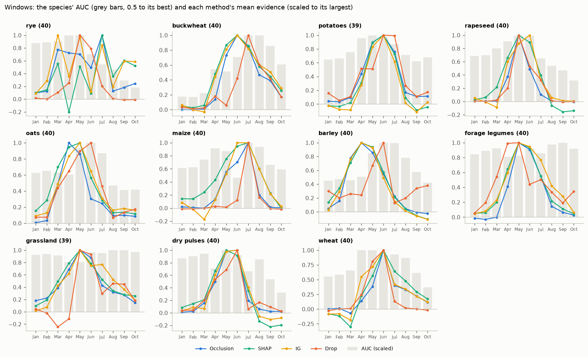
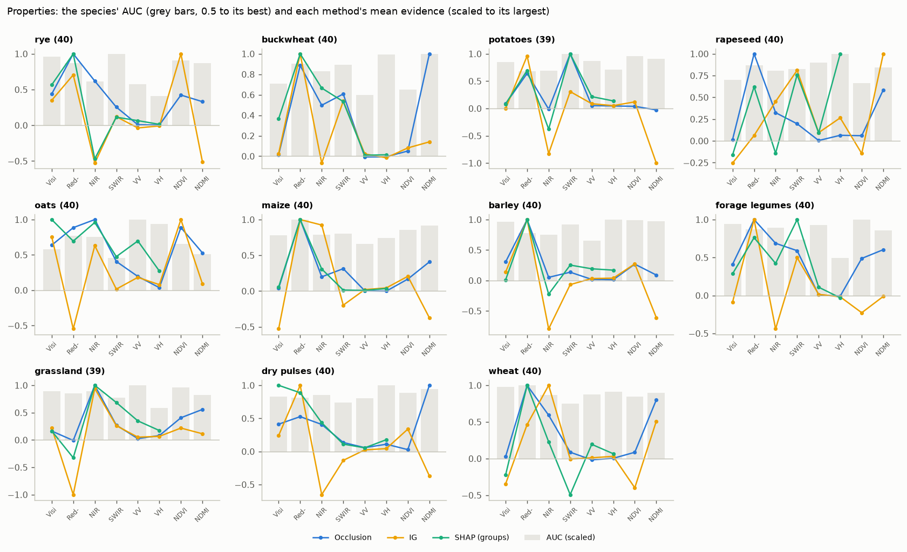

# XAI on TESSERA, focused: windows, band groups and indices against an AUC map on the same blocks: report, 27 November 2026

**Answer.** On the same blocks, for 438 correctly predicted fields, the model's evidence agrees with what separates
the crop in the data for some crops and not for others, and which ones depends on the level:

- **When (10 windows).** The model's window ranking follows its species' own AUC map more than the other species'
  maps for 6 of 11 species, and its top window is a main AUC window for most fields of **potatoes (97 %; 30 % by
  chance), rapeseed (95 %; 20 %) and maize (70 %; 10 %)**, and for half of the oats fields (50 %; 20 %). It does not agree for **barley, rye, forage legumes and grassland**: for the
  last two the ranking runs against their maps (Spearman with own map minus other maps −0.73 and −0.68), because their
  strongest window cues come in late summer and autumn (VV and NDVI) while the model looks at May to July.
- **Which property (6 band groups, NDVI, NDMI).** Agreement for **maize (80 %; 12 % by chance) and wheat (52 %;
  25 %)**, specific but weak for five more, none for **oats, barley, forage legumes and dry pulses**. Occlusion gives
  the clearer answer (top block a main AUC property for 34 % of fields, 17 % against other maps), and SHAP on the six
  band groups agrees with it (33 % against 19 %); IG's property split is at the baseline.
- **Window × property (80 cells).** Specific but rarely exact: the cell ranking follows the own map for 8 of 11
  species, but the top cell is a main AUC cell for half the fields only for **wheat** (50 %; 5 % by chance), and for
  31 to 40 % for potatoes and maize (chance 1 to 4 %).
- **An exploratory finding, outside the pre-set verdict: the event test agrees best.** Ranking the windows by how
  much the model *needs* them (drop: the window marked not observed) agrees with the AUC windows for **7 of 11
  species** (rye 82 %, buckwheat 72 %, maize 100 %, against 10 to 20 % by chance), more than any method under the mean
  replacement. It is the best of four methods on the windows, read after the results, so it is a lead, not a test.

So the evidence is crop specific and partly agronomic: right season for the summer crops and rapeseed, right
property for maize and wheat, and no agreement for grassland, forage legumes and barley, whose AUC cues are late
season or weak. The verdicts rest on one fit.

## Setup

| | |
|---|---|
| Question | for fields the model predicts correctly, does the XAI evidence agree with the AUC map when both are read on exactly the same blocks? (README) |
| Model | the two-head TESSERA arm of `experiments/2026-11-09_borders_all_arms`, K = 100 %, with the step-0 statistics and mean field of `experiments/2026-11-20_xai_tessera` (copied, same SHA-256) |
| Blocks | 10 three-month windows (Jan-Mar ... Oct-Dec); 8 properties: Visible, Red-edge, NIR, SWIR, VV, VH (all months), NDVI, NDMI (all months); 80 window × property cells |
| Hiding | the mean replacement (species-balanced training mean); for NDVI and NDMI an index swap, the index set to the mean field's with the band pair's sum kept; the windows also under drop |
| Methods | occlusion (98 blocks + 10 under drop); SHAP, 12 months (16 permutations) summed to windows, 6 band groups exact; IG from the mean field, 32 steps, each index pair split into its index and brightness parts. Consensus: mean of the methods' within-field ranks (windows: occlusion, SHAP, IG; properties and cells: occlusion, IG), set before the run |
| AUC map | rebuilt from the model's own input: `EE_2021_rev` composites, training chips only, 109,469 fields; window means per band (best band of each group) and per index; each species against the rest as in the crop-signature study. Its monthly cells match the crop-signature map at Spearman 0.83 to 0.97 per species; potatoes now has a map |
| Fields | 440 test fields predicted correctly by the stored predictions, 40 per species, at most 3 per species and chip (42 chips); 438 also correct by the explained score |
| Agreement | per field, *hit*: the top block is a main AUC cue (within 0.02 AUC of the best, so near ties count); *Spearman* of the block ranking with the AUC; both against the other species' maps. *Agrees*: the Spearman with the own map exceeds the other maps' (95 % bootstrap interval above 0) and hit ≥ 50 %; *partly*: one of the two |
| Runs | hub RTX A4000, 26 and 27 November 2026, shared with another session's job: the first launch ran out of memory after 4 chips (IG's backward now 2 fields per pass, and a chip that runs out of memory retries with smaller batches); 45 s per field |

**Checks.** SHAP's parts add up to the total change exactly (largest gap 0.0000); IG's within 0.23 % (median over
chips); the index swaps hit their target and keep the pair's sum (asserted on the pilot chip). The first run's
deletion curves and step check are not repeated.

**The AUC map on the blocks** (main = within 0.02 of the best):

| species | best cell | main windows | main properties |
|---|---|---|---|
| rapeseed | May-Jul VH 0.95 | May-Jul, Jun-Aug | VH |
| maize | Jul-Sep Red-edge 0.94 | Jul-Sep | Red-edge |
| potatoes | May-Jul SWIR 0.91 | Apr-Jun, May-Jul, Jun-Aug | SWIR, NDVI |
| grassland | Aug-Oct VV 0.91 | Jun-Aug to Oct-Dec | VV, NDVI |
| buckwheat | Jul-Sep NDMI 0.90 | Jul-Sep, Aug-Oct | VH, NDMI |
| rye | May-Jul SWIR 0.85 | Apr-Jun, May-Jul | Visible, SWIR |
| wheat | Apr-Jun Red-edge 0.82 | Apr-Jun, May-Jul | Visible, Red-edge |
| forage legumes | Sep-Nov NDVI 0.80 | Aug-Oct, Sep-Nov | Visible, NDVI |
| barley | Jun-Aug VH 0.78 | Jun-Aug, Jul-Sep | Visible, VH, NDVI, NDMI |
| dry pulses | May-Jul VH 0.76 | Mar-May, May-Jul | VH, NDMI |
| oats | Jun-Aug VV 0.75 | May-Jul, Jun-Aug | VV, VH |

EVI is never above the better of NDVI and NDMI (best EVI 0.66 to 0.89, at most equal); it is left out of the XAI side because
it cannot be removed apart from NDVI.

## Results

### The verdict

**What it shows.** Per species and level, the consensus ranking's Spearman with the species' own AUC map minus with
the other species' maps (dot, 95 % interval), and at the right the share of fields whose top block is a main AUC cue.

| species | windows | properties | cells |
|---|---|---|---|
| potatoes | **agrees** (97 %) | partly (15 %) | partly (31 %) |
| rapeseed | **agrees** (95 %) | partly (0 %) | partly (0 %) |
| oats | **agrees** (50 %) | does not (0 %) | partly (0 %) |
| maize | partly (70 %) | **agrees** (80 %) | partly (40 %) |
| wheat | partly (10 %) | **agrees** (52 %) | **agrees** (50 %) |
| buckwheat | partly (15 %) | partly (25 %) | partly (5 %) |
| dry pulses | partly (42 %) | does not (5 %) | partly (0 %) |
| rye | does not (25 %) | partly (18 %) | partly (0 %) |
| barley | does not (2 %) | does not (18 %) | does not (0 %) |
| forage legumes | does not (0 %) | does not (12 %) | does not (0 %) |
| grassland | does not (26 %) | partly (8 %) | does not (0 %) |

The chance of a hit differs between species, because near ties enlarge the set of main cues: a random top window
would hit 50 % of the time for grassland (5 main windows of 10) and 10 % for maize (1 of 10). Every "agrees" above is
far above its chance level (in `figures/tables.md`, with the intervals). **The same rule for each method** (share of
fields whose top block is a main cue; chance in brackets below the table; \* = the hit is no better than chance).
SHAP ranks the six band groups only, with their main cues re-ranked among the six:

| species | windows: occlusion / SHAP / IG / **drop** | properties: occlusion / SHAP (6 groups) / IG |
|---|---|---|
| potatoes | agrees / agrees / agrees / **agrees** (95, 92, 92, 56 %) | agrees / agrees / partly (77, 69, 21 %) |
| rapeseed | agrees / agrees / agrees / **agrees** (95, 92, 100, 88 %) | partly / agrees / partly (0, 50, 0 %) |
| maize | partly / partly / partly / **agrees** (70, 68, 52, 100 %) | agrees / agrees / agrees (90, 100, 50 %) |
| oats | no / agrees / agrees / **agrees** (30, 60, 78, 62 %) | no / no / no (0, 12, 0 %) |
| rye | no / no / no / **agrees** (30, 12, 38, 82 %) | partly / partly / partly (5, 35, 8 %) |
| buckwheat | partly / partly / partly / **agrees** (30, 28, 18, 72 %) | agrees / partly / partly (55, 0, 15 %) |
| barley | no / no / no / **agrees** (10, 2, 8, 68 %) | no / no / no (18, 2, 18 %) |
| wheat | partly / partly / partly / partly (10, 10, 5, 30 %) | agrees / agrees / partly (55, 75, 50 %) |
| dry pulses | partly / agrees / partly / partly (45, 55, 25, 12 %) | no / partly / no (42, 0, 5 %) |
| grassland | no / no / no / partly\* (36, 28, 28, 51 %) | no / partly / partly (18, 0, 3 %) |
| forage legumes | no / no / no / no (0, 0, 0, 8 %) | partly / no / no (10, 18, 8 %) |

Chance per species: windows 20 % (potatoes 30 %, maize 10 %, grassland 50 %); properties 25 % (rapeseed and maize
12 %, barley 50 %); SHAP's six groups 17 to 50 %. Grassland's drop "partly" rests only on a hit at chance (51 %
against 50 %); its ranking is not specific (interval of the Spearman difference −0.24 to +0.11), so it does not
agree.

### Where the evidence sits

**What it shows.** Per species, the AUC of each window × property cell (left), and the model's mean evidence on the
same grid by occlusion and IG (dot: the top block).

**What it tells us.** Occlusion puts the evidence of almost every species in the May-Jul and Jun-Aug windows, on
red-edge, NIR, SWIR or NDMI. Its top cell is the AUC's best cell for **potatoes (May-Jul SWIR)** and **maize (Jul-Sep
red-edge)**, and close for **wheat** (Jun-Aug red-edge against Apr-Jun red-edge) and **buckwheat** (Jul-Sep SWIR
against Jul-Sep NDMI, which is built on SWIR). **Rapeseed**'s top occlusion cell is May-Jul NDMI (AUC 0.88), its
best AUC cell May-Jul VH (0.95). For grassland and forage legumes the AUC map is high almost everywhere, with its
best cells late in the season on VV and NDVI, while the model's evidence is May-Jul NIR, red-edge and SWIR. IG's maps
alternate strong positive and negative cells between correlated groups (red-edge against NIR, the NDMI part against
its brightness), the cancellation already seen in the first run.

**What it tells us.** Under the mean replacement, occlusion, SHAP and IG draw nearly the same window profile for
every species (the consensus is not needed to settle them). Drop moves the peak towards the AUC's main windows for
several species: later for barley (Jun-Aug against Apr-Jun), oats (Jun-Aug against May-Jul) and buckwheat (Jul-Sep
against Jun-Aug), earlier for rye (May-Jul against Jul-Sep).

**What it tells us.** Occlusion and SHAP agree on the leading band group for most species: red-edge for maize,
wheat, rye, barley and buckwheat, SWIR for potatoes, NIR for grassland; they differ for oats, rapeseed and forage
legumes (SHAP: visible, VH, SWIR; occlusion: NIR, red-edge, red-edge). Occlusion's index swap makes **NDMI** the
top property for 55 % of buckwheat fields and 40 % of dry pulses fields, both species whose AUC map has NDMI among
its main properties; NDVI rarely leads (at most 22 % of a species' fields). IG's profile disagrees with both.

### Pooled over species

| level | method | top block a main cue | against other maps | Spearman (median) | diffuse |
|---|---|---|---|---|---|
| window | consensus | 0.39 | 0.43 | 0.47 | 0.00 |
| window | drop | **0.57** | 0.40 | 0.48 | 0.11 |
| property | occlusion | **0.34** | 0.17 | 0.19 | 0.03 |
| property | SHAP (6 groups) | **0.33** | 0.19 | 0.20 | 0.00 |
| property | IG | 0.16 | 0.17 | 0.07 | 0.00 |
| cell | occlusion | **0.18** | 0.05 | 0.20 | 0.11 |
| cell | IG | 0.05 | 0.03 | 0.12 | 0.00 |

Pooled, the windows show no specific agreement under the mean (the crops that agree and those that run against
their maps cancel out); the drop windows, the properties by occlusion and SHAP, and the occlusion cells do. With
p ≥ 0.95 (166 fields) every figure rises a little (windows 0.49 against 0.46; properties by occlusion and SHAP 0.39
against 0.17 and 0.19; cells by occlusion 0.21 against 0.04). **Diffuse** fields, whose top block is under 10 % of
their total effect, are gone at the window level (0 % under the mean; in the first run 13 to 27 % of the single-month main drivers
rested on falls under 0.05); under drop 11 % remain, two thirds of grassland's fields among them.

## Analysis

**Coarser blocks removed the noise of the first run.** Every method now names a clear top window for every field,
and the three methods under the mean replacement draw nearly the same window profile. The disagreements that remain
are between the model and the data, not between the methods.

**The agreement is crop specific.** Potatoes, rapeseed and maize agree on the season; maize and wheat on the property;
wheat even on the cell. These are crops whose AUC cue is optical or falls in the growing season. Grassland and forage
legumes, the pair the model confuses most, run against their maps: their strongest window cues in the data come in
late summer and autumn (VV and NDVI, best cells Aug-Oct and Sep-Nov), while the model recognises them from May to July. Barley's map is flat
(best cell 0.78) and the model's evidence matches none of it.

**State and event answer differently, and the event agrees more (exploratory).** Under the mean replacement a window matters when
the field's state in it differs from the average crop's; under drop it matters when the model cannot fill it from the
other months. The AUC of a window measures how well that window alone separates the crop. Drop agrees with it for 7
of 11 species, including rye, buckwheat, barley and maize, where the mean replacement agrees only partly or not at
all: the windows the data rates highly are the ones the model cannot fill from the other months, even where the
field's state in another window carries more of its score. This was not part of the pre-set verdict and holds for 7 of 11 species; for grassland,
two thirds of the drop explanations are diffuse.

**For properties, occlusion and SHAP are the methods to read; IG is not.** The two agree with each other and with
the map above the baseline. IG's split between correlated groups (red-edge and NIR, an index and its brightness) is
unstable and sits at the baseline; its windows, where the split does not matter, agree with the other methods. The
pre-set consensus for properties includes IG and is therefore conservative: by occlusion alone, buckwheat and
potatoes agree on the property too.

**The indices add one finding.** NDMI, the near-infrared against shortwave-infrared contrast (canopy water), is a
main property for buckwheat in both the data (its best cell, Jul-Sep NDMI 0.90) and the model (top property of 55 %
of fields), and similarly for dry pulses. NDVI adds little beyond the band groups on either side.

**Against the first run.** There, "when" agreed against the random forest's window; against the AUC windows the
verdict is harsher, as that run's own driver comparison already showed. The pattern is the same: the model's evidence is optical, concentrated in May to July,
and agrees with the data's cue for wheat, rapeseed, maize and the summer crops, not for grassland, forage legumes and
barley. What changed is that the comparison is now block for block with intervals, from the model's own input, and
that the event test separates "the season the model needs" from "the season whose state it reads".

## Caveats

- **One fit**: one draw and one seed; the stability of the explanations across refits is not known.
- **The AUC is univariate**: a window or property takes its best single band; a block whose bands separate the crop
  only jointly is underrated on the AUC side.
- **Main cues are a threshold** (within 0.02 AUC); a different threshold moves hits, not the Spearman comparisons.
- **The reference is the training fields, the explanations test fields**, both from `EE_2021_rev`.
- **The consensus was fixed before the run** and includes IG for properties and cells, whose split is unreliable;
  the per-method verdicts are reported beside it.
- **Drop's diffuse fields**: for grassland 67 % of the drop explanations rest on falls under 10 % of the total.
- The run lost a night to a memory clash on the shared GPU; no result is affected (a chip is written only when
  complete).

## Next steps

- The drop test on the properties is impossible (TESSERA loses only whole frames), but a drop of windows per sensor
  would say whether the late-season need is radar or optical.
- The same blocks on the other arms of the two-head workflow and on PRUE from ImageNet, to see whether the late-season
  gap is TESSERA's.
- Seeds, for the stability of the verdicts.

## Reproduce

    poetry run python experiments/2026-11-26_xai_tessera_blocks/auc_map.py --workers 24
    poetry run python experiments/2026-11-26_xai_tessera_blocks/sample.py
    bash experiments/2026-11-26_xai_tessera_blocks/run_hub.sh          # every chip, then compare.py
